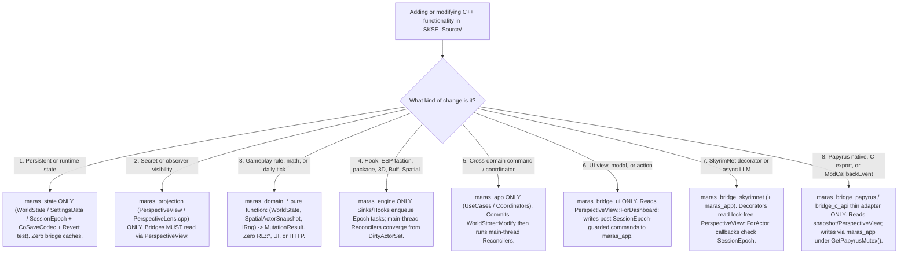

# AGENTS.md — SKSE C++ Plugin (`SKSE_Source/`)

Applies to all C++ headers and sources in `SKSE_Source/`. Supplements root [AGENTS.md](../AGENTS.md); see also [modules/AGENTS.md](modules/AGENTS.md) and [tests/AGENTS.md](tests/AGENTS.md).

---

## 0. Exact Build & Test Commands (Zero Path-Hunting)

Run from workspace root via `.agents/skills/maras-build-and-test`:
```powershell
# Build maras_tests + MARAS.dll + run all headless unit tests
powershell -NoProfile -ExecutionPolicy Bypass -File ".agents/skills/maras-build-and-test/scripts/build-and-test.ps1" -Target all

# Fast test-only build & run (~1-2s, never touches MARAS.dll; optional -Filter "<Substr>")
powershell -NoProfile -ExecutionPolicy Bypass -File ".agents/skills/maras-build-and-test/scripts/build-and-test.ps1" -Target tests
```
- Pass `-Reconfigure` after editing [CMakeLists.txt](CMakeLists.txt) or adding new `.cpp` files under `SKSE_Source/modules/` or `SKSE_Source/tests/`.
- **Locked `MARAS.dll` Note**: When Skyrim is open, `SKSE/Plugins/MARAS.dll` is locked by Windows; `MARAS.vcxproj` still compiles/links `SKSE_Source/build/release/Release/MARAS.dll` cleanly and only the `POST_BUILD` copy (`MSB3073`) fails (handled as `[WARN]` + exit `0` by `build-and-test.ps1`). Never retry in a loop or kill `SkyrimSE.exe`.

---

## 1. 13-Module DAG, Tiered PCHs & Decision Tree

`SKSE_Source` compiles a **13-module (`7 STATIC + 6 OBJECT`) CMake DAG** into `MARAS.dll` (composition root `plugin/plugin.cpp` + `version.rc`) and `maras_tests.exe`:
- **Layers 0–2 (`7 STATIC` pure modules, reusing `pch_core.h` from `maras_foundation`)**: `maras_foundation`, `maras_state`, `maras_projection`, `maras_domain_relationships`, `maras_domain_lineage`, `maras_domain_household`, `maras_domain_agency`. Zero CommonLibSSE/`<RE/...>`/`<SKSE/...>`/JSON/YAML/spdlog includes.
- **Layers 3–5 (`6 OBJECT` engine/app/bridge modules, reusing `pch_engine.h` from dedicated anchor `maras_pch_engine`)**: `maras_engine`, `maras_app`, `maras_bridge_papyrus`, `maras_bridge_ui`, `maras_bridge_skyrimnet`, `maras_bridge_c_api`.



### File Granularity & Anti-God-File Rule

- **Strict Minimal Blast Radius**: Implement only what was requested. Before adding any reconciler or UI broadcast call (`FactionReconciler`, `SendOverviewData`, etc.), verify that the reconciler actually reads the mutated state and that the caller does not already broadcast. Report out-of-scope bugs or ideas in chat instead of editing extra files unasked.
- **Legacy Large Hubs Are Extraction Targets, Never Dumping Grounds**: Do **not** append new subsystems, pure rules, JSON payload builders, or unrelated helpers into multi-thousand-line files (`RelationshipUseCases.cpp`, `LineageUseCases.cpp`, `PaternityWorkflowCoordinator.cpp`, `AgencyWorkflowCoordinator.cpp`, `UIDataBridge.cpp`, `SkyrimNetDecorators.cpp`, `SkyrimNetMemoryService.cpp`).
- **Required Decomposition for New Features & Refactors**:
  1. **Pure rules, scoring, eligibility, or transitions** $\to$ focused `.h`/`.cpp` in `modules/domain_{relationships,lineage,household,agency}/` + headless unit tests in `tests/test_domain_*.cpp`.
  2. **Secret/observer visibility** $\to$ `modules/projection/` (`PerspectiveView`).
  3. **Command orchestration** $\to$ focused coordinator/use-case `.h`/`.cpp` in `modules/app/` (keep methods thin: gather snapshot/inputs $\to$ pure domain call $\to$ `WorldStore::Modify` $\to$ reconcilers/events).
  4. **Bridge serialization / native adapters** $\to$ focused `.cpp` in `modules/bridge_{papyrus,ui,skyrimnet,c_api}/`, added to [CMakeLists.txt](CMakeLists.txt) and built via `build-and-test.ps1 -Target all -Reconfigure`.

### The 8 Non-Negotiable Architectural Invariants

1. **`WorldStore::Modify` Contract & Single State Owner (`modules/state/include/maras/state/WorldStore.h`)**:
   - `WorldStore` is the single runtime owner of `WorldState` and atomic `WorldStore::Snapshot()` (`std::shared_ptr<const WorldStateSnapshot>`). Never create new singletons or file-scope maps owning actor/child/house/cooldown state.
   - `Modify` and `ReadLive` enforce `static_assert(!std::is_reference_v<ReturnT> && !std::is_pointer_v<ReturnT>)` (value/void returns only). Callbacks inside `Modify`/`ReadLive` must **never** acquire external mutexes or call SKSE/`TESForm::LookupByID`, Papyrus, UI, or network APIs.
2. **`SessionEpoch` in `modules/state/` (`SessionEpoch.{h,cpp}`)**:
   - Re-exported into `MARAS::` by `TaskDispatcher.h`; every `AddEpochTask`/`AddCurrentEpochTask`, `DeferredActorResolver` flush, async SkyrimNet LLM callback, and modal queue **must** capture `expectedEpoch` at dispatch time and bail out immediately on `!IsSessionEpochCurrent(expectedEpoch)`. Call `ResetPluginEventSinks()` *before* adopting/bumping an epoch.
3. **`DeferredActorResolver` & Main-Thread Capture (`modules/engine/include/maras/engine/DeferredActorResolver.h`)**:
   - `CaptureMainThread()` runs strictly at `SKSEPluginLoad` and `kInputLoaded` (never `kDataLoaded` [`InitTESThread`] or pooled tasks).
   - Unloaded actor reconciliations retain pending `SyncFlags` (`Factions`, `Package`, `All`) via `MarkUnloaded()` and flush on `OnActorLoaded()` (`ActorInitLoadedEventSink`). Never touch `RE::Actor` state (`EvaluatePackage`, `MoveTo`, `AddSpell`), UI, Factions, Globals, or Papyrus VM off the main thread, and never capture raw `RE::Actor*`/`RE::TESObjectREFR*`/`RE::TESForm*` in async/timer lambdas—pass `RE::FormID` / strong IDs and re-validate (`!IsDeleted()`, `IsDead()`, `Is3DLoaded()`).
4. **`~SkyrimNetProfileService` Shutdown Safety (`modules/bridge_skyrimnet/src/SkyrimNetProfileService.cpp`)**:
   - Queue state (`queueMutex`, `pendingQueue`, `workerActive`, `shuttingDown`) lives in `std::shared_ptr<WorkerQueueState>`. Destructor sets `shuttingDown.store(true, release)`, clears `pendingQueue`, calls `workerThread_.request_stop()`, and `detach()`es (never `join()`s inside a static destructor, avoiding Windows `LdrpLoaderLock` deadlock at `ExitProcess`).
   - Runtime `EnqueueProfileTask` bounds queue size (`kMaxPendingTasks = 32`) and joins finished `std::jthread` workers before respawning. Gameplay/flee timers (`IntimateThreadService`, `ChildrenFleeService`) run on main-thread `PollingService` ticks—never spawn detached sleeping threads.
5. **`'MARS'` v7 Co-Save (12 Chunks + 5 Optional Trailing Extensions)**:
   - Preserve `v1`–`v7` load compatibility across all 12 chunks (`NPCR`, `SPHR`, `AFCT`, `PHOU`, `SPAS`, `PLCH`, `CFSN`, `MKMK`, `DCSD`, `BNTR`, `ACTR`, `CNFG`) in `modules/state/src/CoSaveCodec.cpp`, plus optional trailing extensions (each omitted when empty): `'FRT1'` (`kExtFertilityBatchFRT1` inside `'NPCR'`), `'PLC1'` (`kExtPlayerChildrenStatePLC1` inside `'PLCH'`), `'REL1'` (`kExtRelationshipStateREL1` inside `'MKMK'`), `'DCS1'` (`kExtDeceasedSecrecyDCS1` inside `'DCSD'`), and `'BNT1'` (`kExtBanterSceneStateBNT1` inside `'BNTR'`).
   - Enforce `kMaxEntries`, check every read (immediately `Revert()` and `return false` on truncation—never `break;`), preserve `0` sentinels, and strictly isolate two-phase load (`SkseSerializationCallbacks::LoadCallback` $\to$ `State::LoadWorldState` $\to$ `WorldStore::ReplaceState` $\to$ `AppLifecycleCoordinator::FinalizeCoSaveLoad` $\to$ reconcilers; `Revert()` clears C++ containers without mutating torn-down engine forms).
6. **Strict Command-Query Separation (CQS)**:
   - Snapshots (`WorldStore::Snapshot()`, `SpatialSnapshotStore::Snapshot()`), UI JSON builders (`UIDataBridge`), SkyrimNet `ttm_*` decorators (`23` decorators in `SkyrimNetDecorators.cpp`), and Papyrus read queries—including `GetTrackedNpcHomeMarker` and `GetChildHomeMarker` in `PapyrusHousehold.cpp`—**must** stay pure read-only, never mutating state, syncing custody, lazy-registering actors, or recording memories.
7. **`PerspectiveView` Single Secret-Masking Choke Point (`modules/projection/{include/maras/projection/PerspectiveView.h,src/PerspectiveLens.cpp}`)**:
   - All UI and SkyrimNet queries must pass through `PerspectiveView::ForDashboard`, `PerspectiveView::ForActor`, or `PerspectiveView::ForDialogueTarget` (`ViewerMode::{DashboardIntrigue, ActorSelf, DialogueTargetPublic, Omniscient}`). Never read raw `AffairLedger`/`LineageTable` secrets directly in bridges, and **never** add `0x14` Player exemptions in `DashboardIntrigue`.
8. **Lock Ordering & Snapshot-Before-Lookup**:
   - `MARAS::GetPapyrusMutex()` (`PapyrusDomainMutex`, recursive) is **always outermost**, acquired before any leaf/service mutex (`WorldStore`'s internal `writeMutex_`, `SpatialWorldIndex::m_mutex`, `RelationshipUseCases::overridesMutex_` / `childScanMutex_`, `HouseholdUseCases::travelMutex_`, `ChildrenFleeService::sourceMutex_` / `fleeMutex_`, `DeferredActorResolver::mutex_`, `PackageReconciler::writeMutex_`, `ModalManager::mutex_`, `UIDataBridge::mutex_`, `SkyrimNetMemoryService::mutex_`, `SkyrimNetProfileService::mutex_`). Leaf mutexes must never acquire `GetPapyrusMutex()`.
   - **Never** call `RE::TESForm::LookupByID` (or engine/UI/Papyrus/`SpatialWorldIndex` APIs) while holding `m_mutex`, `overridesMutex_`, `travelMutex_`, `sourceMutex_`, `writeMutex_`, etc.—snapshot FormIDs/data inside a tight lock scope, unlock first, then resolve `TESForm::LookupByID`.

---

## 2. Logging, `FormCache`, `SpatialWorldIndex`, SkyrimNet & Engine Rules

- **Namespaces & Logging**:
  - Pure `STATIC` modules (`7` targets) use `MARAS::Foundation::LogTrace/LogDebug/LogInfo/LogWarn/LogError` (`maras/foundation/Logging.h`).
  - Engine/app/bridge `OBJECT` modules (`6` targets) use `MARAS_LOG_TRACE/DEBUG/INFO/WARN/ERROR` (`maras/engine/EngineLogging.h`)—never `std::cout` or raw `spdlog::*`.
- **`FormCache` Mandatory (`modules/engine/include/maras/engine/FormCache.h`)**: Cache all `TT_MARAS.esp`, `Skyrim.esm`, `HearthFires.esm`, and integration forms once in `FormCache::Initialize()` at `kDataLoaded`; never call `TESDataHandler::LookupForm` repeatedly at runtime.
- **`SpatialWorldIndex` vs. `RE::Actor*` & `SpatialActorSnapshot`**:
  - Single loaded `RE::Actor*`: call CommonLibSSE methods directly (`IsChild()`, `IsDead()`, `IsDisabled()`, `IsInCombat()`, `IsPlayerTeammate()`)—never query `SpatialWorldIndex`.
  - Bulk enumeration / spatial queries: use `SpatialWorldIndex::GetSingleton().GetAllEntries()` or lock-free `SpatialSnapshotStore::GetSingleton().Snapshot()` (published at `2 Hz` by `PollingService`)—**never** call `RE::TESForm::GetAllForms()` at runtime.
- **SkyrimNet Dynamic Lookup & Gating (`modules/bridge_skyrimnet/`)**: Resolve exports via `GetModuleHandleW(L"SkyrimNet.dll")` + `GetProcAddress`. Check `MARAS::IsSkyrimNetAvailable()` (`SkyrimNetApiLoader.h`: checks DLL loaded && `!SettingsCoordinator::GetSingleton().GetSimulateNoSkyrimNet()`) **at the call site** before preparatory work. Add the 3rd `[Decline (Explain)]` confirmation modal button **only** when `MARAS::IsSkyrimNetAvailable() == true`.
- **Faction Helper Mandatory (`ActorEngineUtils.h`)**: Always mutate actor factions via `Utils::AddToFaction` / `Utils::RemoveFromFaction`, which wrap `FactionReconciler::InternalFactionScope` to suppress recursive VTable hook triggers and handle relocation fallbacks. Never call raw `actor->AddToFaction` / `RemoveFromFaction` in services.
- **Runtime-Cloned Forms (`ChildVisualReconciler`)**:
  - Deep-clone raw pointer sub-arrays (`TESNPC::keywords` via `RE::calloc<RE::BGSKeyword*>`) when cloning `RE::TESNPC` via `RE::malloc`.
  - Verify `!actor->IsDeleted() && actor->GetObjectReference() == cloneNpc` before reverting `SetObjectReference(origNpc)`, and retire unlinked clones via `FlushRetiredForms()` post-load instead of calling `RE::free` inside `RevertCallback`.
- **UI Focus (`UIManager`)**: Coordinate view visibility/focus solely via `UIManager::SyncViewVisibilityAndFocus()` (`IsInitialized()`), using Magelight UI `RequestUIMode(..., kUIModeFlagPause)` for pause/modals and `PostToGameThread()` for render-thread JS callbacks; raw hide/release must never run while `ModalManager::HasActiveModal()` is true.

---

## 3. Containers, JSON, Unloaded `0xFF`/Synthetic IDs, Bindings & `GuardianSlots`

- **`std::unordered_map` Safety**: Never hold an element reference/pointer across a potential map insertion/rehash (`GetOrCreateActorProfile`, `GetOrCreateAffection`), and never call mutating methods while iterating tables directly (snapshot keys into a local `std::vector` first). Never return `const char*` into mutex-guarded maps after unlock.
- **`nlohmann::json` Safety**:
  - Always pass `nlohmann::json::error_handler_t::replace` to `.dump(-1, ' ', false, nlohmann::json::error_handler_t::replace)` so non-UTF-8 localized NPC/cell strings never throw error 316 and CTD.
  - Wrap `AddTask` and SKSE event-sink JSON handlers in `try / catch (const std::exception&)`.
  - Check `.is_string()` / `.is_number()` / `.is_boolean()` before `.get<T>()` or `.value()` (`payload.value("k", def)` still throws on `null` or mismatched type).
- **Unloaded Placed NPCs (`0x00`–`0xFE`) vs. Dynamic `0xFF` & Synthetic IDs (`0xFF700000`–`0xFF7FFFFF`)**:
  - `TESForm::LookupByID` returns `nullptr` when a cell is unloaded. Use `ActorSvc::IsValid` / `ActorSvc::GetActorBase` / `SpatialWorldIndex` FormID overloads so unloaded spouses, tenants, hierarchy, homes, and affection stay intact. Use `pendingRelationshipsByBaseId` / `pendingChildrenByBaseId` in `LineageTable` for unspawned base-ID registrations.
  - Check `IsSyntheticChildID(id)` *before* `ResolveFormID` or `LookupByID`, never advance `nextSyntheticChildID_` from `0xFF800000+` FormIDs, prune missing/deleted non-synthetic `0xFF` actors in `FinalizeWorldStateAfterLoad()`, and key dynamic `0xFF` actors in `DeceasedTable` by unique `RefId`—never shared template `BaseId`.
- **Bindings Parity**: Keep `modules/bridge_papyrus/include/maras/bridge_papyrus/PapyrusInterface.h`, `modules/bridge_papyrus/src/Papyrus*.cpp`, `RegisterPapyrusFunctions`, and `Scripts/Source/MARAS.psc` in exact signature sync, guarded by `GetPapyrusMutex()`. Always bounds-check `int32_t` Papyrus parameters before casting to `uint8_t` enums. Sync companion C exports in `modules/bridge_c_api/{include/MARAS_PublicAPI.h,src/MARAS_PublicAPI.cpp}`.
- **Slot-Neutral Guardians (`GuardianSlots`)**: Never write positional `guardianA`/`guardianB` checks, manual slot-shifts, or `Utils::MatchesActor(0, 0)` comparisons. Always use `GuardianSlots` helpers (`HasGuardian`, `HasAnyGuardian`, `Count`, `IsSingleGuardian`, `SingleGuardian`, `IsSoleGuardian`, `OtherGuardian`, `HasSameSet`, `Assign`, `Remove`).
