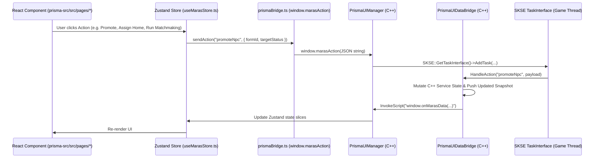

# M.A.R.A.S — Public APIs & Prisma UI Bridge Reference

This document provides the complete technical reference for external modders and developers integrating with M.A.R.A.S across three interfaces:
1. **C++ Public DLL API** ([MARAS_PublicAPI.h](file:///e:/Skyrim/development/mods/M.A.R.A.S%20Dev/SKSE_Source/include/MARAS_PublicAPI.h)) for companion SKSE plugins.
2. **Papyrus Native API & ModEvents** ([MARAS.psc](file:///e:/Skyrim/development/mods/M.A.R.A.S%20Dev/Scripts/Source/MARAS.psc)) for Papyrus scripts.
3. **Prisma UI C++ $\leftrightarrow$ JS Bridge Protocol** ([PrismaUIDataBridge.h](file:///e:/Skyrim/development/mods/M.A.R.A.S%20Dev/SKSE_Source/include/core/PrismaUIDataBridge.h) & [prismaBridge.ts](file:///e:/Skyrim/development/mods/M.A.R.A.S%20Dev/prisma-src/src/lib/prismaBridge.ts)).

---

## 1. C++ Public DLL API (`MARAS_PublicAPI.h`)

Companion SKSE plugins (such as `MARASUnleashed.dll`) can query M.A.R.A.S state at native speed without going through the Papyrus VM by resolving exported `extern "C"` functions from `MARAS.dll` via `GetProcAddress` from `kDataLoaded` onwards.

### 1.1 Resolving Exported Functions
```cpp
#include "MARAS_PublicAPI.h"

using GetPermanentAffectionFn = int (*)(std::uint32_t);
GetPermanentAffectionFn g_getPermanentAffection = nullptr;

void ConnectToMARAS() {
    if (auto handle = GetModuleHandleW(L"MARAS.dll")) {
        g_getPermanentAffection = reinterpret_cast<GetPermanentAffectionFn>(
            GetProcAddress(handle, "MARAS_GetPermanentAffection"));
    }
}
```

### 1.2 Exported C Functions Summary

| Exported Symbol | Signature | Description |
| :--- | :--- | :--- |
| `MARAS_GetPermanentAffection` | `int (uint32_t npcFormID)` | Returns permanent affection `[0..100]` for `npcFormID`, or `50` if not found. |
| `MARAS_GetDaysSinceLastAffection` | `float (uint32_t npcFormID)` | Returns game days since `npcFormID` last received an affection interaction, or `-1.0f` if never. |
| `MARAS_GetAllMarried` | `uint32_t (uint32_t* buf, uint32_t maxCount)` | Fills `buf` with up to `maxCount` married player spouse FormIDs and returns the total married count. |
| `MARAS_GetAllEngaged` | `uint32_t (uint32_t* buf, uint32_t maxCount)` | Fills `buf` with up to `maxCount` engaged player partner FormIDs and returns the total engaged count. |
| `MARAS_GetTemperament` | `MARAS_Temperament (uint32_t npcFormID)` | Returns the NPC's `MARAS_Temperament` (`Proud = 0`, `Humble = 1`, `Jealous = 2`, `Romantic = 3`, `Independent = 4`), falling back to `DeceasedRegistry` or `Proud (0)` if unregistered. |
| `MARAS_GetStatusHistoryCount` | `uint32_t (uint32_t npcFormID, uint32_t targetFormID)` | Returns the number of status transition entries for the `(npcFormID, targetFormID)` pair (`0x14` for player). |
| `MARAS_GetStatusHistoryEntry` | `bool (uint32_t npcFormID, uint32_t targetFormID, uint32_t index, uint8_t* outFromStatus, uint8_t* outToStatus, float* outTimestamp, uint32_t* outInitiatorFormID)` | Copies the status transition entry at `index` (`outTimestamp` is fractional game days passed, or `-1.0f` for pre-existing relationships). Returns `false` if `index` is out of range. |
| `MARAS_GetTenantHouseFormID` | `uint32_t (uint32_t tenantFormID)` | Returns the FormID of the player home `tenantFormID` is assigned to, or `0`. |
| `MARAS_GetPlayerHouseTenants` | `uint32_t (uint32_t houseFormID, uint32_t* buf, uint32_t maxCount)` | Fills `buf` with up to `maxCount` tenant FormIDs for `houseFormID` and returns the total tenant count. |
| `MARAS_GetCurrentTeammates` | `uint32_t (uint32_t* buf, uint32_t maxCount)` | Fills `buf` with up to `maxCount` current player teammate FormIDs and returns the total teammate count. |

---

## 2. Papyrus Native API (`MARAS.psc`)

All native functions are global methods on `Scriptname MARAS Hidden` declared in `SKSE_Source/include/papyrus/PapyrusInterface.h`, registered in `MARAS::PapyrusInterface::RegisterPapyrusFunctions` (`SKSE_Source/src/papyrus/PapyrusInterface.cpp`), and implemented across five domain translation units (`PapyrusInterface.cpp`, `PapyrusRelationship.cpp`, `PapyrusHousehold.cpp`, `PapyrusChildren.cpp`, `PapyrusSettings.cpp`) protected by `GetPapyrusMutex()`.

### 2.1 Functional Sections in `MARAS.psc`

| Section | C++ Translation Unit | Key Global Functions | Description |
| :--- | :--- | :--- | :--- |
| **1. Core Registration & Queries** | `PapyrusRelationship.cpp` | `RegisterCandidate`, `UnregisterNPC`, `IsNPCCandidate`, `GetTrackedNPCs`, `GetNPCsByStatus`, `IsNPCStatus` | Manages the tracked NPC roster and queries player-partner status. |
| **2. Pair-Keyed Relationships** | `PapyrusRelationship.cpp` | `PromoteNPCToStatus`, `PromoteNPCToStatusWith`, `IsNPCStatusWith`, `GetAllPartners`, `GetPartnersByStatus`, `HasAnyPartner`, `MakeNpcDeceased`, `WasMarriedTo`, `WasEngagedTo`, `WasExOf` | Queries and mutates both Player-NPC and NPC-NPC relationships, plus death transitions. |
| **3. Cheating, Affairs & Open Rel** | `PapyrusRelationship.cpp` | `IsRelationshipCheating`, `RecordCheating`, `SetCheatingDiscovered`, `HasCheatedOn`, `ClearCheatingHistory`, `SetPairIsOpen`, `GetPairIsOpen`, `GetCheatingParamours` | Full infidelity lifecycle and directional open-relationship consent flags. |
| **4. Archetypes & Overrides** | `PapyrusRelationship.cpp` | `GetNpcCurrentTypeName`, `GetNpcCurrentTypeEnum`, `SetNpcType`, `DetermineAllTypes` | Queries or overrides `socialClass`, `skillType`, and `temperament`. |
| **5. Spouse Hierarchy & Buffs** | `PapyrusHousehold.cpp` | `GetHierarchyRank`, `SetHierarchyRank`, `PromoteSpouse`, `DemoteSpouse`, `TriggerBuffCalculation`, `GetEffectiveFollowerMultiplier` | Controls polygamy rank order (`1..4`) and triggers `SpouseBuffService`. |
| **6. Affection System** | `PapyrusRelationship.cpp` | `GetPermanentAffection`, `SetPermanentAffection`, `AddAffection`, `GetAffectionTier`, `DecayDailyAffection`, `ApplyEstrangedDivorceHoursDelta` | Reads/modifies affection (`0..100`), evaluates daily decay/growth, and manages estranged divorce timers. |
| **7. Player Housing & Assets** | `PapyrusHousehold.cpp` | `RegisterPlayerHouse`, `RegisterPlayerHouseCell`, `AssignTenantToHouse`, `GetSpouseHouseMarker`, `GetCalculatedSharePerDay`, `CalculateHomeShareMoney` | Multi-home tenant registry, original home cell restore, and spouse store gold calculation. |
| **8. Children & Paternity Secrets** | `PapyrusChildren.cpp` | `RegisterChild`, `ReplaceChildId`, `GetParentChildren`, `GetGuardians`, `SetChildGuardian`, `GetBioMother`, `GetBioFather`, `SetBioMother`, `SetBioFather`, `EvaluateAndRecordPaternitySecret`, `DiscoverPaternitySecret`, `RevealPaternitySecret` | Global child lineage, neutral guardian slots (`guardianA/B`), synthetic ID migration, and paternity secret state machine. |
| **9. Household Children (`PlayerChildrenService`)** | `PapyrusChildren.cpp` | `RegisterHouseholdChild`, `AssignChildToHouse`, `AssignChildPet`, `AssignChildCritter`, `SnapshotChildFactions`, `RestoreChildFactions` | Manages active household child slots, independent per-child pets/critters, and faction snapshots. |
| **10. Matchmaking, Banter & OStim** | `PapyrusSettings.cpp` | `RunAutonomousPairingNow`, `CreatePairRelationship`, `NotifyIntimateSceneStarted`, `NotifyIntimateSceneEnded`, `ShowConfirmationModal`, `ShowThreeWayModal` | Invokes AI/dice-roll matchmaking, background OStim walk-in detection, and native 2/3-button confirmation dialogs. |
| **Children Flee** | `PapyrusInterface.cpp` | `FleeChildrenFromPlayerCell`, `StopChildrenFleeing` | Makes children in the player's current cell run away until stopped (intimate scenes trigger the same mechanism automatically). See `ChildrenFleeService.md`. |
| **11. Settings & Prisma UI** | `PapyrusSettings.cpp` / `PapyrusInterface.cpp` | `ShowUI`, `HideUI`, `IsUIVisible`, `GetSettingBool`, `GetSettingInt`, `GetSettingFloat`, `SetSettingBool`, `SetSettingInt`, `SetSettingFloat`, `GetEnablePolygamy`, `SetEnablePolygamy`, `GetDisablePolygamyQuest`, `SetDisablePolygamyQuest` | Controls the Prisma UI web view, polygamy toggles, and reads/writes C++ `Settings` (`'CNFG'`). |


### 2.2 SKSE ModEvents Emitted by C++ (`TTM_MainController.psc` Listeners)

When C++ state changes (via Prisma UI actions, background services, or C++ hooks), `MARAS.dll` dispatches SKSE `ModCallbackEvent` notifications so Papyrus quests, scenes, and factions stay synchronized:

| ModEvent Name | Arguments (`string strArg`, `float numArg`, `Form sender`) | Handled By |
| :--- | :--- | :--- |
| `MARAS_StatusChanged` | `strArg = newStatus`, `numArg = partnerFormID`, `sender = Actor` | `TTM_MainController` $\rightarrow$ `TTM_ServiceRelationships` / `TTM_ServiceSkyrimNet` |
| `MARAS_AffectionChanged` | `strArg = tierName`, `numArg = newScore`, `sender = Actor` | `TTM_MainController` $\rightarrow$ `TTM_ServiceAffection` / `TTM_ServiceBuff` |
| `MARAS_HierarchyChanged` | `strArg = "updated"`, `numArg = newRank`, `sender = Actor` | `TTM_MainController` $\rightarrow$ `TTM_ServiceBuff` |
| `MARAS_HouseAssigned` | `strArg = houseName`, `numArg = houseIndex`, `sender = Actor` | `TTM_MainController` $\rightarrow$ `TTM_ServicePlayerHouse` |
| `MARAS_CaughtCheating` | `strArg = witnessType`, `numArg = paramourFormID`, `sender = CheaterActor` | `TTM_MainController` $\rightarrow$ `TTM_NpcsScenes` / `TTM_ServiceSkyrimNet` |
| `MARAS_ActionDeclined` | `strArg = declinedActionType`, `numArg = 0`, `sender = TargetActor` | `TTM_MainController` $\rightarrow$ `TTM_ServiceSkyrimNet.RegisterActionDeclined` |
| `MARAS_ChildUpdated` | `strArg = updateType`, `numArg = childFormID`, `sender = GuardianActor` | `TTM_MainController` $\rightarrow$ `TTM_ServiceChildrenLogic` |
| `maras_stop_polygamy_quest` | `strArg = ""`, `numArg = 0`, `sender = None` | `TTM_MainController` $\rightarrow$ `StopAndResetPolygamyQuest()` (triggered when `disablePolygamyQuest` setting is activated) |

---

## 3. Prisma UI C++ $\leftrightarrow$ JS Bridge Architecture

The React/Vite dashboard (`prisma-src/`, compiled into `PrismaUI/views/MARAS/index.html`) communicates asynchronously with `PrismaUIManager` and `PrismaUIDataBridge` (`SKSE_Source/include/core/PrismaUIDataBridge.h`).



### 3.1 C++ $\rightarrow$ JS Payloads (`PrismaUIDataBridge`)
Before invoking any JavaScript function, `PrismaUIManager` verifies `IsAvailable()` and `IsViewValid()`. Data is pushed via `window.onMarasData(type, payload)`:
- `"overview"`: Dashboard stat counters, active buffs summary, recent relationship history log (`StatusHistoryEntry`), and affection distribution.
- `"household"`: Housed spouses, spouse hierarchy array (`0..3`), player homes (capacities, tenants, custom cell info), and household children (`0..5` slots, pets, critters, orders).
- `"npcs"` / `"npcDetail"`: Full profile for tracked NPCs (`formId`, `name`, `race`, `gender`, `archetypes`, `affection`, `preferredPackageIndex`, `availablePackages`, `relationships`, `children`, `isDeceased`).
- `"matchmaking"`: Eligible NPC pool, active NPC-to-NPC couples, matchmaking run history, and LLM evaluation status.
- `"settings"`: Complete `Settings` state including `hasSkyrimNet` and `simulateNoSkyrimNet` for frontend gating.

### 3.2 Frontend Gating Rule (`prisma-src/`)
All SkyrimNet-specific controls in `prisma-src/` inspect `useMarasStore(s => s.settings.hasSkyrimNet)`:
- **Navigation tabs / settings sections** exclusive to SkyrimNet are hidden when `!hasSkyrimNet`.
- **Action buttons / toggles** that require SkyrimNet LLM evaluation are disabled with a tooltip explaining that `SkyrimNet.dll` is required.

