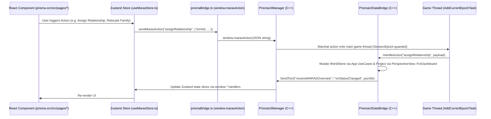

# M.A.R.A.S — Public APIs & Prisma UI Bridge Reference

This document provides the complete technical reference for external modders and developers integrating with M.A.R.A.S across three interfaces:
1. **C++ Public DLL API** ([MARAS_PublicAPI.h](../../SKSE_Source/modules/bridge_c_api/include/MARAS_PublicAPI.h)) for companion SKSE plugins.
2. **Papyrus Native API & ModEvents** ([MARAS.psc](../../Scripts/Source/MARAS.psc)) for Papyrus scripts.
3. **Prisma UI C++ $\leftrightarrow$ JS Bridge Protocol** ([PrismaUIDataBridge.h](../../SKSE_Source/modules/bridge_ui/include/maras/bridge_ui/PrismaUIDataBridge.h) & [prismaBridge.ts](../../prisma-src/src/store/prismaBridge.ts)).

---

## 1. C++ Public DLL API (`MARAS_PublicAPI.h`)

Companion SKSE plugins (such as `MARASUnleashed.dll`) can query M.A.R.A.S state at native speed without going through the Papyrus VM by resolving exported `extern "C"` functions from `MARAS.dll` via `GetProcAddress` from `kDataLoaded` onwards.

### 1.1 Resolving Exported Functions
```cpp
#include "MARAS_PublicAPI.h"

using GetPermanentAffectionFn = int (*)(std::uint32_t);
GetPermanentAffectionFn g_getPermanentAffection = nullptr;

void ConnectToMARAS() {
    if (auto handle = GetModuleHandleW(L"MARAS.dll")) {
        g_getPermanentAffection = reinterpret_cast<GetPermanentAffectionFn>(
            GetProcAddress(handle, "MARAS_GetPermanentAffection"));
    }
}
```

### 1.2 Exported C Functions Summary
All exported queries are strictly read-only (`WorldStore::Snapshot()`, `SpatialSnapshotStore::Snapshot()`, `PerspectiveView::ForDashboard`), executing lock-free with uniform Intrigue Mode secrecy (`!revealSecretsInUI`):

| Exported Symbol | Signature | Description |
| :--- | :--- | :--- |
| `MARAS_GetPermanentAffection` | `int (uint32_t npcFormID)` | Returns permanent affection `[0..100]` for `npcFormID`, or `50` if not found. |
| `MARAS_GetDaysSinceLastAffection` | `float (uint32_t npcFormID)` | Returns game days since `npcFormID` last received an affection interaction, or `-1.0f` if never. |
| `MARAS_GetAllMarried` | `uint32_t (uint32_t* buf, uint32_t maxCount)` | Fills `buf` with up to `maxCount` married player spouse FormIDs and returns the total married count. |
| `MARAS_GetAllEngaged` | `uint32_t (uint32_t* buf, uint32_t maxCount)` | Fills `buf` with up to `maxCount` engaged player partner FormIDs and returns the total engaged count. |
| `MARAS_GetTemperament` | `MARAS_Temperament (uint32_t npcFormID)` | Returns `MARAS_Temperament` (`Proud = 0`, `Humble = 1`, `Jealous = 2`, `Romantic = 3`, `Independent = 4`), falling back to `DeceasedTable` or `Proud (0)` if unregistered. |
| `MARAS_GetStatusHistoryCount` | `uint32_t (uint32_t npcFormID, uint32_t targetFormID)` | Returns status history entry count for `(npcFormID, targetFormID)` (`0x14` for player), masked via `PerspectiveView::ForDashboard` when Intrigue Mode is active. |
| `MARAS_GetStatusHistoryEntry` | `bool (uint32_t npcFormID, uint32_t targetFormID, uint32_t index, uint8_t* outFromStatus, uint8_t* outToStatus, float* outTimestamp, uint32_t* outInitiatorFormID)` | Copies status transition entry at `index` (masked via `PerspectiveView::ForDashboard`; `outTimestamp` is fractional game days passed, or `-1.0f` for pre-existing relationships). Returns `false` if `index` is out of range. |
| `MARAS_GetTenantHouseFormID` | `uint32_t (uint32_t tenantFormID)` | Returns the FormID of the player home `tenantFormID` is assigned to, or `0`. |
| `MARAS_GetPlayerHouseTenants` | `uint32_t (uint32_t houseFormID, uint32_t* buf, uint32_t maxCount)` | Fills `buf` with up to `maxCount` tenant FormIDs for `houseFormID` and returns the total tenant count. |
| `MARAS_GetCurrentTeammates` | `uint32_t (uint32_t* buf, uint32_t maxCount)` | Fills `buf` with up to `maxCount` current player teammate FormIDs from `SpatialSnapshotStore::Snapshot()` (`PollingService`) and returns total count. |

---

## 2. Papyrus Native API (`MARAS.psc`)

All native functions are global methods on `Scriptname MARAS Hidden` declared in [PapyrusInterface.h](../../SKSE_Source/modules/bridge_papyrus/include/maras/bridge_papyrus/PapyrusInterface.h), registered in `MARAS::PapyrusInterface::RegisterPapyrusFunctions` ([PapyrusInterface.cpp](../../SKSE_Source/modules/bridge_papyrus/src/PapyrusInterface.cpp)), and implemented across five translation units in `SKSE_Source/modules/bridge_papyrus/src/`: `PapyrusInterface.cpp`, `PapyrusRelationship.cpp`, `PapyrusHousehold.cpp`, `PapyrusChildren.cpp`, and `PapyrusSettings.cpp`.

> [!IMPORTANT]
> **Strict CQS Read-Only Semantics**: Query natives (including `GetTrackedNpcHomeMarker`, `GetChildHomeMarker`, `GetNpcStatusName*`, `GetPermanentAffection`, `GetGuardians`, `IsSecretForBioFather`, `IsSecretForPartner`, and status/hierarchy queries) read `WorldStore::Snapshot()` / `SpatialSnapshotStore::Snapshot()` / `PerspectiveView` purely read-only without mutating persistent tables, syncing custody, lazy-registering actors, or placing missing markers. Mutating natives serialize writes through `GetPapyrusMutex()`.

### 2.1 Functional Sections in `MARAS.psc`

| Section | C++ Translation Unit | Key Global Functions | Description |
| :--- | :--- | :--- | :--- |
| **1. Core Registration & Queries** | `PapyrusInterface.cpp`, `PapyrusRelationship.cpp` | `RegisterCandidate`, `UnregisterNPC`, `IsNPCCandidate`, `GetTrackedNPCs`, `GetNPCsByStatus`, `IsNPCStatus` | Manages the tracked NPC roster and queries player-partner status. |
| **2. Pair-Keyed Relationships** | `PapyrusRelationship.cpp` | `PromoteNPCToStatus`, `PromoteNPCToStatusWith`, `IsNPCStatusWith`, `GetAllPartners`, `GetPartnersByStatus`, `GetRelationshipPartners`, `HasAnyPartner`, `MakeNpcDeceased`, `WasMarriedTo`, `WasEngagedTo`, `WasExOf` | Queries and mutates both Player-NPC and NPC-NPC relationships, plus deceased snapshots (`DeceasedTable`). |
| **3. Cheating, Affairs & Open Rel** | `PapyrusRelationship.cpp` | `IsRelationshipCheating`, `RecordCheating`, `SetCheatingDiscovered`, `HasCheatedOn`, `GetPairIsOpen`, `SetPairIsOpen`, `GetCheatingAffairStatus`, `SetCheatingAffairStatus`, `GetAffairStage`, `SetAffairStage`, `GetPartnerPendingIntent`, `ClearPartnerIntent`, `EvaluatePartnerHomeArrival` | Full infidelity lifecycle, 2-stage affair tracking (`talking` vs `physical`), partner force-greet intents, home-arrival agency evaluation, and directional open-relationship consent flags. |
| **4. Archetypes & Overrides** | `PapyrusRelationship.cpp` | `GetNpcCurrentTypeName`, `GetNpcCurrentTypeEnum`, `GetNpcTypes`, `SetNpcType`, `DetermineAllTypes` | Queries or overrides `socialClass`, `skillType`, and `temperament`. |
| **5. Spouse Hierarchy, Difficulty & Buffs** | `PapyrusRelationship.cpp` | `GetHierarchyRank`, `SetHierarchyRank`, `CalculateMarriageSuccessChance`, `GetSpouseMultiplier`, `GetFollowersMultipliers`, `GetPermanentMultipliers`, `GetBonusCount`, `GetBonusPerk`, `GetBonusPerkValue` | Controls polygamy hierarchy (`0..2` + `3+`), marriage complexity probability, and exposes `SpouseBuffRules` / `bonuses.json` multipliers. |
| **6. Affection System** | `PapyrusRelationship.cpp` | `GetAffection`, `GetPermanentAffection`, `SetPermanentAffection`, `AddAffection`, `ApplyDailyAffection`, `SetAffectionMinMax`, `SetAffectionDecayMultiplier` | Reads/modifies affection (`0..100`), evaluates daily decay/growth, and exposes affection decay multipliers. |
| **7. Player Housing, Markers & Assets** | `PapyrusHousehold.cpp` | `RegisterPlayerHouseCell`, `GetAllPlayerHouses`, `RegisterTenantInPlayerHouse`, `RemoveTenantFromPlayerHouse`, `GetTrackedNpcHomeMarker`, `SetTrackedNpcHomeMarker`, `GetChildHomeMarker`, `ShareHouseWithPlayer`, `StopShareHouseWithPlayer`, `IsHouseSharedWithPlayer`, `GetNpcOriginalHouse`, `GetCellDoors`, `GetNpcBeds` | Multi-home tenant registry, read-only CQS marker queries (`GetTrackedNpcHomeMarker`, `GetChildHomeMarker`), original home cell detection, and shared spouse cell management. |
| **8. Children, Paternity Secrets & Names** | `PapyrusChildren.cpp` | `RegisterChildActor`, `GetGuardians`, `SetChildGuardian`, `GetBioMother`, `GetBioFather`, `SetBioMother`, `SetBioFather`, `GetChildTrainingClass`, `GetChildSavedRaceIndex`, `ResolvePaternitySecret`, `ResolvePaternitySecretForPartner`, `ResolvePaternitySecretForBioFather`, `RevealPregnancyToPartner`, `SetPaternitySecretEdges`, `IsSecretForBioFather`, `IsSecretForPartner`, `IsPregnancySecretForPartner`, `BuildChildBirthMessage`, `BuildChildBirthJson`, `GenerateRandomChildName`, `GenerateRandomCritterName` | Global child lineage, slot-neutral guardian slots (`guardianA/B`), synthetic ID migration, Stage 2–4 training metadata, two-phase pregnancy/paternity secret state machine, perspective-masked builders (`maskSecrets`), and race/species name pools. |
| **9. Household Children** | `PapyrusChildren.cpp` | `AssignChildToHouse`, `IssueChildOrder`, `ResetChildForceGreeting`, `AssignChildPet`, `AssignChildCritter`, `SetChildPetBanned`, `SetChildCritterBanned`, `GetAllPlayerChildren`, `GetChildrenAssignedToHouse` | Household child residence, timed orders (`Variable06`), force-greets (`Variable07`), and independent per-child pets/critters. |
| **10. Matchmaking, Banter, OStim, Flee & Modals** | `PapyrusInterface.cpp` | `FindBanterCoupleCandidates`, `RegisterIntimateThread`, `ReportIntimateInteraction`, `ClearIntimateThread`, `FleeChildrenFromPlayerCell`, `StopChildrenFleeing`, `ShouldTriggerSkyrimNetNarration`, `RegisterSkyrimNetEvent`, `ShowConfirmationModal`, `ShowSkipWeddingModal`, `ShowDivorceSettlementModal`, `ShowChooseHomeModal`, `ShowChooseAdoptionSpouseModal`, `ShowDebugStatusModal`, `ShowChildMigrationAuditModal` | Banter candidate discovery, main-thread OStim walk-in detection, intimate-scene child fleeing (`ChildrenFleeService`), SkyrimNet narration gating & audience-controlled event registration (`PublicRegisterEvent`), and latent Prisma UI modals. |
| **11. Settings & Prisma UI** | `PapyrusSettings.cpp`, `PapyrusInterface.cpp` | `ShowUI`, `HideUI`, `IsUIVisible`, `GetSettingBool`, `GetSettingInt`, `GetSettingFloat`, `SetSettingBool`, `SetSettingInt`, `SetSettingFloat`, `GetEnablePolygamy`, `SetEnablePolygamy`, `GetDisablePolygamyQuest`, `SetDisablePolygamyQuest`, `GetShouldUseSkyrimNetDecisions` | Controls the Prisma UI web view, polygamy toggles, and reads/writes C++ `SettingsData` (`'CNFG'`). |

### 2.2 SKSE ModEvents Emitted by C++ (`TTM_MainController.psc` Listeners)

When C++ state changes (via Prisma UI actions, `PollingService` / `IntimateThreadService`, or workflow coordinators), `MARAS.dll` dispatches lowercase SKSE `ModCallbackEvent` notifications via `EmitModCallbackEvent` so Papyrus quests, scenes, and SkyrimNet narration stay synchronized:

| ModEvent Name | Arguments (`strArg`, `numArg`, `sender`) | Primary Emitter / Purpose |
| :--- | :--- | :--- |
| `maras_status_changed` | `strArg = lowerStatus`, `numArg = statusEnum`, `sender = partnerActor` | `RelationshipUseCases` — mirrors relationship changes to `TTM_MainController` & quests. |
| `maras_status_changed_full` | `strArg = jsonPayload` (`initiator`, `acceptor`, `initiatorName`, `acceptorName`, `status`), `numArg = statusEnum`, `sender = actor` | `RelationshipUseCases` — drives rich NPC-NPC / Player SkyrimNet event builders. |
| `maras_change_affection` | `strArg = tierOrThreshold`, `numArg = delta`, `sender = npcActor` | `RelationshipUseCases` — notifies affection threshold/score changes. |
| `maras_hierarchy_changed` | `strArg = action` (`"promote"`, `"demote"`, etc.), `numArg = rankDelta`, `sender = npcActor` | `RelationshipUseCases` — syncs spouse hierarchy changes (`C++ BuffReconciler` runs automatically). |
| `maras_open_relationship_changed` | `strArg = jsonPayload`, `numArg = isOpen ? 1 : 0`, `sender = partnerActor` | `RelationshipUseCases` — notifies open/closed pair policy changes. |
| `maras_affair_exposed` / `maras_affair_resolved` | `strArg = jsonPayload`, `numArg`, `sender = partnerActor` | `RelationshipUseCases` — affair discovery, confession/exposure, and resolution narration. |
| `maras_cheating_caught` | `strArg = jsonPayload`, `numArg = threadID`, `sender = victimActor` | `IntimateThreadService` — walk-in cheating interruption during OStim/SexLab scenes. |
| `maras_open_relationship_walkin` | `strArg = jsonPayload`, `numArg = threadID`, `sender = witnessActor` | `IntimateThreadService` — permissive walk-in narration for consented open pairs. |
| `maras_partner_intent_changed` | `strArg = intentName` (`"none"`, `"suggest_open"`, `"suggest_close"`, `"confess_talking"`, `"confess_physical"`), `numArg = PartnerIntentType`, `sender = PartnerActor` | `AgencyWorkflowCoordinator` / `IntimateThreadService` — partner force-greet & intent package triggers. |
| `maras_partner_home_arrival_event` | `strArg = jsonPayload` (`partnerFormId`, `loverFormId`, `scenario`, `affairStage`, `isOpenRelationship`, `targetLocationFormId`, `targetMarkerFormId`, `targetLocationName`), `numArg = isPriorityIntent`, `sender = PartnerActor` | `AgencyWorkflowCoordinator` — Home-Arrival Scenes, `TTM_PartnerAway` quest, and force-greets. |
| `maras_banter_scene_trigger` | `strArg = jsonPayload` (`actorA`, `actorB`, `partnerPresent`), `numArg = partnerPresent`, `sender = actorA` | `AgencyWorkflowCoordinator` — initiates CK couple banter scenes (`TTM_NpcsScenes`). |
| `maras_decline` | `strArg = evJson`, `numArg = 0.0`, `sender = speakerActor` | `ConfirmationModal` — fires when clicking `[Decline (Explain)]` in confirmation modal. |
| `maras_actor_died` / `maras_child_died` / `maras_child_pet_died` | `strArg = ""`, `numArg = isPlayerKiller ? 1 : 0`, `sender = victimActor` | `LineageUseCases` (`OnActorDeath`) — death/bereavement & inheritance workflows. |
| `maras_child_event` / `maras_child_chest_event` / `maras_spawn_synthetic_child` | `strArg = jsonOrAction`, `numArg = childIdOrFlag`, `sender = guardianOrChild` | `LineageUseCases` / `PlayerChildrenEngineOps` / `PrismaUIDataBridge` — child promotion, chest state, and UI child spawning. |
| `maras_paternity_secret_resolved` | `strArg = outcome`, `numArg = childID`, `sender = None` | `PaternityWorkflowCoordinator` / `LineageUseCases` / `SkyrimNetDecorators` — paternity discovery/reveal triggers. |
| `maras_dialogue_opened` / `maras_day_changed` / `maras_teammate_*` | `strArg = ""`, `numArg = newDay` (`maras_day_changed`), `sender = npcOrNone` | `DialogueEventSink` / `PollingService` — dialogue globals refresh, midnight ticks, and follower deltas (`maras_teammate_change`, `maras_teammate_added`, `maras_teammate_removed`). |
| `maras_stop_polygamy_quest` / `maras_verify_intimate_thread` | `strArg`, `numArg`, `sender` | `SettingsCoordinator` (`disablePolygamyQuest`) & `IntimateThreadService`. |

---

## 3. Prisma UI C++ $\leftrightarrow$ JS Bridge Architecture

The React/Vite dashboard (`prisma-src/`, compiled into `PrismaUI/views/MARAS/index.html`) communicates asynchronously with `PrismaUIManager` and `PrismaUIDataBridge` ([PrismaUIDataBridge.h](../../SKSE_Source/modules/bridge_ui/include/maras/bridge_ui/PrismaUIDataBridge.h) & [prismaBridge.ts](../../prisma-src/src/store/prismaBridge.ts)).



### 3.1 C++ $\leftrightarrow$ JS Callbacks & Inbound Actions (`PrismaUIDataBridge`)
Before invoking any JavaScript function, `PrismaUIManager` verifies `IsAvailable()` and `IsViewValid()`. All dashboard payloads project secrets through `PerspectiveView::ForDashboard` (uniform world-wide Intrigue Mode masking when `!revealSecretsInUI`, with no `0x14` Player exemption):
- **Outbound C++ $\rightarrow$ JS Handlers (`window.*` in `prismaBridge.ts`)**:
  - Snapshots & Searches: `receiveMARASOverview` (overview summary, household, children, affairs, settings), `receiveMARASBuffs`, `receiveNPCList`, `receiveAllSkyrimNPCs`, `receiveNPCDetail`, `receiveNPCSearchResults`, `receiveMatchmakingResults`, `receiveMatchmakingSettings`, `receiveGeneratedMemories`.
  - Real-time Mutations & Lifecycle: `onAffectionChanged`, `onStatusChanged`, `onHierarchyChanged`, `onChildUpdated`, `onChildRemoved`, `onChildPromoted`, `onActionRejected`, `onDataDumpCompleted`, `onNPCIndexDumpCompleted`, `openMARAS`, `closeMARASView`, `onGamePausedChanged`, `showMARASModal`, `clearMARASModal`, `refocusView`.
- **Inbound JS $\rightarrow$ C++ Actions (`window.marasAction`)**:
  - Lifecycle & Queries: `uiReady`, `modalResponse`, `fetchOverview`, `fetchHouseholdBuffs`, `fetchNPCList`, `fetchAllSkyrimNpcs`, `fetchNPCDetail`, `fetchMatchmakingData`, `closeUi`, `setGamePaused`, `searchNPCs`.
  - Relationship & Archetype Mutations: `setAffection`, `setSocialClass`, `setSkillType`, `setTemperament`, `setPairIsOpen`, `setHierarchyRank`, `assignRelationship`, `removeRelationship`, `updateSetting`.
  - Household, Children, Teleports & Dumps: `teleportPlayerToNpc`, `teleportNpcToPlayer`, `fleeChildrenFromCell`, `setChildCritterBanned`, `setChildPetBanned`, `dismissChildCritter`, `dismissChildPet`, `addChild`, `removeChild`, `updateChild`, `spawnChild`, `sendChildToTraining`, `completeChildTraining`, `relocateFamilyUnit`, `setPaternitySecretEdges`, `evaluateChildSecret`, `setNPCCurrentHome`, `setNPCStayAtHome`, `dumpData`, `dumpNPCIndex`.
  - SkyrimNet Matchmaking Actions: `skyrimNetMatchSuggest`, `skyrimNetGlobalMatchSuggest`, `generateMatchMemories`, `updateMatchmakingSettings`.

### 3.2 Frontend Gating Rule (`prisma-src/`)
All SkyrimNet-specific controls in `prisma-src/` inspect `useMarasStore(s => s.settings.hasSkyrimNet)`:
- **Navigation tabs / settings sections** exclusive to SkyrimNet are hidden when `!hasSkyrimNet`.
- **Action buttons / toggles** that require SkyrimNet LLM evaluation are disabled with a tooltip explaining that `SkyrimNet.dll` is required.

### 3.3 Prisma UI Standalone Modal Protocol (`PrismaModalManager` $\leftrightarrow$ `useModalStore`)
`PrismaModalManager` ([PrismaModalManager.h](../../SKSE_Source/modules/bridge_ui/include/maras/bridge_ui/PrismaModalManager.h)) provides a generic FIFO-queued modal system rendered inside the shared `MARAS/index.html` view (`<PrismaModalHost />`) independently of `<DashboardLayout>`:
- **Independent Mounting & Locked Focus**: When a modal is queued while the dashboard is closed, only `<PrismaModalHost />` mounts in the web view. `PrismaUIManager::SyncViewVisibilityAndFocus()` calls `prismaAPI_->Focus(view_, /*pauseGame=*/true, /*disableFocusMenu=*/false)` (and uses `disableFocusMenu = false` for dashboard focus as well) so the game pauses cleanly and the modal remains resolvable only via its control buttons rather than closing unexpectedly via `Esc` or the dashboard toggle hotkey.
- **Outbound Modal Dispatch (`C++ -> JS`)**: `PrismaModalManager::SendActiveModalToUI()` invokes `window.showMARASModal(modalJson)` with a declarative schema (`modalId`, `modalType`, `title`, `subtitle`, `message`, `tone`, `size`, `controls` (`checkbox`, `select`, `text`, `checklist`, `infobox`), `buttons`, and optional `customData`), and `window.clearMARASModal()` when the modal queue empties.
- **Inbound Modal Resolution (`JS -> C++`)**: Selecting a control button dispatches `sendMarasAction("modalResponse", { modalId, buttonId, buttonIndex, values })`, which `PrismaUIDataBridge` routes to `PrismaModalManager::HandleModalResponse` on the SKSE main game thread to advance the queue, restore focus/pause state, and invoke the `SessionEpoch`-guarded `ModalCallback`.


