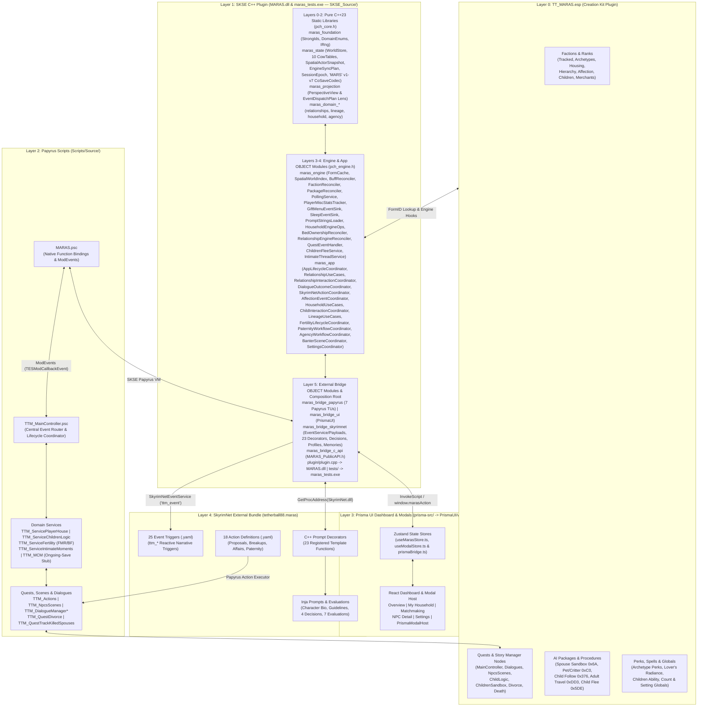
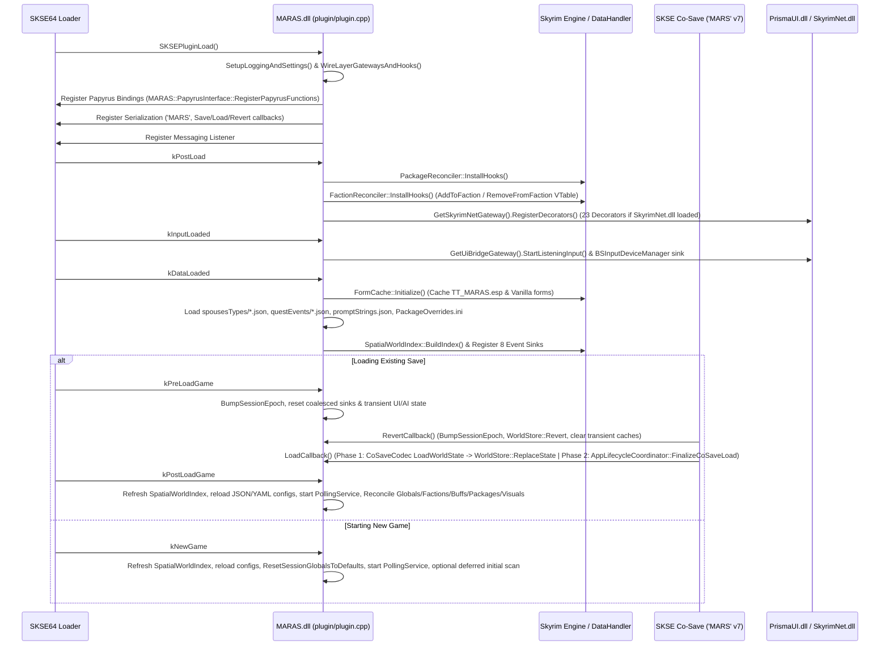

# M.A.R.A.S — System Architecture & Technical Reference

**More Appropriate Relationships And Spouses (M.A.R.A.S)** is built on a four-layer hybrid architecture that combines native SKSE64 C++ services, an embedded React/Vite web dashboard via Prisma UI, event-driven Papyrus quest/dialogue controllers, and an optional SkyrimNet AI narrative integration layer, backed by the `TT_MARAS.esp` plugin.

---

## 1. High-Level Four-Layer Architecture

### Related Architecture Documents
- [SKYRIMNET_AND_AI_INTEGRATION.md](SKYRIMNET_AND_AI_INTEGRATION.md) — Deep dive into `SkyrimNetIntegration`, 23 C++ decorators, `PerspectiveView` bio masking, `AgencyWorkflowCoordinator` matchmaking/banter, `IntimateThreadService` (OStim), and the `tetherball88.maras` bundle.
- [HOUSEHOLD_AND_CHILDREN_ARCHITECTURE.md](HOUSEHOLD_AND_CHILDREN_ARCHITECTURE.md) — Deep dive into `SpouseHierarchyTable`, `HouseholdUseCases`, `SpatialWorldIndex` home-cell detection, `BuffReconciler`, `LineageUseCases`, `ChildGrowthRules`, and `TravelRules`.
- [API_AND_PRISMA_BRIDGE_REFERENCE.md](API_AND_PRISMA_BRIDGE_REFERENCE.md) — Complete reference for `MARAS_PublicAPI.h`, `MARAS.psc` native functions/events, CQS read-only guarantees, and the Prisma UI JSON bridge.
- [RELATIONSHIP_DYNAMICS_GUIDE.md](RELATIONSHIP_DYNAMICS_GUIDE.md) — Guide to the unified pair-keyed relationship engine (`RelationshipUseCases`, `RelationshipEdgeTable`), cheating/affair tracking (`AffairLedger`), and paternity secrecy (`PaternityWorkflowCoordinator`).
- [FERTILITY_MODE_RELOADED_INTEGRATION.md](FERTILITY_MODE_RELOADED_INTEGRATION.md) — Integration architecture for Fertility Mode Reloaded (FMR) and adolescent child training (`ChildGrowthRules`, `ChildVisualReconciler`).

### Dedicated C++ Service & Module Guides (`docs/modder/services/`)
- **Core State, Projection & Engine Registries**:
  - [WorldStoreAndCoSave.md](services/WorldStoreAndCoSave.md) — Thread-safe `WorldStore` snapshots (`10` `CowTable<T>` tables), `SessionEpoch` concurrency fencing, and `'MARS'` v1–v7 SKSE co-save serialization (`CoSaveCodec`, `SkseSerializationCallbacks`).
  - [PerspectiveView.md](services/PerspectiveView.md) — Epistemic and Intrigue Mode projection lens (`ActorSelf`, `DialogueTargetPublic`, `DashboardIntrigue`, `Omniscient`) enforcing paternity, affair, pregnancy, and werewolf secrecy invariants.
  - [SpatialWorldIndex.md](services/SpatialWorldIndex.md) — Base-to-Reference FormID resolution, uniqueness scoring, inn/tavern destination discovery, 2 Hz `SpatialActorSnapshot` cache, and `DeferredActorResolver`.
  - [FactionReconciler.md](services/FactionReconciler.md) — Engine `AddToFaction`/`RemoveFromFaction` VTable hooks, `InternalFactionScope` re-entrancy guard, `GlobalVarReconciler`, and declarative `EngineSyncPlan` faction convergence.
  - [PackageReconciler.md](services/PackageReconciler.md) — Lock-free RCU `PackageStartHook`, 5-tier `PackageRole` plan, INI whitelist filtering, and linked-ref sandbox orchestration.
  - [DeceasedQueries.md](services/DeceasedQueries.md) — Historical snapshots of deceased partners and children (`'DCSD'` + optional `'DCS1'` secrecy extension), `DeathEventHandler`, bereavement queries, and widowhood state.
  - [PollingService.md](services/PollingService.md) — Coalesced main-thread periodic scheduler (`500ms` spatial snapshot, `5s` day-rollover & child orders/travel, `15s` teammate scan) and `UpdateEventSink` tick dispatch.
- **Relationships, Archetypes & Courting**:
  - [RelationshipUseCases.md](services/RelationshipUseCases.md) — Pair-keyed romantic states, infidelity/affair lifecycle, spouse hierarchy ranking (`0..2` + `3+`), and custodial divorce policy.
  - [AffectionRules.md](services/AffectionRules.md) — Daily interaction caps, temperament-scaled decay, polygamy jealousy, affection tiers (`happy`, `content`, `troubled`, `estranged`), and estranged divorce countdowns.
  - [MarriageDifficulty.md](services/MarriageDifficulty.md) — Proposal complexity calculation, player prestige vs. social class expectations, guild alignment, and sigmoid probability curve.
  - [TraitClassifier.md](services/TraitClassifier.md) — Automatic classification of NPC Social Class, Skill Type, and Temperament (`NpcTypeRules`, `NPCTypeDeterminer`, `spousesTypes/` overrides).
- **Household, Spouses & Children**:
  - [HouseholdUseCases.md](services/HouseholdUseCases.md) — Player home registration, tenant capacity, family unit relocation, shared spouse home assets (`SpouseAssetRules`), child slot/pet/order orchestration, and welcome-home child forcegreet/pet/critter/gift/chest coordination (`ChildForcegreetRules`, `ChildInteractionCoordinator`).
  - [BuffReconciler.md](services/BuffReconciler.md) — Hierarchy- and affection-weighted permanent/follower perk & ability spell reconciliation (`SpouseBuffRules`, `BuffReconciler`, `bonuses.json`).
  - [HomeCellDetector.md](services/HomeCellDetector.md) — Heuristic detection of pre-marriage home cells, shareable doors, center markers, and bed-ownership restoration (`BedOwnershipReconciler`).
  - [LineageUseCases.md](services/LineageUseCases.md) — Child registry lifecycles, slot-neutral guardian rules, synthetic FormID promotion, fertility/werewolf inheritance, and FMR integration.
  - [PaternityWorkflowCoordinator.md](services/PaternityWorkflowCoordinator.md) — Two-phase pregnancy/paternity secrecy state machine, phenotype mismatch checks, and SkyrimNet paternity discovery evaluations.
  - [ChildGrowthAndVisuals.md](services/ChildGrowthAndVisuals.md) — Adolescent `childTraining.yaml` progression (`22` locations, `12` Daedric blessings), stat inheritance (`ChildGrowthRules`), `ChildSpawnService`, and isolated per-actor `TESNPC` clones (`ChildVisualReconciler`).
  - [TravelRules.md](services/TravelRules.md) — Autonomous travel and inn/family-visit rotation across Skyrim for independent Stage 4 (`Adult`) offspring.
  - [NamePoolLoader.md](services/NamePoolLoader.md) — Lore-friendly race-specific child naming and species-aware critter naming (`NamePool`, `NamePoolLoader`).
- **AI, Autonomous World, Quests & UI Bridge**:
  - [SkyrimNetIntegration.md](services/SkyrimNetIntegration.md) — Dynamic `SkyrimNet.dll` binding (`SkyrimNetApiLoader`), `23` prompt decorators, async LLM evaluation pipelines (`SkyrimNetDecisions`), and memory/event dispatch.
  - [SkyrimNetMemoryService.md](services/SkyrimNetMemoryService.md) — Bounded per-episode memory compaction (`1s` idle debounce, `3s` hard cap) and LLM memory generation for autonomous events.
  - [SkyrimNetProfileService.md](services/SkyrimNetProfileService.md) — Bounded `std::jthread` worker queue generating per-save SkyrimNet 10-block character profiles for newly spawned Stage 2 (`Child`) and Stage 4 (`Adult`) actors.
  - [AgencyWorkflowCoordinator.md](services/AgencyWorkflowCoordinator.md) — Matchmaking eligibility/LLM verification (`NpcMatchmaker`), two-tier ambient couple banter (`BanterPlanner`, `BanterSceneStarter`), and `encounters/*.json` partner home-arrival/agency workflows.
  - [IntimateThreadService.md](services/IntimateThreadService.md) — Main-thread (`PollingService` / `UpdateEventSink` `1500ms`) OStim Standalone thread monitoring, bed-search heuristics, pregnancy/affair hooks, and post-scene pillow talk.
  - [ChildrenFleeService.md](services/ChildrenFleeService.md) — Children running from threatened cells (intimate scenes or manual request), highest-priority package override (`0x5DE`), sticky per-cell fleeing, and blocked-path teleport.
  - [QuestEventHandler.md](services/QuestEventHandler.md) — Data-driven JSON quest event triggers (`questEvents/*.json`) for relationship promotions, affection changes, archetype updates, and scripted deaths.
  - [PrismaUIDataBridge.md](services/PrismaUIDataBridge.md) — Prisma UI view lifecycle (`PrismaUIManager`), hotkey handling, uniform Intrigue Mode JSON snapshots (`PerspectiveView::ForDashboard`), and main-thread action dispatching.
  - [PrismaModalManager.md](services/PrismaModalManager.md) — Standalone/blocking Prisma UI modal queue, locked focus (`Focus(view, true, false)`) and game pause coordination, and declarative interactive controls.

---

## 2. Plugin Initialization, CMake Module DAG & Runtime Lifecycle (`plugin.cpp`)

The SKSE C++ codebase (`SKSE_Source/`) compiles via [CMakeLists.txt](../../SKSE_Source/CMakeLists.txt) into a strict 13-module layered DAG (`7 STATIC + 6 OBJECT`) plus two precompiled header targets and two final binaries:
- **Precompiled Header Tiers**: `pch_core.h` (precompiled by `maras_foundation`, reused across the 6 pure `STATIC` domain/state/projection libraries and `maras_tests`) and `pch_engine.h` (owned by anchor `maras_pch_engine`, reused across all 6 `OBJECT` engine/app/bridge libraries and `MARAS.dll`).
- **7 Pure `STATIC` Core/Domain Libraries (zero CommonLibSSE dependencies)**: `maras_foundation`, `maras_state`, `maras_projection`, `maras_domain_relationships`, `maras_domain_lineage`, `maras_domain_household`, `maras_domain_agency`.
- **6 `OBJECT` Engine/App/Bridge Libraries**: `maras_engine`, `maras_app`, `maras_bridge_papyrus`, `maras_bridge_ui`, `maras_bridge_skyrimnet`, `maras_bridge_c_api`.
- **Outputs**: `MARAS.dll` (linked at [plugin.cpp](../../SKSE_Source/plugin/plugin.cpp)) and `maras_tests.exe` (`SKSE_Source/tests/`, physically enforced by `LNK2019` to link only the 7 pure `STATIC` libraries).

The SKSE plugin entry point (`SKSEPluginLoad` in [plugin.cpp](../../SKSE_Source/plugin/plugin.cpp)) wires cross-layer gateways and orchestrates initialization across five SKSE messaging phases and eight engine event sinks:

### Engine Event Sinks Registered at `kDataLoaded`

| Event Sink | C++ Handler (`plugin.cpp` / `engine`) | Purpose |
| :--- | :--- | :--- |
| `RE::TESInitScriptEvent` | `ActorInitLoadedEventSink` | Coalesces newly initialized actor `FormID`s from engine worker threads into a single `SessionEpoch`-guarded main-thread task per frame (`SpatialWorldIndex`, `RelationshipUseCases`, and `DeferredActorResolver`). |
| `RE::TESObjectLoadedEvent` | `ActorInitLoadedEventSink` | Coalesces 3D-loaded actor `FormID`s into the per-frame main-thread drain task to resolve deferred actors (`DeferredActorResolver`), reconcile pending factions/packages (`FactionReconciler` / `PackageReconciler`), and enforce child visuals/gear safely on the game thread. |
| `RE::TESQuestStartStopEvent` | `QuestStartStopEventSink` | Captures matching quest FormIDs and marshals `QuestEventManager` execution onto the main thread (`AddEpochTask` + `GetPapyrusMutex()`) when quest aliases and stages initialize/stop. |
| `RE::TESQuestStageEvent` | `QuestStageEventSink` | Captures matching quest stage transitions and marshals `QuestEventManager` command execution onto the main thread (`AddEpochTask` + `GetPapyrusMutex()`). |
| `RE::TESDeathEvent` | `DeathEventHandler` | Extracts victim/killer `FormID`s by value and marshals death processing onto the main thread (`AddCurrentEpochTask`) to update `DeceasedTable`, relationship state, and bereaved child custody. |
| `RE::MenuOpenCloseEvent` | `UpdateEventSink`, `DialogueEventSink` & `GiftMenuEventSink` | `UpdateEventSink` schedules coalesced `PollingService::Update()` ticks and active-modal resends on UI transitions; `DialogueEventSink` resolves the speaker on `Dialogue Menu` openings, invokes `OnDialogueOpened` (`RelationshipInteractionCoordinator` updates No-AI proposal globals), and emits `maras_dialogue_opened`; `GiftMenuEventSink` resets and finalizes in-memory player gift sessions on `"GiftMenu"` open/close (`OnPlayerGiftCompleted`). |
| `RE::TESContainerChangedEvent` | `GiftMenuEventSink` | Accumulates player-to-tracked-NPC gift transfers while `"GiftMenu"` is open (routing household-child gifts to `TTM_ServiceChildrenLogic.ChildReceiveGiftItem`) without `StorageUtil` keys. |
| `RE::TESSleepStopEvent` | `SleepEventSink` | Awards same-cell partner slept affection (`OnPlayerSlept`), clears vanilla rested/adoption states via `PlayerSleepQuestScript`, and applies lover/marriage/adoption rested abilities in `BuffReconciler`. |

---

## 3. Core C++ Infrastructure & Registries

### 3.1 `FormCache` ([FormCache.h](../../SKSE_Source/modules/engine/include/maras/engine/FormCache.h))
Central singleton initialized once at `kDataLoaded` (`FormCache::GetSingleton().Initialize()`). It resolves and caches every `RE::TESForm*`, `RE::TESFaction*`, `RE::TESQuest*`, `RE::TESPackage*`, `RE::SpellItem*`, `RE::BGSPerk*`, `RE::TESGlobal*`, `RE::BGSKeyword*`, and `RE::BGSListForm*` from `TT_MARAS.esp`, `Skyrim.esm`, `HearthFires.esm`, and optional mods (`Fertility Mode.esp`).
- Eliminates repeated `RE::TESDataHandler::LookupForm` overhead during gameplay loops and AI decorator evaluations.
- Provides typed getters used across all engine, app, and bridge modules.

### 3.2 `SpatialWorldIndex` & `SpatialActorSnapshot` ([SpatialWorldIndex.h](../../SKSE_Source/modules/engine/include/maras/engine/SpatialWorldIndex.h))
Centralized spatial index (`std::shared_mutex` guarded) built at `kDataLoaded` (`BuildIndex()`) and refreshed on save transitions (`RefreshIndex()`), supplemented by `Data/SKSE/Plugins/MARAS/npc_index_overrides.ini`.
- **Unified World Mapping**: Merges Base `TESNPC` $\leftrightarrow$ Placed `Actor` Reference FormID lookup + fuzzy name search (`SpatialWorldIndex`), home cell shareable doors/markers/owned beds (`HomeCellData`), and Skyrim inn/tavern travel destinations (`TravelRules`).
- **Strict Scope**: Exists for static/live lookup resolution, home cell/inn metadata, and publishing the 2 Hz lock-free `SpatialActorSnapshot` (`SpatialSnapshotStore::Snapshot()`) via `PollingService`. Live actor runtime state (child race flag, dead/deleted state) is always queried directly on `RE::Actor*` when on the main game thread.

### 3.3 `FactionReconciler` ([FactionReconciler.h](../../SKSE_Source/modules/engine/include/maras/engine/FactionReconciler.h))
`FactionReconciler` hooks the engine's faction mutation functions (`AddToFaction` and `RemoveFromFaction`) to detect external faction changes on tracked NPCs while preventing infinite recursion via RAII guard `InternalFactionScope`.
- Computes desired `TT_MARAS.esp` and vanilla marriage/follower/werewolf faction memberships and ranks via `EngineSyncPlan` (`maras_state`) and applies minimal deltas idempotently on the main thread so Creation Kit dialogue conditions, AI packages, and Story Manager nodes evaluate C++ domain state at zero script cost.

### 3.4 `PackageReconciler` ([PackageReconciler.h](../../SKSE_Source/modules/engine/include/maras/engine/PackageReconciler.h))
`PackageReconciler` installs the `PackageStartHook` engine detour and loads filter rules from `Data/SKSE/Plugins/PackageOverrides.ini` (`Whitelist`, `AllowedPlugins`, `QuestWhitelist`, `QuestPriority`).
- Computes desired `PackageRole` plans via `EngineSyncPlan` (`ComputeActorPackagePlan`), manages home/parent/destination linked references (`0x6B` / `0x377`), and publishes an immutable RCU `PackageRegistrySnapshot` read lock-free (`memory_order_acquire`) inside `PackageStartHook`.
- Evaluates `ChildrenFleeService` (`0x5DE`) first, then active-follower skipping, INI whitelist, plugin/quest whitelists, and quest-priority rules before substituting a household tenant's (`0x6A`), pet/critter's (`0xC0`), Stage 2 follow child's (`0x376`), or Stage 4 traveling adult child's (`0xDD3`) AI package.

### 3.5 `DeceasedTable` & `DeceasedQueries` ([DeceasedQueries.h](../../SKSE_Source/modules/domain_household/include/maras/domain/household/DeceasedQueries.h))
Persists historical records for all deceased MARAS-tracked NPCs and children inside `WorldTables` `'DCSD'` (with optional `'DCS1'` secrecy metadata):
- Keyed via `DeceasedTable::ComputePrimaryKey` so dynamic `0xFFxxxxxx` actors always index strictly by unique `RefId` rather than shared template `BaseId`.
- Tracks `deathTimestamp` (`gameDay`), `wasKilledByPlayer`, killer identity, adult archetypes, `partnersAtDeath` (plus `isSecretAffair` & `publicStatusAtDeath` in `'DCS1'`), and `childInfo` (guardians, bio parents, `isAdopted`, plus `publicBioFatherBaseId` & `hasUndiscoveredPaternitySecret` in `'DCS1'`).
- Queried read-only through `DeceasedQueries` and `PerspectiveView` so bereaved partners and children retain consistent, secret-masked historical context after an NPC or child dies.

### 3.6 `PollingService` ([PollingService.h](../../SKSE_Source/modules/engine/include/maras/engine/PollingService.h))
Coalesced main-game-thread periodic scheduler driven via `UpdateEventSink` (`RE::MenuOpenCloseEvent` & `500ms`-throttled `RE::InputEvent*`) using steady-clock delta checks:
- Drives `500ms` (`2 Hz`) `SpatialSnapshotStore` publication for zero-lock off-thread proximity/teammate reads, `5s` calendar day-rollover and child order/adult travel checks, `15s` teammate change scans (`maras_teammate_change`), plus `1500ms` `IntimateThreadService` / `ChildrenFleeService` ticks and `1s`/`3s` `SkyrimNetMemoryService` episode flushes without detached sleeper threads.

### 3.7 `SessionEpoch` & Concurrency Perimeter ([SessionEpoch.h](../../SKSE_Source/modules/state/include/maras/state/SessionEpoch.h))
Monotonic `std::atomic<uint64_t>` session generation counter incremented on every save transition (`Serialization::RevertCallback`, `kPreLoadGame`):
- **Cross-Save Isolation (`AddEpochTask` / `AddCurrentEpochTask`)**: Every deferred main-thread task, asynchronous SkyrimNet LLM/Decisions HTTP callback, `PrismaModalManager` modal entry, and latent Papyrus `ReturnLatentResult` callback stamps the originating `SessionEpoch` and silently drops execution if the player loaded another save or started a new game while the task or HTTP request was in flight.
- **Main-Thread Engine Invariant**: Off-thread engine event sinks (`TESInitScriptEvent`, `TESObjectLoadedEvent`, `TESDeathEvent`, `TESQuestStartStopEvent`, `TESQuestStageEvent`, `BSInputDeviceManager` poll trigger) capture value `RE::FormID`s only and marshal all `RE::Actor*` / `TESNPC*` / engine mutations onto the SKSE main game thread.
- **Zero Unmanaged Threads**: Gameplay services run deterministically on the main thread; `SkyrimNetProfileService` isolates blocking localhost HTTP/file I/O inside a single bounded, joinable `std::jthread` worker queue that performs zero `RE::*` or `SkyrimNet.dll` calls off-thread.

### 3.8 `GlobalVarReconciler`, `BuffReconciler` & `DeferredActorResolver`
- **`GlobalVarReconciler`** ([GlobalVarReconciler.h](../../SKSE_Source/modules/engine/include/maras/engine/GlobalVarReconciler.h)): Computes desired counters and feature toggles via `EngineSyncPlan::ComputeDesiredGlobals` (`LoveInterestsCount` `0x4F`, `SpousesCount` `0x117`, `PlayerHousesCount` `0xC2`, `TTM_EnablePolygamyToggle` `0x06`, `TTM_SkyrimNetInstalled` `0xC4`) and manages `.ess`-persisted MCM dialogue globals (`TTM_MCM_StartDialGender` `0x4B`, `TTM_MCM_MinRelRankForDial` `0xE4`, `TTM_MCM_PreferVanillaAudio` `0x18`, `TTM_MCM_AllowAIDial` `0x1C`) idempotently with `TT_MARAS.esp`.
- **`BuffReconciler`** ([BuffReconciler.h](../../SKSE_Source/modules/engine/include/maras/engine/BuffReconciler.h)): Reconciles active spouse bonus perks (`BGSPerk` `0x35..0x42`), ability spell magnitudes, and perk entry-point values (`"spell"`, `"multiply"`, `"add"` with single `RemovePerk`/`AddPerk` cycling) directly in C++ from `bonuses.json` and `EngineSyncPlan` whenever relationship status, hierarchy rank, married spouse affection, archetype, teammate state, or save load/revert occurs.
- **`DeferredActorResolver`** ([DeferredActorResolver.h](../../SKSE_Source/modules/engine/include/maras/engine/DeferredActorResolver.h)): Queues unloaded actors needing pending relationship registration, faction, or package convergence until `TESInitScriptEvent` / `TESObjectLoadedEvent` brings them into memory, cleared automatically on `SessionEpoch` transitions.

---

## 4. `TT_MARAS.esp` Plugin Architecture

Because Creation Kit dialogue branches, AI packages, and Story Manager nodes evaluate native engine records directly, `TT_MARAS.esp` provides the structural backbone that C++ and Papyrus manipulate at runtime:

### 4.1 Core Factions in `TT_MARAS.esp`
- **Tracking & Status**:
  - `0x7` (`TrackedNpcFaction`): Marks an NPC as registered in M.A.R.A.S (`0..8` mirror of `RelationshipStatus`: `Candidate` `0`, `Engaged` `1`, `Married` `2`, `Divorced` `3`, `Jilted` `4`, `Dating` `5`, `Lover` `6`, `ExDating` `7`, `ExLover` `8`).
  - `0x111` (`SpouseHierarchyFaction`): Rank `0` = Lead Spouse, `1` = Second, `2` = Third; Rank `3+` subordinates are removed (`std::nullopt`) so Creation Kit checks evaluate `!InFaction(0x111)` cleanly alongside rank `0..2`.
  - `0x119` (`SpouseAffectionFaction`): Rank stores exact clamped permanent affection (`0..100`) so CK dialogue conditions can threshold directly (Estranged `<25`, Troubled `25..49`, Content `50..74`, Happy `>=75`).
  - `0x2BD` (`SpouseCheatingFaction`) & `0x2DC` (`SpouseOpenRelFaction`): `0x2BD` (`Rank 0` = undiscovered ongoing secret, `Rank 1` = known ongoing affair) and `0x2DC` mark infidelity and open-relationship state for dialogue/scene conditions.
  - `0x5D2` (`TTM_CanFormNonCheatingMain`): Assigned to the Player (`Rank 1` when polygamy is active or no closed main-tier partner exists, `Rank 0` otherwise) and all registered NPCs (`Rank 0` = in a closed main-tier pair; `Rank 1` = free to form a non-cheating main relationship).
  - `0x5A3`, `0x5A4`, `0x5C4`: Caught-cheating state factions used during confrontation dialogues.
- **Archetypes**:
  - `0x66` (`SocialClassFaction`): Ranks `0..7` (`Outcast` `0`, `Poverty` `1`, `Working` `2`, `Middle` `3`, `Wealthy` `4`, `Religious` `5`, `Nobles` `6`, `Rulers` `7`).
  - `0x4E` (`SkillTypeFaction`): Ranks `0..5` (`Warrior` `0`, `Mage` `1`, `Rogue` `2`, `Craftsman` `3`, `Ranger` `4`, `Orator` `5`).
  - `0x118` (`TemperamentFaction`): Ranks `0..4` (`Proud` `0`, `Humble` `1`, `Jealous` `2`, `Romantic` `3`, `Independent` `4`).
- **Housing & Vendor Merchants**:
  - `0x6C` (`SpouseHousedFaction`), `0x7B` (`SharedHouseFaction`), `0x7F` (`NoInitialHouseFaction`).
  - `0xC0C`–`0xC14` (`HousedSpouseMerchFactions` [0..8]): Assigned by `HouseholdEngineOps` / `HouseholdUseCases` when a spouse moves into a MARAS-managed player home, linking the spouse to an archetype-appropriate vendor merchant chest and barter list.
- **Children & Pets**:
  - `0xC23` (`PlayerChildFaction`), `0x28A` (`PlayerChildBothParentsFaction`), `0xC24` (`SpouseChildrenFaction`), `0x2BB` (`PlayerChildPetFaction`).
- **Dialogue Conditional Global Variables**:
  - `0xC4` (`TTM_SkyrimNetInstalled`): Updated via `GlobalVarReconciler` / `TTM_Data.GetSetHasSkyrimNetGlobal` (`1` when `SkyrimNet.dll` is loaded and `!simulateNoSkyrimNet`, `0` otherwise).
  - `0x15C` (`GetMarriageChanceGV`), `0x5D0` (`GetDatingChanceGV`), `0x5D1` (`GetLoverChanceGV`): Populated dynamically in C++ when dialogue opens (`DialogueEventSink` $\rightarrow$ `RelationshipInteractionCoordinator::OnDialogueOpened` $\rightarrow$ `MarriageDifficultyRules` & `RelationshipEngineReconciler`) for non-AI romance proposals, with an optional VM callback (`RefreshDialogueLoversLedger` $\rightarrow$ `ApplyDialogueLoversLedgerBonus`) when `TT_LoversLedger.esp` is active. Holds the computed `0–100` threshold for engagement/marriage, dating, and lover proposals after applying ex-partner (`0.75x`), closed-pair (`0.6x`), and current-stage multipliers.

### 4.2 Quests, Story Manager Nodes & AI Packages in `TT_MARAS.esp`
- **Core Quests**:
  - `0x800` (`Main`): Attaches `TTM_MainController.psc` and domain service scripts.
  - `0x5C` (`EnablePolygamy`): Relaxes vanilla single-marriage guards on `RelationshipMarriage` / `RelationshipMarriageFIN`.
  - `0x67` (`Dialogues`): Player-facing dialogue branches (proposals, breakups, divorce, housing assignment, home share collection, affection gifts, hierarchy changes, intimate invitations).
  - `0x378` (`NpcsScenes` / `TTM_NpcsScenes.psc`): Orchestrates multi-actor AI scenes (autonomous gifts, arguments, breakups, weddings, intimate moments).
  - `0xC25` (`ChildLogic` / `TTM_ServiceChildrenLogic.psc`) & `0x2BC` (`ChildrenSandbox` / `TTM_ChildrenSandbox.psc`): Manages Papyrus alias sandbox/forcegreet slots (2 vanilla or 6 expanded slots via `TTM_ServiceChildrenLogic`, while `WorldStore` stores unbounded children in `HouseholdTable`/`LineageTable`), child chest refills, pet/critter adoption, orders, and games.
- **Story Manager Event Quests**:
  - `0x11E`–`0x121` (`AffectionGiftQuests`): Triggered via Story Manager node when interacting with partners at specific affection tiers.
  - `0x160` (`TTM_QuestDivorce`): Triggered to dispatch the divorce settlement letter via `WICourierScript` with a 72-game-hour fallback timer before routing settlement execution to `MARAS.ProcessDivorceSettlement`.
  - `TTM_QuestTrackKilledSpouses`: Triggered by the **Kill Actor Event** Story Manager node when a tracked partner/ex dies; calculates inheritance (`(socialClass + 1) * 400` gold for spouses if player is not the killer) and queues the appropriate courier letter (`SpouseLetter`, `FianceLetter`, or `ExLetter`), while `WorldState::RecordActorDeath` sets `playerKiller` when the player kills a married or engaged partner.
  - `TTM_QuestTrackNewAdoption`: Triggered when vanilla Hearthfire adoption completes to register the child into M.A.R.A.S.
- **Custom AI Packages**:
  - `0x6A` (`TTM_HouseSpouseSandboxMulti`): Multi-spouse home sandbox package referencing the partner's persistence/home marker.
  - `0xC0` (`PetCritterSandbox` / `DoNotMove`), `0x376` (`NonPlayerChildFollow` / `FollowPlayer`), `0xDD3` (`AdultChildTravel`), and `0x5DE` (`ChildrenFleeIntimateScene`): Managed deterministically by `PackageReconciler` + `ChildrenFleeService`.
  - Child behavior packages on `ChildLogic` (`0xC25`) / `ChildrenSandbox` (`0x2BC`) aliases conditioned on `ActorValue` `Variable06` (orders/games) and `Variable07` (forcegreets).

---

## 5. SKSE Co-Save Binary Serialization (`'MARS'` v7)

All persistent runtime state is stored in the SKSE co-save under plugin UID `'MARS'` (`0x4D415253`) with `kDataVersion = 7` ([CoSaveCodec.h](../../SKSE_Source/modules/state/include/maras/state/CoSaveCodec.h) & [SkseSerializationCallbacks.cpp](../../SKSE_Source/modules/engine/src/SkseSerializationCallbacks.cpp)).

### 5.1 Deterministic Chunk Save/Load Table & Two-Phase Load Finalization

During `SaveCallback`, [`SkseSerializationCallbacks.cpp`](../../SKSE_Source/modules/engine/src/SkseSerializationCallbacks.cpp) copies the live `WorldState` via `MARAS::State::WorldStore::GetSingleton().ReadLive()` and streams all 12 record chunks sequentially through `MARAS::State::SaveWorldState` (`SkseCoSaveWriter`). During `LoadCallback`, loading executes in two phases:
- **Phase 1 (Pure Chunk Deserialization & Consolidation)**: A staged `WorldState` (seeded with INI baseline `SettingsData`) is populated via `MARAS::State::LoadWorldState` (`SkseCoSaveReader` + `SkseFormIdResolver`), validated per chunk without cross-service engine side effects, pruned by `MARAS::State::FinalizeWorldStateAfterLoad`, and committed atomically via `WorldStore::GetSingleton().ReplaceState(...)`. On revert (`RevertCallback`), `WorldStore::Revert()` clears persistent tables while restoring INI baseline settings.
- **Phase 2 (Post-Chunk Engine Finalization)**: `AppLifecycleCoordinator::BeginCoSaveLoad()` suppresses duplicate profile/memory generation while `FinalizeCoSaveLoad()` runs `SettingsCoordinator::ApplyPostLoadEngineSideEffects()`, `RelationshipUseCases::FinalizeLoad()`, `LineageUseCases::FinalizeCoSaveLoad()`, `PaternityWorkflowCoordinator::FinalizeLoad()`, `HouseholdUseCases::FinalizeLoad()`, `ChildVisualReconciler::ReassertAllChildVisualsOnLoad()`, `GlobalVarReconciler::ReconcileGlobals()`, `FactionReconciler::ReconcileAllOnLoad()`, `BuffReconciler::ReconcilePlayerBuffs()`, `PlayerChildrenEngineOps::ReassertChildPackagesOnLoad()`, and `PackageReconciler::ReconcileWorld()` (queuing unloaded actors in `DeferredActorResolver`).

| Order | FourCC | Record Constant | `WorldTables` / App Owner | Persisted Data Summary |
| :---: | :---: | :--- | :--- | :--- |
| 1 | `'NPCR'` | `kNPCRelationshipData` | `ActorProfileTable`, `RelationshipEdgeTable`, `AffairLedger`, `LineageTable` | Unified relationship & lineage stream containing: (1) tracked NPC profiles (`ActorProfileRecord`), (2) pair-keyed `RelationshipEdge` entries (status, originalStatus, `isOpen`, `StatusChangeRecord` history) and directional `AffairLedger` cheating records, (3) pending deferred relationship queue, (4) pending deferred child queue, and (5) global `ChildRecord` entries (real or synthetic `0xFF700001..0xFF7FFFFF` `ChildId`, `bioMotherId`, `bioFatherId`, slot-neutral `guardians`, `isAdopted`, `PaternitySecretState` including `bioFatherName` & `bioFatherRaceId` in v7+, stage, training state, and child name), with inline sub-markers `'AGN1'`, `'PRG1'`, `'CHD1'`, `'LYC1'`, `'CHD2'`, and `'FRT1'` (`ActiveDeliveryBatch` multi-fetus fertility delivery batch state). |
| 2 | `'SPHR'` | `kSpouseHierarchyData` | `SpouseHierarchyTable` / `RelationshipUseCases` | Ordered top-3 ranked spouse slots (`0..2`: `Lead`, `Second`, `Third`; `3+` implied beyond slot 2). |
| 3 | `'AFCT'` | `kAffectionData` | `AffectionTable` / `RelationshipUseCases` | Per-NPC permanent affection (`0..100`), daily accumulators (`daily_` in v7+), last interaction day, and estranged timers. |
| 4 | `'PHOU'` | `kPlayerHouseData` | `HouseholdTable` / `HouseholdUseCases` | Registered player houses, custom house cells/markers, tenant lists, stay-at-home flags, and capacity overrides. |
| 5 | `'SPAS'` | `kSpouseAssetsData` | `HouseholdTable` / `HouseholdUseCases` | Shared spouse home cells (`SharedCellRecord`), original `kPublicArea` flags, sharing spouse sets, and pre-share bed ownership (`originalBedOwners_` in v7+). |
| 6 | `'PLCH'` | `kPlayerChildrenData` | `HouseholdTable` / `HouseholdUseCases` | Adopted household children (`ChildHouseholdState`), active home/bed markers, assigned pet/critter FormIDs, allowance/gift cooldowns, and active `Variable06`/`Variable07` state, plus optional trailing `'PLC1'` extension (`ChildChestIntroduced`, `PoorCounter`, `NameCallingUsedLast`, `transientCritterId`, coordinated by `ChildInteractionCoordinator` / `ChildForcegreetRules`). |
| 7 | `'CFSN'` | `kChildFactionSnapshotData` | `HouseholdTable` / `PlayerChildrenEngineOps` | Saved pre-adoption/original faction snapshots (`ChildFactionSnapshotRecord`) to support clean restoration on unadopt/removal. |
| 8 | `'MKMK'` | `kMatchmakingData` | `CooldownTable` / `AgencyWorkflowCoordinator` | Matchmaking history, scheduled run timestamps, cooldowns, pending LLM verification timestamps, plus optional trailing `'REL1'` extension (`npcBrokeupTime`, `npcLastTimeSharedIncome`, `lastTimePaidDivorceFee`, `playerKiller`, `playerHadWedding`, `dontShowSkipWeddingMessage`). |
| 9 | `'DCSD'` | `kDeceasedRegistryData` | `DeceasedTable` / `DeceasedQueries` | Historical snapshots of deceased partners and young/adult children (`deathTimestamp`, `wasKilledByPlayer`, `partnersAtDeath`, `childInfo`), plus optional trailing `'DCS1'` extension persisting `isSecretAffair`, `publicStatusAtDeath`, `publicBioFatherBaseId`, and `hasUndiscoveredPaternitySecret` (omitted when none exist). |
| 10 | `'BNTR'` | `kBanterData` | `CooldownTable` / `AgencyWorkflowCoordinator` / `BanterSceneCoordinator` | Couple banter cooldowns, last-scene timestamps, recent pair history, plus optional trailing `'BNT1'` extension (`movedSceneActors` return XMarkers and `skyrimNetMutedActors` filter-faction recovery state). |
| 11 | `'ACTR'` | `kAdultChildTravelData` | `LineageTable` / `HouseholdUseCases` | Autonomous travel schedules (`AdultChildTravelRecord`), current/home/destination locations, and departure/return timestamps for Stage 4 (`Adult`) offspring. |
| 12 | `'CNFG'` | `kPluginSettingsData` | `SettingsData` / `SettingsCoordinator` | All user-configured per-save dashboard settings (`kSettingsVersionMarker = 0xFF`, `kSettingsSubVersion = 4`, including `revealSecretsInUI` Intrigue Mode). |

### 5.2 FormID Resolution & Save-Game Compatibility Rules
- Every persisted `RE::FormID` is passed through `SkseFormIdResolver::ResolveFormId` (`a_intfc->ResolveFormID`) during `LoadCallback` so load-order changes do not corrupt references.
- **Synthetic Child FormIDs** (`0xFF700001`–`0xFF7FFFFF`, tested via `ChildId::IsSyntheticChild` and allocated via `WorldState::AllocateSyntheticChildId`) bypass `ResolveFormID` because they represent pre-spawned/abstract biological children (`Unborn`, `Infant`, `InTraining`) until linked to a physical `RE::Actor` (`ReplaceChildId`). Real dynamically spawned `0xFF` child/adult actors (`>= 0xFF800000` or `< 0xFF700000`) are distinct from synthetic IDs and never advance `nextSyntheticChildId`.
- Chunk version (`a_version`) is dispatched inside `MARAS::State::LoadWorldState` ([CoSaveCodec.cpp](../../SKSE_Source/modules/state/src/CoSaveCodec.cpp)) so older co-save versions (`v1`–`v6`) and legacy un-prefixed `'DCSD'` chunks migrate cleanly to `v7` without data loss.

### 5.3 Engine-Free Core Modules & Headless Test Gate (`maras_tests`)
- **`maras_foundation`** (`SKSE_Source/modules/foundation/`): Zero-dependency C++23 static library owning `pch_core.h`, strong 32/64-bit domain identifiers (`RefId`, `BaseId`, `SyntheticChildId`, `ActorId`, `ChildId`, `HouseId`, `CellId`, `LocationId`, `FormRawId`, `AffairId`, `CanonicalPairKey`), deterministic RNG injection (`IRng` / `DeterministicRng`), and an engine-free atomic log sink (`Logging.h`).
- **`maras_state`** (`SKSE_Source/modules/state/`): Engine-header-free C++23 static library consolidating all persistent domain state into `WorldState` across 10 normalized Copy-on-Write (`CowTable<T>`) tables (`ActorProfileTable`, `RelationshipEdgeTable`, `AffairLedger`, `LineageTable`, `SpouseHierarchyTable`, `HouseholdTable`, `AffectionTable`, `DeceasedTable`, `CooldownTable`, `SettingsData`), `WorldStateSnapshot` ($O(1)$ lock-free structural sharing), `WorldStore` (sole runtime owner offering lock-free `Snapshot()`, leaf-mutex `Modify(...)`, `ReplaceState(...)`, and INI-baseline-preserving `Revert()`), `SpatialActorSnapshot` / `SpatialSnapshotStore` (2 Hz main-thread spatial cache published by `PollingService`), `EngineSyncPlan` (pure desired-state calculators for factions, globals, package roles, and player buff magnitudes), `SessionEpoch`, and `'MARS'` v1–v7 `CoSaveCodec` (`SaveWorldState`, `LoadWorldState`, `FinalizeWorldStateAfterLoad`).
- **`maras_projection`** (`SKSE_Source/modules/projection/`): Engine-header-free C++23 static library implementing `PerspectiveView`, the unified epistemic and Intrigue Mode projection lens over immutable (`WorldStateSnapshot`, `SpatialActorSnapshot`) pairs across `ActorSelf`, `DialogueTargetPublic`, `DashboardIntrigue`, and `Omniscient` modes, delegating live werewolf faction checks via `IWerewolfStateProvider` (`GetEngineWerewolfStateProvider()` in `MARAS.dll`).
- **Pure Domain Libraries (`maras_domain_relationships`, `maras_domain_lineage`, `maras_domain_household`, `maras_domain_agency`)**: Engine-header-free C++23 static libraries encapsulating all pure gameplay mutations, validations, custody policies, buff math, growth snapshots, matchmaking, and travel plans.
- **SKSE Co-Save Glue** ([SkseSerializationCallbacks.h](../../SKSE_Source/modules/engine/include/maras/engine/SkseSerializationCallbacks.h) & [SkseSerializationCallbacks.cpp](../../SKSE_Source/modules/engine/src/SkseSerializationCallbacks.cpp)): `maras_engine` adapter bridging `SKSE::SerializationInterface` (`SkseCoSaveReader`, `SkseCoSaveWriter`, `SkseFormIdResolver`) and delegating co-save hooks through `IEngineEventHooks`.
- **`maras_tests`** (`SKSE_Source/tests/`): Standalone headless C++23 test runner (`maras_tests.exe`) reusing `pch_core.h` from `maras_foundation` and linking ONLY the 7 pure `STATIC` libraries (`maras_foundation`, `maras_state`, `maras_projection`, `maras_domain_relationships`, `maras_domain_lineage`, `maras_domain_household`, `maras_domain_agency` — enforcing physical `LNK2019` engine-header isolation) across 10 test suites (`test_cosave_migrations.cpp`, `test_custody_and_death.cpp`, `test_affair_ledger.cpp`, `test_world_store.cpp`, `test_perspective_lens.cpp`, `test_reconcilers.cpp`, `test_domain_relationships.cpp`, `test_domain_lineage.cpp`, `test_domain_household.cpp`, `test_domain_agency.cpp`).

