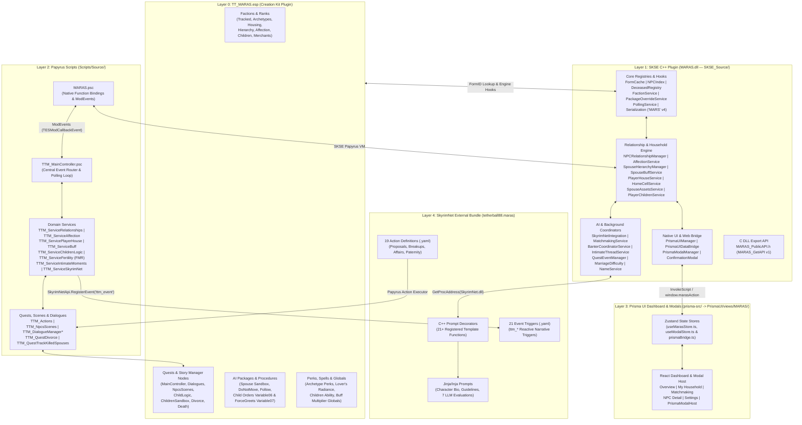
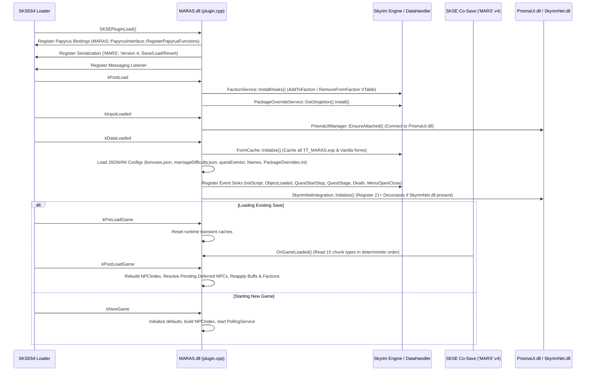

# M.A.R.A.S — System Architecture & Technical Reference

**More Appropriate Relationships And Spouses (M.A.R.A.S)** is built on a four-layer hybrid architecture that combines native SKSE64 C++ services, an embedded React/Vite web dashboard via Prisma UI, event-driven Papyrus quest/dialogue controllers, and an optional SkyrimNet AI narrative integration layer, backed by the `TT_MARAS.esp` plugin.

---

## 1. High-Level Four-Layer Architecture

### Related Architecture Documents
- [SKYRIMNET_AND_AI_INTEGRATION.md](file:///e:/Skyrim/development/mods/M.A.R.A.S%20Dev/docs/modder/SKYRIMNET_AND_AI_INTEGRATION.md) — Deep dive into `SkyrimNetIntegration`, C++ decorators, `MatchmakingService`, `BanterCoordinatorService`, `IntimateThreadService` (OStim), and the `tetherball88.maras` bundle.
- [HOUSEHOLD_AND_CHILDREN_ARCHITECTURE.md](file:///e:/Skyrim/development/mods/M.A.R.A.S%20Dev/docs/modder/HOUSEHOLD_AND_CHILDREN_ARCHITECTURE.md) — Deep dive into `SpouseHierarchyManager`, `PlayerHouseService`, `HomeCellService`, `SpouseAssetsService`, `SpouseBuffService`, and `PlayerChildrenService`.
- [API_AND_PRISMA_BRIDGE_REFERENCE.md](file:///e:/Skyrim/development/mods/M.A.R.A.S%20Dev/docs/modder/API_AND_PRISMA_BRIDGE_REFERENCE.md) — Complete reference for `MARAS_PublicAPI.h`, `MARAS.psc` native functions/events, and the Prisma UI JSON bridge.
- [RELATIONSHIP_DYNAMICS_GUIDE.md](file:///e:/Skyrim/development/mods/M.A.R.A.S%20Dev/docs/modder/RELATIONSHIP_DYNAMICS_GUIDE.md) — Guide to the unified pair-keyed relationship engine (`NPCRelationshipManager`), cheating/affair states, and paternity secrets.
- [FERTILITY_MODE_RELOADED_INTEGRATION.md](file:///e:/Skyrim/development/mods/M.A.R.A.S%20Dev/docs/modder/FERTILITY_MODE_RELOADED_INTEGRATION.md) — Integration architecture for Fertility Mode Reloaded (FMR).

### Dedicated C++ Service Guides (`docs/modder/services/`)
- **Relationships, Archetypes & Courting**:
  - [NPCRelationshipManager.md](file:///e:/Skyrim/development/mods/M.A.R.A.S%20Dev/docs/modder/services/NPCRelationshipManager.md) — Pair-keyed romantic states, cheating/affair tracking, child registry, paternity secrets, and custody transfer rules.
  - [AffectionService.md](file:///e:/Skyrim/development/mods/M.A.R.A.S%20Dev/docs/modder/services/AffectionService.md) — Daily interaction caps, temperament-scaled decay, polygamy jealousy, affection tiers, and estranged divorce countdowns.
  - [MarriageDifficulty.md](file:///e:/Skyrim/development/mods/M.A.R.A.S%20Dev/docs/modder/services/MarriageDifficulty.md) — Proposal complexity calculation, player prestige vs. social class expectations, guild alignment, and sigmoid probability curve.
  - [NPCTypeDeterminer.md](file:///e:/Skyrim/development/mods/M.A.R.A.S%20Dev/docs/modder/services/NPCTypeDeterminer.md) — Automatic classification of NPC Social Class, Skill Type, and Temperament.
- **Household, Spouses & Children**:
  - [SpouseHierarchyManager.md](file:///e:/Skyrim/development/mods/M.A.R.A.S%20Dev/docs/modder/services/SpouseHierarchyManager.md) — Polygamous spouse ranking (`Lead`, `Second`, `Third`, `Fourth+`), rank promotion/demotion, and compact shifting.
  - [SpouseBuffService.md](file:///e:/Skyrim/development/mods/M.A.R.A.S%20Dev/docs/modder/services/SpouseBuffService.md) — Hierarchy-weighted passive player buffs, follower multipliers, Lover's Radiance, and Mother's/Father's Love.
  - [PlayerHouseService.md](file:///e:/Skyrim/development/mods/M.A.R.A.S%20Dev/docs/modder/services/PlayerHouseService.md) — Player home registration, tenant capacity, family unit relocation, and housed spouse merchant setup.
  - [HomeCellService.md](file:///e:/Skyrim/development/mods/M.A.R.A.S%20Dev/docs/modder/services/HomeCellService.md) — Heuristic detection of an NPC's original pre-marriage home cell and bed/persistence markers.
  - [SpouseAssetsService.md](file:///e:/Skyrim/development/mods/M.A.R.A.S%20Dev/docs/modder/services/SpouseAssetsService.md) — Social-class store income calculation and home-share gold payouts.
  - [PlayerChildrenService.md](file:///e:/Skyrim/development/mods/M.A.R.A.S%20Dev/docs/modder/services/PlayerChildrenService.md) — 6-slot household child management, timed `Variable06` orders/games, `Variable07` forcegreets, and pet/critter adoption.
  - [NameService.md](file:///e:/Skyrim/development/mods/M.A.R.A.S%20Dev/docs/modder/services/NameService.md) — Lore-friendly race-specific child naming and species-aware critter naming.
- **AI, Autonomous World & Scene Coordination**:
  - [SkyrimNetIntegration.md](file:///e:/Skyrim/development/mods/M.A.R.A.S%20Dev/docs/modder/services/SkyrimNetIntegration.md) — Dynamic `SkyrimNet.dll` binding, 21+ prompt decorators, async LLM evaluation pipelines, and memory/event dispatch.
  - [MatchmakingService.md](file:///e:/Skyrim/development/mods/M.A.R.A.S%20Dev/docs/modder/services/MatchmakingService.md) — Autonomous and manual NPC-to-NPC pairing, orientation rules, LLM compatibility verification, and dual memory generation.
  - [BanterCoordinatorService.md](file:///e:/Skyrim/development/mods/M.A.R.A.S%20Dev/docs/modder/services/BanterCoordinatorService.md) — Two-tier ambient couple banter, affair drama triggers, and non-SkyrimNet scene fallback.
  - [IntimateThreadService.md](file:///e:/Skyrim/development/mods/M.A.R.A.S%20Dev/docs/modder/services/IntimateThreadService.md) — OStim Standalone thread monitoring, bed-search heuristics, pregnancy/affair hooks, and post-scene pillow talk.
  - [ChildrenFleeService.md](file:///e:/Skyrim/development/mods/M.A.R.A.S%20Dev/docs/modder/services/ChildrenFleeService.md) - Children running from threatened cells (intimate scenes or manual request), sticky per-cell fleeing, and blocked-path teleport.
  - [QuestEventManager.md](file:///e:/Skyrim/development/mods/M.A.R.A.S%20Dev/docs/modder/services/QuestEventManager.md) — Data-driven JSON quest event triggers for relationship promotions, affection changes, and archetype updates.
- **Core Engine Hooks, Registries & UI Bridge**:
  - [FactionService.md](file:///e:/Skyrim/development/mods/M.A.R.A.S%20Dev/docs/modder/services/FactionService.md) — Engine `AddToFaction`/`RemoveFromFaction` VTable hooks, `InternalFactionScope` re-entrancy guard, and faction-to-service synchronization.
  - [PackageOverrideService.md](file:///e:/Skyrim/development/mods/M.A.R.A.S%20Dev/docs/modder/services/PackageOverrideService.md) — AI package evaluation hook, 7-step safety gate, and status-driven package overrides.
  - [NPCIndex.md](file:///e:/Skyrim/development/mods/M.A.R.A.S%20Dev/docs/modder/services/NPCIndex.md) — Base-to-Reference FormID resolution, uniqueness scoring, and fast name search index.
  - [DeceasedRegistry.md](file:///e:/Skyrim/development/mods/M.A.R.A.S%20Dev/docs/modder/services/DeceasedRegistry.md) — Historical snapshots of deceased partners and children, bereavement tracking, and widowhood state.
  - [PollingService.md](file:///e:/Skyrim/development/mods/M.A.R.A.S%20Dev/docs/modder/services/PollingService.md) — Throttled real-time follower detection, child order expiration ticks, and midnight day-rollover orchestration.
  - [PrismaUIDataBridge.md](file:///e:/Skyrim/development/mods/M.A.R.A.S%20Dev/docs/modder/services/PrismaUIDataBridge.md) — Prisma UI view lifecycle, hotkey handling, outbound JSON state snapshots, and main-thread action dispatching.
  - [PrismaModalManager.md](file:///e:/Skyrim/development/mods/M.A.R.A.S%20Dev/docs/modder/services/PrismaModalManager.md) — Standalone/blocking Prisma UI modal queue, locked focus and game pause coordination, and declarative interactive controls.

---

## 2. Plugin Initialization & Runtime Lifecycle (`plugin.cpp`)

The SKSE plugin entry point (`SKSEPluginLoad` in `SKSE_Source/plugin.cpp`) orchestrates initialization across five SKSE messaging phases and six engine event sinks:

### Engine Event Sinks Registered at `kDataLoaded`

| Event Sink | C++ Handler (`plugin.cpp`) | Purpose |
| :--- | :--- | :--- |
| `RE::TESInitScriptEvent` | `InitScriptEventHandler` | Detects newly initialized actors in the world and triggers `NPCRelationshipManager::TryResolveForActor` for deferred/unloaded NPCs. |
| `RE::TESObjectLoadedEvent` | `ObjectLoadedEventHandler` | Resolves deferred relationship/child records when an actor's 3D loads and refreshes AI package overrides. |
| `RE::TESQuestStartStopEvent` | `QuestStartStopEventHandler` | Forwards quest start/stop events to `QuestEventManager` to evaluate JSON-defined quest triggers. |
| `RE::TESQuestStageEvent` | `QuestStageEventHandler` | Forwards quest stage transitions to `QuestEventManager` and syncs vanilla `RelationshipMarriageFIN` / adoption stages. |
| `RE::TESDeathEvent` | `DeathEventHandler` | Records actor deaths in `DeceasedRegistry`, transitions active partners to `Deceased` status, and notifies `PlayerChildrenService` if a guardian dies. |
| `RE::MenuOpenCloseEvent` | `MenuEventHandler` | Tracks menu transitions (e.g., `Loading Menu`, `Dialogue Menu`, `Journal Menu`) to safely manage `PrismaUIManager` focus and modal states. |

---

## 3. Core C++ Infrastructure & Registries

### 3.1 `FormCache` (`SKSE_Source/include/core/FormCache.h`)
Central singleton initialized once at `kDataLoaded` (`FormCache::GetSingleton().Initialize()`). It resolves and caches every `RE::TESForm*`, `RE::TESFaction*`, `RE::TESQuest*`, `RE::TESPackage*`, `RE::SpellItem*`, `RE::BGSPerk*`, `RE::TESGlobal*`, `RE::BGSKeyword*`, and `RE::BGSListForm*` from `TT_MARAS.esp`, `Skyrim.esm`, `HearthFires.esm`, and optional mods (`Fertility Mode.esp`).
- Eliminates repeated `RE::TESDataHandler::LookupForm` overhead during gameplay loops and AI decorator evaluations.
- Provides typed getters used across all C++ services.

### 3.2 `NPCIndex` (`SKSE_Source/include/core/NPCIndex.h`)
Centralized lookup index built from `RE::TESDataHandler` and live world references, supplemented by `SKSE/Plugins/MARAS/npc_index_overrides.ini`.
- **Strict Scope**: Exists **exclusively** for mapping Base FormIDs (`RE::TESNPC`) $\leftrightarrow$ Placed Reference FormIDs (`RE::Actor` / `RE::TESObjectREFR`) and performing fast case-insensitive/fuzzy name searches (`FindByName`, `GetRefID`, `GetBaseID`).
- **Rule**: Never used to query runtime actor state (child status, death, combat, etc.), which must always be queried directly on `RE::Actor*` via CommonLibSSE (e.g., `actor->IsChild()`, `actor->IsDead()`).

### 3.3 `FactionService` (`SKSE_Source/include/core/FactionService.h`)
Hooks the engine's faction mutation functions (`AddToFaction` and `RemoveFromFaction`) to detect external faction changes on tracked NPCs while preventing infinite recursion via RAII guard `InternalFactionScope`.
- Synchronizes C++ state (`NPCRelationshipManager`, `AffectionService`, `SpouseHierarchyManager`, `PlayerHouseService`, `PlayerChildrenService`) with `TT_MARAS.esp` factions so that Creation Kit dialogue conditions, AI packages, and Story Manager nodes can evaluate state at zero script cost.

### 3.4 `PackageOverrideService` (`SKSE_Source/include/core/PackageOverrideService.h`)
Installs a low-level hook on `RE::Actor::CheckValidPackage` / AI package evaluation.
- Loads priority-ordered package lists per relationship status (`married`, `engaged`, `lover`, `dating`, `divorced`, `jilted`, `ex_lover`, `ex_dating`) from `SKSE/Plugins/MARAS/PackageOverrides.ini`.
- Supports per-NPC preferred package selection (`SetPreferredPackageIndex`) controlled from the Prisma UI NPC Detail view.
- Evaluates a 7-step safety gate before overriding an actor's AI package (skipping disabled/dead actors, actors in combat, actors in active quests/scenes, current followers, or actors without an active override).

### 3.5 `DeceasedRegistry` (`SKSE_Source/include/core/DeceasedRegistry.h`)
Tracks all deceased MARAS-tracked NPCs along with death metadata:
- `npcID` (`RE::FormID`)
- `gameDayDied` (`float`)
- `killedByPlayer` (`bool`)
- Queried by `NPCRelationshipManager`, `PrismaUIDataBridge`, and SkyrimNet prompt decorators so bereaved partners and children retain historical relationship context after an NPC dies.

### 3.6 `PollingService` (`SKSE_Source/include/core/PollingService.h`)
Lightweight background periodic scheduler running on the game thread via time-delta checks:
- Drives daily affection decay/growth checks, estranged divorce countdowns, `BanterCoordinatorService` Tier 1/Tier 2 scans, and `MatchmakingService` scheduled intervals without relying on heavy Papyrus `OnUpdate` loops.

---

## 4. `TT_MARAS.esp` Plugin Architecture

Because Creation Kit dialogue branches, AI packages, and Story Manager nodes evaluate native engine records directly, `TT_MARAS.esp` provides the structural backbone that C++ and Papyrus manipulate at runtime:

### 4.1 Core Factions in `TT_MARAS.esp`
- **Tracking & Status**:
  - `0x7` (`TrackedNpcFaction`): Marks an NPC as registered in M.A.R.A.S.
  - `0x111` (`SpouseHierarchyFaction`): Rank `0` = Lead Spouse, `1` = Second, `2` = Third, `3` = Fourth+, `-1` = Unranked.
  - `0x119` (`SpouseAffectionFaction`): Rank mirrors affection tier (`0` = Estranged, `1` = Unhappy, `2` = Content, `3` = Happy) for fast dialogue condition checks.
  - `0x2BD` (`SpouseCheatingFaction`) & `0x2DC` (`SpouseOpenRelFaction`): Flags cheating/affair state and open-relationship consent for dialogue/scene conditions.
  - `0x5D2` (`TTM_CanFormNonCheatingMain`): Assigned to the Player and all registered NPCs (`Rank 0` = cannot form a relationship without cheating because they are in a closed main-tier relationship; `Rank 1` = can form a relationship without cheating, including when the Player has polygamy enabled).
  - `0x5A3`, `0x5A4`, `0x5C4`: Caught-cheating state factions used during confrontation dialogues.
- **Archetypes**:
  - `0x66` (`SocialClassFaction`): Ranks `0..7` (`Poverty`, `Working`, `Middle`, `Wealthy`, `Religious`, `Nobles`, `Rulers`, `Outcast`).
  - `0x4E` (`SkillTypeFaction`): Ranks `0..5` (`Warrior`, `Mage`, `Rogue`, `Craftsman`, `Ranger`, `Orator`).
  - `0x118` (`TemperamentFaction`): Ranks `0..4` (`Proud`, `Humble`, `Jealous`, `Romantic`, `Independent`).
- **Housing & Vendor Merchants**:
  - `0x6C` (`SpouseHousedFaction`), `0x7B` (`SharedHouseFaction`), `0x7F` (`NoInitialHouseFaction`).
  - `0xC0C`–`0xC14` (`HousedSpouseMerchFactions` [0..8]): Assigned by `PlayerHouseService` when a spouse moves into a MARAS-managed player home, linking the spouse to an archetype-appropriate vendor merchant chest and barter list.
- **Children & Pets**:
  - `0xC23` (`PlayerChildFaction`), `0x28A` (`PlayerChildBothParentsFaction`), `0xC24` (`SpouseChildrenFaction`), `0x2BB` (`PlayerChildPetFaction`).
- **Dialogue Conditional Global Variables**:
  - `0xC4` (`TTM_SkyrimNetInstalled`): Set via `TTM_Data.GetSetHasSkyrimNetGlobal` (`1` when SkyrimNet is active and not simulated off, `0` otherwise).
  - `0x15C` (`GetMarriageChanceGV`), `0x5D0` (`GetDatingChanceGV`), `0x5D1` (`GetLoverChanceGV`): Populated dynamically when dialogue opens (`TTM_MainController.OnDialogueOpened` $\rightarrow$ `TTM_Data.SetGameNoAIChancesGlobals`) for non-AI romance proposals (`!TTM_Data.GetHasSkyrimNet()`) when the partner is not already `married` or `engaged`. Holds the computed `0–100` threshold for engagement/marriage, dating, and lover proposals after applying ex-partner (`0.75x`), cheating (`0.6x` via `0x5D2`), and current-stage multipliers.

### 4.2 Quests, Story Manager Nodes & AI Packages in `TT_MARAS.esp`
- **Core Quests**:
  - `0x800` (`Main`): Attaches `TTM_MainController.psc` and domain service scripts.
  - `0x5C` (`EnablePolygamy`): Relaxes vanilla single-marriage guards on `RelationshipMarriage` / `RelationshipMarriageFIN`.
  - `0x67` (`Dialogues`): Player-facing dialogue branches (proposals, breakups, divorce, housing assignment, home share collection, affection gifts, hierarchy changes, intimate invitations).
  - `0x378` (`NpcsScenes` / `TTM_NpcsScenes.psc`): Orchestrates multi-actor AI scenes (autonomous gifts, arguments, breakups, weddings, intimate moments).
  - `0xC25` (`ChildLogic` / `TTM_ServiceChildrenLogic.psc`) & `0x2BC` (`ChildrenSandbox` / `TTM_ChildrenSandbox.psc`): Manages up to 6 active household children slots, child chest refills, pet/critter adoption, orders, and games.
- **Story Manager Event Quests**:
  - `0x11E`–`0x121` (`AffectionGiftQuests`): Triggered via Story Manager node when interacting with partners at specific affection tiers.
  - `0x160` (`TTM_QuestDivorce`): Triggered to dispatch the divorce settlement letter via `WICourierScript` with a 72-game-hour fallback timer.
  - `TTM_QuestTrackKilledSpouses`: Triggered by the **Kill Actor Event** Story Manager node when a tracked partner/ex dies; calculates inheritance (`(socialClass + 1) * 400` gold for spouses if player is not the killer), queues the appropriate courier letter (`SpouseLetter`, `FianceLetter`, or `ExLetter`), and calls `TTM_ServiceRelationships.MakeNpcDeceased()`.
  - `TTM_QuestTrackNewAdoption`: Triggered when vanilla Hearthfire adoption completes to register the child into M.A.R.A.S.
- **Custom AI Packages**:
  - `0x6A` (`TTM_HouseSpouseSandboxMulti`): Multi-spouse home sandbox package referencing the partner's persistence/home marker.
  - `0xC0` (`DoNotMovePackage`) & `0x376` (`FollowPlayerPackage`): Scene control packages used during proposals, weddings, and intimate transitions.
  - Child behavior packages on `ChildLogic` (`0xC25`) / `ChildrenSandbox` (`0x2BC`) aliases conditioned on `ActorValue` `Variable06` (orders/games) and `Variable07` (forcegreets).

---

## 5. SKSE Co-Save Binary Serialization (`'MARS'` v4)

All persistent runtime state is stored in the SKSE co-save under plugin UID `'MARS'` (`0x4D415253`) with `kDataVersion = 4` (`SKSE_Source/include/core/Serialization.h` & `src/core/Serialization.cpp`).

### 5.1 Deterministic Chunk Save/Load Table

During `SaveCallback`, 11 top-level record chunks are written sequentially. During `LoadCallback`, chunks are dispatched by their 4-byte FourCC type code:

| Order | FourCC | Record Constant | Owning Service | Persisted Data Summary |
| :---: | :---: | :--- | :--- | :--- |
| 1 | `'NPCR'` | `kNPCRelationshipData` | `NPCRelationshipManager` | Unified relationship & lineage stream containing: (1) tracked NPC profiles (`NPCProfileData`), (2) pair-keyed `NPCRelationshipData` entries (status, originalStatus, open-relationship flag, inline `StatusChangeRecord` history, and `CheatingRecord` list), (3) pending deferred relationship queue (`pendingRelationshipsByBaseID`), (4) pending deferred child queue (`pendingChildrenByBaseID`), and (5) global child-centric registry (`ChildRegistryEntry`: real or synthetic `0xFF700000+` `childID`, `bioMotherID`, `bioFatherID`, `guardianAID`, `guardianBID`, `isAdopted`, `PaternitySecret`, stage, and child name). |
| 2 | `'SPHR'` | `kSpouseHierarchyData` | `SpouseHierarchyManager` | Ordered list of ranked spouses (`Lead`, `Second`, `Third`, `Fourth+`). |
| 3 | `'AFCT'` | `kAffectionData` | `AffectionService` | Per-NPC affection score (`0..100`), tier, daily accumulators, decay timestamps, and estranged countdown timers. |
| 4 | `'PHOU'` | `kPlayerHouseData` | `PlayerHouseService` | Registered player houses, custom house cells/markers, tenant lists, stay-at-home flags, and capacity overrides. |
| 5 | `'SPAS'` | `kSpouseAssetsData` | `SpouseAssetsService` | Accumulated spouse store gold (`homeShare`) and last-payout game day timestamps. |
| 6 | `'PLCH'` | `kPlayerChildrenData` | `PlayerChildrenService` | Household child slots (`0..5`), active house/bed markers, assigned pet/critter FormIDs, allowance/gift cooldowns, and active `Variable06`/`Variable07` state. |
| 7 | `'CFSN'` | `kChildFactionSnapshotData` | `PlayerChildrenService` | Saved pre-adoption/original faction snapshots for children to support clean restoration on unadopt/removal. |
| 8 | `'MKMK'` | `kMatchmakingData` | `MatchmakingService` | Matchmaking history, scheduled run timestamps, cooldowns, and pending LLM verification queues. |
| 9 | `'DCSD'` | `kDeceasedRegistryData` | `DeceasedRegistry` | Deceased NPC FormIDs, `gameDayDied`, and `killedByPlayer` flags. |
| 10 | `'BNTR'` | `kBanterData` | `BanterCoordinatorService` | Couple banter cooldowns, last-scene timestamps, and recent pair history. |
| 11 | `'CNFG'` | `kPluginSettingsData` | `Settings` | All user-configured dashboard settings (overrides `.ini` defaults per save). |

### 5.2 FormID Resolution & Save-Game Compatibility Rules
- Every persisted `RE::FormID` is passed through `a_intfc->ResolveFormID(oldID, newID)` during `OnGameLoaded` so load-order changes do not corrupt references.
- **Synthetic Child FormIDs** (`0xFF700000`–`0xFF7FFFFF`, tested via `NPCRelationshipManager::IsSyntheticChildId`) bypass `ResolveFormID` because they represent pre-spawned/abstract biological children managed internally until linked to a physical `RE::Actor` (`ReplaceChildId`).
- Chunk version headers are checked independently inside each service's `Load()` method so older co-save versions (`v1`–`v3`) migrate cleanly to `v4` without data loss.

