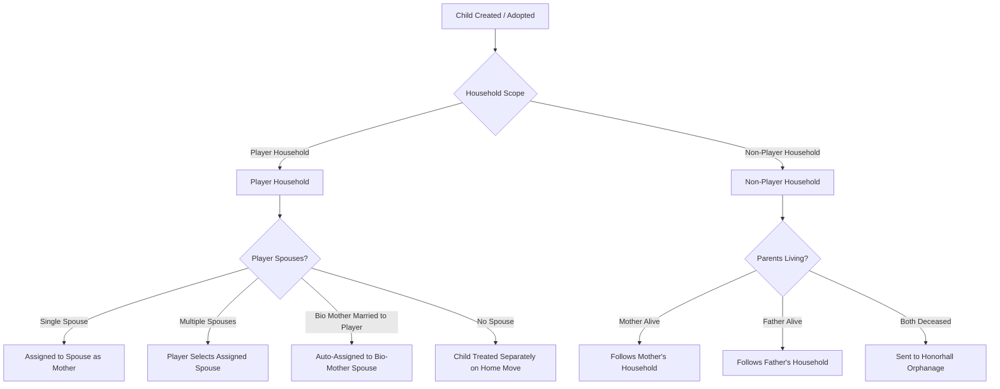
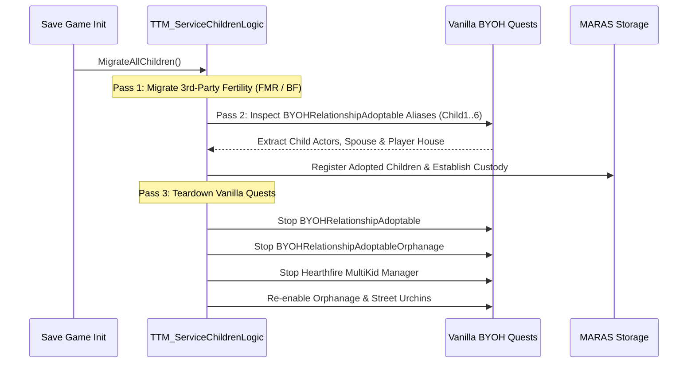

# M.A.R.A.S. Children Architecture & Fertility Integration Specification

This document provides a comprehensive technical reference for the child management architecture in **M.A.R.A.S.**, encompassing vanilla adoption, household hierarchy, custody mechanics, paternity secrets, and deep integration with fertility frameworks like **Fertility Mode Reloaded (FMR)** (and upcoming support for **Beeing Female NG**).

---

## 1. M.A.R.A.S. Core Children Architecture

M.A.R.A.S. replaces Skyrim's hardcoded and brittle Hearthfire adoption system with an extensible, high-capacity children framework that works seamlessly with:
1. **Vanilla Adoptable Children**: Street urchins (Sofie, Alesan, Lucia, Blaise), Honorhall Orphanage children, and adoptable NPCs from modded quests.
2. **Modded Fertility Children**: Biological children generated by fertility engines such as **Fertility Mode Reloaded (FMR v1.0.7+)** and **Beeing Female NG (BF v3.6.4+)**.

### 1.1 Unlimited Capacity & Ephemeral vs. Physical Actors
Unlike vanilla Skyrim (capped at 2 children) or Hearthfire Multiple Adoptions (capped at 6), M.A.R.A.S. supports an **unlimited number of children** across the province.

To achieve this without degrading game performance or crashing the Havok/Papyrus runtime, children in M.A.R.A.S. are divided into two physical states:

| Child State | Description | Representation in Game |
|---|---|---|
| **Ephemeral Children** | Children registered as data records within the SKSE co-save. They have full biological parentage, age tracking, racial attributes, and emotional ties. | Visible in the Prisma UI Dashboard, fully recognized by SkyrimNet AI Prompts, but exist **without a physical 3D actor in the world**. |
| **Real Spawned Actors** | Physical 3D child NPCs in the game world (either young vanilla children living in homes or grown-up adult followers). | Physically present in homes, sandboxing, playing games, or following the player across Skyrim. |

When an ephemeral child is adopted into a home or spawned into the world, M.A.R.A.S. re-keys and binds the physical `Actor` to the pre-existing synthetic record.

---

## 2. Household Hierarchy & Child Categorization

M.A.R.A.S. divides all children into two primary operational groups:
1. **Player Household Children**
2. **Non-Player Household Children**



### 2.1 Player Household Children
Children residing within the player's domestic sphere integrate directly with M.A.R.A.S.'s spouse hierarchy and home assignment system:

- **Spouse-to-Child Assignment**:
  - If the player is married to a single spouse, children are automatically assigned to that spouse as their maternal/custodial figure.
  - If the player has **multiple spouses** (polygamy enabled), the player can choose which spouse is assigned custody over the child.
  - **Biological Priority**: If a child was biologically born to a modded female partner who is married to the player, the child is **automatically assigned to their biological mother spouse**.
  - **Unmarried Players**: If the player has no spouse, each child is managed independently when assigned to a player house.
- **Vanilla Parity & Behaviors**: Player household children retain full parity with vanilla child routines: they ask for allowances, receive gifts, play games (tag, hide-and-seek), perform household chores, and trigger greeting scenes when the player returns home.
- **Independent Critters & Pets (No Vanilla Bottlenecks)**:
  - In vanilla Skyrim, a household can only have **1 critter** (hare, fox, mudcrab, skeever) and **1 pet** (dog) shared across all children.
  - In M.A.R.A.S., **each child can have 1 critter and 1 pet** independently ([`MARAS.AssignChildCritter()`](file:///e:/Skyrim/development/mods/M.A.R.A.S%20Dev/SKSE_Source/src/papyrus/PapyrusChildren.cpp) and [`MARAS.AssignChildPet()`](file:///e:/Skyrim/development/mods/M.A.R.A.S%20Dev/SKSE_Source/src/papyrus/PapyrusChildren.cpp)).
- **Spouse House Assignment Constraints**:
  - If a spouse has a child assigned to them, that spouse **must be assigned to a house and cannot be relieved** of their residential duty.
  - *Hang-Out Toggle*: The player can uncheck the spouse's "Hang Out in House" setting in M.A.R.A.S., which frees the spouse to follow their normal default external AI packages (e.g., store tending or adventuring) while remaining the child's legal custodial parent.
- **Performance & Overcrowding Safeguards**:
  - While M.A.R.A.S. supports unlimited actors theoretically, players should avoid stacking excessive numbers of actors in one interior cell (e.g., 30 children, 20 spouses, 30 critters, and 30 pets in Breezehome will overload the Skyrim actor processing engine).
  - **Detailed Routine Cap (20 Children per House)**: Only up to **20 children per house** are pulled into active sandbox quest aliases ([`TTM_ChildreSandboxQst`](file:///e:/Skyrim/development/mods/M.A.R.A.S%20Dev/Scripts/Source/TTM_ServiceChildrenLogic.psc#L1058-L1076)) for detailed forcegreets, chore events, and gift sequences. Any children beyond the 20-actor threshold fall back to standard interior sandboxing packages.

### 2.2 Non-Player Household Children
Spawned children belonging to NPC couples operate under realistic custody routines:
- They reside with and follow their **mother** by default, or their **father** if the mother is absent.
- **Orphanage Fallback**: If both biological parents are killed, orphaned NPC children automatically relocate to **Honorhall Orphanage** in Riften, becoming eligible for future adoption by the player.

---

## 3. Marriage, Divorce & Custody Policies

Custody management in M.A.R.A.S. is handled via [`NPCRelationshipManager::EvaluateChildCustodyOnDivorce()`](file:///e:/Skyrim/development/mods/M.A.R.A.S%20Dev/SKSE_Source/src/core/NPCRelationshipManager_Children.cpp#L602-L797), operating under configurable gameplay rules:

1. **Biological Parent Priority** (`childCustodyPrioritizeBioParent`):
   - If one spouse is a biological parent and the other is an adoptive stepparent, custody is automatically awarded to the biological parent.
2. **Player Custody Override** (`childCustodyPlayerPolicy`):
   - When the player divorces a spouse, the player policy can be set to `AlwaysWithPlayer`, `NeverWithPlayer`, or `UseGenderPolicy`.
3. **Gender Custody Policy** (`childCustodyGenderPolicy`):
   - For opposite-sex couples where biological priority does not resolve custody, custody follows the configured policy: `StayWithMother` (default) or `StayWithFather`.
4. **Same-Sex Couple Rule**:
   - For couples of matching sex without a biological differentiator, custody is awarded via a fair **50/50 coin flip**.

---

## 4. Native Paternity Secrets & Intrigue System

A child born naturally possesses a **Paternity Secret** whenever the biological sire does not match the mother's primary partner (`bioFatherID != presumedFatherID`).

```
                    ┌────────────────────────────────────────┐
                    │      Conception: Bio Father !=         │
                    │      Mother's Current Partner          │
                    └──────────────────┬─────────────────────┘
                                       │
                        Creates Paternity Secret:
                        • isSecretForPartner = true
                        • isSecretForBioFather = true
                                       │
                 ┌─────────────────────┴─────────────────────┐
                 │                                           │
         Daily Discovery Roll                        SkyrimNet AI Action
   Base chance + (Age * Daily Growth)              Mother Confesses OR Father
   (Accelerated for Phenotype Mismatch)             Investigates & Figures Out
                 │                                           │
                 └─────────────────────┬─────────────────────┘
                                       │
                          ┌────────────┴────────────┐
                          ▼                         ▼
                  [Partner Forgives]       [Partner Divorces]
                     Remains with          Custody evaluated;
                      Household            Partner leaves
                                                    │
                                           Bio-Father Step-In:
                                         Evaluates if bio-father
                                         steps in & marries mother
```

### 4.1 Inception & Secrecy Flags
- `isSecret = true`
- `isSecretForPartner = true` (partner unaware)
- `isSecretForBioFather = true` (bio-father unaware)
- `hasPhenotypeMismatch = true` (evaluated when distinct racial phenotypes exist between presumed father and bio-father).

### 4.2 Discovery Progression: SkyrimNet vs. Non-SkyrimNet
- **Daily Scaling**: With each passing day, discovery probability for born children increases:
  $$\text{Chance} = \text{Base} + (\text{Age} \times \text{DailyGrowth})$$
  *(accelerated substantially if racial phenotype mismatch is present)*.
- **SkyrimNet AI**:
  - Mother can confess to either father via dialogue.
  - Presumed or bio-father can investigate using SkyrimNet action YAMLs (`DiscoverChildPaternity`, `RevealChildSecret`).
  - When daily rolls succeed, an LLM evaluation ([`maras_paternity_evaluation`](file:///e:/Skyrim/development/mods/M.A.R.A.S%20Dev/SKSE_Source/src/core/SkyrimNetIntegration.cpp#L2387)) determines how the partner reacts (`"none"`, `"divorce"`, `"breakup"`).
- **Non-SkyrimNet Fallback**: Uses background dice rolls against `paternityNonSkyrimNetRevealChance` and `paternityBreakupChance`.

### 4.3 Bio-Father Step-In & Remarriage Prevention
If the presumed father leaves (divorces the mother) following discovery:
1. MARAS queues a **Step-In Evaluation** via [`EvaluateBioFatherStepIn()`](file:///e:/Skyrim/development/mods/M.A.R.A.S%20Dev/SKSE_Source/src/core/NPCRelationshipManager_Fertility.cpp#L39-L204).
2. **Loop Prevention Check**: The candidate pool explicitly excludes any biological father who is divorced from the mother ([`IsMostRecentRelationshipDivorced`](file:///e:/Skyrim/development/mods/M.A.R.A.S%20Dev/SKSE_Source/src/core/NPCRelationshipManager.cpp#L661-L674)), preventing infinite divorce/remarriage cycling.
3. If evaluated positively (via SkyrimNet LLM or non-SkyrimNet `paternityBioStepUpChance`), MARAS automatically marries the biological father to the mother ([`ApplyBioFatherStepIn()`](file:///e:/Skyrim/development/mods/M.A.R.A.S%20Dev/SKSE_Source/src/core/NPCRelationshipManager_Fertility.cpp#L15-L37)) and transfers household guardianship to him.

### 4.4 Partner Secret Resolution on Divorce
If the mother and her partner divorce for **any reason** (e.g. player divorce, infidelity, low affection), any active partner-side paternity secrets (`isSecretForPartner`) for their born or unborn children are **immediately resolved** (emitting `maras_paternity_secret_resolved` with `"divorce_revealed"` while preserving `isSecretForBioFather` if the biological father is still unaware), and the bio-father step-in check triggers right away.

---

## 5. Vanilla Adopted Children Migration

When initializing M.A.R.A.S. on an ongoing save, [`TTM_ServiceChildrenLogic.MigrateAllChildren()`](file:///e:/Skyrim/development/mods/M.A.R.A.S%20Dev/Scripts/Source/TTM_ServiceChildrenLogic.psc#L1103-L1200) executes a multi-pass migration to take full ownership of adopted children:



1. **Pass 1: 3rd-Party Fertility Migration**: Runs the one-time FMR migration ([`TTM_ServiceFertilityFMR.Migrate()`](file:///e:/Skyrim/development/mods/M.A.R.A.S%20Dev/Scripts/Source/TTM_ServiceFertilityFMR.psc)) or the one-time Beeing Female migration ([`TTM_ServiceFertilityBF.Migrate()`](file:///e:/Skyrim/development/mods/M.A.R.A.S%20Dev/Scripts/Source/TTM_ServiceFertilityBF.psc), see section 7).
2. **Pass 2: Adoption Extraction**:
   - Inspects running vanilla aliases (`BYOHRelationshipAdoptable` Child1–Child2, or Child1–Child6 if Hearthfire Multi-Kid is present).
   - Extracts existing adopted child actors, the player's co-adopting spouse, and the assigned player home.
   - Registers each child into M.A.R.A.S. household storage via [`AdoptChild(childActor, isMigrating = true)`](file:///e:/Skyrim/development/mods/M.A.R.A.S%20Dev/Scripts/Source/TTM_ServiceChildrenLogic.psc), which suppresses spurious adoption affection bonuses (+27), achievements, and ModEvent broadcasts during save game migration.
3. **Pass 3: Teardown & Re-enabling**:
   - Resets and stops the vanilla `BYOHRelationshipAdoptable`, `BYOHRelationshipAdoptableOrphanage`, and `BYOHRelationshipAdoptableUrchins` manager quests.
   - Stops and removes Hearthfire Multi-Kid custom home manager spells and scripts.
   - Re-enables all remaining street urchins (Sofie, Alesan, Lucia, Blaise) and orphanage orphans, bringing them under M.A.R.A.S. adoption logic.

---

## 6. Fertility Mode Reloaded (FMR v1.0.7+) Integration Specifics

> [!IMPORTANT]
> **Version Requirement:** M.A.R.A.S requires **Fertility Mode Reloaded v1.0.7 or higher**. Older builds lack required ModEvents (`FMR_ChildSpawned`, `FMR_ChildGrewUpNpcNpc`, `FMR_AdultChildSpawned`) and data structures necessary for synthetic record re-keying.

### 6.1 Clean Lifecycle Scope
M.A.R.A.S. deliberately avoids duplicating FMR's internal mechanics (menstrual cycles, ovulation schedules, sperm count arrays, or hygiene/washing). It registers strictly for FMR's child development lifecycle ModEvents:

| FMR ModEvent | Parameters | M.A.R.A.S. Handler Action |
|---|---|---|
| `FMR_Conception` | `akMother, akFather, iTrackingIndex` | Registers Unborn child record; sets bio-father & presumed father; initializes paternity secret if sire $\neq$ partner. |
| `FMR_BabyBirth` | `akMother, akFather, iTrackingIndex` | Promotes Unborn record to **Stage 1 (`Infant`)** named `"Newborn"`. |
| `FMR_Abort` / `FMR_PregnancyCancelled` | `akMother, akFather, iTrackingIndex` | Removes Unborn record; notifies SkyrimNet AI of pregnancy loss. |
| `FMR_ChildGrewUpNpcNpc` | `akMother, akFather` | Generates lore-friendly racial name; promotes to **Stage 2 (`Child`)** as an **ephemeral child** belonging to NPC couple. |
| `FMR_ChildGrewUp` | `childIndex, childName, gender, akMother` | Applies player-chosen name; promotes to **Stage 2 (`Child`)** as an ephemeral child scoped to mother. |
| `FMR_ChildSpawned` | `childActor, childIndex, childName` | Re-keys physical `Actor` to existing ephemeral record, linking 3D child with full lineage. |
| `FMR_ChildSentToTraining` | `childIndex, childName, trainingLoc, class` | Moves child to **Stage 3 (`Training`)**; stores guild training location. |
| `FMR_AdultChildSpawned` | `adultActor, childIndex, childName` | Promotes child to **Stage 4 (`Adult`)**; binds adult follower actor in dashboard and registers lineage with SkyrimNet AI. |

### 6.2 FMR Save Game Migration Heuristics
When migrating from an existing FMR installation ([`TTM_ServiceFertilityFMR.Migrate()`](file:///e:/Skyrim/development/mods/M.A.R.A.S%20Dev/Scripts/Source/TTM_ServiceFertilityFMR.psc#L302-L432)):
- **FMR Storage Caps**: FMR stores only the single most recent birth (`LastBirth`, `LastFatherRef`) and active pregnancies/carried babies. Historical births from earlier in the playthrough that FMR already cleared cannot be retroactively recovered.
- **Player Child Mother Resolution**:
  - In FMR, `PlayerChildName[]` stores child names and training statuses, but does *not* record which mother gave birth to which child.
  - M.A.R.A.S. gathers candidate mothers from `TrackedActors` where `LastFatherRef == player` or married to the player, sorted chronologically by `LastBirth` ascending.
  - Children are matched sequentially from newest to oldest against the sorted mother list. If births were interleaved (e.g. Mother A, Mother B, Mother A, Mother C), M.A.R.A.S. resolves them sequentially, grouping them by mother (`Mother A, Mother A, Mother B, Mother C`).
- **NPC-NPC Lore Names**: Unnamed NPC babies saved from FMR receive a procedurally generated name via [`TTM_Utils.GetChildNameByParents()`](file:///e:/Skyrim/development/mods/M.A.R.A.S%20Dev/Scripts/Source/TTM_Utils.psc), taking race and gender into account.

---

## 7. Beeing Female NG (v3.6.4+) Integration Specifics

> [!IMPORTANT]
> **Version Requirement:** M.A.R.A.S requires **Beeing Female NG v3.6.4 or higher**. Earlier builds do not provide the necessary ModEvents (`BeeingFemaleConception`, `BeeingFemaleLabor`, `BeeingFemaleBirth`, `BeeingFemaleChildSpawned`, `BeeingFemaleAdultChildSpawned`) or event parameter structures for clean lifecycle handoff.

M.A.R.A.S. integrates [`TTM_ServiceFertilityBF`](file:///e:/Skyrim/development/mods/M.A.R.A.S%20Dev/Scripts/Source/TTM_ServiceFertilityBF.psc) with Beeing Female NG (BF) **purely through BF's ModEvents**. There is no polling or periodic sync: after the one-time migration (7.3) every change reaches M.A.R.A.S. as an event. Beeing Female keeps doing what it is good at (scaling and growing children, stats, adult graduation); **M.A.R.A.S. owns the child's behavior** (7.4).

### 7.1 Lifecycle Events

| BF ModEvent | Parameters | M.A.R.A.S. Handler Action |
|---|---|---|
| `BeeingFemaleConception` | `mother, childCount, father0..2` | Registers one **Unborn** record **per fetus**, each with its own bio father read from `FW.ChildFather`. The bio-father step-in is evaluated once, after the last fetus is registered, so every father is a candidate. |
| `BeeingFemaleLabor` | `mother, childCount, father0..2` | SkyrimNet labor notification; starts a fresh birth batch. |
| `BeeingFemaleBirth` | `mother, father, baby, name, sex` | Fired once per child that reached the world. Promotes the **one** unborn child fathered by `father` to **Stage 1 (`Infant`)** with the given name and sex (`-1` = unknown). BF delivers fetuses in reverse order, so the match is by father. If Baby NTR replaced a father without any event, the first unborn record is corrected to the real father first. When no unborn record is left the batch is announced as one birth message (including multi-father twins). |
| `BeeingFemaleChildSpawned` | `mother, father, child, name` | A child is physically in the world (a carried baby that finished growing, or a baby born straight as an actor). The Infant becomes a **Stage 2 (`Child`)** bound to that actor and BF's behavior is taken over (7.4). |
| `BeeingFemaleAdultChildSpawned` | `mother, father, adult, child, name` | The child record moves to the adult actor at **Stage 4 (`Adult`)** (`child` equals `adult` when it graduated in place). The old household entry is released and the adult never receives child factions or packages. |
| `BeeingFemaleAbort` | `mother, father, abortusState, reason` | The pregnancy ended in loss (`abortion`, `miscarriage`, `stillbirth` for a missed abortion): all unborn records of the mother are removed. |
| `BeeingFemaleStillbirth` | `mother, father` | One child was lost to the stillbirth roll at delivery: only the unborn child fathered by `father` is removed; the siblings are still announced. |
| `BeeingFemale` (`stateChanged`) | `numArg` = the woman's FormID | When she reaches the postpartum state with unborn records left, BF never reported those children (baby gem, NPC babies disabled): they become Infants with a generated name and unknown sex. |

### 7.2 Multi-Child, Multi-Father Pregnancies
BF can carry up to 12 fetuses from different fathers in one pregnancy. M.A.R.A.S. keeps one record per fetus with its own bio father and paternity secret, and birth and stillbirth events always address the record by father. Twins from different fathers are announced as a single superfecundation birth message.

> [!NOTE]
> Beeing Female replaces a father silently on Baby NTR (`FW.ChildFather` changes, no event). M.A.R.A.S. only notices at birth, when the event's father does not match any unborn record.

### 7.3 One-Time Migration (`TTM_ServiceFertilityBF.Migrate()`)
Run from `TTM_ServiceChildrenLogic.MigrateAllChildren()` the first time M.A.R.A.S. loads with `BeeingFemale.esm` present (guarded by `MARAS_BF_Migrated`). It imports whatever Beeing Female already holds:
1. **Dialogue quests**: stops the two Beeing Female child dialogue quests (see 7.4).
2. **Active pregnancies** (trimesters 1-3 and labor, every tracked mother plus the player): one unborn child per fetus with its own father.
3. **Carried baby items**: each becomes an Infant with its recorded name, sex, father and birth day.
4. **Physical child actors** (`FW.Babys`): registered at Stage 2 (or Stage 4 when already grown up) with their recorded mother and father, and taken over (7.4).
5. **Births that left nothing behind**: Beeing Female records only a father and a time per birth (`FW.BornChildFather/Time`), so only NPC-NPC births are reconstructed, and only as many as no item or child actor accounts for. Children that were dismissed or died before M.A.R.A.S. was installed cannot be told apart from such births, so a few may be re-created as Infants.

### 7.4 M.A.R.A.S. Owns Child Behavior
Beeing Female controls children with an actor value (`JumpingBonus`) read by packages on the shared base NPCs, plus two dialogue quests. M.A.R.A.S. takes over without modifying Beeing Female:
- **Packages**: registered children go through `PackageOverrideService`, which replaces the winning package in the engine, so Beeing Female's packages never run.
- **Teammate / follower state**: at every adoption (birth, hatch, migration) M.A.R.A.S. clears the player-teammate flag and the vanilla follower faction and stores order 11 ("go home") in `FW.Child.Order`, so Beeing Female itself keeps the teammate flag off on every load. If another mod makes a child follow the player, the package override yields to it as it does for any follower.
- **Dialogue**: `BF_ChildDialNPCChildren` and `BF_ChildDialPlayerChildren` are stopped during migration (never reset). Beeing Female never restarts them.
- **Growth**: Beeing Female still scales the child and graduates it to an adult when its settings say so.

### 7.5 Synthetic Child Spawning
`TTM_ServiceChildrenLogic.SpawnSyntheticChild` resolves the child `ActorBase` from the per-race baby actor lists Beeing Female keeps in `StorageUtil` (`FW.AddOn.BabyActor_Female/Male` and the `...Player` variants for player children).
