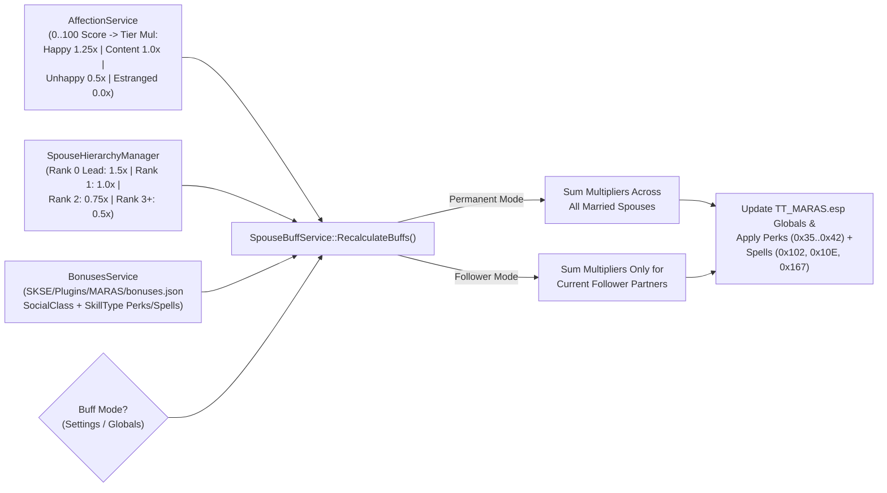
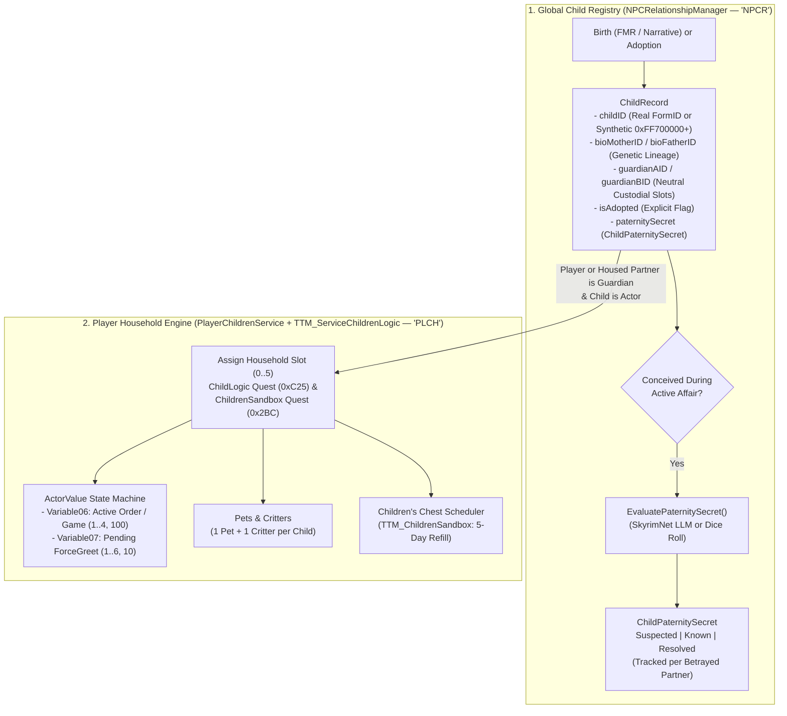

# M.A.R.A.S — Household, Hierarchy, Housing & Children Architecture

This document details the C++ and Papyrus architecture governing player households: the **Spouse Hierarchy & Buff Engine**, **Multi-Home Housing & Merchant Assets**, and the **Children, Guardianship, Paternity Secret & Sandbox System**.

---

## 1. Spouse Hierarchy & Dynamic Buff Engine

### 1.1 `SpouseHierarchyManager` (`SKSE_Source/include/core/SpouseHierarchyManager.h`)
Manages the ordered vector of married player spouses (persisted in co-save chunk `'SPHR'` and mirrored to `TT_MARAS.esp` faction `0x111` `SpouseHierarchyFaction`):
- **Ranks & Default Multipliers**:
  - **Rank 0 (`Lead Spouse`)**: `1.50x` buff multiplier (configurable in Prisma UI Settings).
  - **Rank 1 (`Second Spouse`)**: `1.00x` buff multiplier.
  - **Rank 2 (`Third Spouse`)**: `0.75x` buff multiplier.
  - **Rank 3+ (`Fourth+ Spouse`)**: `0.50x` buff multiplier.
- When a spouse is married, divorced, or marked deceased, `SpouseHierarchyManager` automatically compacts the hierarchy list, updates `SpouseHierarchyFaction` ranks on all affected actors, fires the `MARAS_HierarchyChanged` ModEvent, and triggers `SpouseBuffService`.

### 1.2 `BonusesService` & `SpouseBuffService` (`SKSE/Plugins/MARAS/bonuses.json`)
- `BonusesService` loads `SKSE/Plugins/MARAS/bonuses.json` at `kDataLoaded`, mapping each **Social Class** (`poverty`, `working`, `middle`, `wealthy`, `religious`, `nobles`, `rulers`, `outcast`) and **Skill Type** (`warrior`, `mage`, `rogue`, `craftsman`, `ranger`, `orator`) to its `TT_MARAS.esp` Perk (`0x35`–`0x42`), effect indices, scaling unit (`%` or `points`), and scaling operation (`multiply`, `add`, or `spell`).
- For each active spouse $i$, the effective contribution to their archetype bonus is:
  $$\text{EffectiveBonus}_i = \text{BaseValue} \times \text{HierarchyMultiplier}(\text{Rank}_i) \times \text{AffectionMultiplier}(\text{Tier}_i)$$
- **Additional Household Abilities**:
  - **Lover's Radiance (`TTM_LoversRadianceAbility`)**: Temporary buff applied after an intimate scene (`TTM_ServiceIntimateMoments.psc`), scaled by partner count/affection.
  - **Children's Joy (`TTM_ChildrenAbility`)**: Applied by `TTM_ServiceChildrenLogic.psc` when the player resides with or interacts positively with household children.

---

## 2. Multi-Home Housing & Spouse Assets

### 2.1 `PlayerHouseService` & `HomeCellService`
Located in `SKSE_Source/include/core/PlayerHouseService.h` and `HomeCellService.h` (persisted in chunk `'PHOU'`):
- **Vanilla, Hearthfire & Custom Mod Homes**:
  - Tracks built/purchased vanilla player homes (`Breezehome`, `Honeyside`, `Vlindrel Hall`, `Hjerim`, `Proudspire Manor`), Hearthfire manors (`Lakeview`, `Windstad`, `Heljarchen`), and **up to multiple custom interior cells** registered dynamically by the player via dialogue or Prisma UI (`RegisterCustomHouseCell`).
- **Tenant Management & Capacity**:
  - Enforces configurable per-home spouse limits.
  - Updates `SpouseHousedFaction` (`0x6C`), `SharedHouseFaction` (`0x7B`, when $\ge 2$ partners share the same home), and `NoInitialHouseFaction` (`0x7F`).
  - Assigns the spouse to one of the 9 **Housed Spouse Merchant Factions** (`0xC0C`–`0xC14` in `TT_MARAS.esp`) based on their Social Class and Skill Type, giving housed spouses a working vendor chest and barter inventory.
  - Sets the spouse's persistence location / `LinkedRef` marker so `TTM_HouseSpouseSandboxMulti` (`0x6A`) sandboxes naturally inside the assigned home.

### 2.2 `SpouseAssetsService` (`SKSE_Source/include/core/SpouseAssetsService.h`)
Persisted in co-save chunk `'SPAS'`:
- Tracks per-spouse accumulated store gold (`homeShare`) generated daily based on the spouse's **Social Class** (`Poverty` through `Rulers`), scaled by their **Hierarchy Rank** and **Affection Tier**.
- Manages daily cooldowns for spouse-provided meals and archetype-specific crafted/gathered items (`TTM_ServiceSpouseAssets.psc`).

---

## 3. Children, Guardianship, Paternity Secrets & Sandbox System

M.A.R.A.S implements a dual-layer child architecture:
1. **Global Child & Lineage Registry (`NPCRelationshipManager` — Chunk `'NPCR'`)**: Tracks every biological and adopted child across all NPCs and the player, including abstract/pre-spawned children and paternity secrets.
2. **Player Household Child Engine (`PlayerChildrenService` + `TTM_ServiceChildrenLogic.psc` — Chunks `'PLCH'`, `'CFSN'`)**: Manages up to **6 active household children** living in the player's home, including beds, chests, pets, critters, orders, games, and forcegreets.

### 3.1 Strict Guardian, Bio-Parent & Adoption Semantics
Per project architecture rules, `ChildRecord` strictly separates genetic lineage, legal custody, and adoption:
- **`bioMotherID` / `bioFatherID`**: Genetic parents only. Populated at birth (e.g., via [FERTILITY_MODE_RELOADED_INTEGRATION.md](file:///e:/Skyrim/development/mods/M.A.R.A.S%20Dev/docs/modder/FERTILITY_MODE_RELOADED_INTEGRATION.md)). Never conflated with custodial guardians.
- **`guardianAID` / `guardianBID`**: **Strictly gender-neutral custodial slots**. Slot `A` and Slot `B` are completely interchangeable—code never infers maternal or paternal roles from slot position. Both slots can be populated simultaneously (e.g., player + spouse, or two NPC partners).
- **`isAdopted`**: Explicit boolean flag set **only** when a child goes through an adoption flow. Never inferred from the presence, absence, or count of guardians or biological parents.
- **Adoption Eligibility & Quest Blocking (`IsChildBlockedFromAdoption`)**:
  - Certain children are quest-locked by Skyrim's engine and story manager. Specifically, **Aventus Aretino** (`0x1B121` / base `0x14132`) is blocked from adoption during the Dark Brotherhood first quest **Innocence Lost** (`DB01`, `0x1EA50`) while it is active and incomplete.
  - C++ enforcement guards both `NPCRelationshipManager::RegisterChildActor` and `PrismaUIDataBridge::ProcessAddChild`, preventing adoption by player or NPC-NPC couples.
  - In Prisma UI, blocked children display a `Blocked` status badge with a tooltip/banner explaining why (*"Performing the Black Sacrament (Innocence Lost in progress)"*) and have their adoption buttons disabled.
- **Synthetic Child FormIDs (`0xFF700000`–`0xFF7FFFFF`)**:
  - When a biological child is born via FMR or narrative events without an immediate physical child `RE::Actor` in the world, `NPCRelationshipManager::AllocateSyntheticChildId()` assigns a unique ID in the `0xFF700000+` range and generates an appropriate name via `NameService` (`SKSE/Plugins/MARAS/childrenNames.json` by race/sex).
  - If a physical child actor is later spawned/linked, `ReplaceChildId(syntheticID, realActorFormID)` seamlessly migrates the `ChildRecord`, guardian links, and paternity secrets to the real actor.

### 3.2 Paternity Secrets (`ChildPaternitySecret`)
When a mother conceives a child with a third-party paramour while in a committed relationship (`Married`, `Engaged`, `Lover`, `Dating`) with another partner:
- `EvaluatePaternitySecret(childID)` determines whether the mother conceals the true father (`trueFatherID`) and leads the betrayed partner (`deceivedPartnerID`) to believe the child is theirs.
- **Discovery & Resolution States**:
  - `Hidden` $\rightarrow$ `Suspected` $\rightarrow$ `Known` (`DiscoverChildPaternity` / `RevealChildSecret` SkyrimNet actions or Prisma UI/dialogue exposure) $\rightarrow$ `Resolved`.
  - Discovering paternity deception triggers heavy affection penalties and `ttm_paternity_discovered` / `ttm_paternity_secret_revealed` narrative events.

### 3.3 Household Children Behavior (`PlayerChildrenService` & `TTM_ServiceChildrenLogic.psc`)
Up to 6 physical child actors in the player's household are bound to aliases on `ChildLogic` (`0xC25`) and `ChildrenSandbox` (`0x2BC`):

#### ActorValue-Driven Package Conditioning (`TT_MARAS.esp`)
To allow Creation Kit AI packages on the quest aliases to switch behaviors instantaneously without polling scripts:
- **`Variable06` (Child Orders & Active Games)**:
  - `0` = Normal daily schedule (sandbox inside/outside depending on `GameHour`; reset automatically by `TTM_ChildrenPackages.psc` when `GameHour < 16`).
  - `1` = Ordered inside (`order_inside_accept`).
  - `2` = Ordered to bed (`order_bed_accept` / `game_bedtime`).
  - `3` = Ordered outside to play (`order_outside_accept`).
  - `4` = Ordered to do chores (`order_chores_accept`).
  - `100` = Actively playing Tag or Hide-and-Seek with the player (`StartGame`).
- **`Variable07` (ForceGreet Event Queue)**:
  - `0` = No pending forcegreet.
  - `1` = Ask for allowance (`allowance_topic`).
  - `2` = Present a gift to the player (`gift_topic`).
  - `3` = Show off items collected in the child's chest (`chest`).
  - `4` = Ask to keep a captured critter (`critter_topic`, named via `critterNames.json`).
  - `5` = Ask to keep a stray/follower pet (`pet_topic`).
  - `6` = Ask the player to play a game (`game_ask`).
  - `10` = Pet bailout / scared of aggressive pet (`pet_bailout`).
- **Faction Snapshot & Clean Removal (`'CFSN'`)**:
  - Before `PlayerChildrenService` adds a child to `PlayerChildFaction` (`0xC23`), it snapshots the child's original factions and ranks into chunk `'CFSN'`. If a child is ever removed/unadopted via Prisma UI or script, their original factions are restored cleanly.

