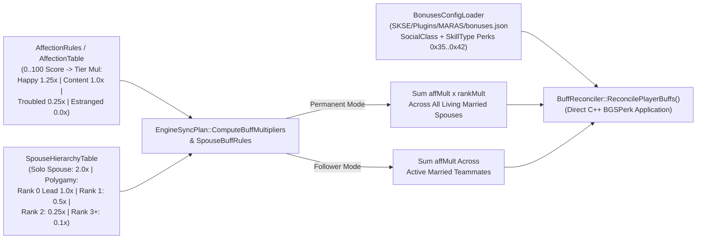
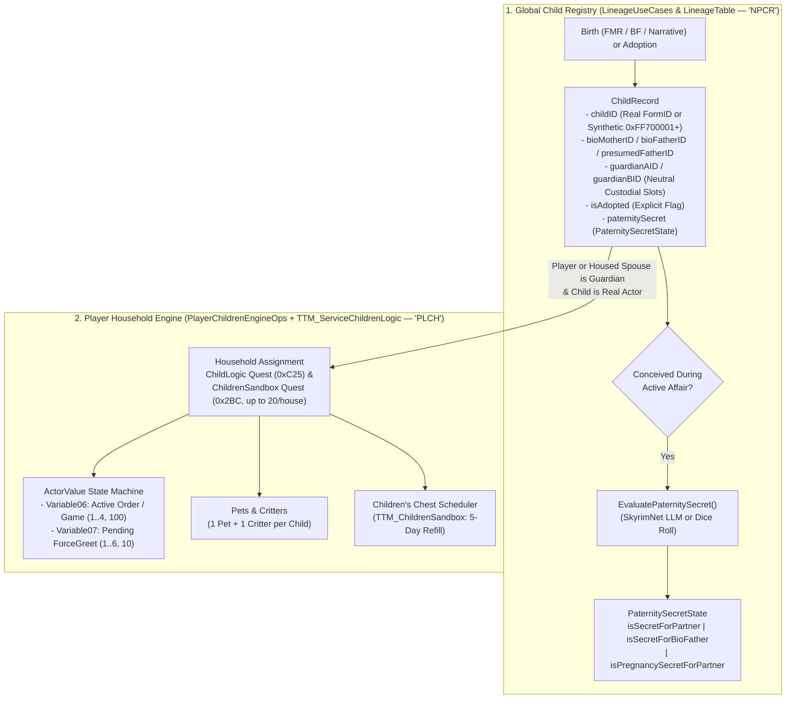

# M.A.R.A.S — Household, Hierarchy, Housing & Children Architecture

This document details the C++ and Papyrus architecture governing player households: the **Spouse Hierarchy & Buff Engine**, **Multi-Home Housing & Merchant Assets**, and the **Children, Guardianship, Paternity Secret & Sandbox System**.

---

## 1. Spouse Hierarchy & Dynamic Buff Engine

### 1.1 Spouse Hierarchy ([`RelationshipUseCases`](services/RelationshipUseCases.md) & `SpouseHierarchyTable`)
Located across [`WorldTables.h`](../../SKSE_Source/modules/state/include/maras/state/WorldTables.h), [`SpouseHierarchyRules.h`](../../SKSE_Source/modules/domain_relationships/include/maras/domain/relationships/SpouseHierarchyRules.h), and [`RelationshipUseCases.h`](../../SKSE_Source/modules/app/include/maras/app/RelationshipUseCases.h), this subsystem manages the ordered list of married player spouses (persisted in co-save chunk `'SPHR'` and mirrored to `TT_MARAS.esp` faction `0x111` `SpouseHierarchyFaction` for Ranks `0..2`, absent for `3+`):
- **Ranks & Multiplier Formula (`EngineSyncPlan::ComputeHierarchyRankMultiplier`)**:
  - **Single Living Spouse (`marriedSpouseCount == 1`)**: `2.00x` solo spouse multiplier regardless of rank index.
  - **Polygamous Household (`marriedSpouseCount >= 2`)**:
    - **Rank 0 (`Lead Spouse`)**: `1.00x` buff multiplier.
    - **Rank 1 (`Second Spouse`)**: `0.50x` buff multiplier.
    - **Rank 2 (`Third Spouse`)**: `0.25x` buff multiplier.
    - **Rank 3+ (`Fourth+ Spouse`)**: `0.10x` buff multiplier (stored in `'SPHR'`, omitted from `0x111`).
- **Affection Multipliers (`EngineSyncPlan::ComputeAffectionMultiplier`)**: `Happy` ($\ge 75$) = `1.25x`, `Content` ($50\text{–}74$) = `1.00x`, `Troubled` ($25\text{–}49$) = `0.25x`, `Estranged` ($< 25$) = `0.00x`.
- When a spouse is married, divorced, or marked deceased, `RelationshipUseCases` automatically compacts the hierarchy list, triggers [`FactionReconciler`](services/FactionReconciler.md) to sync `SpouseHierarchyFaction`, fires the `maras_hierarchy_changed` ModEvent, and schedules [`BuffReconciler::ReconcilePlayerBuffs()`](services/BuffReconciler.md).

### 1.2 [`BonusesConfigLoader`](../../SKSE_Source/modules/engine/include/maras/engine/BonusesConfigLoader.h), [`SpouseBuffRules`](../../SKSE_Source/modules/domain_household/include/maras/domain/household/SpouseBuffRules.h) & [`BuffReconciler`](services/BuffReconciler.md)
- `BonusesConfigLoader` loads `SKSE/Plugins/MARAS/bonuses.json` at `kDataLoaded` (and save load), mapping each **Social Class** (`outcast`, `poverty`, `working`, `middle`, `wealthy`, `religious`, `nobles`, `rulers`) and **Skill Type** (`warrior`, `mage`, `rogue`, `craftsman`, `ranger`, `orator`) to its `TT_MARAS.esp` Perk (`0x35`–`0x42`), `effectIndex`, scaling unit (`%` or `points`), and scaling operation (`multiply`, `add`, or `spell`).
- `SpouseBuffRules` and `EngineSyncPlan::ComputeBuffMultipliers` compute category multipliers without globals:
  - **Permanent Social-Class Multiplier**: Sums $\text{ComputeAffectionMultiplier}(\text{PermAff}_i) \times \text{ComputeHierarchyRankMultiplier}(\text{Rank}_i, N_{\text{spouses}})$ across all living married spouses $i$.
  - **Follower Skill-Type Multiplier**: Sums $\text{ComputeAffectionMultiplier}(\text{PermAff}_j)$ across active married teammates $j$ tracked by [`PollingService::GetCurrentTeammates()`](services/PollingService.md).
- `BuffReconciler` evaluates `ComputeBonusTargetValue` on the main thread and updates `PlayerCharacter` perks (`0x35`–`0x42`) directly in C++ (removing inactive perks and performing at most one `RemovePerk` / `AddPerk` refresh cycle per changed perk).
- **Additional Household Abilities (Papyrus)**:
  - **Lover's Radiance (`TTM_LoversRadianceAbility`)**: Applied by `TTM_PlayerScript.psc` when the player rests/sleeps indoors with a lover or spouse at home.

---

## 2. Multi-Home Housing & Spouse Assets

### 2.1 [`HouseholdUseCases`](services/HouseholdUseCases.md), [`HomeCellDetector`](services/HomeCellDetector.md) & [`SpatialWorldIndex`](services/SpatialWorldIndex.md)
Located across [`HouseholdUseCases.h`](../../SKSE_Source/modules/app/include/maras/app/HouseholdUseCases.h), [`HouseholdRules.h`](../../SKSE_Source/modules/domain_household/include/maras/domain/household/HouseholdRules.h), [`SpatialWorldIndex.h`](../../SKSE_Source/modules/engine/include/maras/engine/SpatialWorldIndex.h), and [`BedOwnershipReconciler.h`](../../SKSE_Source/modules/engine/include/maras/engine/BedOwnershipReconciler.h) (persisted in chunk `'PHOU'`):
- **Vanilla, Hearthfire & Custom Mod Homes**:
  - Tracks built/purchased vanilla player homes (`Breezehome`, `Honeyside`, `Vlindrel Hall`, `Hjerim`, `Proudspire Manor`), Hearthfire manors (`Lakeview`, `Windstad`, `Heljarchen`), and custom interior cells registered dynamically by the player via dialogue or Prisma UI (`RegisterPlayerHouseCell`).
- **Tenant Management & Capacity**:
  - Tracks tenant assignments (`RegisterTenantInPlayerHouse` / `RemoveTenantFromPlayerHouse`) and `stayAtHome` flags.
  - Updates `SpouseHousedFaction` (`0x6C`), `SharedHouseFaction` (`0x7B`), and `NoInitialHouseFaction` (`0x7F`) via `FactionReconciler`.
  - Assigns housed spouses to one of the 9 **Housed Spouse Merchant Factions** (`0xC0C`–`0xC14` in `TT_MARAS.esp`) based on their Social Class and Skill Type, giving housed spouses a working vendor chest and barter inventory.
  - Places home markers and asserts `PackageRole::HomeSandbox` (`0x6A` via [`PackageReconciler`](services/PackageReconciler.md)) so housed partners sandbox inside the assigned home.

### 2.2 Shared Spouse Assets (`SpouseAssetRules` & `TTM_ServiceSpouseAssets.psc`)
Persisted in co-save chunk `'SPAS'` (domain rules in [`SpouseAssetRules.h`](../../SKSE_Source/modules/domain_household/include/maras/domain/household/SpouseAssetRules.h), orchestrated by [`HouseholdUseCases`](services/HouseholdUseCases.md)):
- **`ShareHouseWithPlayer` / `StopShareHouseWithPlayer`**: Grants player co-residence access to a spouse's original home cell (`'SPAS'`, interior cell tracking via `IsHouseSharedWithPlayer`, door unlocking/key gifting in `TTM_ServiceSpouseAssets.psc`).
- **Spouse Store Gold & Assets**: `TTM_ServiceRelationships.ShareIncome` awards elapsed daily spouse income (`ClampInt(diffInt * 100, 0, 500)` gold per share interval), while `TTM_ServiceSpouseAssets.psc` coordinates home-sharing checks (`TTM_CheckSpouseHomeQst`).

---

## 3. Children, Guardianship, Paternity Secrets & Sandbox System

M.A.R.A.S implements a dual-layer child architecture:
1. **Global Child & Lineage Registry ([`LineageUseCases`](services/LineageUseCases.md) — Chunk `'NPCR'`)**: Tracks every biological and adopted child across all NPCs and the player without hard count limits, including ephemeral/synthetic children (`0xFF700001..0xFF7FFFFF`) and paternity secrets.
2. **Player Household Child Engine ([`PlayerChildrenEngineOps.h`](../../SKSE_Source/modules/engine/include/maras/engine/PlayerChildrenEngineOps.h) + `TTM_ServiceChildrenLogic.psc` — Chunks `'PLCH'`, `'CFSN'`)**: Manages physical household children living in player homes—including markers, beds, chests, pets, critters, orders (`Variable06`), forcegreets (`Variable07`), and up to 20 per-house `TTM_ChildrenSandboxQst` aliases (`Child001`–`Child020` on `0x2BC`) plus `ChildLogic` (`0xC25`) dialogue/chore handlers.

### 3.1 Strict Guardian, Bio-Parent & Adoption Semantics
Per project architecture rules, `ChildRecord` strictly separates genetic lineage, legal custody, and adoption:
- **`bioMotherID` / `bioFatherID`**: Genetic parents only. Populated at birth (e.g., via [FERTILITY_MODE_RELOADED_INTEGRATION.md](FERTILITY_MODE_RELOADED_INTEGRATION.md)). Never conflated with custodial guardians.
- **`presumedFatherID`**: Lineage-level presumed father recorded when a mother conceives or gives birth while in a main-tier relationship (`Married`, `Engaged`, `Dating`) with a partner who is not the biological father (`bioFatherID != presumedFatherID`). If the couple is `Married`, the presumed father is **both** a household guardian (`guardianB`) and the presumed father; if unmarried (`Dating` or `Engaged`), the mother holds sole custody (`guardianA = mother`, `guardianB = 0`) while `presumedFatherID` tracks the deceived partner on the level of biological parents across data, Prisma UI (3-block lineage view), and SkyrimNet prompts.
  - **Dashboard Secret Visibility Mode (`SettingsData::revealSecretsInUI`, default `false`)**: Masked uniformly by [`PerspectiveView::ForDashboard`](services/PerspectiveView.md) (`!revealSecretsInUI`): for any child with an active partner paternity secret (`isSecretForPartner`), the UI presents `presumedFatherId` as `bioFatherId` and hides `presumedFatherId`, secret badges, secret pregnancy entries, unexposed `CheatingRecord`s, secret affair pairs, secret `hasBeastblood`, and deceased secrecy (`'DCS1'` extension inside `'DCSD'`, queried via [`DeceasedQueries`](services/DeceasedQueries.md)) until discovered in-game or toggled in UI.
  - **Interactive 5-Slot Parent Swapping (`updateChild` Bridge Action)**: On the Child Detail page (`ChildGuardiansSection.tsx`), clicking `Guardian A`, `Guardian B`, `Biological Mother` (filtered to females), `Biological Father` (filtered to males), or `Presumed Father` (filtered to males) opens an inline NPC selector that dispatches `updateChild` to [`PrismaUIDataBridge::ProcessUpdateChild`](services/PrismaUIDataBridge.md).
- **`guardianAID` / `guardianBID`**: **Strictly gender-neutral custodial slots**. Slot `A` and Slot `B` are completely interchangeable—code never infers maternal or paternal roles from slot position. Both slots can be populated simultaneously (e.g., player + spouse, or two NPC partners).
- **`isAdopted`**: Explicit boolean flag set **only** when a child goes through an adoption flow. Never inferred from the presence, absence, or count of guardians or biological parents.
- **Adoption Eligibility & Quest Blocking (`IsChildBlockedFromAdoption`)**:
  - Certain children are quest-locked by Skyrim's engine and story manager. Specifically, **Aventus Aretino** (`0x1B121` / base `0x14132`) is blocked from adoption during the Dark Brotherhood first quest **Innocence Lost** (`DB01`, `0x1EA50`) while it is active and incomplete.
  - C++ enforcement guards [`LineageRules::IsChildBlockedFromAdoption`](../../SKSE_Source/modules/domain_lineage/include/maras/domain/lineage/LineageRules.h), `LineageUseCases::RegisterChildActor`, and `PrismaUIDataBridge::ProcessAddChild`, preventing adoption by player or NPC-NPC couples.
  - In Prisma UI, blocked children display a `Blocked` status badge with a tooltip/banner explaining why (*"Performing the Black Sacrament (Innocence Lost in progress)"*) and have their adoption buttons disabled.
- **Synthetic Child FormIDs (`0xFF700001`–`0xFF7FFFFF`)**:
  - When a biological child is born via FMR, Beeing Female NG, or narrative events without an immediate physical child `RE::Actor` in the world, `WorldState::AllocateSyntheticChildId()` assigns a unique ID in the `0xFF700001+` range and generates an appropriate name via [`NamePoolLoader`](services/NamePoolLoader.md) (`SKSE/Plugins/MARAS/childrenNames.json` by race/sex).
  - If a physical child actor is later spawned/linked, `ReplaceChildId(syntheticID, realActorFormID)` migrates the `ChildRecord`, guardian links, and paternity secrets to the real actor.
- **Unmarried Birth Custody & Non-Player Custodial Children**:
  - When a child is born to unmarried parents (e.g., `Dating`, `Engaged`, `Lover`, or casual partners), `WorldState::ApplyBirthCustodyRules` resolves a single custodial parent (`guardianA = custodian`, `guardianB = 0`) using `WorldState::ResolveSingleCustodian` (`childCustodyPrioritizeBioParent`, `childCustodyPlayerPolicy`, `childCustodyGenderPolicy`).
  - Only children where the Player (or a married spouse of the Player) holds custodial guardianship (`guardianA` or `guardianB`) are enrolled in `PlayerChildrenEngineOps` and assigned to a `LocTypePlayerHouse`. Children in an unmarried or divorced NPC's sole custody are assigned `TTM_Children_NotPlayer` (`0x377`) and linked via `TTM_ChildrenFollowParent` (`0x376`, `PackageRole::NonPlayerChild` in `PackageReconciler`) to follow and sandbox around their custodial NPC parent. If the Player later marries the custodial parent, `LineageUseCases::EvaluateChildCustodyOnMarriage` automatically brings the child into the Player's household (routing already-spawned physical Stage-2 children through `TTM_ServiceChildrenLogic.AdoptChildGlobal` so the Choose Home modal prompts when the spouse is unhoused and relocates both the child and the spouse with `stayAtHome = false`).

### 3.2 Paternity Secrets ([`PaternityWorkflowCoordinator`](services/PaternityWorkflowCoordinator.md))
When a mother conceives a child with a third-party paramour while in a committed relationship (`Married`, `Engaged`, `Lover`, `Dating`) with another partner:
- `PaternityWorkflowCoordinator::EvaluatePaternitySecret(childID)` tracks audience-split secrecy via `PaternitySecretState`: `isPregnancySecretForPartner` (unannounced womb phase), `isSecretForPartner` (betrayed partner unaware of true sire), and `isSecretForBioFather` (biological sire unaware of child/parentage).
- **Discovery & Resolution States**:
  - `Hidden` / `Active` $\rightarrow$ revealed via daily roll (`CheckPaternitySecretsDailyTick`) or SkyrimNet AI (`DiscoverChildPaternity`, `RevealChildSecret`) $\rightarrow$ partner reaction (`none`, `divorce`, `breakup`).
  - Revealing pregnancy or true paternity updates the partner/bio-father flags independently (`ResolvePaternitySecretForPartner`, `ResolvePaternitySecretForBioFather`, `ResolvePaternitySecret`), applies betrayal affection penalties, and dispatches `maras_paternity_secret_resolved` (ModEvent) / `ttm_paternity_secret_resolved` (SkyrimNet). While `isSecretForBioFather` remains `true`, child birth/growth/training/adulthood narrative events are masked from the unaware biological father (`PerspectiveView`).

### 3.3 Household Children Behavior (`PlayerChildrenEngineOps` & `TTM_ServiceChildrenLogic.psc`)
Physical child actors in the player's household are managed via `ChildLogic` (`0xC25`) and `ChildrenSandbox` (`0x2BC`, up to 20 per house):

#### ActorValue-Driven Package Conditioning (`TT_MARAS.esp`)
To allow Creation Kit AI packages on the quest aliases to switch behaviors instantaneously without polling scripts:
- **`Variable06` (Child Orders & Active Games)**:
  - `0` = Normal daily schedule (sandbox inside/outside depending on `GameHour`; reset automatically by `TTM_ChildrenPackages.psc` when `GameHour < 16`).
  - `1` = Ordered inside (`order_inside_accept`).
  - `2` = Ordered to bed (`order_bed_accept` / `game_bedtime`).
  - `3` = Ordered outside to play (`order_outside_accept`).
  - `4` = Ordered to do chores (`order_chores_accept`).
  - `100` = Actively playing Tag or Hide-and-Seek with the player (`StartGame`).
- **`Variable07` (ForceGreet Event Queue)**:
  - `0` = No pending forcegreet.
  - `1` = Ask for allowance (`allowance_topic`).
  - `2` = Present a gift to the player (`gift_topic`).
  - `3` = Show off items collected in the child's chest (`chest`).
  - `4` = Ask to keep a captured critter (`critter_topic`, named via `critterNames.json`).
  - `5` = Ask to keep a stray/follower pet (`pet_topic`).
  - `6` = Ask the player to play a game (`game_ask`).
  - `10` = Pet bailout / scared of aggressive pet (`pet_bailout`).
- **Faction Snapshot & Clean Removal (`'CFSN'`)**:
  - Before `PlayerChildrenEngineOps::SnapshotChildFactions` adds a child to `PlayerChildFaction` (`0xC23`), it snapshots the child's original factions and ranks into chunk `'CFSN'`. If a child is ever removed/unadopted via Prisma UI or script, `RestoreChildFactions` restores their original factions cleanly.
- **Adolescent Training & Adult Offspring Lifecycle (Stages 2–4)**:
  - Both ephemeral and physically spawned Stage 2 (`Child`) records can be sent to Stage 3 (`Training`) via [`LineageUseCases::SendChildToTraining`](services/LineageUseCases.md)`(childID, trainingClassIndex)` across 22 built-in training paths (`0..21` in `SKSE/Plugins/MARAS/childTraining.yaml`, plus any custom `Data/SKSE/Plugins/MARAS/childTraining/*.yaml` files loaded by [`TrainingCatalogLoader`](../../SKSE_Source/modules/engine/include/maras/engine/TrainingCatalogLoader.h)), governed by `SettingsData::childTrainingDurationDays` (default `14`), `SettingsData::childTrainingCost` (default `2000`), and `SettingsData::childTrainingRequireFaction` (default `true`).
  - If the Stage 2 child is already a physical 3D actor, `SendChildToTraining` snapshots `savedBioTemplateName` (via [`SkyrimNetProfileService::GetActorBioTemplateName`](services/SkyrimNetProfileService.md)) and `savedRaceIndex`, dismisses any critter/pet, removes the young child from household child custody, disables/deletes the young child actor (`ChildSpawnService::DisableAndDeleteActor`), and re-keys the entry to a synthetic ID (`0xFF7xxxxx`).
  - Once training completes (automatically via `LineageUseCases::CheckChildrenTrainingProgress` or manually via `CompleteChildTraining`), the child enters Stage 4 (`Adult`) as an ephemeral record until spawned via `TTM_ServiceChildrenLogic.SpawnAdultChild`.
  - Physical Stage 4 (`Adult`) offspring are **independent traveling adventurers** coordinated by [`HouseholdUseCases`](services/HouseholdUseCases.md) and [`TravelRules`](services/TravelRules.md) (`AdultChildTravel` package `0xDD3` via [`PackageReconciler`](services/PackageReconciler.md)) rather than permanent house tenants: they travel to inns/taverns across Skyrim (`LocTypeInn`, ~70% weight) or visit player houses and their known parents' homes (~30% weight), stay at each reached destination for **2–4 in-game days** after arrival before picking the next location, receive `PotentialFollowerFaction` (`0x5C84D`) so they can be hired as followers, and inherit their childhood SkyrimNet `.prompt` biography (`CarryOverChildhoodBioFromDisk`).
  - **Per-Actor Visual Genetics, Lineage Snapshots & Dynamic Level-Scaled RPG Progression (`'CHD1'` & `'CHD2'` Co-Save Extensions, [`ChildGrowthAndVisuals`](services/ChildGrowthAndVisuals.md))**:
    - [`ChildVisualReconciler::InitializeAndApplyChildVisualsAndRPG`](../../SKSE_Source/modules/engine/include/maras/engine/ChildVisualReconciler.h) and `ApplyChildVisualsToActor` customize physical child actors per-reference without mutating shared static `TESNPC` records in `Fertility Mode.esm` or `BeeingFemale.esm`, re-applying 3D visuals, runtime base clones, and level-scaled stats on `kPostLoadGame`, `TESObjectLoadedEvent`, and whenever the Player levels up (`PollingService::CheckPlayerLevelChanged`):
      - **Isolated Per-Actor Runtime `TESNPC` Clone (`ChildVisualReconciler::EnsurePerActorRuntimeBase`)**: For each spawned Stage 4 adult child, `EnsurePerActorRuntimeBase` preserves the original shared `TESNPC*` in `originalAdultBases_[childID]` and attaches an isolated heap-allocated `RE::TESNPC*` clone (`clonedAdultBases_[childID]`) to `actor->data.objectReference`. The clone assigns `cloneNpc->npcClass` (`GetTrainingClass`), `cloneNpc->combatStyle` (`GetCombatStyle`), and `cloneNpc->defaultOutfit` (`GetClassOutfit`), clears `cloneNpc->sleepOutfit`, sets `cloneNpc->actorData.level = clamp(PlayerLevel, 10, 50)`, and populates `cloneNpc->playerSkills` directly without calling `AddChange`.
      1. **Stage 1 — Biological Parents at Birth (`ChildVisualReconciler::EvaluateChildBioLineageAtBirth`)**: Snapshots `entry.bioSkillBonuses[18]` (`+2` at Parent Lv 1 $\rightarrow$ `+8` at Parent Lv 50+ per parent to their 4 signature skills, or the Player's actual top 4 highest base skills), hereditary Beastblood (`ChildSpawnService::EvaluateChildBeastbloodInheritance`), per-actor 3D hair color (`UpdateHairColor`), inherited/cross-sex matched `kEyes` headpart, `kHair` and `kFacialHair` headparts (`Actor::ChangeHeadPart`), adult height scale (`SetScale` averaged from bio parents $\pm 0.03$), and 15% Health/Magicka/Stamina weight.
      2. **Stage 2 — Custodial Guardians & Daedric Lineage at Graduation (`ChildVisualReconciler::EvaluateChildGuardianLineageAtGraduation`)**: Snapshots `entry.guardianSkillBonuses[18]` (`+2` at Guardian Lv 1 $\rightarrow$ `+7` at Guardian Lv 50+ per guardian to their 4 signature skills, or the Player's actual top 4 highest base skills), snapshots `entry.daedricBlessingId`, inherits `SocialClass` from the higher-ranking guardian, syncs `SkillType` and `Temperament` to `WorldTables` actor profiles and M.A.R.A.S archetype factions, blends AI `kConfidence` / `kMorality`, and grants starting pocket gold (`25..500` gold).
      3. **Stage 3 — Guild Training (`1..5` Skill Weights) & Dynamic Player-Level Scaling (`EffectiveLevel = clamp(PlayerLevel, 10, 50)`)**: Training class skills in `childTraining.yaml` use `1..5` weights (`5 = Primary`, `4 = Secondary`, `3 = Tertiary`, `2 = Minor`, `1 = Utility`), granting `weight * (5 + 11 * levelFactor)` points (`+25` at Lv 10 $\rightarrow$ `+80` at Lv 50 for Weight 5) on top of base `15` + racial boosts + bio/guardian snapshots + Daedric bonuses. Health/Magicka/Stamina scales from a `+80` bonus pool at Lv 10 up to `+400` at Lv 50 (85% class + 15% bio parents + Daedric/Beastblood bonuses), and grants the class `spells:` and `items:` configured in `childTraining.yaml`.
      4. **Skill-Gated Adult Child Perk Progression (`ChildVisualReconciler::ApplyAdultChildPerks`)**: Evaluates the `perks:` list configured on the child's `trainingLocations` entry in `childTraining.yaml` against the child's current skills and level by reading each `RE::BGSPerk`'s `perk->data.level` and `perk->perkConditions`, deduplicates multi-rank chains (`BGSPerk::nextPerk`) so only the highest qualified rank is active, and unlocks/upgrades perks onto `cloneNpc` (`TESNPC::AddPerks` + `Actor::ApplyPerksFromBase()`) as the child scales from Level 10 to Level 50.
  - **Lycanthropy / Beastblood Genetic Inheritance & Werewolf Pack Training (`'LYC1'` Co-Save Extension)**:
    - **Genetic Inheritance (`ChildSpawnService::EvaluateChildBeastbloodInheritance`)**: Evaluated from biological parents (`bioMotherID`, `bioFatherID`) via `ChildSpawnService::IsActorWerewolf`:
      - **50% deterministic roll** if **1** biological parent carries Lycanthropy / Beastblood (e.g., Aela, Farkas unless cured in `CR13`, Vilkas unless cured in `CR14`, Skjor, Kodlak, Arnbjorn, Sinding, Frostmoon Pack members, or a Werewolf Player).
      - **100% inheritance** if **both** biological parents carry Lycanthropy / Beastblood.
      - Works across **any** training path (a werewolf-blooded child can train at the College of Winterhold, Jorrvaskr, The Cistern, etc., and retain their Beastblood traits on top of their class kit).
    - **Dedicated Werewolf Training Paths (`requiresBeastblood: true` in `childTraining.yaml`)**:
      - **20. Frostmoon Crag — `Primal Pack Hunter`** (`id: pack_hunter`, `skillType: ranger`): Solstheim wilderness pack hunter outfitted in `DLC2dunFrostmoonOutfitMajni` with `DLC2NordicBow`, `DLC2NordicWarAxe`, `Conjure Familiar`, `Rally`, `Rout`, and `Fast Healing`.
      - **21. The Underforge — `Primal Pack Berserker`** (`id: pack_berserker`, `skillType: warrior`): Companions Circle shock-warrior outfitted in `ArmorCompanionsOutfitNoHelmet` with `SkyforgeSteelBattleaxe`, `SkyforgeSteelWarAxe`, `Conjure Familiar`, `Rally`, and `Rout`.
      - Both paths are **strictly closed to children who do not already carry inherited `hasBeastblood`** (training never initiates mortal children into Lycanthropy). Even if `childTrainingRequireFaction` is disabled in Settings, a child without `hasBeastblood` is always blocked from `requiresBeastblood: true` paths.
    - **Adult Beastblood Progression**: Adult offspring with `hasBeastblood` receive innate `+25 Health` and `+50 Stamina`, `WerewolfImmunity` (`Skyrim.esm|0x0F5BA0` — 100% Resist Disease), `WerewolfChange` (`Skyrim.esm|0x092C48` — Beast Form), and membership in `PlayerWerewolfFaction` (`Skyrim.esm|0x091822`) so werewolf follower frameworks (NFF, Moonlight Tales, Growl, AFT) recognize them as werewolf followers while keeping them friendly to town guards in human form.
  - **Training Cost Multipliers (`1.00x`–`3.25x`) & Parent Affiliation Discounts (`10%` Member / `25%` Leader)**:
    - **Tuition Multiplier Scale (`costMultiplier` in `childTraining.yaml`)**: `1.00x` is the minimum floor (the base cost `childTrainingCost` is the starting rate for basic military paths) and multipliers scale upward based on granted equipment, total skill bonuses, and spell repertoire:
      - **Tier 1 (`1.00x`–`1.15x`)**: Stormcloak Shock-Trooper (`1.00x`), Imperial Praetorian (`1.10x`), Shadowfoot Infiltrator (`1.15x`).
      - **Tier 2 (`1.30x`–`1.50x`)**: Spellsword Skald (`1.30x`), Paladin of Stendarr (`1.35x`), Dark Brotherhood Silencer (`1.45x`), Shield-Brother Vanguard (`1.50x`).
      - **Tier 3 (`1.70x`–`1.95x`)**: Guild Wardenscout (`1.70x`), Dawnguard Inquisitor (`1.80x`), Cleric of Kynareth (`1.85x`), Arcane Evoker (`1.95x`).
      - **Tier 4 (`2.10x`–`2.50x`)**: Whispers Necromancer (`2.10x`), Akaviri Dragonguard (`2.20x`), Telvanni Spellwright (`2.25x`), Primal Pack Berserker (`2.35x`), Julianos Mindweaver (`2.40x`), Primal Pack Hunter (`2.45x`), Synod Warmage (`2.50x`).
      - **Tier 5 (`2.75x`–`3.25x`)**: Meridian Dawnbringer (`2.75x`), Coldharbour Dreadknight (`2.90x`), Nightingale Sentinel (`3.10x`), Boethian Shadowblade (`3.25x`).
    - **Parent Affiliation Tuition Discounts ([`TrainingCatalog::EvaluateChildTrainingDiscount`](../../SKSE_Source/modules/domain_lineage/include/maras/domain/lineage/TrainingCatalog.h))**:
      - Evaluates the child's known parents and guardians (`guardianAID`, `guardianBID`, `bioMotherID`, and perspective-masked father via `PerspectiveView::GetVisibleParentIdsForTrainingDiscount`: `presumedFatherID` while an undiscovered partner paternity secret is active, else `bioFatherID`) against each training path's `affiliation:` block in `childTraining.yaml`:
        - **25% Leader Discount (`0.75x`)**: Applied if at least one visible parent/guardian matches `leaderNpcs`, belongs to `leaderFactions`, holds a faction rank $\ge$ `leaderFactionRank` in `memberFactions`, or (when the parent is the Player) has completed a quest in `leaderQuests` (e.g., Arch-Mage `MG08`, Harbinger `C06`, Guild Master `TGLeadership`, Listener `DB10`, Dragonborn `MQ203`, or the corresponding Daedric Champion quest).
        - **10% Member Discount (`0.90x`)**: Applied if at least one visible parent/guardian belongs to `memberFactions`, satisfies `memberWerewolf: true` (`ChildSpawnService::IsActorWerewolf`), or (when the parent is the Player) has completed a quest in `memberQuests`.
      - Serialized per-child as `trainingDiscounts` in `PrismaUIDataBridge::BuildChildTrainingDiscountsJson` and displayed in `ChildTrainingModal.tsx` with a `-10%` / `-25%` parent badge and crossed-out base tuition.

