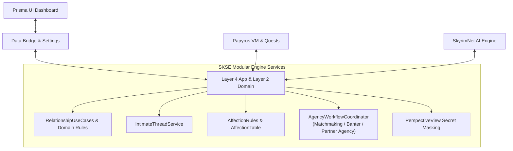
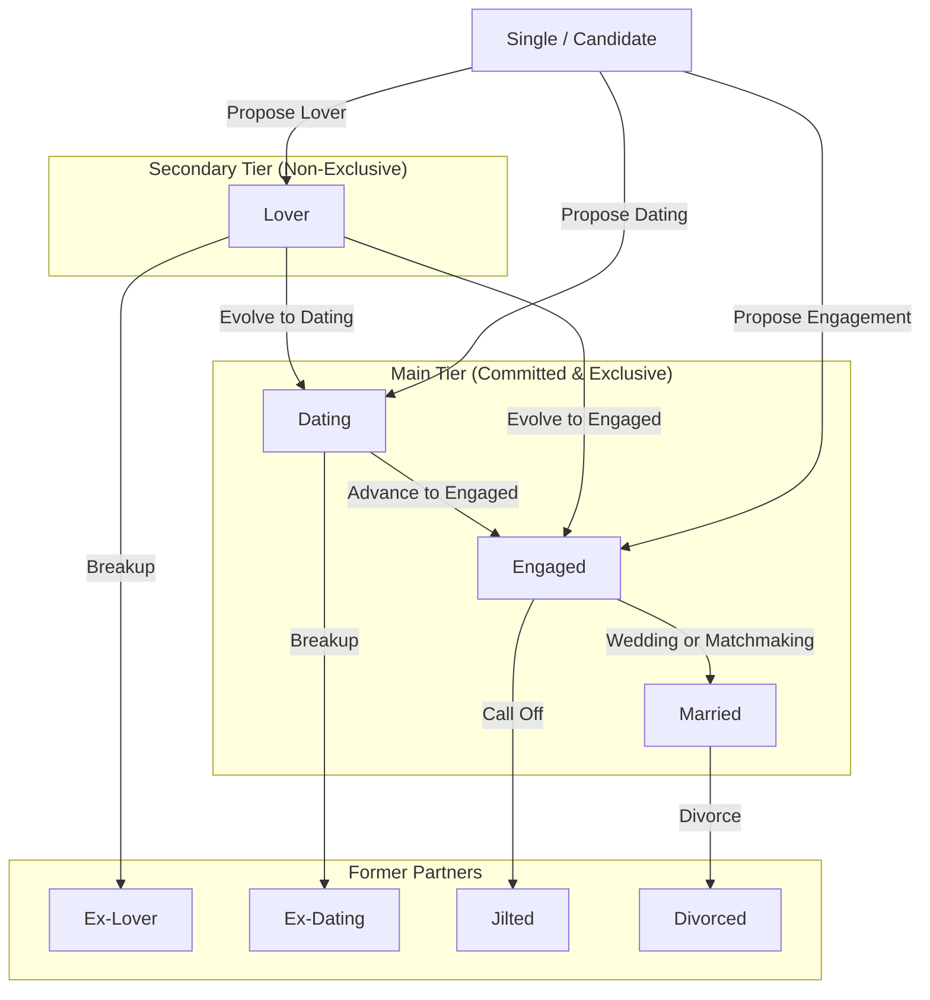
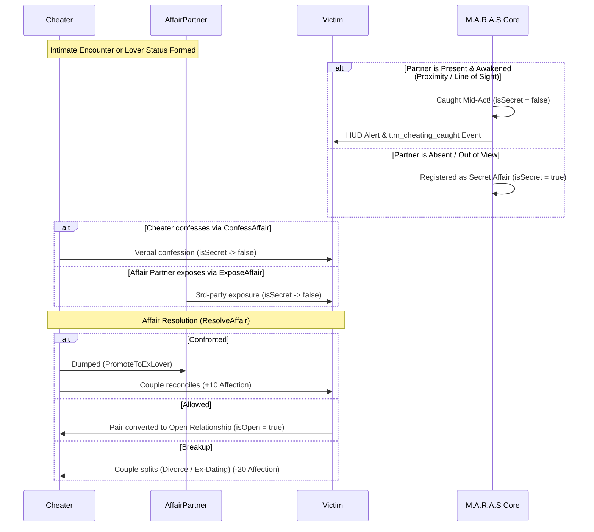

# M.A.R.A.S Adult Relationship Dynamics: Architecture, User Guide & Analysis

This document provides a comprehensive breakdown and player guide for all adult relationship mechanics in **M.A.R.A.S**, including relationship tiers (Main vs. Secondary), cheating and infidelity, open relationships, player polygamy, breakups and divorce, ambient scenes, and their integration with **SkyrimNet**.

For a concise summary and quick reference matrix, see [`RELATIONSHIP_OVERVIEW.md`](../player/RELATIONSHIP_OVERVIEW.md).

---

## 1. System Architecture Overview

Adult relationship dynamics in M.A.R.A.S operate across four interconnected layers:

1. **SKSE Modular C++ Engine (`SKSE_Source/modules/`)**:
   - [`RelationshipUseCases`](services/RelationshipUseCases.md) ([`RelationshipUseCases.h`](../../SKSE_Source/modules/app/include/maras/app/RelationshipUseCases.h), [`RelationshipRules.h`](../../SKSE_Source/modules/domain_relationships/include/maras/domain/relationships/RelationshipRules.h), [`InfidelityRules.h`](../../SKSE_Source/modules/domain_relationships/include/maras/domain/relationships/InfidelityRules.h), [`SpouseHierarchyRules.h`](../../SKSE_Source/modules/domain_relationships/include/maras/domain/relationships/SpouseHierarchyRules.h)): Application coordinator and pure domain rules owning pair keys, relationship status, open flags, directional cheating records, and spouse hierarchy (`Rank 0..2` mirrored on `0x111` plus `Rank 3+` Subordinate Spouses).
   - [`IntimateThreadService`](services/IntimateThreadService.md) ([`IntimateThreadService.h`](../../SKSE_Source/modules/engine/include/maras/engine/IntimateThreadService.h)): Main-thread `1500ms` tracking (`PollingService` / `UpdateEventSink`) of intimate scenes (SexLab / OStim), field-of-view exposure, walk-in detection, and infidelity tracking.
   - [`AffectionRules`](services/AffectionRules.md) ([`AffectionRules.h`](../../SKSE_Source/modules/domain_relationships/include/maras/domain/relationships/AffectionRules.h)): Daily accumulation, temperament scalers, permanent affection levels (`0..100`), and loneliness decay.
   - [`AgencyWorkflowCoordinator`](services/AgencyWorkflowCoordinator.md) ([`AgencyWorkflowCoordinator.h`](../../SKSE_Source/modules/app/include/maras/app/AgencyWorkflowCoordinator.h)): Orchestrates periodic NPC-NPC matchmaking, Tier 2 player-partner infidelity/open-relationship agency & home-arrival events, and local NPC couple ambient banter (`RunDiceRollMatchmaking`, `TryScheduledBanter`, `TryTriggerBanter`, `EvaluatePartnerHomeArrival`).
   - [`PerspectiveView`](services/PerspectiveView.md) & [`DeceasedQueries`](services/DeceasedQueries.md): Enforces actor-perspective and uniform dashboard masking across active affairs, paternity secrets, and deceased partner/child secrecy (`'DCSD'` `'DCS1'` extension).
2. **Prisma UI Dashboard (`prisma-src/` & [`PrismaUIDataBridge`](services/PrismaUIDataBridge.md))**:
   - Interactive web dashboard for viewing relationship networks (filtered by `PerspectiveView::ForDashboard`), toggling open relationships, modifying spouse hierarchy ranks, tracking affection, and launching matchmaking.
3. **Papyrus Scripts (`Scripts/Source/`)**:
   - Quest handling ([`TTM_MainController.psc`](../../Scripts/Source/TTM_MainController.psc)), action execution handlers ([`TTM_Actions.psc`](../../Scripts/Source/TTM_Actions.psc)), native confirmation modals ([`ConfirmationModal.h`](../../SKSE_Source/modules/bridge_ui/include/maras/bridge_ui/ConfirmationModal.h)), and event dispatching.
4. **SkyrimNet External Bundle (`SKSE/Plugins/SkyrimNet/external/tetherball88.maras/`)**:
   - Actions (`18` `actions/*.yaml`), event triggers (`25` `triggers/*.yaml`), prompts, and C++ decorators ([`SkyrimNetDecorators.h`](../../SKSE_Source/modules/bridge_skyrimnet/include/maras/bridge_skyrimnet/SkyrimNetDecorators.h), [`SkyrimNetIntegration.md`](services/SkyrimNetIntegration.md)) providing AI conversational context and decision-making.

---

## 2. User Guide: How Relationship Dynamics Work

> **Lifecycle Connection**: Secondary (`Lover`) and Main (`Dating`/`Engaged`/`Married`) tiers are part of a unified lifecycle. Casual lovers can evolve into exclusive dating partners or betrothed spouses via `Propose Dating` or `Propose Engagement`. When this happens, `RelationshipUseCases::BreakAllLoverConnections` automatically demotes any other outside lovers to `ExLover` (unless the couple is open or the player has polygamy). Likewise, former partners (`Ex-Dating`, `Divorced`, `Ex-Lover`) can rekindle either as committed dating partners or casual lovers.

### 2.1 The Relationship Commitment Scale

M.A.R.A.S establishes an authoritative hierarchy of relationship depth defined in [`0501_relationship_statuses.prompt`](../../SKSE/Plugins/SkyrimNet/external/tetherball88.maras/prompts/submodules/guidelines/0501_relationship_statuses.prompt#L1-L14):

1. **Tier 0: Hookup**
   - Single or transient sexual encounters (e.g. sex framework thread).
   - No permanent relationship record is stored, but triggers infidelity detection if either participant has a committed partner.
2. **Tier 1: Lover (Secondary Tier)**
   - Recurring casual or sexual partnership.
   - Low emotional attachment; explicitly **non-exclusive**.
   - An actor can have multiple lovers across Skyrim.
   - Having or entering a lover relationship while in an exclusive main relationship counts as **cheating**.
3. **Tier 2: Dating (Main Tier)**
   - Committed romantic couple.
   - High emotional attachment; exclusive by default.
   - NPCs are restricted to **one** main-tier partner at a time.
4. **Tier 3: Engaged (Main Tier)**
   - Publicly recognized betrothal.
   - Formal binding commitment intended to culminate in marriage.
5. **Tier 4: Married (Main Tier)**
   - Highest commitment level.
   - Binds property sharing, custodial parenting of children, household hierarchy ranking, and spousal buffs.

---

### 2.2 Main vs. Secondary Relationships

- **Main Tier (`IsMainTierStatus`)**: Includes `Dating`, `Engaged`, and `Married`.
  - NPCs are strictly monogamous: an NPC cannot enter a second main relationship without breaking up with or divorcing their existing partner ([`RelationshipRules::CanFormRelationship`](../../SKSE_Source/modules/domain_relationships/include/maras/domain/relationships/RelationshipRules.h)).
  - Only the player character (with Polygamy enabled) can maintain multiple main partners.
- **Secondary Tier**: Includes `Lover`.
  - Uncapped by default. Anyone can form a lover relationship with anyone without partner count restrictions.
- **Automatic Severing of Secondary Lovers**:
  - Whenever an actor enters a committed main-tier relationship (`PromoteToDating`, `PromoteToEngaged`, or `PromoteToMarried`), the engine calls [`RelationshipUseCases::BreakAllLoverConnections`](../../SKSE_Source/modules/app/include/maras/app/RelationshipUseCases.h) (via `RelationshipRules::ApplyRelationshipTransition`).
  - All existing lovers for both partners are automatically demoted to `ExLover`.
  - **Exemptions**: Lovers are **not** severed if the couple being formed is an **Open Relationship** or if the actor is the **Player with Polygamy enabled**.

---

### 2.3 Cheating & Infidelity Dynamics

#### What Constitutes Cheating?
An actor is guilty of cheating if they engage in intimacy or start a secondary (`Lover`) or dating relationship while already bound by an exclusive, closed main-tier relationship (`Dating`, `Engaged`, `Married`) with someone else.
- **Co-Spouse Exemption**: When two or more of the Player's active main partners (`IsPlayerActiveMainPartner`) engage in intimacy or form a `Lover` bond with each other, it **does not count as cheating** on the Player across `IntimateThreadService`, `RelationshipUseCases`, `AgencyWorkflowCoordinator`, and `SkyrimNetIntegration` (`permission: "player_polygamy"`).

#### Infidelity Detection Channels
1. **Intimate Interactions (Sex / Frameworks)**:
   - Monitored by [`IntimateThreadService::ReportIntimateInteraction`](../../SKSE_Source/modules/engine/include/maras/engine/IntimateThreadService.h).
   - If an actor has an exclusive partner who is absent:
     - **Caught in the Act**: If the partner is nearby, has line-of-sight, and is awake, the affair is marked known immediately (`isSecret = false`), displays a HUD alert (`"You caught X with Y!"`), and dispatches `ttm_cheating_caught`.
     - **Secret Affair**: If the partner has no line-of-sight, it is recorded as a secret affair (`isSecret = true`, `AffairType::Casual`, `AffairStatus::Ongoing`).
     - **Walk-Ins**: The main-thread `1500ms` `IntimateThreadService::Tick` poll (scheduled by `PollingService` / `UpdateEventSink`) continually checks if a partner physically walks into the room while sex is ongoing, dispatching `isWalkIn = true`.
2. **Status Changes**:
   - Entering `Dating` or `Lover` while having an exclusive partner automatically registers an ongoing secret affair ([`InfidelityRules` / `RelationshipUseCases`](../../SKSE_Source/modules/domain_relationships/include/maras/domain/relationships/InfidelityRules.h)).
3. **Matchmaking**:
   - **NPC-NPC Matchmaking**: If `matchmakingAllowCheating` is enabled, the world matchmaker can suggest a `lover` pairing flagged with `isCheating = true` for NPC-NPC couples.
   - **Tier 2 Player-Partner Agency & Infidelity Engine (`AgencyWorkflowCoordinator::TryScheduledPlayerPartnerInfidelity` & `EvaluatePartnerHomeArrival`)**: All active Main Partners of the Player (`Dating`, `Engaged`, `Married` — both Closed and Open) are unconditionally excluded from generic Tier 3 NPC-NPC matchmaking and evaluated every `1.5x L` days (where $L = \text{lonelinessThresholdDays}$, default `2` days $\rightarrow$ `3` days):
     - **2-Stage Affair Progression (`AffairStage::Talking` $\rightarrow$ `AffairStage::Physical`)**: Newly formed Tier 2 secret affairs begin at `AffairStage::Talking` (emotional/flirtatious courtship and secret letters while setting `RelationshipStatus::Lover`). If the affair remains active for `2.0x L` (`4`) days without breaking up or being resolved, it deterministically escalates to `AffairStage::Physical` (sex stage).
     - **5 Scheduled Actions (2-Stage C++ Roll $\rightarrow$ SkyrimNet LLM / Dice-Roll Fallback)**: Evaluates (A) ongoing affair breakup (`>= 1.5x L` days old) & guilt confession (`evalMode = "breakup_affair"`), (B) open-relationship lover breakup (`>= 1.5x L` days old, `evalMode = "breakup_open_lover"`), (C) new `Talking`-stage secret affair (`evalMode = "candidate_select"`), (D) new consensual open-relationship lover (`evalMode = "candidate_select"`), and (E) force-greet relationship intents (`SuggestOpen`, `SuggestClose`, `ConfessTalking`, `ConfessPhysical`, `evalMode = "suggest_open" | "suggest_close"`) with a `2.0x L` TTL. When `playerPartnerCheatingUseLLM && IsSkyrimNetAvailable()` is true, all 5 actions are verified by SkyrimNet (`maras_player_partner_cheating.prompt`) and approved new affairs/open lovers and breakups generate dual first-person character memories (`ExecuteMemoryBatchOrApply`); when disabled or absent, C++ dice rolls act as the complete standalone decision engine.
     - **Anti-Yo-Yo Candidate Rules & Home-Arrival Events**: Candidates with `AffairStatus::EndedConfronted` are permanently blocked, and candidates who already broke up with the partner during the current player relationship lose Tier 1 ("Old Flame") priority and receive `-40` per past breakup. When the player enters a partner's home cell, `EvaluatePartnerHomeArrival` prioritizes active `PendingPartnerIntent`s before rolling across secret-letter / confrontation encounter templates loaded from `Data/SKSE/Plugins/MARAS/encounters/*.json` (`EncounterConfigLoader`) and displaying handwritten note / choice modals via [`PrismaModalManager`](services/PrismaModalManager.md).
     - **Stage 1 (Temptation Roll)**: Computes a deterministic temptation probability (`PartnerAgencyEvaluator`) from permanent affection tier (`Happy`, `Content`, `Troubled` linear `5–18%`, `Estranged` linear `20–40%`), days of player neglect (`> 2` days for Troubled/Estranged, `> 5` days for Content, or `-5%` mitigation if attended within 2 days), revenge for exposed ongoing player infidelity (`+20%`), polygamy hierarchy rank (`Rank 0: 0%`, `Rank 1: +3%`, `Rank 2: +5%`, `Rank 3+: +7%`), shared children (`-12%`, plus pregnancy hard immunity), and multiplicative temperament (`0.50x`–`1.75x`) & stage (`0.80x`–`1.25x`) scalers.
     - **Stage 2 (Localized Candidate Shortlist & Evaluation)**: Excludes co-spouses (`IsPlayerActiveMainPartner`), filters adult NPCs by habitat-whitelisted locations (`FormCache` + `LocTypeDwelling`/`LocTypeCastle`), and scores them across 5 tiers into a quota-balanced Top-8 shortlist (Tier 1: Old Flames from MARAS relationship history `100` with no location requirement; Tier 2: Same Roof / Hangout Cell `85`; Tier 3: Guildmates & Hub `70`; Tier 4: Same Settlement `50`; Tier 5: Same Hold `25`), then either queries SkyrimNet (`maras_player_partner_cheating`) or rolls weighted probabilities to initiate a secret `Lover` affair. All undiscovered affairs, unannounced affair pregnancies, and deceased partner/child secrecy (`'DCS1'`) remain strictly hidden from unaware actors and the Intrigue-mode Dashboard via [`PerspectiveView`](services/PerspectiveView.md).

#### Affair Lifecycle & Resolution
- **Confession**: Cheater comes clean to the victim partner using the `ConfessAffair` action.
- **Exposure**: The third-party affair partner breaks the secret to the victim using `ExposeAffair`.
- **Resolution Outcomes (`ResolveAffair`)**:
  - `confronted`: Cheater agrees to dump the affair partner (affair partner becomes `ExLover`/`ExDating`), and the couple stays together (+10 affection).
  - `allowed`: The victim forgives or permits the secondary relationship; the couple becomes an **Open Relationship** (`SetPairIsOpen`).
  - `breakup`: The victim refuses to forgive; triggers divorce, broken engagement, or dating breakup (-20 affection).

---

### 2.4 Open Relationships

- **Per-Pair Setting**: Openness is tracked specifically on a given couple ([`RelationshipEdge::isOpen`](../../SKSE_Source/modules/state/include/maras/state/WorldTables.h)).
- **Main-Tier Only**: Can only be toggled on `Dating`, `Engaged`, or `Married` couples.
- **Opening a Relationship (`isOpen = true`)**:
  - Mutually permits outside lovers and sexual encounters without it counting as infidelity.
  - Automatically converts all existing ongoing cheating records on that pair to `AffairStatus::Allowed`.
  - In matchmaking, partners are tagged `[secondary only (allowed)]`.
  - If a partner walks in on intimacy with a secondary lover, it triggers `ttm_open_relationship_walkin` rather than a cheating confrontation.
- **Closing a Relationship (`isOpen = false`)**:
  - Reverts the couple to exclusive monogamy.
  - **Automatic Lover Severing**: [`RelationshipUseCases::SetPairIsOpen`](../../SKSE_Source/modules/app/include/maras/app/RelationshipUseCases.h) (via `InfidelityRules::ApplySetPairOpen`) immediately runs `BreakAllLoverConnections` on both partners (unless they have another open main pair or player polygamy), converting secondary lovers to `ExLover`.
- **Affection Impact of Toggling**:
  - Opening: Independent +15, Jealous -35, Romantic -20, Others -10.
  - Closing: Jealous +20, Romantic +15, Independent -10, Others +10.

---

### 2.5 Player Polygamy

- **Player Exclusive**:
  - Toggled via the `enablePolygamy` setting (granted via the Mara's Blessing quest or Prisma UI).
  - **Does NOT apply to NPCs**: NPCs remain strictly monogamous for committed relationships.
- **Mechanics**:
  - The player can date, engage, and marry unlimited NPCs simultaneously.
  - The player is immune to cheating checks (`RelationshipUseCases::RecordCheating` / `InfidelityRules::ApplyRecordCheating` skips player-cheating records).
  - Activating polygamy marks all past player cheating records as `Allowed` ([`RelationshipUseCases::MarkPlayerCheatingAllowedOnPolygamy`](../../SKSE_Source/modules/app/include/maras/app/RelationshipUseCases.h)).
  - Entering a new marriage or dating partner does not sever the player's lover relationships.
  - The `skipWedding` setting allows skipping subsequent Temple of Mara ceremonies after the first.
- **Spouse Household Hierarchy (`SpouseHierarchyTable` / `SpouseHierarchyRules`)**:
  - Manages multiple spouses through ranking (`'SPHR'` chunk):
    - **Rank 0**: First Spouse (Lead Spouse)
    - **Rank 1**: Second Spouse
    - **Rank 2**: Third Spouse
    - **Rank 3+**: Subordinate Spouses (stored in `'SPHR'`; omitted from `0x111`)
  - Controls faction ranks `0..2` in `SpouseHierarchyFaction` (`0x111`).
  - Promoting/demoting spouses impacts affection based on temperament (Proud spouses gain +12 permanent affection per rank promoted; demotions cause resentment).

---

### 2.6 Breaking Up, Jilting & Divorce

- **Exit Paths**:
  - `Married` $\rightarrow$ `Divorced`
  - `Engaged` $\rightarrow$ `Jilted`
  - `Dating` $\rightarrow$ `ExDating`
  - `Lover` $\rightarrow$ `ExLover`
- **Consequences of Divorce**:
  - Spouse is removed from household hierarchy and property sharing ([`HouseholdUseCases::StopShareHouseWithPlayer`](services/HouseholdUseCases.md)).
  - **Child Custody Resolution**: Automatically calls [`LineageUseCases::EvaluateChildCustodyOnDivorce`](../../SKSE_Source/modules/app/include/maras/app/LineageUseCases.h), reassigning custody and sandbox packages based on configured custody policies (`StayWithMother`, `StayWithFather`, `AlwaysWithPlayer`, `NeverWithPlayer`).
  - Active cheating records on that pair terminate with `AffairStatus::EndedVictimSplit`.
- **Reconciliation**:
  - Former exes (`ExDating`, `Divorced`, `Jilted`) are eligible to restart dating through the standard `ProposeDating` action once cleared.

---

### 2.7 Other Adult Relationship Systems

- **Affection System ([`AffectionRules`](services/AffectionRules.md))**:
  - Permanent scale from 0 to 100.
  - Stages: Happy (75–100), Content (50–74), Troubled (25–49), Estranged (0–24).
  - Neglect triggers daily loneliness decay (scaled by temperament, relationship stage, open relationship status, known ongoing cheating, and household partner count).
  - Reaching "Estranged" triggers the Estranged Divorce Quest, where the spouse can demand reconciliation or initiate divorce.
- **Marriage & Romance Proposal Difficulty ([`MarriageDifficulty`](services/MarriageDifficulty.md))**:
  - Comprehensive formula (`MarriageDifficultyRules`) evaluating proposal success chance based on player gold, properties, horses, quests completed, cleared dungeons, dragon souls, thane titles, guild alignment, intimacy history, and existing spouse count.
  - When non-AI dialogue opens (`TTM_Data.SetGameNoAIChancesGlobals`), the base chance is scaled by prior breakup status (`0.75x` for `exlover`, `exdating`, `jilted`, or `divorced`), cheating eligibility (`0.6x` if either actor has `Rank 0` in `TTM_CanFormNonCheatingMain` `0x5D2`), and stage-progression bonuses (`1.5x` for `lover` $\rightarrow$ `dating`, `1.2x` for `lover` $\rightarrow$ `engaged`, and `1.5x` for `dating` $\rightarrow$ `engaged`) to populate three Creation Kit conditional global variables: `LoverChanceGV` (`0x5D1`), `DatingChanceGV` (`0x5D0`), and `MarriageChanceGV` (`0x15C`).
- **Matchmaking Service ([`AgencyWorkflowCoordinator`](services/AgencyWorkflowCoordinator.md))**:
  - Periodically processes the marriage market (`RunDiceRollMatchmaking` / SkyrimNet LLM evaluation).
  - Proposes new pairs, relationship advances, breakups, or open/close toggles among NPCs while strictly respecting sexual orientation rules and NPC cooldowns.
- **Ambient Banter & Scenes ([`AgencyWorkflowCoordinator`](services/AgencyWorkflowCoordinator.md))**:
  - Evaluates nearby NPC couples (`TryScheduledBanter` / `TryTriggerBanter`) and starts contextual CK scenes via `BanterSceneStarter` in eligible locations (inns, stores, homes, streets) for lovers, dating, engaged, married, open relationships, and cheating/caught confrontations.

---
