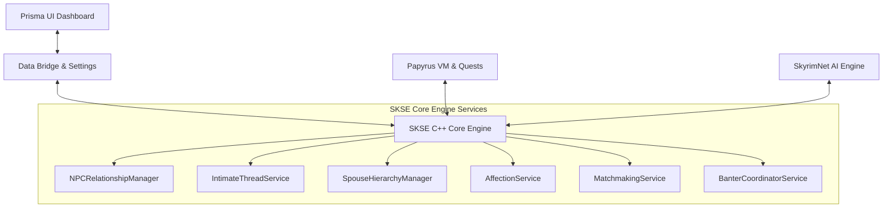
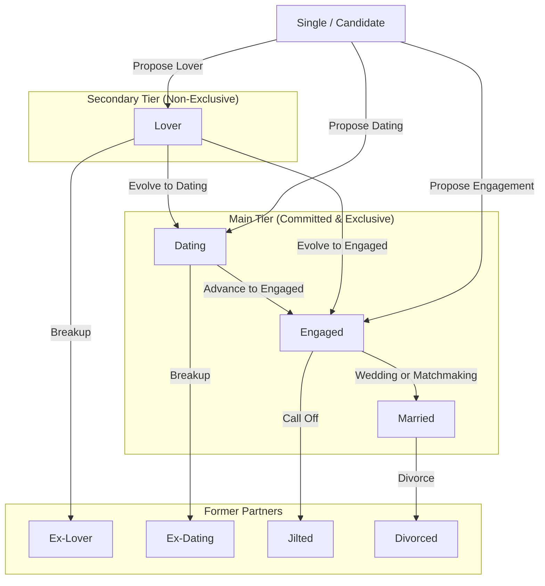
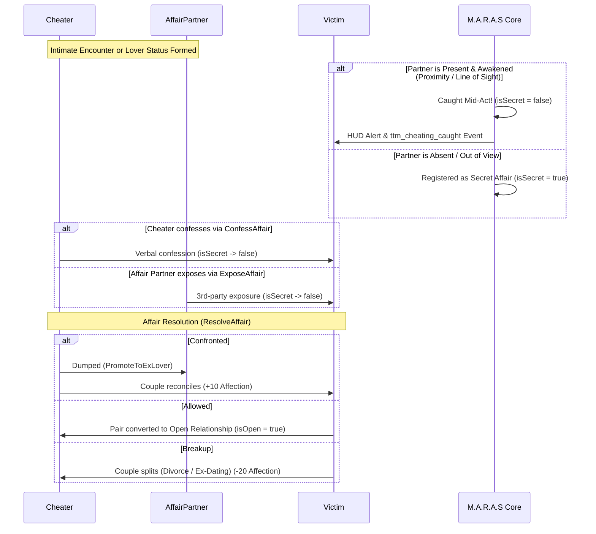

# M.A.R.A.S Adult Relationship Dynamics: Architecture, User Guide & Analysis

This document provides a comprehensive breakdown and player guide for all adult relationship mechanics in **M.A.R.A.S**, including relationship tiers (Main vs. Secondary), cheating and infidelity, open relationships, player polygamy, breakups and divorce, ambient scenes, and their integration with **SkyrimNet**.

For a concise summary and quick reference matrix, see [`docs/RELATIONSHIP_OVERVIEW.md`](file:///e:/Skyrim/development/mods/M.A.R.A.S%20Dev/docs/RELATIONSHIP_OVERVIEW.md).

---

## 1. System Architecture Overview

Adult relationship dynamics in M.A.R.A.S operate across four interconnected layers:

1. **SKSE Core C++ Engine (`SKSE_Source/`)**:
   - [`NPCRelationshipManager`](file:///e:/Skyrim/development/mods/M.A.R.A.S%20Dev/SKSE_Source/src/core/NPCRelationshipManager.cpp): Single source of truth for pair keys, relationship status, open flags, status transitions, and directional cheating records.
   - [`IntimateThreadService`](file:///e:/Skyrim/development/mods/M.A.R.A.S%20Dev/SKSE_Source/src/core/IntimateThreadService.cpp): Real-time tracking of intimate scenes (sex frameworks / OStim), field-of-view exposure, walk-in detection, and infidelity tracking.
   - [`SpouseHierarchyManager`](file:///e:/Skyrim/development/mods/M.A.R.A.S%20Dev/SKSE_Source/src/core/SpouseHierarchyManager.cpp): Manages household rankings (Ranks 0..4+) for player polygamy and faction assignments.
   - [`AffectionService`](file:///e:/Skyrim/development/mods/M.A.R.A.S%20Dev/SKSE_Source/src/core/AffectionService.cpp): Daily accumulation, temperament scalers, permanent affection levels (0..100), and loneliness decay.
   - [`MatchmakingService`](file:///e:/Skyrim/development/mods/M.A.R.A.S%20Dev/SKSE_Source/src/core/MatchmakingService.cpp): Periodic simulation of the Skyrim marriage market via LLM AI or deterministic dice rolls.
   - [`BanterCoordinatorService`](file:///e:/Skyrim/development/mods/M.A.R.A.S%20Dev/SKSE_Source/src/core/BanterCoordinatorService.cpp): Evaluates local NPC couples for ambient Creation Kit relationship banter scenes.
2. **Prisma UI Dashboard (`prisma-src/` & `PrismaUI/`)**:
   - Interactive web dashboard for viewing relationship networks, toggling open relationships, modifying spouse hierarchy ranks, tracking affection, and launching matchmaking.
3. **Papyrus Scripts (`Scripts/Source/`)**:
   - Quest handling ([`TTM_MainController.psc`](file:///e:/Skyrim/development/mods/M.A.R.A.S%20Dev/Scripts/Source/TTM_MainController.psc)), action execution handlers ([`TTM_Actions.psc`](file:///e:/Skyrim/development/mods/M.A.R.A.S%20Dev/Scripts/Source/TTM_Actions.psc)), native confirmation modals ([`ConfirmationModal.h`](file:///e:/Skyrim/development/mods/M.A.R.A.S%20Dev/SKSE_Source/include/ui/ConfirmationModal.h)), and event dispatching.
4. **SkyrimNet External Bundle (`SKSE/Plugins/SkyrimNet/external/tetherball88.maras/`)**:
   - Actions, prompts, event triggers, and C++ decorators ([`SkyrimNetIntegration.cpp`](file:///e:/Skyrim/development/mods/M.A.R.A.S%20Dev/SKSE_Source/src/core/SkyrimNetIntegration.cpp)) providing AI conversational context and decision-making.

---

## 2. User Guide: How Relationship Dynamics Work

> **Lifecycle Connection**: Secondary (`Lover`) and Main (`Dating`/`Engaged`/`Married`) tiers are part of a unified lifecycle. Casual lovers can evolve into exclusive dating partners or betrothed spouses via `Propose Dating` or `Propose Engagement`. When this happens, `NPCRelationshipManager::BreakAllLoverConnections` automatically demotes any other outside lovers to `ExLover` (unless the couple is open or the player has polygamy). Likewise, former partners (`Ex-Dating`, `Divorced`, `Ex-Lover`) can rekindle either as committed dating partners or casual lovers.

### 2.1 The Relationship Commitment Scale

M.A.R.A.S establishes an authoritative hierarchy of relationship depth defined in [`0501_relationship_statuses.prompt`](file:///e:/Skyrim/development/mods/M.A.R.A.S%20Dev/SKSE/Plugins/SkyrimNet/external/tetherball88.maras/prompts/submodules/guidelines/0501_relationship_statuses.prompt#L1-L13):

1. **Tier 0: Hookup**
   - Single or transient sexual encounters (e.g. sex framework thread).
   - No permanent relationship record is stored, but triggers infidelity detection if either participant has a committed partner.
2. **Tier 1: Lover (Secondary Tier)**
   - Recurring casual or sexual partnership.
   - Low emotional attachment; explicitly **non-exclusive**.
   - An actor can have multiple lovers across Skyrim.
   - Having or entering a lover relationship while in an exclusive main relationship counts as **cheating**.
3. **Tier 2: Dating (Main Tier)**
   - Committed romantic couple.
   - High emotional attachment; exclusive by default.
   - NPCs are restricted to **one** main-tier partner at a time.
4. **Tier 3: Engaged (Main Tier)**
   - Publicly recognized betrothal.
   - Formal binding commitment intended to culminate in marriage.
5. **Tier 4: Married (Main Tier)**
   - Highest commitment level.
   - Binds property sharing, custodial parenting of children, household hierarchy ranking, and spousal buffs.

---

### 2.2 Main vs. Secondary Relationships

- **Main Tier (`IsMainTier`)**: Includes `Dating`, `Engaged`, and `Married`.
  - NPCs are strictly monogamous: an NPC cannot enter a second main relationship without breaking up with or divorcing their existing partner ([`NPCRelationshipManager::CanFormRelationship`](file:///e:/Skyrim/development/mods/M.A.R.A.S%20Dev/SKSE_Source/src/core/NPCRelationshipManager.cpp#L1109-L1152)).
  - Only the player character (with Polygamy enabled) can maintain multiple main partners.
- **Secondary Tier**: Includes `Lover`.
  - Uncapped by default. Anyone can form a lover relationship with anyone without partner count restrictions.
- **Automatic Severing of Secondary Lovers**:
  - Whenever an actor enters a committed main-tier relationship (`PromoteToDating`, `PromoteToEngaged`, or `PromoteToMarried`), the engine calls [`NPCRelationshipManager::BreakAllLoverConnections`](file:///e:/Skyrim/development/mods/M.A.R.A.S%20Dev/SKSE_Source/src/core/NPCRelationshipManager.cpp#L149-L170).
  - All existing lovers for both partners are automatically demoted to `ExLover`.
  - **Exemptions**: Lovers are **not** severed if the couple being formed is an **Open Relationship** or if the actor is the **Player with Polygamy enabled**.

---

### 2.3 Cheating & Infidelity Dynamics

#### What Constitutes Cheating?
An actor is guilty of cheating if they engage in intimacy or start a secondary (`Lover`) or dating relationship while already bound by an exclusive, closed main-tier relationship (`Dating`, `Engaged`, `Married`) with someone else.

#### Infidelity Detection Channels
1. **Intimate Interactions (Sex / Frameworks)**:
   - Monitored by [`IntimateThreadService::ReportIntimateInteraction`](file:///e:/Skyrim/development/mods/M.A.R.A.S%20Dev/SKSE_Source/src/core/IntimateThreadService.cpp#L203-L280).
   - If an actor has an exclusive partner who is absent:
     - **Caught in the Act**: If the partner is nearby, has line-of-sight, and is awake, the affair is marked known immediately (`isSecret = false`), displays a HUD alert (`"You caught X with Y!"`), and dispatches `ttm_cheating_caught`.
     - **Secret Affair**: If the partner has no line-of-sight, it is recorded as a secret affair (`isSecret = true`, `AffairType::Casual`, `AffairStatus::Ongoing`).
     - **Walk-Ins**: A background worker thread continually checks if a partner physically walks into the room while sex is ongoing, dispatching `isWalkIn = true`.
2. **Status Changes**:
   - Entering `Dating` or `Lover` while having an exclusive partner automatically registers an ongoing secret affair ([`NPCRelationshipManager::EvaluateCheatingOnStatusChange`](file:///e:/Skyrim/development/mods/M.A.R.A.S%20Dev/SKSE_Source/src/core/NPCRelationshipManager_Infidelity.cpp#L355-L432)).
3. **Matchmaking**:
   - If `matchmakingAllowCheating` is enabled, the matchmaker can deliberately suggest a `lover` pairing flagged with `isCheating = true`.

#### Affair Lifecycle & Resolution
- **Confession**: Cheater comes clean to the victim partner using the `ConfessAffair` action.
- **Exposure**: The third-party affair partner breaks the secret to the victim using `ExposeAffair`.
- **Resolution Outcomes (`ResolveAffair`)**:
  - `confronted`: Cheater agrees to dump the affair partner (affair partner becomes `ExLover`/`ExDating`), and the couple stays together (+10 affection).
  - `allowed`: The victim forgives or permits the secondary relationship; the couple becomes an **Open Relationship** (`SetPairIsOpen`).
  - `breakup`: The victim refuses to forgive; triggers divorce, broken engagement, or dating breakup (-20 affection).

---

### 2.4 Open Relationships

- **Per-Pair Setting**: Openness is tracked specifically on a given couple ([`NPCRelationshipData.isOpen`](file:///e:/Skyrim/development/mods/M.A.R.A.S%20Dev/SKSE_Source/include/core/NPCRelationshipManager.h#L296)).
- **Main-Tier Only**: Can only be toggled on `Dating`, `Engaged`, or `Married` couples.
- **Opening a Relationship (`isOpen = true`)**:
  - Mutually permits outside lovers and sexual encounters without it counting as infidelity.
  - Automatically converts all existing ongoing cheating records on that pair to `AffairStatus::Allowed`.
  - In matchmaking, partners are tagged `[secondary only (allowed)]`.
  - If a partner walks in on intimacy with a secondary lover, it triggers `ttm_open_relationship_walkin` rather than a cheating confrontation.
- **Closing a Relationship (`isOpen = false`)**:
  - Reverts the couple to exclusive monogamy.
  - **Automatic Lover Severing**: [`NPCRelationshipManager::SetPairIsOpen`](file:///e:/Skyrim/development/mods/M.A.R.A.S%20Dev/SKSE_Source/src/core/NPCRelationshipManager_Infidelity.cpp#L32-L74) immediately runs `BreakAllLoverConnections` on both partners (unless they have another open main pair or player polygamy), converting secondary lovers to `ExLover`.
- **Affection Impact of Toggling**:
  - Opening: Independent +15, Jealous -35, Romantic -20, Others -10.
  - Closing: Jealous +20, Romantic +15, Independent -10, Others +10.

---

### 2.5 Player Polygamy

- **Player Exclusive**:
  - Toggled via the `enablePolygamy` setting (granted via the Mara's Blessing quest, Prisma UI, or MCM).
  - **Does NOT apply to NPCs**: NPCs remain strictly monogamous for committed relationships.
- **Mechanics**:
  - The player can date, engage, and marry unlimited NPCs simultaneously.
  - The player is immune to cheating checks ([`NPCRelationshipManager::RecordCheating`](file:///e:/Skyrim/development/mods/M.A.R.A.S%20Dev/SKSE_Source/src/core/NPCRelationshipManager_Infidelity.cpp#L76-L85) returns false for the player).
  - Activating polygamy marks all past player cheating records as `Allowed` ([`MarkPlayerCheatingAllowedOnPolygamy`](file:///e:/Skyrim/development/mods/M.A.R.A.S%20Dev/SKSE_Source/src/core/NPCRelationshipManager_Infidelity.cpp#L341-L353)).
  - Entering a new marriage or dating partner does not sever the player's lover relationships.
  - The `skipWedding` setting allows skipping subsequent Temple of Mara ceremonies after the first.
- **Spouse Household Hierarchy (`SpouseHierarchyManager`)**:
  - Manages multiple spouses through ranking:
    - **Rank 0**: First Spouse (Head of Household)
    - **Rank 1**: Second Spouse
    - **Rank 2**: Third Spouse
    - **Rank 4+**: Subordinate Spouses
  - Controls faction ranks in the marriage hierarchy faction.
  - Promoting/demoting spouses impacts affection based on temperament (Proud spouses gain +12 permanent affection per rank promoted; demotions cause resentment).

---

### 2.6 Breaking Up, Jilting & Divorce

- **Exit Paths**:
  - `Married` $\rightarrow$ `Divorced`
  - `Engaged` $\rightarrow$ `Jilted`
  - `Dating` $\rightarrow$ `ExDating`
  - `Lover` $\rightarrow$ `ExLover`
- **Consequences of Divorce**:
  - Spouse is removed from household hierarchy and property sharing ([`SpouseAssetsService::StopShareHouseWithPlayer`](file:///e:/Skyrim/development/mods/M.A.R.A.S%20Dev/SKSE_Source/src/core/NPCRelationshipManager.cpp#L1520)).
  - **Child Custody Resolution**: Automatically calls [`NPCRelationshipManager::EvaluateChildCustodyOnDivorce`](file:///e:/Skyrim/development/mods/M.A.R.A.S%20Dev/SKSE_Source/src/core/NPCRelationshipManager_Children.cpp#L602-L797), reassigning custody and sandbox packages based on configured custody policies (`StayWithMother`, `StayWithFather`, `AlwaysWithPlayer`, `NeverWithPlayer`).
  - Active cheating records on that pair terminate with `AffairStatus::EndedVictimSplit`.
- **Reconciliation**:
  - Former exes (`ExDating`, `Divorced`, `Jilted`) are eligible to restart dating through the standard `ProposeDating` action once cleared.

---

### 2.7 Other Adult Relationship Systems

- **Affection System (`AffectionService`)**:
  - Permanent scale from 0 to 100.
  - Stages: Happy (75–100), Content (50–74), Troubled (25–49), Estranged (0–24).
  - Neglect triggers daily loneliness decay (scaled by temperament, relationship stage, open relationship status, known ongoing cheating, and household partner count).
  - Reaching "Estranged" triggers the Estranged Divorce Quest, where the spouse can demand reconciliation or initiate divorce.
- **Marriage & Romance Proposal Difficulty**:
  - Comprehensive formula (`MarriageDifficulty`) evaluating proposal success chance based on player gold, properties, horses, quests completed, cleared dungeons, dragon souls, thane titles, guild alignment, intimacy history, and existing spouse count.
  - When non-AI dialogue opens (`TTM_Data.SetGameNoAIChancesGlobals`), the base chance is scaled by prior breakup status (`0.75x` for `exlover`, `exdating`, `jilted`, or `divorced`), cheating eligibility (`0.6x` if either actor has `Rank 0` in `TTM_CanFormNonCheatingMain` `0x5D2`), and stage-progression bonuses (`1.5x` for `lover` $\rightarrow$ `dating`, `1.2x` for `lover` $\rightarrow$ `engaged`, and `1.5x` for `dating` $\rightarrow$ `engaged`) to populate three Creation Kit conditional global variables: `LoverChanceGV` (`0x5D1`), `DatingChanceGV` (`0x5D0`), and `MarriageChanceGV` (`0x15C`).
- **Matchmaking Service**:
  - Periodically processes the marriage market.
  - Uses either LLM AI or deterministic dice rolls.
  - Proposes new pairs, relationship advances, breakups, or open/close toggles among NPCs while strictly respecting sexual orientation rules and NPC cooldowns.
- **Ambient Banter & Scenes (`BanterCoordinatorService`)**:
  - Contextual CK scenes for NPC couples in eligible locations (inns, stores, homes, streets) for lovers, dating, engaged, married, open relationships, and cheating/caught confrontations.

---
