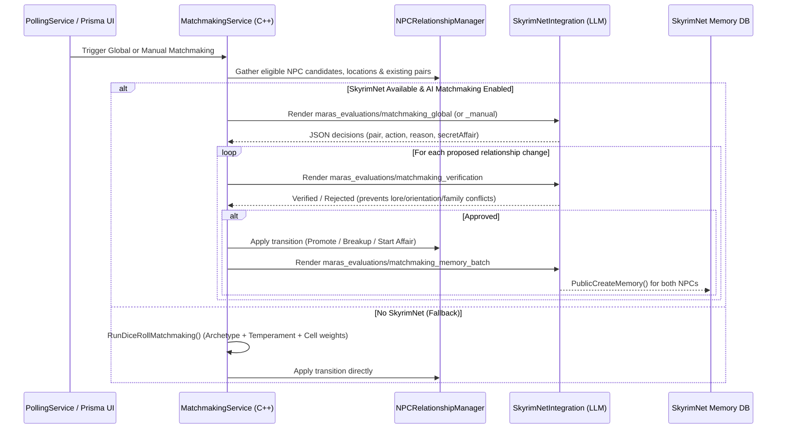
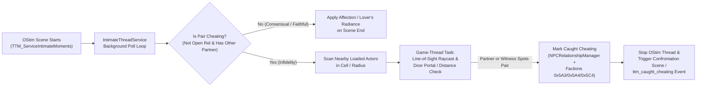

# M.A.R.A.S — SkyrimNet & AI Subsystems Architecture

M.A.R.A.S integrates deeply with **SkyrimNet** to transform NPC relationships, matchmaking, couple banter, infidelity detection, and paternity secrets into dynamic AI-driven narratives. Every SkyrimNet touchpoint follows strict runtime gating so the mod operates seamlessly both with and without SkyrimNet installed.

---

## 1. Runtime Gating & Non-SkyrimNet Fallbacks

### 1.1 Mandatory Availability Checks
- **C++ (`SKSE_Source/`)**: All callers check `MARAS::IsSkyrimNetAvailable()` (`SkyrimNetIntegration.h`), which verifies both `GetModuleHandleW(L"SkyrimNet.dll") != nullptr` and `!Settings::GetSingleton().GetSimulateNoSkyrimNet()`.
- **Papyrus (`Scripts/Source/`)**: All callers check `TTM_Data.GetHasSkyrimNet()` before formatting strings or invoking `SkyrimNetApi`.
- **Prisma UI (`prisma-src/`)**: Reads `settings.hasSkyrimNet` from the C++ data bridge to hide SkyrimNet-only tabs/sections or disable AI buttons with explanatory tooltips.

### 1.2 Subsystem Behavior Matrix (SkyrimNet Active vs. Absent)

| Subsystem | With SkyrimNet Active | Without SkyrimNet (Fallback) |
| :--- | :--- | :--- |
| **Confirmation Modal** (`ConfirmationModal.h`) | 3-button layout: `[Accept]`, `[Cancel]`, `[Decline (Explain)]` (triggers `ttm_action_declined` event so player can explain why in dialogue). | 2-button layout: `[Accept]`, `[Cancel]`. |
| **Global/Manual Matchmaking** (`MatchmakingService`) | Sends candidate profiles & relationship context to SkyrimNet LLM (`matchmaking_global` / `matchmaking_manual`), followed by verification & memory ingestion. | Runs deterministic/weighted `RunDiceRollMatchmaking()` using archetype compatibility, temperament, and proximity scores. |
| **Paternity Secret Creation** (`NPCRelationshipManager`) | Evaluates `EvaluatePaternitySecret()` via LLM (`paternity_secret_eval`) to decide if the mother hides true paternity from a cheated partner. | Uses configurable dice-roll probability (`paternitySecretChance`) when a child is conceived during an affair. |
| **Couple Banter** (`BanterCoordinatorService`) | Tier 1 (nearby real-time) can dispatch SkyrimNet dialogue triggers (`ttm_npc_couple_banter`) or vanilla scenes; Tier 2 runs background checks. | Runs vanilla/MARAS quest scenes (`TTM_NpcsScenes`) for nearby couples. |
| **Papyrus Event Registration** (`TTM_ServiceSkyrimNet.psc`) | Formats structured JSON payloads (`BuildJson`) and calls `SkyrimNetApi.RegisterEvent("ttm_event", ...)`. | Early returns immediately (`no-op`). |

---

## 2. Low-Level C++ Bridge (`SkyrimNetIntegration`)

Located in `SKSE_Source/include/core/SkyrimNetIntegration.h` and `src/core/SkyrimNetIntegration.cpp`, this layer uses dynamic `GetProcAddress` lookups against `SkyrimNet.dll` so `MARAS.dll` has zero hard link dependencies on SkyrimNet.

### 2.1 Resolved DLL Exports from `SkyrimNet.dll`
- `PublicRegisterDecorator`: Registers C++ callbacks exposed to SkyrimNet Jinja/Inja prompt templates.
- `PublicRenderTemplate`: Renders a named prompt template in `external/tetherball88.maras/prompts/` with a JSON context object.
- `PublicSendCustomPrompt`: Dispatches an asynchronous LLM completion request (used by `MatchmakingService` and `NPCRelationshipManager` for background evaluations) and returns the response to a C++ callback.
- `PublicCalculateActorUUID`: Resolves an `RE::Actor*` FormID into SkyrimNet's internal 64-bit Actor UUID.
- `PublicCreateMemory`: Injects a first-person narrative memory directly into an NPC's SkyrimNet long-term memory database (complete with importance score, emotion tag, location, and participant UUIDs).

### 2.2 Registered C++ Prompt Decorators (`SkyrimNetIntegration.cpp`)
Registered at `kDataLoaded` and invoked automatically by SkyrimNet's prompt engine when constructing NPC context:

| Decorator Name | Arguments | Returned JSON / Context |
| :--- | :--- | :--- |
| `maras_is_enabled` | *(none)* | Boolean indicating whether M.A.R.A.S is active. |
| `maras_get_actor_summary` | `actor` | Archetype (`socialClass`, `skillType`, `temperament`), player relationship status, affection tier, hierarchy rank, and housing state. |
| `maras_get_all_relationships` | `actor` | Array of all active and historical relationships (player and NPC-to-NPC), including status, partner name, cheating/open-relationship flags, and history. |
| `maras_get_affair_secrets` | `actor` | Secret infidelity details: whether `actor` is cheating, caught cheating, victim of an affair, or third-party paramour, plus who knows. |
| `maras_get_children_info` | `actor` | Biological and guardian children of `actor`, co-parent/co-guardian names, adoption status, and any active `ChildPaternitySecret` state (`Suspected`, `Known`, `Resolved`, or `Hidden` secret held by the mother/paramour). |
| `maras_get_household_context` | `actor` | Co-spouses sharing the same home, spouse hierarchy ranks (`Lead Spouse`, etc.), and household tension/harmony context. |
| `maras_get_marriage_difficulty` | `actor` | Whether the actor's marriage/romance requirements (gold, houses, quests, relationship rank) are met by the player. |
| `maras_get_deceased_partners` | `actor` | List of deceased current/former partners or children, when they died, and whether the player killed them. |

---

## 3. AI Matchmaking Pipeline (`MatchmakingService`)

`MatchmakingService` (`SKSE_Source/include/core/MatchmakingService.h`) autonomous evolves NPC-to-NPC relationships (`Dating` $\rightarrow$ `Lover` $\rightarrow$ `Engaged` $\rightarrow$ `Married`, plus breakups, divorces, and affairs).

---

## 4. Couple Banter Coordinator (`BanterCoordinatorService`)

`BanterCoordinatorService` (`SKSE_Source/include/core/BanterCoordinatorService.h`) manages ambient interactions between NPC-to-NPC couples using a two-tier architecture:

1. **Tier 1 — Nearby Real-Time Banter**:
   - Scans couples loaded in the player's current cell or within configurable proximity radius.
   - Respects per-couple and global cooldown timers (`BNTR` co-save chunk) and location filters (skipping combat cells, dungeons, or restricted worldspaces).
   - When triggered, dispatches either a SkyrimNet multi-actor dialogue trigger (`ttm_npc_couple_banter`) or a `TTM_NpcsScenes` interaction scene.
2. **Tier 2 — Background Global Progression**:
   - Periodically samples unloaded/distant NPC couples across Skyrim to advance or test their relationship stability and feed into `MatchmakingService`.

---

## 5. OStim Intimate Scene & Infidelity Detection (`IntimateThreadService`)

`IntimateThreadService` (`SKSE_Source/include/core/IntimateThreadService.h`) runs a dedicated background worker thread during active OStim scenes (`TTM_ServiceIntimateMoments.psc`) to detect realistic walk-ins and infidelity exposure:

---

## 6. External SkyrimNet Bundle (`SKSE/Plugins/SkyrimNet/external/tetherball88.maras/`)

Compliant with the SkyrimNet Beta 25+ external plugin specification (`manifest.json`), the bundle is divided into three directories:

### 6.1 Actions (`actions/*.yaml` — 19 Actions)
Every action file's filename strictly matches its internal `name:` attribute and invokes `TTM_Actions.psc` or `TTM_ServiceRelationships.psc`:
- **Relationship Progression**: `ProposeDating`, `ConsiderDating`, `ProposeLover`, `ConsiderLover`, `ProposeMarriage`, `ConsiderMarriage`.
- **Breakups & Terminations**: `BreakupDating`, `BreakupLover`, `CallOffEngagement`, `Divorce`.
- **Open Relationships**: `OpenRelationship`, `CloseRelationship`.
- **Infidelity & Affairs**: `ConfessAffair`, `ExposeAffair`, `ResolveAffair`.
- **Children & Paternity Secrets**: `DiscoverChildPaternity`, `RevealChildSecret`.
- **General Management**: `ManageRelationships`.

### 6.2 Triggers (`triggers/*.yaml` — 25 Triggers)
Listen for `ttm_event` dispatches from `TTM_ServiceSkyrimNet.psc` (matched via `event_json.type`). Because `ttm_event` already records `event_json.msg` in the event history (`recent_events`), active `direct_narration` triggers use template variables (`{{originator}}` and `event_json.*` fields) to instruct NPCs on how to react and roleplay the moment rather than duplicating the raw event message:
- **Proposals & Declines**: `ttm_action_decline`, `ttm_dating_proposal`, `ttm_polygamy_blessing`
- **Relationship & Household Changes**: `ttm_became_lovers`, `ttm_became_engaged`, `ttm_marital_status_change`, `ttm_open_relationship_change`, `ttm_spouse_affection_change`, `ttm_spouse_hierarchy_change`
- **Infidelity, Affairs & Walk-Ins**: `ttm_cheating_caught`, `ttm_affair_confessed`, `ttm_affair_exposed`, `ttm_affair_resolved`, `ttm_open_relationship_walkin`
- **Pregnancy, Birth & Children**: `ttm_pregnancy_announced`, `ttm_pregnancy_lost`, `ttm_labor_started`, `ttm_child_birth`, `ttm_child_grew_up`, `ttm_child_sent_to_training`, `ttm_child_became_adult`, `ttm_child_adopted`, `ttm_child_inherited`, `ttm_child_parents_changed`, `ttm_paternity_secret_resolved`

### 6.3 Prompt Templates (`prompts/`)
- `submodules/character_bio/0450_maras_character_bio.prompt`: Injects the NPC's M.A.R.A.S archetype, partners, household rank, children, and any active affair/paternity secrets into their core character biography.
- `submodules/guidelines/0900_maras_guidelines.prompt`: Instructs the LLM on when to invoke M.A.R.A.S actions (proposals, breakups, affair confessions/exposures, paternity reveals) and how to roleplay affection tiers and temperament.
- `maras_evaluations/*.prompt` (7 evaluation templates):
  1. `matchmaking_global.prompt` — Multi-pair autonomous matchmaking evaluator.
  2. `matchmaking_manual.prompt` — Targeted single-NPC or pair matchmaking evaluator.
  3. `matchmaking_verification.prompt` — Sanity/lore/relationship validator for proposed matches.
  4. `matchmaking_memory_batch.prompt` — Generates first-person memories for newly matched/broken-up NPCs.
  5. `paternity_secret_eval.prompt` — Evaluates whether a mother conceals an affair child's paternity.
  6. `affair_reaction_eval.prompt` — Evaluates how a betrayed partner reacts upon discovering infidelity.
  7. `banter_topic_eval.prompt` — Generates contextual conversation seeds for `BanterCoordinatorService`.

