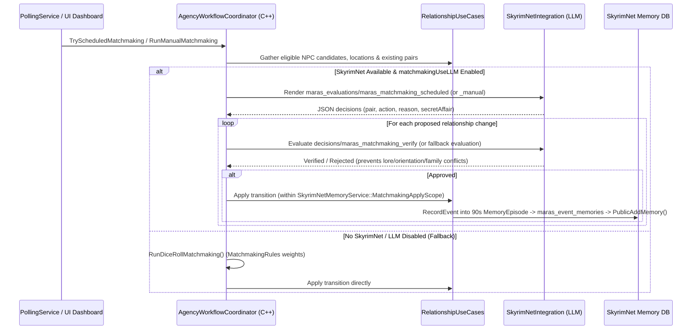
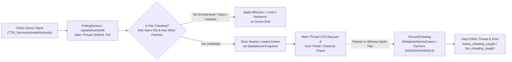

# M.A.R.A.S — SkyrimNet & AI Subsystems Architecture

M.A.R.A.S integrates deeply with **SkyrimNet** to transform NPC relationships, matchmaking, couple banter, infidelity detection, and paternity secrets into dynamic AI-driven narratives. Every SkyrimNet touchpoint follows strict runtime gating so the mod operates seamlessly both with and without SkyrimNet installed.

---

## 1. Runtime Gating & Non-SkyrimNet Fallbacks

### 1.1 Mandatory Availability Checks
- **C++ (`SKSE_Source/`)**: All callers check `MARAS::App::GetSkyrimNetGateway().IsAvailable()` (`MARAS::Bridge::SkyrimNet::IsSkyrimNetAvailable()` in [SkyrimNetApiLoader.h](../../SKSE_Source/modules/bridge_skyrimnet/include/maras/bridge_skyrimnet/SkyrimNetApiLoader.h)), which verifies both `GetModuleHandleW(L"SkyrimNet.dll") != nullptr` and `!SettingsCoordinator::GetSingleton().GetSimulateNoSkyrimNet()`.
- **Papyrus (`Scripts/Source/`)**: All callers check `TTM_Data.GetHasSkyrimNet()` before formatting strings or invoking `MARAS.RegisterSkyrimNetEvent`.
- **UI Dashboard (`ui-src/`)**: Reads `settings.hasSkyrimNet` from the C++ data bridge to hide SkyrimNet-only tabs/sections or disable AI buttons with explanatory tooltips.

### 1.2 Subsystem Behavior Matrix (SkyrimNet Active vs. Absent)

| Subsystem | With SkyrimNet Active | Without SkyrimNet (Fallback) |
| :--- | :--- | :--- |
| **Confirmation Modal** ([ConfirmationModal.h](../../SKSE_Source/modules/bridge_ui/include/maras/bridge_ui/ConfirmationModal.h)) | 3-button layout: `[Accept]`, `[Decline (Explain)]` (invokes `ISkyrimNetGateway::EmitActionDecline` / `ttm_action_decline` event so player can explain why in dialogue), `[Cancel]`. | 2-button layout: `[Accept]`, `[Cancel]`. |
| **Global/Manual Matchmaking** ([AgencyWorkflowCoordinator.h](../../SKSE_Source/modules/app/include/maras/app/AgencyWorkflowCoordinator.h)) | Sends candidate profiles & relationship context to SkyrimNet LLM (`maras_matchmaking_scheduled` / `maras_matchmaking_manual`), followed by `maras_matchmaking_verify` & memory ingestion. | Runs deterministic/weighted `RunDiceRollMatchmaking()` (`MatchmakingRules` / `NpcMatchmaker`) using archetype compatibility, temperament, and proximity scores. |
| **Paternity Secret Creation** ([PaternityWorkflowCoordinator.h](../../SKSE_Source/modules/app/include/maras/app/PaternityWorkflowCoordinator.h)) | Evaluates `EvaluatePaternitySecret()` via LLM (`maras_paternity_evaluation`) to decide if the mother hides true paternity from a cheated partner. | Uses `EvaluatePaternitySecretFallback()` with configurable dice-roll probability (`paternitySecretChance`) when a child is conceived during an affair. |
| **Couple Banter** ([AgencyWorkflowCoordinator.h](../../SKSE_Source/modules/app/include/maras/app/AgencyWorkflowCoordinator.h)) | Gated by `GetSkyrimNetGateway().IsAvailable()` and `enableScenes`; fires `maras_banter_scene_trigger` (`TryScheduledBanter()` / `TryTriggerBanter()`) for loaded couples via `BanterPlanner` & `BanterSceneStarter` (`TTM_NpcsScenes`). | No autonomous `TryScheduledBanter()` dispatch (`GetSkyrimNetGateway().IsAvailable()` gate returns early); CK scenes remain script-accessible if invoked directly. |
| **C++ Event Dispatch** (`SkyrimNetEventService`) | Formats structured JSON payloads (`SkyrimNetEventPayloads` via `nlohmann::json`) and invokes `PublicRegisterEvent("ttm_event", ...)` per `EventDispatchPlan` (`EventAudience::Exact` vs `Nearby`, plus secret/narration masking; `"ttm_event"` schema registered by `TTM_MainController.psc`). | Early returns immediately (`no-op`). |

---

## 2. Low-Level C++ Bridge (`bridge_skyrimnet` & `PerspectiveView`)

Located in `SKSE_Source/modules/bridge_skyrimnet/` ([SkyrimNetApiLoader.h](../../SKSE_Source/modules/bridge_skyrimnet/include/maras/bridge_skyrimnet/SkyrimNetApiLoader.h), [SkyrimNetDecorators.h](../../SKSE_Source/modules/bridge_skyrimnet/include/maras/bridge_skyrimnet/SkyrimNetDecorators.h), [SkyrimNetDecisions.h](../../SKSE_Source/modules/bridge_skyrimnet/include/maras/bridge_skyrimnet/SkyrimNetDecisions.h), [SkyrimNetEventPayloads.h](../../SKSE_Source/modules/bridge_skyrimnet/include/maras/bridge_skyrimnet/SkyrimNetEventPayloads.h), [SkyrimNetEventService.h](../../SKSE_Source/modules/bridge_skyrimnet/include/maras/bridge_skyrimnet/SkyrimNetEventService.h), [SkyrimNetMemoryService.h](../../SKSE_Source/modules/bridge_skyrimnet/include/maras/bridge_skyrimnet/SkyrimNetMemoryService.h), [SkyrimNetProfileService.h](../../SKSE_Source/modules/bridge_skyrimnet/include/maras/bridge_skyrimnet/SkyrimNetProfileService.h)) and abstracted behind [SkyrimNetGateway.h](../../SKSE_Source/modules/app/include/maras/app/SkyrimNetGateway.h), this layer uses dynamic `GetProcAddress` lookups against `SkyrimNet.dll` so `MARAS.dll` has zero hard link dependencies on SkyrimNet. See [SkyrimNetIntegration.md](services/SkyrimNetIntegration.md), [SkyrimNetMemoryService.md](services/SkyrimNetMemoryService.md), and [SkyrimNetProfileService.md](services/SkyrimNetProfileService.md).

### 2.1 Resolved DLL Exports from `SkyrimNet.dll`
- `PublicRegisterDecorator`: Registers C++ callbacks exposed to SkyrimNet Inja prompt templates (`23` MARAS decorators).
- `PublicRenderTemplate`: Renders a named prompt template in `external/tetherball88.maras/prompts/` with a JSON context object.
- `PublicSendCustomPromptToLLM`: Dispatches an asynchronous Chat LLM completion request (`gamemaster_evaluation` or `memory` variant) and returns the response to a C++ callback.
- `PublicSendCustomDecisionToLLM` (SkyrimNet Public API v12+): Dispatches a structured Jev decision evaluation (`decisions/*.prompt`) against SkyrimNet's `decisions` model slot and returns typed per-decision JSON (`{"decisions": {"<key>": {"selected": "...", "value": ...}}}`) to `SkyrimNetDecisions`. When `skyrimnetUseDecisions` is disabled or SkyrimNet returns `"error": "no_decisions_route"`, `SkyrimNetDecisions` automatically falls back to `PublicSendCustomPromptToLLM` (`maras_evaluations/*.prompt`).
- `PublicCalculateActorUUID`: Resolves an `RE::Actor*` FormID into SkyrimNet's internal 64-bit Actor UUID.
- `PublicCreateMemory`: Injects a first-person narrative memory directly into an NPC's SkyrimNet long-term memory database (complete with importance score, emotion tag, location, and participant UUIDs).
- `PublicRequestProfileUpdate` (SkyrimNet Public API v13+): Queues an asynchronous dynamic character profile generation/update on SkyrimNet's internal worker thread pool with caller-provided `additionalInstructions` and `updatableBlocksCSV` overrides (used by [SkyrimNetProfileService](services/SkyrimNetProfileService.md), with legacy fallback for SkyrimNet `< v13`).
- `PublicRegisterEvent` (SkyrimNet Public API v11+): Registers an event (`"ttm_event"`, `"direct_narration"`, etc.) with either `EventAudience::Nearby` (`audienceCount == 0`) or `EventAudience::Exact` (`audienceCount > 0`), exposed to C++ via `Bridge::SkyrimNet::RegisterSkyrimNetEvent` / `SkyrimNetEventService` (`ISkyrimNetGateway`) and to Papyrus via the `MARAS` SkyrimNet bridge (`PapyrusSkyrimNet.cpp` + `MARAS.RegisterSkyrimNetEvent`).

### 2.1.1 Audience Control & Paternity Secret Masking (`EventDispatchPlan` & `SkyrimNetEventService`)
- **Exact Audience vs. Nearby Audience**:
  - When `exactAudience == true` (or `audience` is non-empty), `RegisterSkyrimNetEvent` populates `audienceFormIds` (including `originatorActor`, `targetActor`, and all valid `audience` elements, filtering out synthetic child IDs) and passes `audienceCount > 0` to `PublicRegisterEvent`. This activates `EventAudience::Exact` in SkyrimNet—excluding nearby bystanders, virtual NPCs, and the Player (unless `0x14` is explicitly in the audience) and bypassing SkyrimNet's `2 * maxInteractionDistance` player-distance filter.
  - Normal interpersonal, relationship, household, and public events use `exactAudience = false` (`EventAudience::Nearby`) so nearby actors can naturally overhear them.
  - `exactAudience = true` (`EventAudience::Exact`) is planned by [`EventDispatchPlan`](../../SKSE_Source/modules/projection/include/maras/projection/EventDispatchPlan.h) **only** for:
    1. `PregnancyAnnounced` (the mother's private internal discovery/thoughts — delivered exclusively to `mother`).
    2. `PaternitySecretResolved` when one of the fathers (`stillSecretAssumed` or `stillSecretBio`) still does not know the truth.
    3. Child lifecycle events (`ChildBirth`, `ChildGrewUp`, `ChildSentToTraining`, `ChildBecameAdult`) whenever `IsSecretForPartner` (`isSecretForAssumed`) OR `IsSecretForBioFather` (`isSecretForBio`) is active (when neither flag is set, they use `exactAudience = false`).
- **Perspective-Bound Secret Event Splitting**:
  - Whenever a pregnancy-reveal or child milestone event carries `isSecretForAssumed` or `isSecretForBio`, `Projection::EventDispatchPlan` splits delivery into `EventDeliveryLeg`s using `EventAudience::Exact`, serialized by `SkyrimNetEventPayloads` and dispatched by `SkyrimNetEventService`:
    1. **Privy Audience (`exactAudience = true`)**: Receives `DispatchMaskMode::Unmasked` narration only for privy adults (`mother`, plus `bioFather` only if `!isSecretForBio`, plus `presumedPartner` only if `!isSecretForAssumed`).
    2. **Deceived Partner / Child Audience (`exactAudience = true`)**: Receives secret-masked text/JSON (`DispatchMaskMode::MaskForPartner` or `DispatchMaskMode::MaskForChildOnly`) omitting true bio-father identity when masked for the presumed partner (`presumedFather`) and shielding child actors when hidden paternity would otherwise be exposed—while never falling back to Player `0x14` as speaker if an unmasked bio-father secret is active.

### 2.2 Registered C++ Prompt Decorators ([SkyrimNetDecorators.cpp](../../SKSE_Source/modules/bridge_skyrimnet/src/SkyrimNetDecorators.cpp))
All **23 decorators** are registered at `kPostLoad` (`GetSkyrimNetGateway().RegisterDecorators()`) and invoked automatically by SkyrimNet's prompt engine when constructing NPC context. Every callback executes lock-free against `WorldStore::Snapshot()`, `SpatialSnapshotStore::Snapshot()`, and [PerspectiveView](services/PerspectiveView.md):

| Decorator Name | Arguments | Returned JSON / Context |
| :--- | :--- | :--- |
| `ttm_is_registered` | `actor` | Boolean JSON indicating whether `actor` is tracked in M.A.R.A.S (Player, tracked NPC, registered child, or pregnant mother). |
| `ttm_npc_relationship_profile` | `actor` *(optional render mode)* | Schema-v2 JSON relationship, pregnancy, family, and infidelity profile projected through `PerspectiveView::ForActor` (`ActorSelf` epistemic filtering) or `PerspectiveView::ForDialogueTarget` when `render_mode == "dialogue_target"` (public knowledge only; hides undiscovered affairs, secret paternity, `siblings`, and `has_beastblood`—even when the target personally knows). |
| `ttm_get_nearby_actors` | `actor` | JSON `{ "actorIds": [...] }` of nearby valid NPCs/Player queried off-thread from `SpatialActorSnapshot`. |
| `ttm_get_ex_partner` | `actor` | Backstory sentence describing prior vanilla relationship (`Spouse`, `Courting`, `Lover`) ties to a player household member. |
| `ttm_get_available_actions` | `actor` | Composite explanation list of relationship and drama actions currently valid for `actor` with nearby targets. |
| `ttm_get_propose_dating_candidates`, `ttm_get_propose_lover_candidates`, `ttm_get_propose_engagement_candidates` | `actor` | Nearby eligible target names for proposing Dating, Lover, or Engagement. |
| `ttm_get_breakup_dating_candidates`, `ttm_get_breakup_lover_candidates`, `ttm_get_breakup_engagement_candidates`, `ttm_get_divorce_candidates` | `actor` | Current partner/spouse names eligible for breakup, calling off engagement, or divorce. |
| `ttm_get_open_relationship_candidates`, `ttm_get_close_relationship_candidates`, `ttm_get_open_main_partners`, `ttm_get_dating_partner` | `actor` | Partner names eligible for opening/closing a relationship, active open main-tier partners, or current dating partner. |
| `ttm_get_exclusive_main_partners`, `ttm_get_lovers_becoming_ex` | `actor` | Consequence warnings listing exclusive main partners who would be betrayed or lovers who would become ex-lovers. |
| `ttm_get_reveal_child_secret_candidates`, `ttm_get_discover_child_paternity_candidates` | `actor` | Nearby paternity secret reveal targets (for mother) and discovery targets (for deceived partner / bio father). |
| `ttm_get_confess_affair_candidates`, `ttm_get_expose_affair_candidates`, `ttm_get_resolve_affair_candidates` | `actor` | Nearby partner/victim targets for confessing, exposing, or resolving affairs. |

---

## 3. AI Matchmaking Pipeline (`AgencyWorkflowCoordinator`)

[`AgencyWorkflowCoordinator`](services/AgencyWorkflowCoordinator.md) ([AgencyWorkflowCoordinator.h](../../SKSE_Source/modules/app/include/maras/app/AgencyWorkflowCoordinator.h)) paired with `MatchmakingRules` and `NpcMatchmaker` (`maras_domain_agency`) autonomously evolves NPC-to-NPC relationships (`Dating` $\rightarrow$ `Lover` $\rightarrow$ `Engaged` $\rightarrow$ `Married`, plus breakups, divorces, open/close changes, and affairs).

---

## 4. Couple Banter & Partner Agency Coordination (`AgencyWorkflowCoordinator`)

[`AgencyWorkflowCoordinator`](services/AgencyWorkflowCoordinator.md) also manages ambient couple interactions (`BanterPlanner`, `BanterSceneStarter`) and Tier 2 Player-Partner Agency (`PartnerAgencyEvaluator`, `EncounterConfigLoader`):

1. **Tier 1 — Nearby Real-Time Banter (`TryScheduledBanter` / `TryTriggerBanter` & `BanterSceneCoordinator`)**:
   - Gated on `GetSkyrimNetGateway().IsAvailable()` and `SettingsData::enableScenes`. Scans couples loaded in the player's current cell or within `skyrimnetActionRadius` (`3000.0`).
   - Respects per-couple and global cooldown timers (`'BNTR'` co-save chunk) and location filters via `BanterSceneStarter::IsLocationAllowedForScenes` (skipping restricted cells).
   - Emits `maras_banter_scene_trigger` so `TTM_NpcsScenes` delegates scene planning, off-cell XMarker relocation/restoration (`'BNT1'`), cheating scene fallbacks & affair exposure, caught-cheating scene selection, and SkyrimNet filter faction (`0x12DB`) mute lifecycle + load recovery natively to C++ (`BanterPlanner` & `BanterSceneCoordinator`).
2. **Tier 2 — Player-Partner Agency (`TryScheduledPlayerPartnerInfidelity` & `EvaluatePartnerHomeArrival`)**:
   - Periodically samples unhappy/neglected/non-closed player partners via `PartnerAgencyEvaluator` and evaluates open-relationship suggestions, breakups, or affair escalation via `decisions/maras_player_partner_cheating.prompt` (or dice fallback), queuing pending `PartnerIntentType` prompts and `encounters/*.json` courier/home-arrival modals when returning home.

---

## 5. OStim Intimate Scene & Infidelity Detection (`IntimateThreadService`)

[`IntimateThreadService`](services/IntimateThreadService.md) ([IntimateThreadService.h](../../SKSE_Source/modules/engine/include/maras/engine/IntimateThreadService.h)) runs deterministically on the **SKSE main game thread** via `PollingService` / `UpdateEventSink` (`1500ms` periodic ticks — zero detached background threads) during active OStim/SexLab scenes (`TTM_ServiceIntimateMoments.psc`), alongside [`ChildrenFleeService`](services/ChildrenFleeService.md) (`0x5DE`). It also tracks player intimacy partners, sexual-action flags (`MarkIntimateThreadSexual`), and temporary `0x5C4` (`CheatingNpcCaughtFaction`) memberships natively across start/stage/end, dispatching end-of-thread affection through `AppLifecycleCoordinator::OnIntimateThreadEnded` when `ClearIntimateThread` runs:

---

## 6. External SkyrimNet Bundle (`SKSE/Plugins/SkyrimNet/external/tetherball88.maras/`)

Compliant with the SkyrimNet Beta 25+ external plugin specification (`manifest.json`), the bundle is divided into actions, triggers, dialogue actions (`dialogue_actions/user_lists.yaml`), and prompts:

### 6.1 Actions (`actions/*.yaml` — 18 Actions)
Every action file's filename strictly matches its internal `name:` attribute and invokes a thin 1-line Papyrus entrypoint in `TTM_Actions.psc` (delegating execution natively to C++ `SkyrimNetActionCoordinator` via `Execute*Action` and `GetDivorceResolutionQuestStage` on `MARAS.psc`):
- **Relationship Progression**: `ProposeDating`, `ConsiderDatingProposal`, `ProposeLover`, `ConsiderLoverProposal`, `ProposeEngagement`, `ConsiderEngagementProposal`.
- **Breakups & Terminations**: `BreakupDating`, `BreakupLover`, `CallOffEngagement`, `Divorce`.
- **Open Relationships**: `OpenRelationship`, `CloseRelationship`.
- **Infidelity & Affairs**: `ConfessAffair`, `ExposeAffair`, `ResolveAffair`.
- **Children & Paternity Secrets**: `DiscoverChildPaternity`, `RevealChildSecret`.
- **General Management**: `ManageRelationships`.

### 6.2 Triggers (`triggers/*.yaml` — 25 Triggers)
Listen for `ttm_event` dispatches serialized by `SkyrimNetEventPayloads` and emitted directly from C++ via `SkyrimNetEventService` (`TTM_MainController.psc::RegisterSkyrimNetEventSchema()` registers the `"ttm_event"` schema on startup/load; matched via `event_json.type`, where `ttm_became_lovers` and `ttm_became_engaged` match `type = "ttm_marital_status_change"` filtered on `newStatus = "lover"` / `"engaged"`). `EventDispatchPlan` and `SkyrimNetEventService` evaluate `MARAS::ShouldTriggerSkyrimNetNarration(speaker, target)` ([SkyrimNetApiLoader.cpp](../../SKSE_Source/modules/bridge_skyrimnet/src/SkyrimNetApiLoader.cpp)) to verify that participating actors are 3D-loaded, alive/enabled, in the same interior cell or exterior worldspace as the Player, and within `skyrimnetActionRadius` (default `3000.0` units)—setting `skipTrigger = true` whenever actors are off-screen so distant/unloaded events still record in history without firing live `direct_narration` in the Player's scene. Background matchmaking (`AgencyWorkflowCoordinator`) passes `sendEvent = false` when applying autonomous NPC–NPC status or open-relationship transitions while wrapping the batch in `SkyrimNetMemoryService::MatchmakingApplyScope` so `SkyrimNetMemoryService` records and flushes first-person memories via `maras_event_memories.prompt`. Because `ttm_event` already records `event_json.msg` in the event history (`recent_events`), active `direct_narration` triggers use template variables (`{{originator}}` and `event_json.*` fields) to instruct NPCs on how to react rather than duplicating raw event text:
- **Proposals & Declines**: `ttm_action_decline`, `ttm_dating_proposal`, `ttm_polygamy_blessing`
- **Relationship & Household Changes**: `ttm_became_lovers`, `ttm_became_engaged`, `ttm_marital_status_change`, `ttm_open_relationship_change`, `ttm_spouse_affection_change`, `ttm_spouse_hierarchy_change`
- **Infidelity, Affairs & Walk-Ins**: `ttm_cheating_caught`, `ttm_affair_confessed`, `ttm_affair_exposed`, `ttm_affair_resolved`, `ttm_open_relationship_walkin`
- **Pregnancy, Birth & Children**: `ttm_pregnancy_announced`, `ttm_pregnancy_lost`, `ttm_labor_started`, `ttm_child_birth`, `ttm_child_grew_up`, `ttm_child_sent_to_training`, `ttm_child_became_adult`, `ttm_child_adopted`, `ttm_child_inherited`, `ttm_child_parents_changed`, `ttm_paternity_secret_resolved`
- **Action-Initiated & Cascade Narration Suppression (`SuppressNextActionNarration` / `IsActionNarrationSuppressed`) & `SkyrimNetActionCoordinator`**: Conversational SkyrimNet action entrypoints in `TTM_Actions.psc` (`ProposeRelationshipChange`, `ConsiderRelationshipChange`, `BreakupRelationship`, `SetOpenRelationshipChange`, `RevealChildSecret`, `DiscoverChildPaternity`, `ConfessAffair`, `ExposeAffair`, `ResolveAffair`) delegate to C++ `SkyrimNetActionCoordinator` (`Execute*Action` natives), which handles C++ confirmation modals (`ShowConfirmationModalWithCallback`), post-modal state revalidation, delayed NPC–NPC proposal narrations (`TickPendingNarrations`), `-15.0f` rejection affection penalties, and paternity reveal/discovery directive parsing (`PaternityActionRules`). Both `SkyrimNetActionCoordinator` and Creation Kit scenes (`TTM_NpcsScenes.psc` / `TTM_NpcsScenesEnd.psc`) invoke `SuppressNextActionNarration` to set a C++ `std::chrono::steady_clock` suppression window inside `SkyrimNetEventService` (cleared on `Revert()`) so resulting events still log to `recent_events` (and record directly in `SkyrimNetMemoryService`) with `skipTrigger = true`, preventing a redundant second `direct_narration` from firing. Likewise, secondary cascading events (`ttm_child_parents_changed` on marriage/divorce, or status/open-relationship transitions firing alongside `ttm_affair_resolved` / `ttm_paternity_secret_resolved`) automatically set `skipTrigger = true` so only a single primary trigger narrates per burst.

### 6.3 Prompt Templates (`prompts/`)
- `submodules/character_bio/0602_maras_relations.prompt` *(plus Gamemaster bio helpers `9999_ttm_gm.prompt` & `9999_ttm_gm_with_recent_events.prompt`)*: Calls `ttm_npc_relationship_profile(actorUUID)` and renders `submodules/maras_relations/*.prompt` (`0001_child_bio.prompt`, `0010_pregnancy.prompt`, `0020_children.prompt`, `0030_partners.prompt`, `0030_polygamy.prompt`, `0040_ex_partners.prompt`, `0050_infidelity.prompt`) using `PerspectiveView` epistemic filtering (`ActorSelf` vs. `DialogueTargetPublic`). Supports SkyrimNet's `render_mode == "stable"` / `stable_split` cache split (rendering during `"stable"`, `"thoughts"`, `"transform"`, unsplit `"full"`, `"dialogue_target"`, and `"ttm_relations"`, while suppressing `render_mode == "full"` when `stable_split` is `true` so relationship state stays inside the cached `system` bio right after `0600_relationships.prompt`). In addition, [`SkyrimNetProfileService`](services/SkyrimNetProfileService.md) asynchronously generates and saves a per-save 10-block character profile (`saves/<saveId>/prompts/characters/<bioTemplateName>.prompt`) whenever a placed Young Child (`Stage 2`) or Adult Child (`Stage 4`) actor spawns into the world.
- `submodules/guidelines/0501_relationship_statuses.prompt` & `submodules/user_final_instructions/0502_affection_estranged_divorce.prompt`: Instructs the LLM on M.A.R.A.S's 5-tier commitment scale (`Hookup < Lover < Dating < Engaged < Married`) and estranged divorce/affection behavior.
- `helpers/` & `maras_actions/`: Bio helpers (`maras_actor_bio_recent_events.prompt`, `maras_child_bio_context.prompt`) and `18` per-action parameter/eligibility prompts (`prompts/maras_actions/*.prompt`).
- `decisions/*.prompt` (4 Typed Jev Decisions via `PublicSendCustomDecisionToLLM` / `SkyrimNetDecisions`, enabled when `skyrimnetUseDecisions = true` with automatic fallback to `maras_evaluations/*.prompt`):
  1. `maras_step_in_evaluation.prompt` — `noul` question (`bio_father_steps_in`) evaluating whether a biological father steps in after a paternity-driven divorce.
  2. `maras_paternity_evaluation.prompt` — Multi-question `choice` schema (`outcome` and `partner_reaction`) resolving paternity secrets.
  3. `maras_player_partner_cheating.prompt` — Mode-switched Jev decisions (`candidate_select` via `decision` `choice`, and `breakup_affair` / `breakup_open_lover` / `suggest_open` / `suggest_close` via `noul` questions) for Tier 2 Player-Partner Agency.
  4. `maras_matchmaking_verify.prompt` — Per-actor `noul` matchmaking validator enforcing bilateral consent (`willing_a && willing_b`) for `new`/`advance`/`open`/`close` and unilateral initiation (`wants_breakup_a || wants_breakup_b`) for `breakup`.
- `maras_evaluations/*.prompt` (7 Chat LLM JSON prompts via `PublicSendCustomPromptToLLM`):
  1. `maras_matchmaking_scheduled.prompt` — Multi-pair autonomous matchmaking evaluator.
  2. `maras_matchmaking_manual.prompt` — Targeted single-NPC or pair matchmaking evaluator.
  3. `maras_matchmaking_verify.prompt` — Fallback sanity, lore, and relationship validator for proposed matches.
  4. `maras_event_memories.prompt` — Unified multi-participant episode memory generator (`SkyrimNetMemoryService`, used when `skyrimnetUseLLMMemories` is enabled; when disabled, `SkyrimNetMemoryService` builds programmatic first-person memories in C++ without an LLM call).
  5. `maras_paternity_evaluation.prompt` — Fallback evaluator for whether a paternity secret is exposed at birth or from the Dashboard.
  6. `maras_step_in_evaluation.prompt` — Fallback evaluator for biological father step-in after a paternity divorce.
  7. `maras_player_partner_cheating.prompt` — Fallback evaluator for Tier 2 Player-Partner Agency actions.

