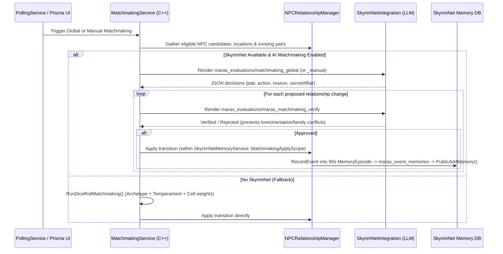
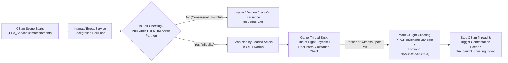

# M.A.R.A.S — SkyrimNet & AI Subsystems Architecture

M.A.R.A.S integrates deeply with **SkyrimNet** to transform NPC relationships, matchmaking, couple banter, infidelity detection, and paternity secrets into dynamic AI-driven narratives. Every SkyrimNet touchpoint follows strict runtime gating so the mod operates seamlessly both with and without SkyrimNet installed.

---

## 1. Runtime Gating & Non-SkyrimNet Fallbacks

### 1.1 Mandatory Availability Checks
- **C++ (`SKSE_Source/`)**: All callers check `MARAS::IsSkyrimNetAvailable()` (`SkyrimNetIntegration.h`), which verifies both `GetModuleHandleW(L"SkyrimNet.dll") != nullptr` and `!Settings::GetSingleton().GetSimulateNoSkyrimNet()`.
- **Papyrus (`Scripts/Source/`)**: All callers check `TTM_Data.GetHasSkyrimNet()` before formatting strings or invoking `MARAS.RegisterSkyrimNetEvent`.
- **Prisma UI (`prisma-src/`)**: Reads `settings.hasSkyrimNet` from the C++ data bridge to hide SkyrimNet-only tabs/sections or disable AI buttons with explanatory tooltips.

### 1.2 Subsystem Behavior Matrix (SkyrimNet Active vs. Absent)

| Subsystem | With SkyrimNet Active | Without SkyrimNet (Fallback) |
| :--- | :--- | :--- |
| **Confirmation Modal** (`ConfirmationModal.h`) | 3-button layout: `[Accept]`, `[Cancel]`, `[Decline (Explain)]` (triggers `ttm_action_declined` event so player can explain why in dialogue). | 2-button layout: `[Accept]`, `[Cancel]`. |
| **Global/Manual Matchmaking** (`MatchmakingService`) | Sends candidate profiles & relationship context to SkyrimNet LLM (`matchmaking_global` / `matchmaking_manual`), followed by verification & memory ingestion. | Runs deterministic/weighted `RunDiceRollMatchmaking()` using archetype compatibility, temperament, and proximity scores. |
| **Paternity Secret Creation** (`NPCRelationshipManager`) | Evaluates `EvaluatePaternitySecret()` via LLM (`paternity_secret_eval`) to decide if the mother hides true paternity from a cheated partner. | Uses configurable dice-roll probability (`paternitySecretChance`) when a child is conceived during an affair. |
| **Couple Banter** (`BanterCoordinatorService`) | Tier 1 (nearby real-time) can dispatch SkyrimNet dialogue triggers (`ttm_npc_couple_banter`) or vanilla scenes; Tier 2 runs background checks. | Runs vanilla/MARAS quest scenes (`TTM_NpcsScenes`) for nearby couples. |
| **Papyrus Event Registration** (`TTM_ServiceSkyrimNet.psc`) | Formats structured JSON payloads (`BuildJson`) and calls `MARAS.RegisterSkyrimNetEvent("ttm_event", ...)` with audience control (`EventAudience::Exact` vs `EventAudience::Nearby`). | Early returns immediately (`no-op`). |

---

## 2. Low-Level C++ Bridge (`SkyrimNetIntegration`)

Located in `SKSE_Source/include/core/SkyrimNetIntegration.h` and `src/core/SkyrimNetIntegration.cpp`, this layer uses dynamic `GetProcAddress` lookups against `SkyrimNet.dll` so `MARAS.dll` has zero hard link dependencies on SkyrimNet.

### 2.1 Resolved DLL Exports from `SkyrimNet.dll`
- `PublicRegisterDecorator`: Registers C++ callbacks exposed to SkyrimNet Jinja/Inja prompt templates.
- `PublicRenderTemplate`: Renders a named prompt template in `external/tetherball88.maras/prompts/` with a JSON context object.
- `PublicSendCustomPromptToLLM`: Dispatches an asynchronous Chat LLM completion request (`gamemaster_evaluation` or `memory` variant) and returns the response to a C++ callback.
- `PublicSendCustomDecisionToLLM` (SkyrimNet Public API v12+): Dispatches a structured Jev decision evaluation (`decisions/*.prompt`) against SkyrimNet's `decisions` model slot and returns typed per-decision JSON (`{"decisions": {"<key>": {"selected": "...", "value": ...}}}`) to `SkyrimNetDecisions`. When `skyrimnetUseDecisions` is disabled or SkyrimNet returns `"error": "no_decisions_route"`, `SkyrimNetDecisions` automatically falls back to `PublicSendCustomPromptToLLM` (`maras_evaluations/*.prompt`).
- `PublicCalculateActorUUID`: Resolves an `RE::Actor*` FormID into SkyrimNet's internal 64-bit Actor UUID.
- `PublicCreateMemory`: Injects a first-person narrative memory directly into an NPC's SkyrimNet long-term memory database (complete with importance score, emotion tag, location, and participant UUIDs).
- `PublicRequestProfileUpdate` (SkyrimNet Public API v13+): Queues an asynchronous dynamic character profile generation/update on SkyrimNet's internal worker thread pool with caller-provided `additionalInstructions` and `updatableBlocksCSV` overrides (used by [`SkyrimNetProfileService`](file:///e:/Skyrim/development/mods/M.A.R.A.S%20Dev/docs/modder/services/SkyrimNetProfileService.md), with legacy fallback for SkyrimNet `< v13`).
- `PublicRegisterEvent` (SkyrimNet Public API v11+): Registers an event (`"ttm_event"`, `"direct_narration"`, etc.) with either `EventAudience::Nearby` (`audienceCount == 0`) or `EventAudience::Exact` (`audienceCount > 0`), exposed to C++ via `MARAS::RegisterSkyrimNetEvent` and to Papyrus via `MARAS.RegisterSkyrimNetEvent`.

### 2.1.1 Audience Control & Paternity Secret Masking (`MARAS.RegisterSkyrimNetEvent`)
- **Exact Audience vs. Nearby Audience**:
  - When `exactAudience == true` (or `audience` is non-empty), `MARAS::RegisterSkyrimNetEvent` populates `audienceFormIds` (including `originatorActor`, `targetActor`, and all valid `audience` elements, filtering out synthetic child IDs) and passes `audienceCount > 0` to `PublicRegisterEvent`. This activates `EventAudience::Exact` in SkyrimNet—excluding nearby bystanders, virtual NPCs, and the Player (unless `0x14` is explicitly in the audience) and bypassing SkyrimNet's `2 * maxInteractionDistance` player-distance filter.
  - Normal interpersonal, relationship, household, and public events use `exactAudience = false` (`EventAudience::Nearby`) so nearby actors can naturally overhear them.
  - `exactAudience = true` (`EventAudience::Exact`) is used **only** for:
    1. `RegisterPregnancyAnnounced` (the mother's private internal discovery/thoughts — delivered exclusively to `mother`).
    2. `RegisterPaternitySecretEvent` when one of the fathers (`stillSecretAssumed` or `stillSecretBio`) still does not know the truth.
    3. Child lifecycle events (`RegisterChildBirthBatch`, `RegisterChildBirth`, `RegisterChildGrewUp`, `RegisterChildSentToTraining`, `RegisterChildBecameAdult`) **only** when an undiscovered paternity secret is present in the message text (when no secret exists, they use `exactAudience = false`).
- **Perspective-Bound Secret Event Splitting**:
  - When a child lifecycle or pregnancy-reveal event carries an undiscovered paternity secret (`isSecretForPartner` / `isSecretForAssumed`), `TTM_ServiceSkyrimNet.psc` splits event delivery by perspective:
    1. **Privy Audience (`exactAudience = true`)**: Receives the true secret-aware text/JSON (`mother`, plus `bioFather` when `!isSecretForBio`, plus `partner` when `!isSecretForPartner`).
    2. **Deceived Partner / Child Audience (`exactAudience = true`)**: Receives a secret-masked text/JSON (e.g., via `MARAS.BuildChildBirthMessage(..., maskSecrets = true)` / `MARAS.BuildChildBirthJson(..., maskSecrets = true)`) presenting the deceived partner as the biological father, with `targetActor = None` and `audience = [presumedFather]` (or `[presumedFather, child]`) so neither the privy mother nor nearby bystanders receive the masked event.

### 2.2 Registered C++ Prompt Decorators (`SkyrimNetIntegration.cpp`)
Registered at `kDataLoaded` and invoked automatically by SkyrimNet's prompt engine when constructing NPC context:

| Decorator Name | Arguments | Returned JSON / Context |
| :--- | :--- | :--- |
| `maras_is_enabled` | *(none)* | Boolean indicating whether M.A.R.A.S is active. |
| `maras_get_actor_summary` | `actor` | Archetype (`socialClass`, `skillType`, `temperament`), player relationship status, affection tier, hierarchy rank, and housing state. |
| `maras_get_all_relationships` | `actor` | Array of all active and historical relationships (player and NPC-to-NPC), including status, partner name, cheating/open-relationship flags, and history. |
| `maras_get_affair_secrets` | `actor` | Secret infidelity details: whether `actor` is cheating, caught cheating, victim of an affair, or third-party paramour, plus who knows. |
| `maras_get_children_info` | `actor` | Biological and guardian children of `actor`, co-parent/co-guardian names, adoption status, and any active `ChildPaternitySecret` state (`Suspected`, `Known`, `Resolved`, or `Hidden` secret held by the mother/paramour). |
| `maras_get_household_context` | `actor` | Co-spouses sharing the same home, spouse hierarchy ranks (`Lead Spouse`, etc.), and household tension/harmony context. |
| `maras_get_marriage_difficulty` | `actor` | Whether the actor's marriage/romance requirements (gold, houses, quests, relationship rank) are met by the player. |
| `maras_get_deceased_partners` | `actor` | List of deceased current/former partners or children, when they died, and whether the player killed them. |

---

## 3. AI Matchmaking Pipeline (`MatchmakingService`)

`MatchmakingService` (`SKSE_Source/include/core/MatchmakingService.h`) autonomous evolves NPC-to-NPC relationships (`Dating` $\rightarrow$ `Lover` $\rightarrow$ `Engaged` $\rightarrow$ `Married`, plus breakups, divorces, and affairs).

---

## 4. Couple Banter Coordinator (`BanterCoordinatorService`)

`BanterCoordinatorService` (`SKSE_Source/include/core/BanterCoordinatorService.h`) manages ambient interactions between NPC-to-NPC couples using a two-tier architecture:

1. **Tier 1 — Nearby Real-Time Banter**:
   - Scans couples loaded in the player's current cell or within configurable proximity radius.
   - Respects per-couple and global cooldown timers (`BNTR` co-save chunk) and location filters (skipping combat cells, dungeons, or restricted worldspaces).
   - When triggered, dispatches either a SkyrimNet multi-actor dialogue trigger (`ttm_npc_couple_banter`) or a `TTM_NpcsScenes` interaction scene.
2. **Tier 2 — Background Global Progression**:
   - Periodically samples unloaded/distant NPC couples across Skyrim to advance or test their relationship stability and feed into `MatchmakingService`.

---

## 5. OStim Intimate Scene & Infidelity Detection (`IntimateThreadService`)

`IntimateThreadService` (`SKSE_Source/include/core/IntimateThreadService.h`) runs a dedicated background worker thread during active OStim scenes (`TTM_ServiceIntimateMoments.psc`) to detect realistic walk-ins and infidelity exposure:

---

## 6. External SkyrimNet Bundle (`SKSE/Plugins/SkyrimNet/external/tetherball88.maras/`)

Compliant with the SkyrimNet Beta 25+ external plugin specification (`manifest.json`), the bundle is divided into three directories:

### 6.1 Actions (`actions/*.yaml` — 19 Actions)
Every action file's filename strictly matches its internal `name:` attribute and invokes `TTM_Actions.psc` or `TTM_ServiceRelationships.psc`:
- **Relationship Progression**: `ProposeDating`, `ConsiderDating`, `ProposeLover`, `ConsiderLover`, `ProposeMarriage`, `ConsiderMarriage`.
- **Breakups & Terminations**: `BreakupDating`, `BreakupLover`, `CallOffEngagement`, `Divorce`.
- **Open Relationships**: `OpenRelationship`, `CloseRelationship`.
- **Infidelity & Affairs**: `ConfessAffair`, `ExposeAffair`, `ResolveAffair`.
- **Children & Paternity Secrets**: `DiscoverChildPaternity`, `RevealChildSecret`.
- **General Management**: `ManageRelationships`.

### 6.2 Triggers (`triggers/*.yaml` — 25 Triggers)
Listen for `ttm_event` dispatches from `TTM_ServiceSkyrimNet.psc` (matched via `event_json.type`). All event builders and `DirectNarration` calls evaluate `MARAS::ShouldTriggerSkyrimNetNarration(speaker, target)` (`SkyrimNetIntegration.cpp` / `MARAS.psc`) to verify that participating actors are 3D-loaded, alive/enabled, in the same interior cell or exterior worldspace as the Player, and within `skyrimNetActionRadius` (default `2000.0` units)—setting `skipTrigger = true` whenever actors are off-screen so distant/unloaded events still record in history without firing live `direct_narration` in the Player's scene. Background matchmaking (`MatchmakingService::ApplyMatch`) passes `sendEvent = false` when applying autonomous NPC–NPC status or open-relationship transitions while wrapping the batch in `SkyrimNetMemoryService::MatchmakingApplyScope` so `SkyrimNetMemoryService` records and flushes first-person memories via `maras_event_memories.prompt`. Because `ttm_event` already records `event_json.msg` in the event history (`recent_events`), active `direct_narration` triggers use template variables (`{{originator}}` and `event_json.*` fields) to instruct NPCs on how to react and roleplay the moment rather than duplicating the raw event message:
- **Proposals & Declines**: `ttm_action_decline`, `ttm_dating_proposal`, `ttm_polygamy_blessing`
- **Relationship & Household Changes**: `ttm_became_lovers`, `ttm_became_engaged`, `ttm_marital_status_change`, `ttm_open_relationship_change`, `ttm_spouse_affection_change`, `ttm_spouse_hierarchy_change`
- **Infidelity, Affairs & Walk-Ins**: `ttm_cheating_caught`, `ttm_affair_confessed`, `ttm_affair_exposed`, `ttm_affair_resolved`, `ttm_open_relationship_walkin`
- **Pregnancy, Birth & Children**: `ttm_pregnancy_announced`, `ttm_pregnancy_lost`, `ttm_labor_started`, `ttm_child_birth`, `ttm_child_grew_up`, `ttm_child_sent_to_training`, `ttm_child_became_adult`, `ttm_child_adopted`, `ttm_child_inherited`, `ttm_child_parents_changed`, `ttm_paternity_secret_resolved`
- **Action-Initiated & Cascade Narration Suppression (`SuppressNextActionNarration` / `IsActionNarrationSuppressed`)**: When a state change is initiated by a SkyrimNet dialogue action in `TTM_Actions.psc` (such as `RevealChildSecret`, `DiscoverChildPaternity`, `ConfessAffair`, `ExposeAffair`, `ResolveAffair`, `ConsiderRelationshipChange`, `BreakupRelationship`, or `SetOpenRelationshipChange`) or a Creation Kit banter scene (`TTM_NpcsScenes.psc` / `TTM_NpcsScenesEnd.psc`), the speaker has already performed the speech act in dialogue. `TTM_ServiceSkyrimNet.SuppressNextActionNarration()` sets a short suppression window so the resulting `ModCallbackEvent`s still log to `recent_events` (and record in `SkyrimNetMemoryService`) with `skipTrigger = true`, preventing a redundant second `direct_narration` from firing. Likewise, secondary cascading events (such as `ttm_child_parents_changed` on marriage/divorce, or status/open-relationship transitions firing alongside `ttm_affair_resolved` / `ttm_paternity_secret_resolved`) automatically set `skipTrigger = true` so only a single primary trigger narrates per burst.

### 6.3 Prompt Templates (`prompts/`)
- `submodules/character_bio/0450_maras_character_bio.prompt`: Injects the NPC's M.A.R.A.S archetype, partners, household rank, children, and any active affair/paternity secrets into their core character biography (and `submodules/maras_relations/0001_child_bio.prompt` renders child/adult parentage, stage, and `training_location`). In addition, [`SkyrimNetProfileService`](file:///e:/Skyrim/development/mods/M.A.R.A.S%20Dev/docs/modder/services/SkyrimNetProfileService.md) asynchronously generates and saves a per-save 10-block character profile (`saves/<saveId>/prompts/characters/<bioTemplateName>.prompt`) whenever a placed Young Child (`Stage 2`) or Adult Child (`Stage 4`) actor is newly spawned into the world.
- `submodules/guidelines/0900_maras_guidelines.prompt`: Instructs the LLM on when to invoke M.A.R.A.S actions (proposals, breakups, affair confessions/exposures, paternity reveals) and how to roleplay affection tiers and temperament.
- `decisions/*.prompt` (Typed Jev Decisions via `PublicSendCustomDecisionToLLM` / `SkyrimNetDecisions`, enabled when `skyrimnetUseDecisions = true` with automatic fallback to `maras_evaluations/*.prompt`):
  1. `maras_step_in_evaluation.prompt` — Boolean `step_in` decision evaluating whether a biological father steps in after a paternity-driven divorce.
  2. `maras_paternity_evaluation.prompt` — Multi-decision schema (`mother_confesses`, `partner_reaction`, `presumed_discovers`, `bio_father_learns`) resolving paternity secrets.
  3. `maras_player_partner_cheating.prompt` — Mode-switched Jev decisions (`candidate_select`, `breakup_affair`, `breakup_open_lover`, `suggest_open`, `suggest_close`) for Tier 2 Player-Partner Agency.
  4. `maras_matchmaking_verify.prompt` — Per-actor matchmaking validator using bilateral consent (`willing_a && willing_b`) for `new`/`advance`/`open`/`close` and unilateral initiation (`wants_breakup_a || wants_breakup_b`) for `breakup`.
- `maras_evaluations/*.prompt` (Chat LLM JSON prompts via `PublicSendCustomPromptToLLM`):
  1. `maras_matchmaking_scheduled.prompt` — Multi-pair autonomous matchmaking evaluator.
  2. `maras_matchmaking_manual.prompt` — Targeted single-NPC or pair matchmaking evaluator.
  3. `maras_matchmaking_verify.prompt` — Legacy/fallback sanity, lore, and relationship validator for proposed matches.
  4. `maras_event_memories.prompt` — Unified multi-participant episode memory generator (`SkyrimNetMemoryService`, used when `skyrimnetUseLLMMemories` is enabled; when disabled, `SkyrimNetMemoryService::BuildProgrammaticMemories` constructs first-person memories in C++ without an LLM call).
  5. `maras_paternity_evaluation.prompt` — Legacy/fallback evaluator for whether a paternity secret is exposed at birth or from the Dashboard.
  6. `maras_step_in_evaluation.prompt` — Legacy/fallback evaluator for biological father step-in after a paternity divorce.
  7. `maras_player_partner_cheating.prompt` — Legacy/fallback evaluator for Tier 2 Player-Partner Agency actions (`candidate_select`, `breakup_affair`, `breakup_open_lover`, `suggest_open`, `suggest_close`).
  8. `maras_npc_couple_banter.prompt` — Generates contextual conversation seeds for `BanterCoordinatorService`.

