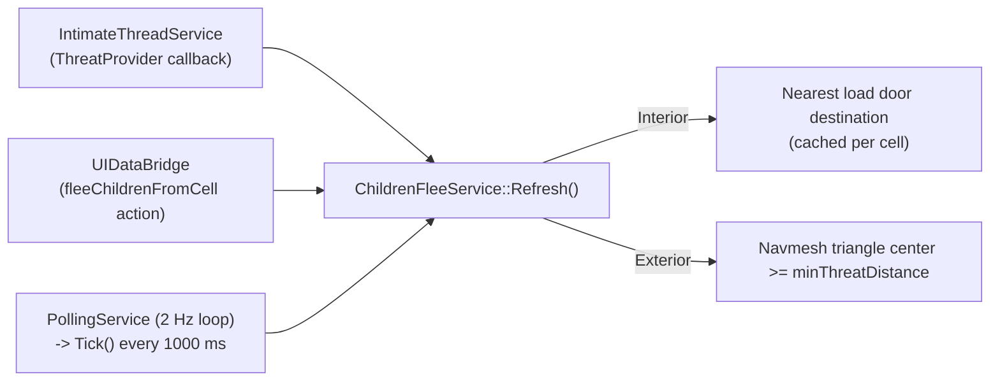

# `ChildrenFleeService` — Architecture & Behavioral Guide

**Layer**: Engine (`SKSE_Source/modules/engine`)  
**Sources**:
- [ChildrenFleeService.h](../../../SKSE_Source/modules/engine/include/maras/engine/ChildrenFleeService.h)
- [ChildrenFleeService.cpp](../../../SKSE_Source/modules/engine/src/ChildrenFleeService.cpp)
- [Architecture Overview](../ARCHITECTURE.md)

---

## 1. Purpose & Responsibility

`ChildrenFleeService` automatically clears child actors out of cells hosting active threats—most commonly intimate adult scenes registered by [`IntimateThreadService`](IntimateThreadService.md), plus manual cell-clear requests triggered from the UI Dashboard or scripts. While an adult scene or manual threat is active in a cell, loaded awake children are temporarily relocated outside (interiors) or to distant walkable navmesh points (exteriors) and remain tracked until the threat ends.

---

## 2. Threat Providers & State Synchronization

`ChildrenFleeService` decouples threat detection from scene-framework storage via a registered provider callback and two explicit mutex-guarded sets:

- **Threat Provider Integration**: `IntimateThreadService::Initialize()` registers `CollectSceneThreats` via `SetThreatProvider`, decoupling scene storage from flee execution.
- **Manual Cell Flee**: Dashboard/script requests call `FleeFromPlayerCell()`, queuing a `sourceMutex_`-guarded threat entry at the player's current cell and position. `StopFleeing()` clears `manualThreats_` and queues an immediate refresh.
- **Child Eligibility (`IsFleeCandidate`)**: Alive (`!IsDead()`), awake (`!IsSleeping()`), and identified as a non-adult child via `WorldStateSnapshot::lineage` (`stage != ChildStage::Adult`), `actor->IsChild()`, `SpatialWorldIndex` child flag, child race flag, or pending child base IDs.
- **Locking & Threading**:
  - `sourceMutex_` guards `threatProvider_` and `manualThreats_`.
  - `fleeMutex_` guards `fleeingChildren_` (paired with an acquire/release atomic fast-path `fleeActive_` for `IsFleeing()`).
  - `QueueRefresh()` captures `GetSessionEpoch()`, sets `monitoring_`, and dispatches onto the SKSE task queue under `GetPapyrusMutex()` before calling `Refresh()`. No lock is held across SKSE task scheduling or world mutations.

---

## 3. Relocation Rules & Caching

- **Interior Cells**: On first visit to an interior cell, `FindExitDestination` scans its references once for `ExtraTeleport` load doors, caches door world positions and destination `FormID`s in `exitDoorCache_`, and moves each fleeing child to the linked exit reference of the nearest load door.
- **Exterior Cells**: `FindWalkableSpot` walks `cell->GetRuntimeData().navMeshes`, skipping deleted triangles (`TriangleFlag::kDeleted`), and selects the nearest non-deleted triangle centroid to `childPos + awayDir * kFleeTeleportDistance` that stays at least `kFleeTeleportDistance * 0.5` away from the threat center, calling `actor->SetPosition(*spot, true)`.
- **Periodic Monitoring & Reset**: [`PollingService`](PollingService.md) drives `ChildrenFleeService::Tick()` (throttled to `kPollInterval = 1000 ms`) whenever `monitoring_` is true, catching newly loaded children walking into an active threat cell. `Reset()` clears both threat and fleeing sets and clears `exitDoorCache_` on `kPreLoadGame` / revert (`monitoring_` and `fleeActive_` reset to `false`).
