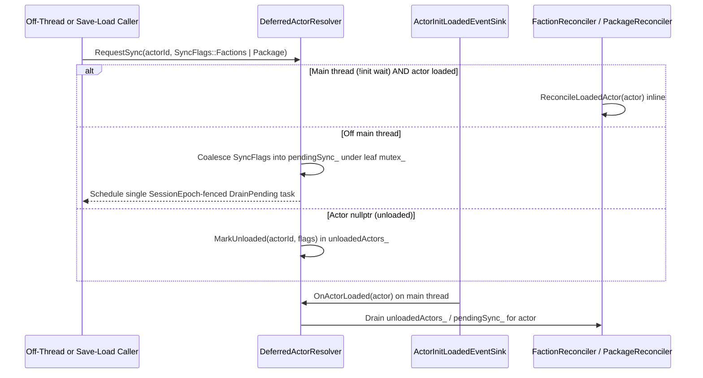

# FactionReconciler

**Sources**: [FactionReconciler.h](../../../SKSE_Source/modules/engine/include/maras/engine/FactionReconciler.h) · [FactionReconciler.cpp](../../../SKSE_Source/modules/engine/src/FactionReconciler.cpp) · [FactionHooks.cpp](../../../SKSE_Source/modules/engine/src/FactionHooks.cpp) · [DeferredActorResolver.h](../../../SKSE_Source/modules/engine/include/maras/engine/DeferredActorResolver.h) · [DeferredActorResolver.cpp](../../../SKSE_Source/modules/engine/src/DeferredActorResolver.cpp) · [EngineSyncPlan.h](../../../SKSE_Source/modules/state/include/maras/state/EngineSyncPlan.h) · [EngineSyncPlan.cpp](../../../SKSE_Source/modules/state/src/EngineSyncPlan.cpp)  
**Cross-References**: [WorldStoreAndCoSave.md](WorldStoreAndCoSave.md) · [PackageReconciler.md](PackageReconciler.md) · [LineageUseCases.md](LineageUseCases.md) · [ARCHITECTURE.md](../ARCHITECTURE.md)

## Overview

In M.A.R.A.S, `TT_MARAS.esp`, vanilla, and Hearthfire factions are strictly **non-authoritative engine mirrors** computed from immutable `WorldStore` snapshots (`EngineSyncPlan`) and applied idempotently on Skyrim's main thread by `FactionReconciler` (`modules/engine`). Unloaded or off-thread requests coalesce through `DeferredActorResolver`.

---

## Pure Sync Plans & Convergence

`EngineSyncPlan` (`modules/state`, `pch_core.h`) computes pure diff targets without engine dependencies, and `FactionReconciler` applies only changed ranks (`SyncActorFaction`, `ApplyMembershipOp`):

| Target Category | Plan Producer | Mirrored Factions & Edge Rules |
| :--- | :--- | :--- |
| **Player (`0x14`)** | `ComputePlayerFactionPlan` | Synchronizes `PlayerMarriedFaction` (`0x000C6472`, cleared when polygamy is enabled or `spousesCount == 0`) and `CanFormNonCheatingMainFaction` (`1` if polygamy enabled or no closed main relationship exists, `0` otherwise). |
| **Registered Adults & Graduated Stage 4** | `ComputeAdultActorFactionPlan` | Converges MARAS ranked factions (tracked status rank, social class, skill type, temperament, hierarchy, affection, spouse children count, cheating/open flags, non-cheating main rank, housed rank), vanilla marriage/follower factions (`PotentialMarriageFaction` `0x19809` ensured for any non-family registered adult with a Player relationship `playerStatus != Unknown` unless married to another NPC under `!enablePlayerPolygamy`, or with a `Candidate`/`Divorced` NPC edge; `TTM_IgnoreProposal` `0xC0B` stripped only on `Engaged`, `Married`, `Divorced`, or `Jilted` with the Player), and clears young-child factions + optionally restores follower/werewolf factions on graduated Stage 4 adults. For MARAS or vanilla `BGSRelationship` Player family members, assigns `TTM_PlayerFamilyBlocked` (`0xDD4` rank `0`), suppresses Player-romance factions (`trackedRank`, hierarchy, affection, cheating/open, shared house) while preserving archetype/non-cheating-main ranks for NPC-NPC matchmaking, and force-strips `PotentialMarriageFaction` (`0x19809`) even when inherited from a `TESNPC` base record (`forceStripMarriagePotential`). Otherwise, `IsNativeBaseFaction` (`preserveIfNativeOnBase`) prevents stripping native `TESNPC` base factions when removing MARAS flags. |
| **Young Children (`Stage 0–3`)** | `ComputeChildFactionPlan` | Converges `PlayerChildFaction`, `BYOHRelationshipAdoptionChildOwnedFaction`, `BYOHRelationshipAdoptable` (rank `25` in household, rank `0` at Honorhall orphanage marker), `PlayerFaction`, and dual-parent marriage indicator rank (`2` if other spouse is male, `1` otherwise), plus saved crime faction restoration (`ClearChildHouseholdFactions` strips these when leaving custody). |
| **Child Pets & Critters** | `ComputeCompanionFactionPlan` | Synchronizes `PlayerChildPetFaction` and `PlayerFaction` when assigned to a tracked living child. |

Unregistered/removed actors reaching step 4 of `ReconcileLoadedActor` first check whether `ExtraFactionChanges` or any static `TT_MARAS.esp` base faction is present (`HasCandidateMarasFactionsOnUnknownActor`), skipping the 25-faction scrub completely on untouched creatures/NPCs while still stripping lingering companion and MARAS factions safely via `ClearUnknownActorMarasFactions` when present.

---

## Engine & Papyrus Faction Hooks (`FactionHooks.cpp`)

`FactionReconciler::InstallHooks()` and `FactionReconciler::RegisterPapyrusHooks()` intercept external faction writes across both native C++ engine calls and Papyrus scripts:

- **Native Prologue Detours**: `InstallHooks()` detours `RE::Actor::AddToFaction` (`RELOCATION_ID(36678, 37686)`) and `RE::Actor::RemoveFromFaction` (`RELOCATION_ID(36680, 37688)`), handling already-hooked targets (`E9` chaining) or decoding x64 prologue instruction boundaries (`DecodePrologueSize`) onto a 14-byte SKSE trampoline bridge.
- **Papyrus Native VM Wrappers**: Because vanilla `Actor.psc` implements `Actor.AddToFaction(Faction)` in script as a call to `SetFactionRank(akFaction, 0)` (bypassing `RE::Actor::AddToFaction`), `RegisterPapyrusHooks()` wraps `Actor.SetFactionRank` and `Actor.ModFactionRank` on the VM's `Actor` `ObjectTypeInfo` via `NativeFunctionBase` wrappers (`ActorFactionRankNativeWrapper`), clamping Papyrus ranks to `[-128, 127]` (`ClampPapyrusFactionRank` / `ComputeModdedFactionRank`).
- **Zero-Allocation Fast-Exit for Non-Marriage Factions**: When the target faction is not `PlayerMarriedFaction` (`0x000C6472`) or vanilla courtship/potential factions (`PotentialMarriageFaction` `0x00019809`, `MarriageAskedFaction` `0x000FF7F3`, `CourtingFaction` `0x0007431A`) and no external faction listeners are registered (`!HasListeners()`), all four hook entry points forward immediately with zero snapshot copies or task allocations.
- **Re-Entrancy Suppression (`InternalFactionScope`)**: Sets `thread_local int s_internalFactionDepth` while MARAS performs its own `AddToFaction`/`RemoveFromFaction` writes so external auto-promotion/demotion rules are skipped while still dispatching `NotifyFactionAdded` / `NotifyFactionRemoved` callbacks to registered listeners (such as adoption tracking).
- **Unified Policy (`EvaluateExternalFactionWrite`)**: All four hooks share `HandleExternalFactionRankMutation` backed by `EngineSyncPlan::EvaluateExternalFactionWrite`:
  - **Polygamy Protection**: Drops `PlayerMarriedFaction` additions (`rank >= 0`) to the Player when `enablePlayerPolygamy` is enabled so vanilla marriage quest conditions remain compatible with multiple spouses.
  - **Player Family Guard**: Blocks inline (or reconciles off-thread) additions of `PotentialMarriageFaction`, `MarriageAskedFaction`, or `CourtingFaction` on MARAS or vanilla `BGSRelationship` Player family members.
  - **Vanilla & Modded Marriage Sync**: Marshals external `PlayerMarriedFaction` additions/removals on NPCs onto the main thread (`CanSyncEngineInline()` or `AddCurrentEpochTask` under `GetPapyrusMutex()`) into `OnExternalMarriageFactionAdded` (if `CanAcceptExternalMarriage` permits, otherwise reverted) or `OnExternalMarriageFactionRemoved`.

---

## `DeferredActorResolver` (`PendingEngineSyncSet` & Thread Gate)

- **Main-Thread Identity Rule**: `CaptureMainThread()` is called strictly during `SKSEPluginLoad` / `kInputLoaded` on Skyrim's WinMain thread — **never** during `kDataLoaded` (`InitTESThread`) and **never** treating `BSTaskPool`/`BSJobs` worker threads as the main thread inside `DeferredActorResolver`.
- **Leaf Mutex Discipline**: `DeferredActorResolver::mutex_` protects only `pendingSync_`, `unloadedActors_`, `drainScheduled_`, and `queuedEpoch_`; queued flags are moved out before calling engine/reconciler/`WorldStore` APIs.
- **Save Boundaries**: `ReconcileAllOnLoad` converges Player + all registered adults, children, pets/critters, and tenants after co-save load (recording unloaded ones in `DeferredActorResolver`), while `Revert()` clears `pendingAllOnLoad_` and both `DeferredActorResolver` maps cleanly.
