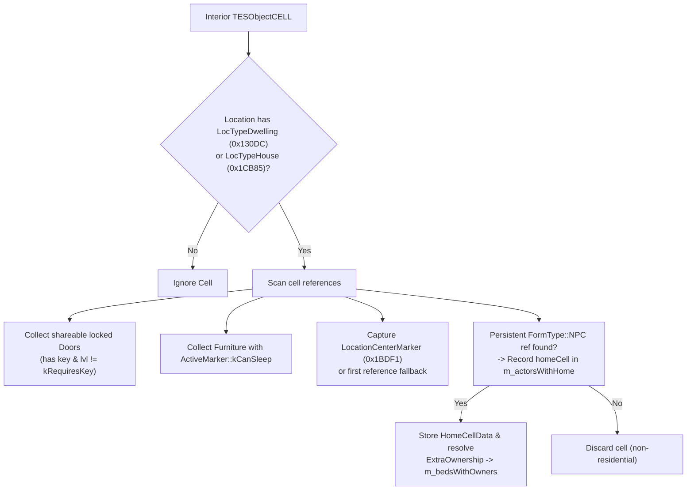

# HomeCellDetector

**Sources**: [SpatialWorldIndex.cpp](../../../SKSE_Source/modules/engine/src/SpatialWorldIndex.cpp) · [SpatialWorldIndex.h](../../../SKSE_Source/modules/engine/include/maras/engine/SpatialWorldIndex.h) · [BedOwnershipReconciler.h](../../../SKSE_Source/modules/engine/include/maras/engine/BedOwnershipReconciler.h) · [BedOwnershipReconciler.cpp](../../../SKSE_Source/modules/engine/src/BedOwnershipReconciler.cpp)  
**Cross-References**: [SpatialWorldIndex.md](SpatialWorldIndex.md) · [HouseholdUseCases.md](HouseholdUseCases.md) · [WorldStoreAndCoSave.md](WorldStoreAndCoSave.md) · [ARCHITECTURE.md](../ARCHITECTURE.md)

## Overview

In the modularized M.A.R.A.S architecture, legacy `HomeCellService` responsibilities are unified into two coordinated engine components:

1. **Static Home Cell, Door & Bed Discovery**: Owned by `SpatialWorldIndex` (`BuildHomeCellIndexLocked`, `ScanHomeCellLocked`) at `kDataLoaded` (replaces standalone `HomeCellService`).
2. **Cell Sharing & Bed Ownership Mutation/Restoration**: Owned by `BedOwnershipReconciler` (`ApplyShareHomeWithPlayer`, `StopShareHomeWithPlayer`, `ApplyShareFurniture`, `RestoreFurniture`, `ReapplyAllSharedCellsOnLoad`), backed by persistent `SharedCellRecord` and `originalBedOwners` entries in `WorldStore`.

---

## Home Cell Scanning Algorithm

At `kDataLoaded`, `SpatialWorldIndex::BuildHomeCellIndexLocked()` iterates `RE::TESDataHandler::interiorCells` using three heuristic filters inside `ScanHomeCellLocked`:

### Exact Heuristic Criteria

| Element | Heuristic Rule |
| :--- | :--- |
| **Residential Keywords** | Cell `BGSLocation` must possess `LocTypeDwelling` (`0x000130DC`) or `LocTypeHouse` (`0x0001CB85`). |
| **Persistent Resident Gate** | A cell is accepted **only** if at least one reference inside it satisfies `ref->IsPersistent()` and `base->formType == RE::FormType::NPC`. Each persistent NPC's first matched cell becomes `m_actorsWithHome[actorId].homeCell`. |
| **Center Marker Resolution** | Prefers a reference carrying `ExtraLocationRefType == LocationCenterMarker` (`0x0001BDF1`); falls back to the first scanned reference if no marker exists (logging a `WARN` if neither is found). |
| **Shareable Doors** | `FormType::Door` references with a valid `RE::REFR_LOCK` that specify a `key` pointer and whose `GetLockLevel(&doorRef) != RE::LOCK_LEVEL::kRequiresKey`. |
| **Bed Ownership Mapping** | `FormType::Furniture` references whose `TESFurniture::furnFlags` include `ActiveMarker::kCanSleep`. Only after confirming a persistent resident exists does `ProcessBedOwnershipLocked` read `bedRef.extraList.GetOwner()` and append `bedRef->GetFormID()` under that owner's FormID (`m_bedsWithOwners`). |

### Query APIs

- `GetNpcHome(actor)` / `GetNpcHome(actorFormID)`: Returns the persistent resident's discovered `homeCell` FormID (resolving both base and reference IDs).
- `GetNpcOriginalHouseCenterMarker(actor)`: Resolves `m_actorsWithHome` -> `m_homeCells[cellId].centerMarker`, used for family visits (see [TravelRules.md](TravelRules.md)) and returning divorced/unhoused spouses home.
- `GetNpcBeds(actor)`: Looks up `m_bedsWithOwners` by base FormID (checking `TESActorBase`), resolving beds owned by that NPC or their household owner form.
- `GetCellDoors(cellFormID)`: Returns the indexed shareable door FormIDs for a cell.

---

## Live Sharing & Restoration (`BedOwnershipReconciler`)

- **Cell Public State & Doors**: `ApplyShareHomeWithPlayer` records the cell's original `Public` boolean (`originalPublicRecorded`, `originalPublicState`) in `WorldStore::household` on first share, sets `cell->SetPublic(true)`, unlocks shareable doors from `GetCellDoors`, and registers the spouse in `sharingSpouses`. On `StopShareHomeWithPlayer`, once the last sharing spouse leaves a cell (`sharingSpouses.size() == 1`), `RestoreUnsharedCells` restores `originalPublicState`.
- **Bed Ownership (`AllOriginalBedOwners`)**: `ApplyShareFurniture` snapshots non-`PlayerFaction` original owners (`bedRef -> originalOwnerFormID`) in `WorldStore` before calling `extraList.SetOwner(PlayerFaction)`. `RestoreFurniture` restores saved original owners (or `nullptr`, or `actorBase` fallback) and erases the saved entry from `WorldStore`.
- **Load Convergence**: `ReapplyAllSharedCellsOnLoad` re-applies `Public` cell state, door unlocks, and `PlayerFaction` bed ownership after co-save load, backfilling `originalPublicRecorded` if a legacy save omitted it.
