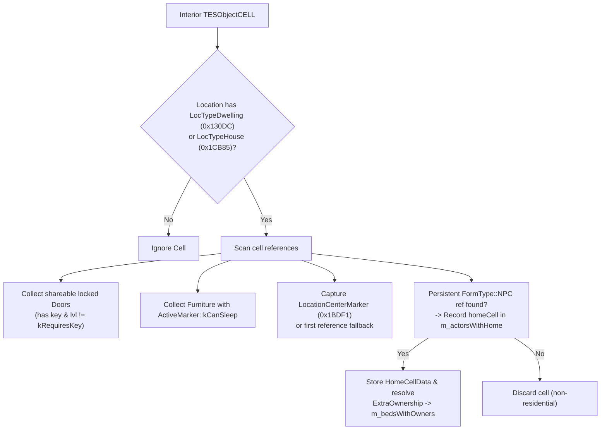

# HomeCellDetector

**Sources**: [SpatialWorldIndex.cpp](../../../SKSE_Source/modules/engine/src/SpatialWorldIndex.cpp) · [SpatialWorldIndex.h](../../../SKSE_Source/modules/engine/include/maras/engine/SpatialWorldIndex.h) · [BedOwnershipReconciler.h](../../../SKSE_Source/modules/engine/include/maras/engine/BedOwnershipReconciler.h) · [BedOwnershipReconciler.cpp](../../../SKSE_Source/modules/engine/src/BedOwnershipReconciler.cpp)  
**Cross-References**: [SpatialWorldIndex.md](SpatialWorldIndex.md) · [HouseholdUseCases.md](HouseholdUseCases.md) · [WorldStoreAndCoSave.md](WorldStoreAndCoSave.md) · [ARCHITECTURE.md](../ARCHITECTURE.md)

## Overview

In the modularized M.A.R.A.S architecture, legacy `HomeCellService` responsibilities are unified into two coordinated engine components:

1. **Static & Lazy Home Cell, Door & Bed Discovery**: Owned by `SpatialWorldIndex` (`BuildHomeCellIndexLocked`, `ScanHomeCellLocked`, `RefreshHomeCellBeds`) at `kDataLoaded` and on interior cell load (`RE::TESCellFullyLoadedEvent`).
2. **Cell Sharing & Bed Ownership Mutation/Restoration**: Owned by `BedOwnershipReconciler` (`ApplyShareHomeWithPlayer`, `StopShareHomeWithPlayer`, `ApplyShareFurniture`, `RestoreFurniture`, `ReapplyAllSharedCellsOnLoad`, `OnCellFullyLoaded`) + pure domain planner `SpouseAssetRules::PlanLoadedCellBedReconciliation`, backed by persistent `SharedCellRecord` and `originalBedOwners` entries in `WorldStore`.

---

## Home Cell Scanning Algorithm

At `kDataLoaded`, `SpatialWorldIndex::BuildHomeCellIndexLocked()` iterates `RE::TESDataHandler::interiorCells` using three heuristic filters inside `ScanHomeCellLocked`:

### Exact Heuristic Criteria

| Element | Heuristic Rule |
| :--- | :--- |
| **Residential Keywords** | Cell `BGSLocation` must possess `LocTypeDwelling` (`0x000130DC`) or `LocTypeHouse` (`0x0001CB85`). |
| **Persistent Resident Gate** | A cell is accepted **only** if at least one reference inside it satisfies `ref->IsPersistent()` and `base->formType == RE::FormType::NPC`. Each persistent NPC's first matched cell becomes `m_actorsWithHome[actorId].homeCell`. |
| **Center Marker Resolution** | Prefers a reference carrying `ExtraLocationRefType == LocationCenterMarker` (`0x0001BDF1`); falls back to the first scanned reference if no marker exists (logging a `WARN` if neither is found). |
| **Shareable Doors** | `FormType::Door` references with a valid `RE::REFR_LOCK` that specify a `key` pointer and whose `GetLockLevel(&doorRef) != RE::LOCK_LEVEL::kRequiresKey`. |
| **Bed Ownership Mapping** | Adult-usable `FormType::Furniture` references whose `TESFurniture::furnFlags` include `ActiveMarker::kCanSleep` while excluding child-only beds (`RecordFlags::kChildCanUse`). Resolves effective ownership from `bedRef.extraList.GetOwner()` with fallback to `cell->GetOwner()` when inherited from the cell: direct `TESNPC` owners map to that adult NPC's base FormID, while residential `TESFaction` owners (e.g., vanilla `*HouseFaction` records) map to adult persistent residents of that cell who belong to the faction (`rank >= 0`). |

### Query & Lazy Refresh APIs

- `IsHomeCell(cellFormID)`: Fast `std::shared_lock` check testing whether an interior cell is an indexed residential home cell.
- `RefreshHomeCellBeds(cell, savedOriginalBedOwners)`: Invoked on the main thread when an interior cell finishes streaming (`RE::TESCellFullyLoadedEvent`), discovering non-persistent furniture beds that were not in memory at `kDataLoaded` (preserving original owners when `extraList` already holds `PlayerFaction`), gathering all `RE::*` pointers outside `m_mutex`, and committing deduplicated bed mappings under a tight lock.
- `GetNpcHome(actor)` / `GetNpcHome(actorFormID)`: Returns the persistent resident's discovered `homeCell` FormID (resolving both base and reference IDs).
- `GetNpcOriginalHouseCenterMarker(actor)`: Resolves `m_actorsWithHome` -> `m_homeCells[cellId].centerMarker`, used for family visits (see [TravelRules.md](TravelRules.md)) and returning divorced/unhoused spouses home.
- `GetNpcBeds(actor)`: Looks up `m_bedsWithOwners` by base FormID (checking `TESActorBase`), resolving beds owned by that NPC or their household owner form.
- `GetCellDoors(cellFormID)` *(C++ engine internal)*: Returns the indexed shareable door FormIDs for a cell, consumed directly by `HouseholdEngineOps::UnlockAndGrantSpouseHomeAccess`.

---

## Live Sharing & Restoration (`BedOwnershipReconciler`)

- **Cell Public State, Factions, Doors & HUD Notifications**: When an NPC has no indexed home cell, `ApplyShareHomeWithPlayer` assigns `NoInitialHouseFaction` (`0x7F`) on the main thread and queues `$TTM_MSG_SpouseNoHome`. Otherwise it records the cell's original `Public` boolean (`originalPublicRecorded`, `originalPublicState`) in `WorldStore::household` on first share, sets `cell->SetPublic(true)`, registers the spouse in `sharingSpouses`, reconciles `SharedHouseFaction` (`0x7B`) via [`FactionReconciler`](FactionReconciler.md), unlocks non-keyed lockable doors or grants missing door keys to the Player via `HouseholdEngineOps::UnlockAndGrantSpouseHomeAccess`, and queues `$TTM_MSG_SpouseSharedHome`. On `StopShareHomeWithPlayer` (with optional reason `"divorce"`, `"deceased"`, `"affection"`, or generic), once the last sharing spouse leaves a cell (`sharingSpouses.size() == 1`), `RestoreUnsharedCells` restores `originalPublicState`, `FactionReconciler` clears `0x7B`, and the matching `$TTM_MSG_SpouseSharedHomeStopped*` HUD notification is queued.
- **Bed Ownership (`AllOriginalBedOwners`)**: `ApplyShareFurniture` snapshots non-`PlayerFaction` original `extraList` owners (`bedRef -> originalOwnerFormID`, using `0` when ownership was originally inherited from `cell->GetOwner()`) in `WorldStore` before calling `extraList.SetOwner(PlayerFaction)`. `RestoreFurniture` restores saved original owners (or `nullptr` for cell-inherited beds), erases the saved entry from `WorldStore`, and re-applies `ApplyShareFurniture` for any remaining co-spouses who still share that cell.
- **Load & Lazy Interior Cell-Load Convergence (`ReapplyAllSharedCellsOnLoad` & `OnCellFullyLoaded`)**: `ReapplyAllSharedCellsOnLoad` re-applies `Public` cell state and loaded bed ownership after co-save load. Because non-persistent furniture inside unloaded interior cells is streamed into memory only when entered, `CellFullyLoadedEventSink` (`plugin.cpp`, `RE::TESCellFullyLoadedEvent`) dispatches interior cell loads onto the main thread to `BedOwnershipReconciler::OnCellFullyLoaded`, which refreshes newly streamed cell beds via `SpatialWorldIndex::RefreshHomeCellBeds` and executes `SpouseAssetRules::PlanLoadedCellBedReconciliation`—sharing beds for active `sharingSpouses` or lazily restoring/erasing stale `originalBedOwners` entries if a divorce occurred while that interior cell was unloaded.
