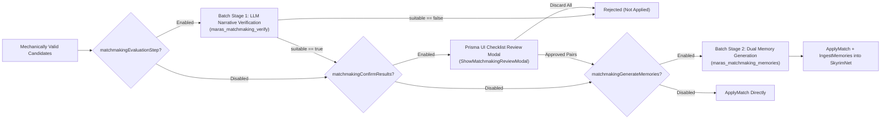

# MatchmakingService — Feature & Mechanics Guide

**Implementation**: [MatchmakingService.cpp](file:///e:/Skyrim/development/mods/M.A.R.A.S%20Dev/SKSE_Source/src/core/MatchmakingService.cpp)

`MatchmakingService` drives autonomous and player-triggered **NPC-to-NPC romance progression** and **Tier 2 Player-Partner Agency** across Skyrim. It pairs single NPCs, advances existing relationships (`Lover -> Dating -> Engaged -> Married`), triggers breakups/divorces, opens or closes primary relationships, runs the dedicated **Player-Partner Agency & Infidelity Engine** (2-stage affairs, open-relationship lovers, side-lover breakups, force-greet intents, and home-arrival events), and—when **SkyrimNet** is installed—runs a multi-stage LLM evaluation, narrative verification, and dual-perspective memory generation pipeline.

---

## 1. Execution Modes: Scheduled vs. Manual Matchmaking

### 1. Scheduled Autonomous World Scans (Tier 3 NPCs)
- Triggered periodically during the game-day tick once `matchmakingIntervalDays` have elapsed since `lastMatchmakingDay_`.
- Can operate in two selection engines depending on player settings and whether **SkyrimNet** is available:
  1. **LLM World Scan (`RunLLMScheduledMatchmaking`)**: Sends the eligible adult NPC pool and existing NPC pairs to SkyrimNet's `gamemaster_evaluation` model (`maras_evaluations/maras_matchmaking_scheduled`) to propose up to `matchmakingMaxSuggestions` relationship changes across the world.
  2. **Weighted Dice-Roll Engine (`RunDiceRollMatchmaking`)**: Rolls weighted action slots in C++ and resolves random mechanically valid NPC pairs without an initial LLM scan.
     - **Hybrid Dice-Roll + SkyrimNet Pipeline**: Even when using the Dice-Roll engine to select pairs, if **SkyrimNet** is loaded and either `matchmakingEvaluationStep` or `matchmakingGenerateMemories` is enabled, the matched pairs are routed through the enabled **LLM Narrative Verification & Memory Generation** pipeline stages before being applied. If SkyrimNet is absent or both stages are disabled, dice-roll matches are applied immediately in the background.

### 2. Manual Per-NPC Matchmaking (Prisma UI)
- Triggered from the Prisma UI Dashboard for a specific target NPC (`maras_evaluations/maras_matchmaking_manual`).
- Pre-computes the exact set of legal operations (`new`, `advance`, `breakup`, `open`, `close`) and target statuses specifically valid for that NPC's current relationship state and sends them to the LLM along with orientation-filtered candidates.
- Deduplicates the LLM's suggestions (enforcing at most 1 suggestion per candidate partner) and streams them back to the Prisma UI so the player can review, edit memories, or apply them.

### 3. Manual Global Matchmaking (Prisma UI)
- Triggered from the Prisma UI Dashboard to scan the entire world on demand, either returning proposals to the UI for manual approval or auto-applying them through the scheduled pipeline.

---

## 2. Candidate Filtering, Orientation & Eligibility Rules

Before any NPC is included in a matchmaking scan or paired by the dice-roll engine, `MatchmakingService` enforces strict eligibility rules:

1. **Player & Child Exclusions**:
   - The Player (`0x14`) and all child NPCs are strictly excluded from NPC-to-NPC matchmaking.
2. **3-Tier Agency Separation (Unconditional Player Main Partner Exclusion)**:
   - All active Main Partners of the Player (`Dating`, `Engaged`, `Married` — whether Closed or Open) are **unconditionally excluded** from generic Tier 3 world matchmaking (`BuildExistingPairsString`, `BuildScheduledContext`, `FindEligiblePairForSlot`, `RunDiceRollMatchmaking`, `ProcessScheduledResults`) and are managed exclusively by the **Tier 2 Player-Partner Agency Engine** (`TryScheduledPlayerPartnerInfidelity` & `EvaluatePartnerHomeArrival`).
3. **Per-NPC Relationship Change Cooldown (`matchmakingNpcCooldownDays`)**:
   - Whenever an NPC undergoes a matchmaking change (`ApplyMatch`), both actors are stamped with the current game day.
   - Neither NPC can be selected again by scheduled world scans or dice rolls until `matchmakingNpcCooldownDays` have elapsed.
4. **Single-Operation-Per-Batch Rule**:
   - Within a single scheduled or global scan batch, each NPC can participate in at most **one** relationship operation. Any subsequent suggestion involving an already-used actor in the same batch is discarded.
5. **7 Sexual Orientation Rules (`matchmakingOrientation`)**:
   - Enforced both in LLM prompt instructions and in hard C++ validation checks:
     - **Any**: Any combination of sexes allowed.
     - **Heterosexual**: Male + Female only (Default).
     - **Homosexual**: Male + Male or Female + Female only.
     - **Gay**: Male + Male only (females excluded).
     - **Lesbian**: Female + Female only (males excluded).
     - **Heterosexual and Gay**: Male + Female or Male + Male only.
     - **Heterosexual and Lesbian**: Male + Female or Female + Female only.
6. **Primary vs. Secondary Eligibility Tagging**:
   - Every Tier 3 NPC is classified into one of three eligibility states based on their existing relationships:
     - **`can form main`**: Single (no active `Dating`, `Engaged`, or `Married` partner). Can form a new `Dating` or `Lover` relationship, or advance an existing `Lover` to `Dating`/`Engaged` (if the lover is also single).
     - **`secondary only (allowed)`**: Has an active primary partner (`Dating`/`Engaged`/`Married`), and at least one primary relationship is marked **Open** (`isOpen == true`). Can form consensual secondary `Lover` relationships.
     - **`secondary only (cheating)`**: Has an exclusive (`isOpen == false`) primary partner. Can only form a secret `Lover` affair if `matchmakingAllowCheating` is enabled.
7. **Incest / Family Blocking**:
   - Queries `NPCRelationshipManager::AreFamilyMembers` to prevent family members (parents, children, siblings) from being paired into new romantic relationships.

---

## 3. Weighted Dice-Roll Engine Mechanics

When running in Dice-Roll mode (`RunDiceRollMatchmaking`), the service plans up to `matchmakingMaxSuggestions` action slots using user-configured weights:

1. **Category Caps (Max 3 per Category)**:
   - Action options are grouped into four categories—**New** (`dating`, `engaged`, `lover` allowed, `lover` cheating), **Advance**, **Breakup**, and **Open/Close**—with a hard cap of **at most 3 slots per category** in a single cycle so one category cannot monopolize a large scan.
2. **Randomized Pair Resolution**:
   - For each rolled slot, shuffles the candidate pool (for `new`) or the existing relationship pair table (for `advance`, `breakup`, `open_or_close`) and picks the first pair that passes orientation, cooldown, family, cheating, and `NPCRelationshipManager` transition rules:
     - **Advance**: Transitions `Dating -> Engaged`, `Engaged -> Married`, or `Lover -> Dating`.
     - **Breakup**: Transitions `Married -> Divorced`, `Engaged -> Jilted`, `Dating -> ExDating`, or `Lover -> ExLover`.
     - **Open / Close**: Evaluates `CanOpenRelationship` / `CanCloseRelationship` and flips a coin if both are valid for an `open_or_close` slot.

---

## 4. Two-Tier LLM Verification & Memory Generation Pipeline

When **SkyrimNet** is active, candidate matches from scheduled scans (both LLM-proposed and Dice-Roll-selected) pass through an asynchronous two-stage batch pipeline:

---

## 5. Tier 2 Player-Partner Agency & Infidelity Engine (`TryScheduledPlayerPartnerInfidelity`)

When `playerPartnerCheatingAgencyEnabled` (closed-relationship cheating agency) or `playerPartnerOpenRelAgencyEnabled` (open-relationship agency) is enabled—independently of generic NPC `matchmakingEnabled`—all active Main Partners of the Player (`Dating`, `Engaged`, `Married` — both Closed and Open) are evaluated by a dedicated Tier 2 agency engine every `GetPartnerAgencyScanIntervalDays()` (`1.5x L`, where $L = \text{lonelinessThresholdDays}$, default `2` days $\rightarrow$ `3` days):

### 5.1 Master Time Unit ($L$) & Configurable Day-Threshold Multipliers (`Settings.h`)
All time thresholds derive from `Settings::lonelinessThresholdDays` ($L$, default `2`, range `1-14`) multiplied by 14 co-save persisted multiplier settings in [`Settings.h`](file:///e:/Skyrim/development/mods/M.A.R.A.S%20Dev/SKSE_Source/include/utils/Settings.h) (all configurable on the dedicated **Partner Agency** settings page in Prisma UI):
- **Partner Agency Scan Interval (`multPartnerAgencyScanInterval`)**: default `1.5x L` (`3` days)
- **Loneliness Decay & Open-Lover Loneliness Onset (`multLonelinessDecayStart`)**: default `1.0x L` (`2` days)
- **Recent Attention & Guilt Window (`multRecentAttentionWindow`)**: default `1.0x L` (`2` days)
- **Very Recent Visit Window for Open Partners (`multVeryRecentVisitWindow`)**: default `0.5x L` (`1` day)
- **Neglect Growth Onset for Troubled/Estranged (`multNeglectGrowthStart`)**: default `1.0x L` (`2` days)
- **Neglect Growth Onset for Content Partners (`multContentNeglectStart`)**: default `2.0x L` (`4` days)
- **Prolonged Absence Penalty for Affair Breakups (`multProlongedAbsencePenalty`)**: default `2.0x L` (`4` days)
- **Affair `Talking` -> `Physical` Escalation (`multAffairTalkingEscalation`)**: default `2.0x L` (`4` days)
- **Minimum Side-Lover Age Before Breakup (`multMinSideFlingAgeForBreakup`)**: default `1.5x L` (`3` days)
- **Pending Force-Greet Intent TTL (`multPartnerIntentTTL`)**: default `2.0x L` (`4` days)
- **Home-Arrival Event Location Cooldown (`multHomeArrivalCooldown`)**: default `1.0x L` (`2` days)
- **Affair Fatigue & Open Fling Novelty Fade Onset (`multAffairFatigueStart`)**: default `5.0x L` (`10` days)
- **Romantic Partner Attended Breakup Window (`multRomanticAttendedBreakup`)**: default `1.5x L` (`3` days)
- **Suggest Open Relationship Neglect Onset (`multSuggestOpenNeglectMin`)**: default `2.0x L` (`4` days)

### 5.2 Pending Intent TTL Expiration & Deterministic `Talking` $\rightarrow$ `Physical` Escalation
At the start of each scan (and lazily on player cell arrival):
1. **Expired `PendingPartnerIntent` (`currentDay - createdGameDay >= 2.0x L`)**:
   - `ConfessTalking` / `ConfessPhysical` expires $\rightarrow$ clears intent; if the affair is still `Talking`, it immediately escalates to `AffairStage::Physical`.
   - `SuggestOpen` expires $\rightarrow$ clears intent and **immediately triggers Stage 2 Candidate Selection to start a `Talking` secret affair** (bypassing the Stage 1 roll).
   - `SuggestClose` expires $\rightarrow$ clears intent and applies **`-12` permanent affection**.
2. **Deterministic Affair Escalation (`currentDay - stageStartDay >= 2.0x L`)**:
   - Any active `AffairStage::Talking` affair on a player partner that has lasted `>= 2.0x L` days without breaking up or being resolved deterministically upgrades to `AffairStage::Physical` (sex stage).

### 5.3 Five Scheduled Partner Agency Actions (Educated C++ Probabilities)
Each eligible partner (not following/nearby the player and off the `2.5x L` partner cooldown) is evaluated across five actions:
- **Shared Diminishing Multiplier for Existing Side Lovers (`Mult_ExistingLovers`)**:
  - `0` active side lovers $\rightarrow$ `1.00x`
  - `1` active side lover $\rightarrow$ `0.75x`
  - `2` active side lovers $\rightarrow$ `0.50x`
  - `3+` active side lovers $\rightarrow$ `0.30x`
  - `>= playerPartnerCheatingMaxSecretLovers` $\rightarrow$ `0.00x` (hard cap)
- **Action A — Break Up Ongoing Cheating Affair (`AffairStatus::Ongoing`, age `>= 1.5x L`)**:
  - Base `10%`, `+20%` Guilt (`Humble`/`Romantic` with `affection >= 60`), `+15%` Reconnected (`daysSince <= 1.0x L`), `+10%` Novelty Worn Off (`age >= 5.0x L`), `-15%` Still Resentful (`affection < 35 || revengeActive`), scaled by `Talking (1.40x)` vs `Physical (0.85x)` and `playerPartnerAgencyBreakupChanceMultiplier` (clamped `5%–65%`).
  - On breakup (`PromoteToExLover` $\rightarrow$ `AffairStatus::EndedBreakup`), if the partner is `Humble` or `Romantic` with `affection >= 60 && daysSince <= 1.0x L`, a `20%` sub-roll queues `ConfessTalking` or `ConfessPhysical`.
- **Action B — Break Up Open-Relationship Side Lover (`isOpen == true`, age `>= 1.5x L`)**:
  - Base `12%`, `+15%` Player Present (`daysSince <= 1.0x L`), `+15%` Novelty Worn Off (`age >= 5.0x L`), `+10%` Monogamous Heart (`Romantic`/`Jealous`), `-10%` Independent (`Independent`), scaled by `playerPartnerAgencyBreakupChanceMultiplier` (clamped `5%–60%`).
- **Action C — Start New Cheating Affair (`!isOpen`, starts at `AffairStage::Talking` + `RelationshipStatus::Lover`)**:
  - Evaluated via the Stage 1 Temptation Formula scaled by `Mult_ExistingLovers`.
- **Action D — Start New Consensual Open Lover (`isOpen == true`)**:
  - Base desire (`Happy: 12%`, `Content: 18%`, `Troubled: 10%`, `Estranged: 0%`) + Loneliness (`daysSince > 2.5x L`: `+(daysSince - 2.5L)*1.5%`, max `+15%`) - Recent Attention (`daysSince <= 1.0x L`: `-8%`), scaled by Temperament (`Independent 1.50x`, `Romantic 1.10x`, `Proud 1.00x`, `Humble 0.65x`, `Jealous 0.40x`), `Mult_ExistingLovers`, and `playerPartnerAgencyOpenLoverChanceMultiplier` (clamped `0%–50%`).
- **Action E — Queue Force-Greet Relationship Intent (`playerPartnerAgencyEnableForceGreets`)**:
  - **`SuggestOpen`** (`!isOpen && activeSideLovers == 0 && affection >= 35`): Base (`Independent: 18%`, `Romantic: 6%`, `Proud: 5%`, `Humble: 2%`, `Jealous: 0%`) + Loneliness (`daysSince > 2.5x L`: `+10%`) + Polygamy Parity (`+12%`), clamped `0%–35%`.
  - **`SuggestClose`** (`isOpen == true`): Base (`Jealous: 30%`, `Romantic: 20%`, `Proud: 12%`, `Humble: 10%`, `Independent: 2%`) + Partner Has 0 Side Lovers While Player Has 1+ (`+15%`) + Devoted (`affection >= 75`: `+10%`) - Partner Enjoying Side Lover (`-20%`), clamped `0%–50%`.

### 5.4 Stage 2 Evaluation Pipeline (`evalMode` in `maras_player_partner_cheating.prompt` vs. Dice-Roll Fallback) & Anti-Yo-Yo Rules
All five Partner Agency actions (Actions A, B, C, D, and E) follow the same 2-stage pipeline:
- **When `playerPartnerCheatingUseLLM && IsSkyrimNetAvailable()` is `true`**:
  - Actions that pass their Stage 1 C++ probability roll are evaluated by SkyrimNet via `maras_evaluations/maras_player_partner_cheating.prompt` using `evalMode`:
    - `"breakup_affair"` (Action A): Evaluates whether the partner ends their secret `talking`/`physical` affair (`"willBreakup"`) and whether guilt compels them to queue a confession intent (`"willConfess"`).
    - `"breakup_open_lover"` (Action B): Evaluates whether the partner amicably ends their consensual open-relationship fling (`"willBreakup"`).
    - `"suggest_open"` / `"suggest_close"` (Action E): Evaluates whether the partner decides to approach the player on next home arrival (`"willSuggest"`).
    - `"candidate_select"` (Action C & D): Evaluates the Top-8 candidate shortlist (`"willCheat"`, `"chosenCandidate"`).
  - Approved new side lovers (`"new"`) and approved side-lover breakups (`"breakup"`) pass through the optional Review Modal (`playerPartnerCheatingConfirmResults`) and **Dual First-Person Memory Generation** (`ExecuteMemoryBatchOrApply` $\rightarrow$ `maras_matchmaking_memories`) before `ApplyMatch` commits the state change (and queues `postBreakupIntent` if `"willConfess": true`).
- **When SkyrimNet is absent or `playerPartnerCheatingUseLLM` is `false`**:
  - Actions A, B, and E apply their Stage 1 C++ dice-roll outcomes directly (with Actions A and B still routing through `playerPartnerCheatingConfirmResults` if enabled), and Actions C & D select from the Top-8 candidate shortlist via weighted dice roll proportional to composite candidate score.
1. **Confronted Affair Hard-Block**: Any candidate with `AffairStatus::EndedConfronted` is permanently excluded (`-1000`).
2. **Failed Side-Fling Demotion & Penalty**: Any candidate who already broke up with `partnerID` during the current `(partnerID, Player)` relationship (`AffairStatus::EndedBreakup` or `ExLover`/`ExDating` timestamp `>= playerRelStartDay`) **never** gets Tier 1 (`100`) "Old Flame" priority; instead they are scored in their normal proximity tier (Tier 2–5) with a **`-40` score penalty per past breakup**.
3. **Co-Spouse Rule**: Other active main partners of the Player (`IsPlayerActiveMainPartner`) are hard-excluded for closed cheating affairs (`!isOpen`), and allowed in Tier 2 (`85`) for open-relationship lovers (`isOpen == true`).

---

## 6. Home-Arrival Evaluation (`EvaluatePartnerHomeArrival`)

Triggered from `TTM_PlayerScript.OnLocationChange` via `MARAS.EvaluatePartnerHomeArrival(akNewLoc)` when the player enters a partner's assigned player house or an unassigned partner's original home (`playerPartnerAgencyEnableHomeArrivalEvents`):
0. **Busy / Scene & Actor Validity Filtering**: Resident partners who are dead, disabled, deleted, in combat, or active player followers are skipped entirely; for Priority #2 side-lover scenarios, partners and side lovers currently participating in an active Skyrim scene (GetCurrentScene() != nullptr) are also skipped before rolling or consuming home-arrival cooldowns (while Priority #1 force-greets still fill their alias so Skyrim naturally executes the force-greet package as soon as any active scene finishes).
1. **Step 0 — Lazy TTL Check**: Processes any expired `PendingPartnerIntent` (`>= 2.0x L`) before evaluating arrival priority.
2. **Priority #1 — Pending Partner Intent (100% Trigger, No Dice Roll)**:
   - If a partner in the arrived cell/location has an active non-expired `PendingPartnerIntent`, it fires **100%** via `SKSE::ModCallbackEvent("maras_partner_home_arrival_event", jsonPayload, 0.0f, partnerActor)` with `"scenario": "intent_suggest_open" | "intent_suggest_close" | "intent_confess_talking" | "intent_confess_physical"` and **blocks** all side-lover scenarios for that visit.
3. **Priority #2 — Side-Lover Scenarios (`1.0x L` Location Cooldown + `25%` Base Roll)**:
   - `+15%` if `daysSince > 1.0x L`, `+10%` if Evening (`17:00-22:00`), or `+20%` if Night (`22:00-05:00`) (max `60%`).
   - Selects one of 6 scenarios (`open_date_away`, `open_in_house`, `cheating_talking_letter`, `cheating_talking_in_house`, `cheating_physical_letter`, `cheating_physical_in_house`).
   - For the 3 letter/away scenarios (`open_date_away`, `cheating_talking_letter`, `cheating_physical_letter`), locates the nearest inn/tavern (`LocTypeInn` `0x0001CB87`) and its interior `LocationCenterMarker` (`0x0001BDF1`), displays a 4-part combinatorial handwritten note via `PrismaModalManager` naming that tavern, and dispatches `maras_partner_home_arrival_event` with `targetLocationFormId` and `targetMarkerFormId`.
   - `TTM_MainController` starts quest `TTM_PartnerAway` (`0x000DC4`), immediately moves the partner to the tavern with a tavern sandbox package (`0x000DC5`), and sets an open-relationship (Stage 10) or cheating (Stage 20) objective pointing to the tavern. When the player enters the tavern (`TTM_PlayerScript.OnLocationChange`), `TTM_QuestPartnerAway.CheckPlayerArrival` completes the quest and delegates to `TTM_NpcsScenes.SetupSceneOnLocationChange` to move the lover into the tavern, mark cheating as exposed (for cheating scenarios), trigger the appropriate scene (sex or dialogue), and restore the lover to their original location when the player leaves.
