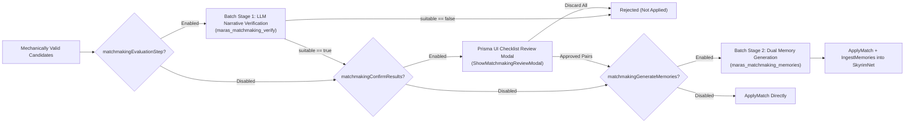

# MatchmakingService — Feature & Mechanics Guide

**Implementation**: [MatchmakingService.cpp](file:///e:/Skyrim/development/mods/M.A.R.A.S%20Dev/SKSE_Source/src/core/MatchmakingService.cpp)

`MatchmakingService` drives autonomous and player-triggered **NPC-to-NPC romance progression** across Skyrim. It pairs single NPCs, advances existing relationships (`Lover -> Dating -> Engaged -> Married`), triggers breakups/divorces, opens or closes primary relationships, and—when **SkyrimNet** is installed—runs a multi-stage LLM evaluation, narrative verification, and dual-perspective memory generation pipeline.

---

## 1. Execution Modes: Scheduled vs. Manual Matchmaking

### 1. Scheduled Autonomous World Scans
- Triggered periodically during the game-day tick once `matchmakingIntervalDays` have elapsed since `lastMatchmakingDay_`.
- Can operate in two selection engines depending on player settings and whether **SkyrimNet** is available:
  1. **LLM World Scan (`RunLLMScheduledMatchmaking`)**: Sends the eligible adult NPC pool and existing NPC pairs to SkyrimNet's `gamemaster_evaluation` model (`maras_evaluations/maras_matchmaking_scheduled`) to propose up to `matchmakingMaxSuggestions` relationship changes across the world.
  2. **Weighted Dice-Roll Engine (`RunDiceRollMatchmaking`)**: Rolls weighted action slots in C++ and resolves random mechanically valid NPC pairs without an initial LLM scan.
     - **Hybrid Dice-Roll + SkyrimNet Pipeline**: Even when using the Dice-Roll engine to select pairs, if **SkyrimNet** is loaded and either `matchmakingEvaluationStep` or `matchmakingGenerateMemories` is enabled, the matched pairs are routed through the enabled **LLM Narrative Verification & Memory Generation** pipeline stages before being applied. If SkyrimNet is absent or both stages are disabled, dice-roll matches are applied immediately in the background.

### 2. Manual Per-NPC Matchmaking (Prisma UI)
- Triggered from the Prisma UI Dashboard for a specific target NPC (`maras_evaluations/maras_matchmaking_manual`).
- Pre-computes the exact set of legal operations (`new`, `advance`, `breakup`, `open`, `close`) and target statuses specifically valid for that NPC's current relationship state and sends them to the LLM along with orientation-filtered candidates.
- Deduplicates the LLM's suggestions (enforcing at most 1 suggestion per candidate partner) and streams them back to the Prisma UI so the player can review, edit memories, or apply them.

### 3. Manual Global Matchmaking (Prisma UI)
- Triggered from the Prisma UI Dashboard to scan the entire world on demand, either returning proposals to the UI for manual approval or auto-applying them through the scheduled pipeline.

---

## 2. Candidate Filtering, Orientation & Eligibility Rules

Before any NPC is included in a matchmaking scan or paired by the dice-roll engine, `MatchmakingService` enforces strict eligibility rules:

1. **Player & Child Exclusions**:
   - The Player (`0x14`) and all child NPCs are strictly excluded from NPC-to-NPC matchmaking.
2. **Player Partner Protection (`matchmakingExcludePlayerActivePartners`)**:
   - When enabled, any NPC who is currently an active primary partner of the player (`Dating`, `Engaged`, `Married`) is excluded from automated matchmaking scans and dice rolls.
3. **Per-NPC Relationship Change Cooldown (`matchmakingNpcCooldownDays`)**:
   - Whenever an NPC undergoes a matchmaking change (`ApplyMatch`), both actors are stamped with the current game day.
   - Neither NPC can be selected again by scheduled world scans or dice rolls until `matchmakingNpcCooldownDays` have elapsed.
4. **Single-Operation-Per-Batch Rule**:
   - Within a single scheduled or global scan batch, each NPC can participate in at most **one** relationship operation. Any subsequent suggestion involving an already-used actor in the same batch is discarded.
5. **7 Sexual Orientation Rules (`matchmakingOrientation`)**:
   - Enforced both in LLM prompt instructions and in hard C++ validation checks:
     - **Any**: Any combination of sexes allowed.
     - **Heterosexual**: Male + Female only (Default).
     - **Homosexual**: Male + Male or Female + Female only.
     - **Gay**: Male + Male only (females excluded).
     - **Lesbian**: Female + Female only (males excluded).
     - **Heterosexual and Gay**: Male + Female or Male + Male only.
     - **Heterosexual and Lesbian**: Male + Female or Female + Female only.
6. **Primary vs. Secondary Eligibility Tagging**:
   - Every NPC is classified into one of three eligibility states based on their existing relationships:
     - **`can form main`**: Single (no active `Dating`, `Engaged`, or `Married` partner). Can form a new `Dating` or `Lover` relationship, or advance an existing `Lover` to `Dating`/`Engaged` (if the lover is also single).
     - **`secondary only (allowed)`**: Has an active primary partner (`Dating`/`Engaged`/`Married`), and at least one primary relationship is marked **Open** (`isOpen == true`). Can form consensual secondary `Lover` relationships.
     - **`secondary only (cheating)`**: Has an exclusive (`isOpen == false`) primary partner. Can only form a secret `Lover` affair if `matchmakingAllowCheating` is enabled.
7. **Incest / Family Blocking**:
   - Queries `NPCRelationshipManager::AreFamilyMembers` to prevent family members (parents, children, siblings) from being paired into new romantic relationships.

---

## 3. Weighted Dice-Roll Engine Mechanics

When running in Dice-Roll mode (`RunDiceRollMatchmaking`), the service plans up to `matchmakingMaxSuggestions` action slots using user-configured weights:

1. **Category Caps (Max 3 per Category)**:
   - Action options are grouped into four categories—**New** (`dating`, `engaged`, `lover` allowed, `lover` cheating), **Advance**, **Breakup**, and **Open/Close**—with a hard cap of **at most 3 slots per category** in a single cycle so one category cannot monopolize a large scan.
2. **Randomized Pair Resolution**:
   - For each rolled slot, shuffles the candidate pool (for `new`) or the existing relationship pair table (for `advance`, `breakup`, `open_or_close`) and picks the first pair that passes orientation, cooldown, family, cheating, and `NPCRelationshipManager` transition rules:
     - **Advance**: Transitions `Dating -> Engaged`, `Engaged -> Married`, or `Lover -> Dating`.
     - **Breakup**: Transitions `Married -> Divorced`, `Engaged -> Jilted`, `Dating -> ExDating`, or `Lover -> ExLover`.
     - **Open / Close**: Evaluates `CanOpenRelationship` / `CanCloseRelationship` and flips a coin if both are valid for an `open_or_close` slot.

---

## 4. Two-Tier LLM Verification & Memory Generation Pipeline

When **SkyrimNet** is active, candidate matches from scheduled scans (both LLM-proposed and Dice-Roll-selected) are not applied blindly; they pass through an asynchronous two-stage batch pipeline:

### Stage 1: Batched Narrative Verification (`maras_matchmaking_verify`)
- Evaluates each proposed pair individually with full character profiles, their existing relationship trees, and the UUIDs/names of any committed primary partners they might be cheating on.
- The LLM returns a JSON verdict (`suitable` / `allow` boolean + `reason`). Only pairs approved by the narrative evaluator advance to the review/memory pipeline.

### Optional Player Review Modal (`matchmakingConfirmResults` / `ShowMatchmakingReviewModal`)
- When `matchmakingConfirmResults` (**"Review Matchmaking Results in Modal"**) is enabled, `MatchmakingService` intercepts all candidate pairs (from scheduled LLM scans, global auto-apply scans, and Dice-Roll matchmaking) right *before* memory generation (`StartMemoryBatch`) and displays a consolidated Prisma UI checklist modal (`ModalTone::Ai`):
  - Each row shows `{actorAName} & {actorBName}`, their current status $\rightarrow$ proposed target status, an action badge (`New`, `Advance`, `Breakup`, `Cheating`, `Open`, `Close`), and the LLM verification reasoning or compatibility description.
  - Rows for `new`, `advance`, and `breakup` include an inline per-row status dropdown (`selectOptions`), allowing the player to override the target status on the fly before applying (with mechanically invalid options automatically disabled and explained via tooltip).
  - Clicking **Apply Selected** forwards only the checked pairs (with any status overrides) to `ExecuteMemoryBatchOrApply`, avoiding wasted LLM memory generation calls for rejected pairs. Clicking **Discard All** skips the entire batch.

### Stage 2: Dual-Perspective Memory Generation (`maras_matchmaking_memories`)
- Requests first-person episodic memories for **both Actor A and Actor B** describing how the relationship change happened (including location, emotion, importance score, and tags).
- **Atomic Application Guarantee**: Relationship status changes (`ApplyMatch`) are **only** committed to `NPCRelationshipManager` after the memory batch finishes for that pair, ensuring NPCs never change relationship state without corresponding SkyrimNet memories when memory generation is active.

### Interactive In-Game Retry / Cancel Modal on LLM Failure
- If any LLM request in a scheduled scan, manual per-NPC scan, global scan, single-pair memory request, verification batch, or memory batch fails or returns unrepairable JSON, `MatchmakingService` queues a Prisma UI modal via [`PrismaModalManager`](file:///e:/Skyrim/development/mods/M.A.R.A.S%20Dev/SKSE_Source/include/ui/PrismaModalManager.h) listing the exact failed NPC pairs or scan target and failure reasons in an info box:
  - **Retry**: Re-dispatches the failed request (or only the failed tasks in a batch without re-running already-succeeded pairs).
  - **Cancel**: Cleanly aborts the failed request or failed batch pairs (leaving their in-game relationship status untouched and clearing any UI loading spinner) while still applying and ingesting memories for any pairs in a batch that succeeded.

