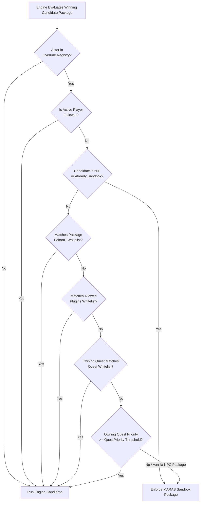

# PackageOverrideService & PackageReconciler — Feature & Mechanics Guide

**Implementations**:
- Engine Hook & INI Config Host: [PackageOverrideService.cpp](file:///e:/Skyrim/development/mods/M.A.R.A.S%20Dev/SKSE_Source/src/core/PackageOverrideService.cpp)
- Idempotent Package Planner & RCU Publisher: [PackageReconciler.cpp](file:///e:/Skyrim/development/mods/M.A.R.A.S%20Dev/SKSE_Source/src/core/PackageReconciler.cpp)
- Unloaded Actor Queue: [DeferredActorResolver.cpp](file:///e:/Skyrim/development/mods/M.A.R.A.S%20Dev/SKSE_Source/src/core/DeferredActorResolver.cpp)

`PackageOverrideService` intercepts the Creation Engine's AI package evaluation loop at the machine-code level (`RELOCATION_ID(36404, 37398) + 0x47`) and loads `PackageOverrides.ini` filter rules. `PackageReconciler` computes desired package assignments in `EngineSyncPlan`, maintains home/parent/destination linked references, manages `DeferredActorResolver` convergence for unloaded references, and publishes immutable override snapshots lock-free (RCU) for `PackageStartHook` to read without lock contention. This keeps housed spouses, children, pets/critters, traveling adult offspring, and dynamically spawned NPC children (`0xFF` Stage 2) anchored to their active M.A.R.A.S packages while yielding cleanly whenever an actor follows the player or runs a whitelisted quest, scene, or mod package.

---

## 1. Three Categories of Managed Sandbox Packages

When `PackageOverrideService` loads its configuration, it resolves three core AI packages from `TT_MARAS.esp` and assigns them to registered actors based on their household role:

1. **Housed Spouses & Player Children (`0x6A` — Base Home Sandbox Package)**:
   - Assigned to all player-house tenants whose `stayAtHome` toggle is enabled in [PlayerHouseService](file:///e:/Skyrim/development/mods/M.A.R.A.S%20Dev/SKSE_Source/src/core/PlayerHouseService.cpp).
   - Directs the actor to sandbox around their personal home `XMarker` (`MARAS_HomeSandboxKeyword`).
2. **Household Pets & Woodland Critters (`0xC0` — Pet/Critter Home Sandbox Package)**:
   - Assigned to pets and critters owned by player children in [PlayerChildrenService](file:///e:/Skyrim/development/mods/M.A.R.A.S%20Dev/SKSE_Source/src/core/PlayerChildrenService.cpp).
   - Directs the animal to sandbox around its owner child inside the home.
3. **Non-Player Dynamic `0xFF` Children (`0x376` — Non-Player Child Follow Parent Package)**:
   - Assigned to dynamically spawned (`0xFF`) Stage 2 children raised by NPC-to-NPC families (or Honorhall Orphanage).
   - Directs the child to follow/sandbox around their NPC parent or orphanage caretaker (`0x377` linked reference).

---

## 2. Engine Hook Decision Pipeline (`PackageStartHook`)

Every time the Creation Engine resolves which AI package an actor should run (`TESPackage*(ExtraDataList*, Actor*)`), `PackageStartHook` intercepts the winning `candidate` package. If the actor is registered in `PackageOverrideService`, it evaluates the candidate through a strict priority cascade:

### Step-by-Step Evaluation Rules
0. **Intimate-Scene Flee Override (children, runs before the registry check)**:
   - If `ChildrenFleeService` currently flags the actor as a child fleeing a threat (an active OStim/SexLab scene or a manual flee request), the hook returns `TTM_ChildrenFleeIntimateScene` (`0x5DE`) immediately. This applies to **any** loaded child (registered or not) and beats every rule below, including whitelists and the follower exemption. See [ChildrenFleeService](file:///e:/Skyrim/development/mods/M.A.R.A.S%20Dev/docs/modder/services/ChildrenFleeService.md).
1. **Active Follower Bypass**:
   - If the actor is currently following the player (`IsPlayerFollower`), the hook immediately yields and lets the follower package run unimpeded. When the player dismisses the follower later, the sandbox override automatically resumes.
2. **Null Candidate or Already Running Sandbox**:
   - If the engine returns `nullptr` (falling back to the NPC's vanilla town package stack) or is already running the M.A.R.A.S sandbox package, the hook returns the M.A.R.A.S sandbox package.
3. **Package EditorID Wildcard Whitelist (`Whitelist`)**:
   - Checks if the candidate package's EditorID matches any wildcard pattern (`*`, `?`) in the `Whitelist` INI setting. If matched, the candidate package is allowed to run.
4. **Originating Plugin Whitelist (`AllowedPlugins`)**:
   - Checks the source plugin file (`GetFile(0)->fileName`) of the candidate package against wildcard patterns in `AllowedPlugins`. Useful for allowing animation frameworks or companion mods to run their packages freely.
5. **Owning Quest EditorID Whitelist (`QuestWhitelist`)**:
   - Inspects the actor's `ExtraAliasInstanceArray` to find which `TESQuest` injected the candidate alias package. If the owning quest's EditorID matches `QuestWhitelist`, the package is allowed.
6. **Quest Priority Threshold (`QuestPriority`)**:
   - If `QuestPriority` is configured (`>= 0`) and the candidate package comes from a quest alias, compares `quest->data.priority` against the threshold:
     - **Priority `>=` Threshold**: Allowed (story/radiant quests with high priority can temporarily pull a spouse or child into a quest behavior).
     - **Priority `<` Threshold**: Suppressed and redirected to the M.A.R.A.S sandbox package.
7. **Default Suppression (Vanilla Routine Override)**:
   - Any non-alias vanilla NPC package (priority `-1`) or low-priority alias package that did not match any whitelist is suppressed and replaced with the actor's M.A.R.A.S sandbox package, keeping the spouse/child/pet at their assigned home.

### Log Deduplication Cache
- Because the engine evaluates AI packages frequently, `PackageStartHook` caches the last `(candidateID, resultID, PackageDecision)` tuple per actor (`s_lastEvals`) and only writes debug log lines when an actor's evaluation state actually changes.

---

## 3. Immediate Injection, RCU Snapshot & Save-Load Rebuild

- **Lock-Free RCU Override Snapshot**:
  - `PackageReconciler` computes each actor's desired package plan via `EngineSyncPlan` (`0x6A` home sandbox, `0xC0` pet/critter sandbox, `0x376` non-player child follow, or adult-child travel package) alongside home/parent/destination linked references, publishing an immutable registry snapshot (`std::atomic<std::shared_ptr<...>>`) read lock-free inside `PackageStartHook` with zero mutex contention on background AI threads.
- **Immediate Run-Once Injection & Deferred Convergence**:
  - Whenever an actor is newly registered or updated (and is not currently a player follower), `PackageReconciler` immediately calls `currentProcess->SetRunOncePackage(basePkg, actor)` followed by `EvaluatePackage` so the actor transitions without waiting for their vanilla package timer to expire. Unloaded actors or deferred home markers are tracked by `DeferredActorResolver` and converged when the actor loads 3D.
- **Stateless Save-Load Rebuild**:
  - Neither `PackageReconciler` nor `PackageOverrideService` stores its own co-save chunk. On every save load (and save revert), `PackageReconciler`'s world reconciliation reconstructs the RCU snapshot and linked references deterministically from `WorldStore`:
    1. Player-house tenants with `stayAtHome == true` (`0x6A`, spawning or re-asserting home markers on the main thread when needed).
    2. Active household pets and critters (`0xC0`).
    3. Non-player `0xFF` Stage 2 children (`0x376`, with their parent/orphanage linked reference).
    4. Active Stage 4 (`Adult`) children on travel assignments (`AdultChildTravelService`).

