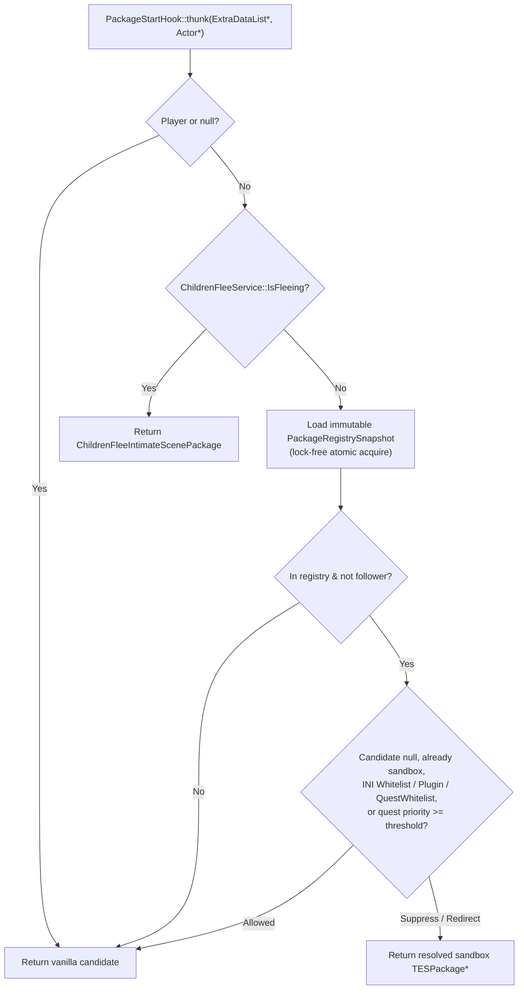

# PackageReconciler

**Sources**: [PackageReconciler.h](../../../SKSE_Source/modules/engine/include/maras/engine/PackageReconciler.h) · [PackageReconciler.cpp](../../../SKSE_Source/modules/engine/src/PackageReconciler.cpp) · [EngineSyncPlan.h](../../../SKSE_Source/modules/state/include/maras/state/EngineSyncPlan.h) · [EngineSyncPlan.cpp](../../../SKSE_Source/modules/state/src/EngineSyncPlan.cpp)  
**Cross-References**: [FactionReconciler.md](FactionReconciler.md) · [HouseholdUseCases.md](HouseholdUseCases.md) · [TravelRules.md](TravelRules.md) · [ChildrenFleeService.md](ChildrenFleeService.md) · [ARCHITECTURE.md](../ARCHITECTURE.md)

## Overview

`PackageReconciler` (`modules/engine`) replaces legacy Papyrus `ActorUtil.AddPackageOverride` writes with a high-frequency, lock-free RCU `PackageStartHook` combined with idempotent main-thread convergence of LinkedRefs (`0x6B`, `0x377`) and active package evaluation (`ComputeActorPackagePlan`).

---

## 5-Tier `PackageRole` Precedence

`State::ComputeActorPackagePlan` evaluates a single living, non-player, non-synthetic actor in strict descending priority — the first matching tier wins:

| Priority Tier | `PackageRole` | Default Package (`TT_MARAS.esp`) | LinkedRef Keyword & Target | Notes |
| :--- | :--- | :--- | :--- | :--- |
| **1. Household Tenant** | `HousedTenant` (or `None` if `!stayAtHome`) | `0x6A` (`baseSandboxPkgID`) when `stayAtHome == true` | `0x6B` -> adult spouse home marker or Stage 2 child home marker | Always clears/owns `0x6B` on tenants; moves newly created markers to assigned house marker. Tenants with `stayAtHome == false` keep `0x6B` synced while resolving no sandbox package override. |
| **2. Pet or Critter** | `PetOrCritter` | `0xC0` (`petCritterSandboxPkgID`) | `0x6B` -> owner `ChildId` actor RefID | Governed by `ComputeCompanionFactionPlan`. |
| **3. Stage 2 Unhoused / `0xFF` Child** | `FollowParentChild` | `0x376` (`nonPlayerChildFollowPkgID`) | `0x377` -> resolved guardian parent or Honorhall orphanage marker | Applies to unhoused player-guardian children or dynamic `0xFF` non-player children. |
| **4. Traveling Stage 4 Adult** | `AdultChildTravel` | `0xDD3` (`adultChildTravelPkgID`) | `0x377` -> `travel->targetMarkerId` | Skipped if married to the Player or already a house tenant. |
| **5. Unmanaged / Default** | `None` | None | Clears `0x6B` & `0x377` LinkedRefs | Unregisters actor from `PackageRegistrySnapshot`. |

---

## Lock-Free RCU `PackageStartHook`

`PackageReconciler::InstallHooks()` branches into Skyrim's package selection path (`RELOCATION_ID(36404, 37398)` + `0x47`) via SKSE trampoline:

### Runtime Evaluation Details

- **Intimate Flee Preemption**: Before touching `PackageRegistrySnapshot`, `PackageStartHook` checks `ChildrenFleeService::GetSingleton().IsFleeing(actorID)` and returns the flee package if active.
- **Follower Bypass**: `ShouldSkipForFollower` lets active player followers follow vanilla/follower framework AI packages instead of teleporting/sandboxing home.
- **INI Override Whitelisting (`LoadConfig`)**: Parses `[PackageOverrides]` from `Data/SKSE/Plugins/PackageOverrides.ini` (case-insensitive comma-separated wildcards `Whitelist`, `AllowedPlugins`, `QuestWhitelist`, and integer `QuestPriority` threshold). `GetQuestForPackage` reads `ExtraAliasInstanceArray::lock` via `RE::BSReadLockGuard` to resolve owning quest EditorIDs and priorities safely.
- **Log Deduplication**: `HookEvalCache` deduplicates repeated per-actor AI tick logs (`PackageDecision`) so steady-state AI evaluations do not spam `MARAS.log`.

---

## Thread Safety & Write Discipline

- **Lock-Free Readers**: AI worker threads and the main thread read `std::atomic<std::shared_ptr<const PackageRegistrySnapshot>>` with `memory_order_acquire`. Zero mutexes sit on the hot AI frame path.
- **Copy-on-Write Writers**: Mutations (`LoadConfig`, `RegisterActor*`, `UnregisterActor`, `SetBaseSandboxPackage`, `ReconcileWorld`, `Revert`) clone/mutate a draft snapshot under leaf `writeMutex_` and atomically publish via `snapshot_.store(..., memory_order_release)`. Standard package forms and engine lookups (`ResolveStandardPackages`, `ConvergeActorLinkedRef`, `EvaluatePackage`) execute **outside** `writeMutex_`.
- **Main-Thread Marshalling**: Off-thread or unloaded calls route through `DeferredActorResolver` (`SyncFlags::Package`), preserving INI whitelist patterns across `Revert()` save-game reloads while clearing actor registries.
