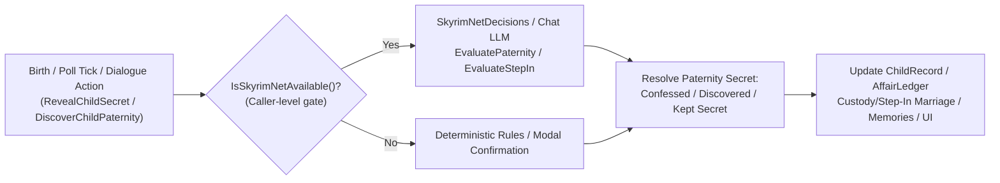

# `PaternityWorkflowCoordinator` — Architecture & Behavioral Guide

**Layers**: App (`SKSE_Source/modules/app`) & Domain Lineage (`SKSE_Source/modules/domain_lineage`)  
**Sources**:
- [PaternityWorkflowCoordinator.h](../../../SKSE_Source/modules/app/include/maras/app/PaternityWorkflowCoordinator.h) / [PaternityWorkflowCoordinator.cpp](../../../SKSE_Source/modules/app/src/PaternityWorkflowCoordinator.cpp)
- [FertilityRules.h](../../../SKSE_Source/modules/domain_lineage/include/maras/domain/lineage/FertilityRules.h) / [FertilityRules.cpp](../../../SKSE_Source/modules/domain_lineage/src/FertilityRules.cpp)
- [SkyrimNetDecorators.cpp](../../../SKSE_Source/modules/bridge_skyrimnet/src/SkyrimNetDecorators.cpp)
- [Architecture Overview](../ARCHITECTURE.md)

---

## 1. Purpose & Responsibility

`PaternityWorkflowCoordinator` owns the full lifecycle of **pregnancy secrecy** and **paternity secrets** across M.A.R.A.S. (and Fertility Mode Reloaded / BeeingFemale integrations): creation when an affair or extra-pair conception occurs, phenotype mismatch detection at birth/spawn, SkyrimNet-assisted confession/discovery/step-in decision flows, non-SkyrimNet deterministic fallback resolution, and custody/relationship fallout when a secret breaks open.

---

## 2. Secret Data Model & Epistemic Invariants

A `ChildRecord` in `LineageTable` tracks independent asymmetric knowledge flags:
- **Pregnancy Secrecy (`'PRG1'`)**: `isPregnancySecretForPartner`, `isPregnancyDiscovered`, `pregnancyDiscoveredByPartner`, enabling pregnant NPCs (or the Player) to conceal an affair-conceived pregnancy until announcement, labor/birth confrontation, or discovery.
- **Paternity Secrecy (`PaternitySecret`)**: Distinguishes the genetic father (`bioFather`), the mother's deceived committed partner (`deceivedPartner` / `motherPartner`), `isSecretForPartner` (concealed from the deceived partner), `isSecretForBioFather` (concealed from the true biological father), `revealedToPlayer`, `hasPhenotypeMismatch`, and explicit `toldActors` witnesses.
- **Epistemic Masking**: All read paths (`PrismaUIDataBridge`, `SkyrimNetDecorators`, `DeceasedQueries`, `TravelRules`) query through [`PerspectiveView`](PerspectiveView.md) so unaware actors—including the Player (`0x14`) in UI Intrigue Mode (`!revealSecretsInUI`)—see `perceivedBioFather == motherPartner` (or `UnknownFather`) until revealed.

---

## 3. Phenotype Mismatch Detection (`FertilityRules`)

When a child is born or inspected (`GetVisualDiscrepancyDescription`), `ClassifyPhenotypeTierFromEditorID` groups Skyrim races into six visual phenotype tiers (`PaleHuman`, `Redguard`, `Mer`, `Orc`, `Khajiit`, `Argonian`, plus `Unknown`):
- Whenever both `bioFather` and `presumedFather` resolve to distinct non-`Unknown` tiers (`HasPhenotypeMismatch`), `hasPhenotypeMismatch` flags obvious physical discrepancies (e.g., Argonian scales/horns, Khajiit fur/whiskers, Mer features, Orc tusks/brow, Redguard/PaleHuman skin-tone heritage) and feeds context strings into LLM evaluations and discovery prompts.

---

## 4. Confession, Discovery & Step-In Workflows

- **Caller-Level SkyrimNet Gate**: `PollFertilityTick`, `ProcessDailyTick`, birth-time checks, and dialogue/dashboard secret evaluations check `GetSkyrimNetGateway().IsAvailable()` **before** invoking `EvaluatePaternitySecret` or LLM decision calls (`EvaluatePaternity` / `EvaluateStepIn`), falling back deterministically or via standalone `PrismaModalManager` confirmation prompts when SkyrimNet is absent.
- **Step-In Marriage Eligibility (`CanFormStepInMarriage`)**: For NPC-to-NPC pregnancies outside Player involvement, verifies both biological parents are non-Player, living, non-related adults before evaluating whether the biological father steps in (`EvaluateStepIn`).
- **Resolution Side Effects**: Revealing or discovering a secret updates `PaternitySecret`, marks affected `AffairRecord`s discovered as appropriate, updates custody / `GuardianSlots` if requested, reconciles factions/packages/child visuals, emits `ttm_paternity_secret_resolved` + [`SkyrimNetMemoryService`](SkyrimNetMemoryService.md) perspective-safe memories, and notifies [`PrismaUIDataBridge`](PrismaUIDataBridge.md).
- **Dashboard Editing Guard (`ProcessSetPaternitySecretEdges`)**: Supports direct Intrigue/Sandbox debugging overrides from the dashboard under `GetPapyrusMutex()`, re-running epistemic sync cleanly afterwards.
