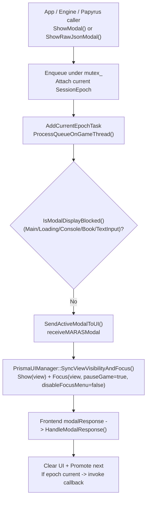

# `PrismaModalManager` & `ConfirmationModal` — Architecture & Behavioral Guide

**Layer**: Bridge UI (`SKSE_Source/modules/bridge_ui`)  
**Sources**:
- [PrismaModalManager.h](../../../SKSE_Source/modules/bridge_ui/include/maras/bridge_ui/PrismaModalManager.h)
- [PrismaModalManager.cpp](../../../SKSE_Source/modules/bridge_ui/src/PrismaModalManager.cpp)
- [ConfirmationModal.h](../../../SKSE_Source/modules/bridge_ui/include/maras/bridge_ui/ConfirmationModal.h)
- [ConfirmationModal.cpp](../../../SKSE_Source/modules/bridge_ui/src/ConfirmationModal.cpp)
- [PrismaUIManager.cpp](../../../SKSE_Source/modules/bridge_ui/src/PrismaUIManager.cpp)
- [Architecture Overview](../ARCHITECTURE.md)

---

## 1. Purpose & Responsibility

`PrismaModalManager` provides M.A.R.A.S.'s standalone, game-pausing interactive dialog system (`<PrismaModalHost />` backed by `useModalStore`), replacing native `RE::MessageBoxMenu` prompts across LLM failure retries, encounter letters, paternity/adoption prompts, and action confirmations. `ConfirmationModal` exposes Papyrus-facing non-blocking latent confirmation prompts and pair cooldown tracking on top of `PrismaModalManager`.

---

## 2. Standalone Modal Queue & Focus Rules

- **Thread-Safe FIFO Queue**: `ShowModal` and `ShowRawJsonModal` can be called from any thread (including background LLM callbacks). When a modal is already active, subsequent requests enter `queue_` under `mutex_` and promote automatically as each active modal resolves.
- **View Independence & Focus Policy**: `<PrismaModalHost />` renders outside `<DashboardLayout>`, so modals appear cleanly even while the M.A.R.A.S. dashboard itself is closed. Inside `PrismaUIManager::SyncViewVisibilityAndFocus()`, an active unblocked modal calls `Show(view_)` and `Focus(view_, /*pauseGame=*/true, /*disableFocusMenu=*/false)`, pausing Skyrim gameplay cleanly and preventing escape shortcuts from closing the modal unintentionally—modals resolve exclusively through their rendered control buttons (`submitModalResponse` $\rightarrow$ `HandleModalResponse`).
- **Blocked Menus & Resend**: `UpdateEventSink` (`MenuOpenCloseEvent`) and `PrismaUIManager::OnUIReady()` trigger non-forced resends (`SendActiveModalToUI(false)`) whenever blocking menus close or the DOM becomes ready while a modal waits in queue.
- **Save Load / Revert Safety**: Every queued `ModalEntry` records `expectedEpoch`. `Revert()` cancels the active modal and drains `queue_` with `aborted = true`, emits `clearMARASModal`, and resynchronizes view focus. Late callbacks across a bumped epoch are dropped cleanly.

---

## 3. `ConfirmationModal` — Latent Papyrus Confirmations & Cooldowns

`ConfirmationModal` adapts `PrismaModalManager` to non-blocking Papyrus latent calls and C++ callback-based confirmation flows (`ShowWithCallback` via `IModalGateway`, used by `SkyrimNetActionCoordinator`) for dialogue and intimate-action prompts (such as proposing, breaking up, opening/closing relationships, adopting, or declining with SkyrimNet roleplay explanations):

- **Cooldown Management (`CheckAndSet` / `IsOnCooldown`)**: Normalizes action keys and sorts actor `FormID` sets cleanly under `ConfirmationCooldownState::mutex`, returning `0` (`kCooldownEligible`) when eligible or `4` (`kCooldownBlocked`) when inside `SettingsData::actionsCooldown` or `actionsDeclineCooldown` within the current `SessionEpoch`.
- **Latent Result Codes (`ConfirmationModal::Show`)**:
  - `0`: Accepted (proceed with action).
  - `1`: Cancelled / Declined silently.
  - `2`: Declined with roleplay explanation (when SkyrimNet is available, lets the user explain why and emits `ttm_action_decline` directly via `ISkyrimNetGateway::EmitActionDecline`).
  - `3`: Blocked (on cooldown, invalid actors, or relationship state changed while waiting).
  - `4`: Confirmation modals disabled by settings (auto-accept).
  - `5`: Prisma UI unavailable / not initialized (auto-accept).
