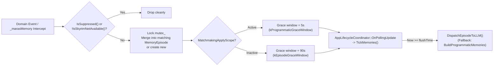

# `SkyrimNetMemoryService` — Architecture & Behavioral Guide

**Layer**: Bridge SkyrimNet (`SKSE_Source/modules/bridge_skyrimnet`)  
**Sources**:
- [SkyrimNetMemoryService.h](../../../SKSE_Source/modules/bridge_skyrimnet/include/maras/bridge_skyrimnet/SkyrimNetMemoryService.h)
- [SkyrimNetMemoryService.cpp](../../../SKSE_Source/modules/bridge_skyrimnet/src/SkyrimNetMemoryService.cpp)
- [SkyrimNetApiLoader.cpp](../../../SKSE_Source/modules/bridge_skyrimnet/src/SkyrimNetApiLoader.cpp)
- [Architecture Overview](../ARCHITECTURE.md)

---

## 1. Purpose & Responsibility

`SkyrimNetMemoryService` translates M.A.R.A.S. life events (proposals, marriages, breakups, open-relationship toggles, infidelity discoveries, pregnancies, paternity reveals, child births, and custody changes) into perspective-aware long-term episodic memories inside SkyrimNet's vector memory database (`PublicAddActorMemory`). It batches rapid consecutive events into coherent episodes, enforces strict secret isolation per participant, and also backs the UI dashboard's matchmaking memory preview/generation workflow.

---

## 2. Episodic Batching & Timing Windows

- **Episode Grouping (`CanMergeWithEpisode`)**: Consecutive events sharing overlapping participants merge into an active `MemoryEpisode` under `mutex_`, extending `flushTime`. Live gameplay events use a `90 s` window (`kEpisodeGraceWindow`) so multi-step dialogue/confrontation sequences consolidate into one memory; programmatic dashboard matchmaking batches enter `MatchmakingApplyScope` (`s_matchmakingApplyDepth_`) to flush in `5 s` (`kProgrammaticGraceWindow`).
- **Suppression Guard (`SuppressScope`)**: `AppLifecycleCoordinator::BeginCoSaveLoad()` holds a thread-local suppression scope during co-save deserialization and post-load reconciliation so state restoration never fabricates duplicate historical memories.
- **Trigger Memory Intercept**: When `RegisterSkyrimNetEvent` sends an event payload containing `"_marasMemory"` metadata (`SkyrimNetApiLoader.cpp`), M.A.R.A.S. parses the participant/actor IDs and automatically feeds the event into `SkyrimNetMemoryService`.

---

## 3. Epistemic Safety, Strict JSON Parsing & Fallbacks

- **Per-Participant Knowledge Filtering**: Each `MemoryParticipant` carries `perspectiveNote`, `knowledgeRestriction`, `hiddenActorFormIDs`, and `generateMemory`. When an episode compiles LLM prompts or programmatic fallback memories, unaware actors (such as a deceived spouse during a still-secret birth or affair) either have secret participants omitted (`hiddenActorFormIDs`) or `generateMemory = false` so private facts never leak into their SkyrimNet memory store.
- **Strict JSON Validation (`ParseGeneratedMemories`)**: LLM responses expecting a `"memories"` array are parsed non-throwing; every entry is checked with `.is_object()`, string/number type checks (`actor`, `actorFormId`, `content`, `location`, `emotion`, `importance_score`, `type`, `tags`), and actor FormID validation against target participants before ingesting via `IngestMemories`.
- **Programmatic Fallback (`BuildProgrammaticMemories`)**: If the LLM request fails, returns malformed JSON, or omits a required participant, deterministic fallback memories are synthesized so key relationship milestones are never lost.
- **Dashboard Memory Preview (`PreviewRelationshipMemories`)**: Generates draft memories for pending UI matchmaking pairs and delivers results back via `SendGeneratedMemories` (`PrismaUIDataBridge`) for player editing/confirmation before applying.
- **Session Reset**: `Revert()` clears `activeEpisodes_` cleanly on `kPreLoadGame` / SKSE revert.
