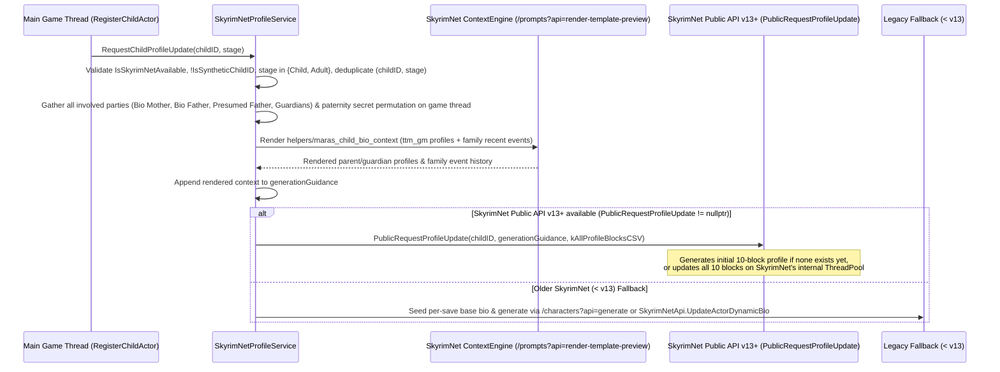

# SkyrimNetProfileService — Placed Child & Adult Spawn Profile Generation

`SkyrimNetProfileService` ([`SKSE_Source/include/core/SkyrimNetProfileService.h`](file:///e:/Skyrim/development/mods/M.A.R.A.S%20Dev/SKSE_Source/include/core/SkyrimNetProfileService.h), [`SKSE_Source/src/core/SkyrimNetProfileService.cpp`](file:///e:/Skyrim/development/mods/M.A.R.A.S%20Dev/SKSE_Source/src/core/SkyrimNetProfileService.cpp)) generates and updates per-save SkyrimNet character biographies when a child born in M.A.R.A.S is physically spawned into the world as a **Young Child (`Stage 2`)** or **Adult Child (`Stage 4`)** `RE::Actor`.

---

## 1. Core Design Rules & Eligibility

1. **Placed Actors Only (Never Synthetic Child Records)**:
   - SkyrimNet character profiles require a placed `RE::Actor` reference in the game world (`!IsSyntheticChildID(childID)`).
   - Synthetic child transitions—such as `OnChildGrewUp` (Newborn Stage 1 $\rightarrow$ synthetic Stage 2) or `OnChildFinishedTraining` (Stage 3 InTraining $\rightarrow$ synthetic Stage 4)—do **not** trigger profile generation because no placed `RE::Actor` exists yet.
2. **Triggered Strictly on Stage 2 (Young Child Spawn) and Stage 4 (Adult Child Spawn)**:
   - Invoked from [`NPCRelationshipManager::RegisterChildActor`](file:///e:/Skyrim/development/mods/M.A.R.A.S%20Dev/SKSE_Source/src/core/NPCRelationshipManager_Children.cpp) when a placed biological/promoted child actor is newly registered at `ChildStage::Child` (`Stage 2`) or `ChildStage::Adult` (`Stage 4`).
   - Covers all five physical child/adult spawn pipelines:
     - [`TTM_ServiceChildrenLogic.SpawnSyntheticChild`](file:///e:/Skyrim/development/mods/M.A.R.A.S%20Dev/Scripts/Source/TTM_ServiceChildrenLogic.psc) (MARAS synthetic child spawned into the world at Stage 2)
     - [`TTM_ServiceFertilityFMR.OnChildSpawned`](file:///e:/Skyrim/development/mods/M.A.R.A.S%20Dev/Scripts/Source/TTM_ServiceFertilityFMR.psc) (Fertility Mode Reloaded Stage 2 child actor spawned)
     - [`TTM_ServiceFertilityBF.OnChildSpawned`](file:///e:/Skyrim/development/mods/M.A.R.A.S%20Dev/Scripts/Source/TTM_ServiceFertilityBF.psc) (Beeing Female Stage 2 child actor spawned)
     - [`TTM_ServiceFertilityFMR.OnAdultChildSpawned`](file:///e:/Skyrim/development/mods/M.A.R.A.S%20Dev/Scripts/Source/TTM_ServiceFertilityFMR.psc) (`PromoteAdultFollowerChild` Stage 4 adult actor spawned)
     - [`TTM_ServiceFertilityBF.OnAdultChildSpawned`](file:///e:/Skyrim/development/mods/M.A.R.A.S%20Dev/Scripts/Source/TTM_ServiceFertilityBF.psc) (Beeing Female Stage 4 adult actor spawned)
3. **Never Triggered on Relocation or Custody Reassignment**:
   - Household relocations, guardian reassignments, and custody transfers on divorce or parent death do **not** trigger profile regeneration.
   - Each `(childID, ChildStage)` pair is deduplicated in `updatedActorStages_` (and pre-populated during co-save load in [`NPCRelationshipManager_Serialization.cpp`](file:///e:/Skyrim/development/mods/M.A.R.A.S%20Dev/SKSE_Source/src/core/NPCRelationshipManager_Serialization.cpp)), ensuring a spawned child generates a profile at most once at `Stage 2` and once if later promoted to a placed `Stage 4` adult actor.
4. **All Involved Parties Rendered into Profile Generation Context**:
   - Because SkyrimNet's `PublicRequestProfileUpdate` (`dynamic_bio_update.prompt` and `helpers/generate_profile.prompt`) injects `additionalInstructions` / `user_input` as a plain context string without rendering `0001_child_bio.prompt`, `SkyrimNetProfileService` pre-renders the character profiles and recent events of **all involved parties at the moment of bio generation/update**:
     - **Biological Mother** (`bioMotherID`)
     - **True Biological Father** (`bioFatherID`, always included even when a paternity secret is active so genetic/physical/supernatural inheritance is never lost)
     - **Presumed Father** (`presumedFatherID` / `motherPartnerID`, when present and distinct from `bioFatherID`)
     - **Custodial Household Guardians** (`guardianAID`, `guardianBID`, if distinct from the above)
   - These profiles are exposed via `parents.bio_generation_adults` in `ttm_npc_relationship_profile` and rendered through [`helpers/maras_child_bio_context.prompt`](file:///e:/Skyrim/development/mods/M.A.R.A.S%20Dev/SKSE/Plugins/SkyrimNet/external/tetherball88.maras/prompts/helpers/maras_child_bio_context.prompt) using `render_character_profile("ttm_gm", adult.uuid)` ([`9999_ttm_gm.prompt`](file:///e:/Skyrim/development/mods/M.A.R.A.S%20Dev/SKSE/Plugins/SkyrimNet/external/tetherball88.maras/prompts/submodules/character_bio/9999_ttm_gm.prompt), which includes `Summary`, `Background`, `Personality`, `Appearance`, `Occupation`, `Skills & Abilities`, `Relationships`, `M.A.R.A.S. Relationships`, and `Memories`) plus chronological family events via [`helpers/maras_actor_bio_recent_events.prompt`](file:///e:/Skyrim/development/mods/M.A.R.A.S%20Dev/SKSE/Plugins/SkyrimNet/external/tetherball88.maras/prompts/helpers/maras_actor_bio_recent_events.prompt).
   - Including `Background`, `Occupation`, and `Skills & Abilities` in `9999_ttm_gm.prompt` ensures that parent traits concealed from a parent's public `Summary` by SkyrimNet's Stranger Test (e.g., Serana's pure-blood Volkihar vampirism and necromancy) are always visible to the LLM when determining what the child inherits.
5. **Paternity Secret Knowledge Permutations**:
   - When a presumed father is present alongside a paternity secret, `BuildProfileGenerationGuidance` separates **biological inheritance** (always derived from Biological Mother and True Biological Father) from **household upbringing and beliefs**, and provides explicit block-level rules for each knowledge permutation:
     1. **Neither Presumed Father nor Biological Father knows (`!partnerKnows && !bioFatherKnows`)**: Only the mother knows. The child and presumed father believe the presumed father is the biological father, and the biological father is unaware. `summary`, `background`, and `relationships` reflect the child's belief that the presumed father is their father, while `appearance`, innate `personality`, and latent `skills` still reflect genetic inheritance from the true biological parents without the child knowing why.
     2. **Only Biological Father knows; Presumed Father does NOT know (`!partnerKnows && bioFatherKnows`)**: Mother and biological father know the truth, while the presumed father and child still believe the presumed father is the biological father. `summary` keeps the secret masked; `background` and `relationships` reflect the child's belief that the presumed father is their father while allowing for the biological father's quiet, unexplained fondness or watchful interest.
     3. **Only Presumed Father knows; Biological Father does NOT know (`partnerKnows && !bioFatherKnows`)**: Mother and presumed father know the child was fathered by the biological father, while the biological father remains unaware. Reflects whether the presumed father continues raising the child as a household guardian/father figure or is separated, while the biological father remains unaware of his paternity.
     4. **Both Presumed Father and Biological Father know (`partnerKnows && bioFatherKnows` / `discovered`)**: Both fathers and the family know the truth. `background` and `relationships` reflect the child's open relationship with their true biological father as well as the presumed father (whether raising them as a guardian/step-father figure in the household or as the mother's former partner), while keeping `summary` grounded in publicly observable facts.

---

## 2. Execution Flow (`PublicRequestProfileUpdate` & Template Rendering)

1. **Involved Parties Context Rendering (`RenderInvolvedPartiesContext`)**:
   - On the background worker thread, renders `helpers/maras_child_bio_context` via `POST /prompts?api=render-template-preview` (with an inline template fallback if the file was added before a prompt reload, and a direct disk + `PublicGetMemoriesForActor` C++ API fallback if SkyrimNet's local web server is disabled in `WebServer.yaml`).
   - Appends the rendered profiles and chronological family events directly to `generationGuidance`.
2. **Primary Path (`PublicRequestProfileUpdate` — SkyrimNet v13+)**:
   - Passes the child's `FormID`, the enriched `generationGuidance`, and all 10 character bio blocks (`summary,interject_summary,background,personality,appearance,aspirations,relationships,occupation,skills,speech_style`) to `PublicRequestProfileUpdate`.
3. **Legacy Fallback Path (SkyrimNet < v13)**:
   - Seeds the 10-block per-save base `.prompt` (`BuildSeedChildBioTemplate`) and invokes `/characters?api=generate` / `SkyrimNetApi.UpdateActorDynamicBio`.
