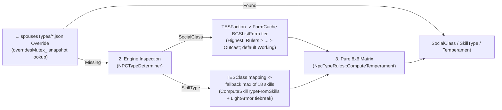

# `TraitClassifier` (`NPCTypeDeterminer`, `NpcTypeRules`, `JsonOverrideLoader`) — Architecture & Behavioral Guide

**Layers**: Engine (`SKSE_Source/modules/engine`) & Domain Relationships (`SKSE_Source/modules/domain_relationships`)  
**Sources**:
- [NPCTypeDeterminer.h](../../../SKSE_Source/modules/engine/include/maras/engine/NPCTypeDeterminer.h) / [NPCTypeDeterminer.cpp](../../../SKSE_Source/modules/engine/src/NPCTypeDeterminer.cpp)
- [NpcTypeRules.h](../../../SKSE_Source/modules/domain_relationships/include/maras/domain/relationships/NpcTypeRules.h) / [NpcTypeRules.cpp](../../../SKSE_Source/modules/domain_relationships/src/NpcTypeRules.cpp)
- [JsonOverrideLoader.h](../../../SKSE_Source/modules/engine/include/maras/engine/JsonOverrideLoader.h) / [JsonOverrideLoader.cpp](../../../SKSE_Source/modules/engine/src/JsonOverrideLoader.cpp)
- [Architecture Overview](../ARCHITECTURE.md)

---

## 1. Purpose & Responsibility

Every adult NPC registered in M.A.R.A.S. carries three permanent trait archetypes—**Social Class** (8 tiers driving permanent household spouse buffs and marriage prestige expectations), **Skill Type** (6 classes driving active-follower spouse combat buffs), and **Temperament** (5 personalities driving affection decay, infidelity dialogue/letter tone, and SkyrimNet AI reactions). Classification combines modder JSON overrides with automatic Skyrim engine inspection and a deterministic pure trait matrix.

---

## 2. Classification Precedence

### 1. JSON Override Pipeline (`JsonOverrideLoader` & `spousesTypes/`)
- At `kDataLoaded` (`plugin.cpp`), `RelationshipUseCases::LoadOverridesFromFolder("Data/SKSE/Plugins/MARAS/spousesTypes")` invokes `JsonOverrideLoader::LoadOverridesFromFolder` before acquiring locks, then publishes `npcOverrides_` under `overridesMutex_`.
- Supports recursive JSON collection, C-style/line comments inside authored files, and `__formData|<PluginName>|<0xHexFormID>` keys (resolved against both `RefId` and `BaseId`).
- Validates `socialClass`, `skillType`, and `temperament` string values strictly against known enum labels before storing optional overrides and tracking load diagnostics (`GetLastOverrideLoadStats`).

### 2. Automatic `SocialClass` Resolution (`NPCTypeDeterminer`)
Inspects the live `RE::Actor` and `RE::TESNPC` base factions against pre-cached `FormCache` form lists (`Rulers`, `Nobles`, `Religious`, `Wealthy`, `Middle`, `Poverty`, `Outcast`). If an actor belongs to multiple ranked factions, the **highest** tier wins; actors matching none default to `Working`.

### 3. Automatic `SkillType` Resolution (`NPCTypeDeterminer` + `NpcTypeRules`)
1. Checks the NPC's `RE::TESClass` archetype first (`DetermineSkillTypeByClass`).
2. Otherwise extracts all 18 Skyrim actor-value skill levels and invokes pure `Domain::Relationships::ComputeSkillTypeFromSkills`:
   - `Warrior`: One-Handed, Two-Handed, Block, Heavy Armor
   - `Ranger`: Archery
   - `Rogue`: Pickpocket, Lockpicking, Sneak
   - `Mage`: Alteration, Conjuration, Destruction, Illusion, Restoration
   - `Orator`: Speech
   - `Craftsman`: Smithing, Alchemy, Enchanting
   - `LightArmor` tiebreaker: resolves to `Ranger` if `Archery` strictly exceeds both `Pickpocket` and `Lockpicking`, otherwise `Rogue`.

### 4. Deterministic Temperament Matrix (`NpcTypeRules::ComputeTemperament`)
When no temperament override exists, `(SocialClass, SkillType)` indexes a static `8 × 6` lookup matrix producing one of `Proud`, `Humble`, `Jealous`, `Romantic`, or `Independent` consistently across engine and headless unit tests.
