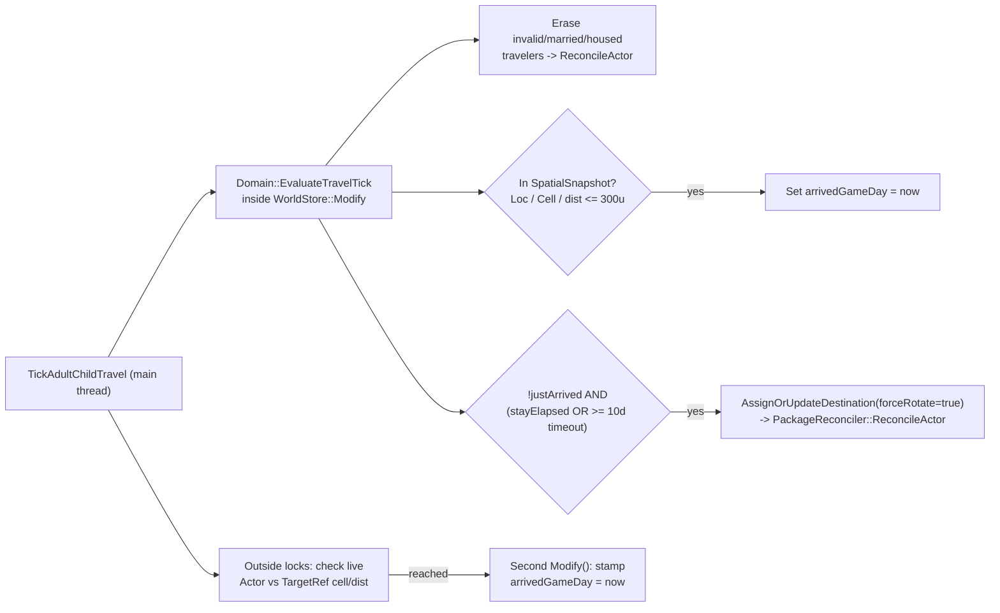

# TravelRules

**Sources**: [TravelRules.h](../../../SKSE_Source/modules/domain_household/include/maras/domain/household/TravelRules.h) · [TravelRules.cpp](../../../SKSE_Source/modules/domain_household/src/TravelRules.cpp) · [HouseholdUseCases.h](../../../SKSE_Source/modules/app/include/maras/app/HouseholdUseCases.h) · [HouseholdUseCases.cpp](../../../SKSE_Source/modules/app/src/HouseholdUseCases.cpp)  
**Cross-References**: [HouseholdUseCases.md](HouseholdUseCases.md) · [SpatialWorldIndex.md](SpatialWorldIndex.md) · [PackageReconciler.md](PackageReconciler.md) · [ChildGrowthAndVisuals.md](ChildGrowthAndVisuals.md) · [ARCHITECTURE.md](../ARCHITECTURE.md)

## Overview

Autonomous travel for graduated Stage 4 (`ChildStage::Adult`) children is split between pure state evaluation in `MARAS::Domain::Household::TravelRules` (`modules/domain_household`) and Skyrim engine orchestration in `HouseholdUseCases` (`modules/app`). Independent adult offspring roam across Skyrim's inns and taverns while periodically visiting living family homes, driven by `PackageReconciler` (`AdultChildTravel`, `0xDD3`) and 2 Hz spatial telemetry (`SpatialActorSnapshot`).

---

## Travel Eligibility

An adult child is travel-eligible (`IsTravelEligibleAdultChild`) only when **all** of the following hold:

1. `childID` is non-null and non-synthetic (`!IsSyntheticChildRawId`).
2. `lineage` contains the record with `stage == ChildStage::Adult`.
3. The actor is living (`!IsDeceased`).
4. The actor is not registered as a tenant in any player home (`GetTenantHouse(childID).IsNull()`).
5. The actor is not married to the Player (`RelationshipStatus::Married` stops travel).

Ineligible adults found inside `AllAdultChildTravel` are evicted during `TickAdultChildTravel` or `AssignOrUpdateDestination` and have their `PackageReconciler` override stripped.

---

## Constants & Destination Selection

Verified policy constants in `TravelRules.h`:

| Constant | Value | Purpose |
| :--- | :--- | :--- |
| `kFamilyVisitChancePercent` | `30` | `30%` probability of picking a family home destination instead of an inn when family candidates exist. |
| `kMinTravelStayDays` | `2.0f` | Minimum in-game stay duration rolled upon assignment. |
| `kMaxTravelStayDays` | `4.0f` | Maximum in-game stay duration rolled upon assignment. |
| `kMaxTravelTimeoutDays` | `10.0f` | Maximum in-game days elapsed since `assignedGameDay` before forcing destination rotation even if arrival was never triggered. |

`SelectNextTravelDestination` partitions candidates into `familyDestinations` (`BuildFamilyVisitCandidates` / `BuildFamilyVisitDestinations`) and `innDestinations` (`SpatialWorldIndex::GetInnDestinations`), rolls the `30%` family-visit bias when `familyDestinations` is non-empty, filters out `previousMarkerId` when alternatives exist so consecutive destinations do not repeat unnecessarily, and constructs `AdultChildTravelRecord` via `CreateTravelRecord`.

---

## Arrival, Timeout & Rotation Flow

- **Two-Pass Arrival Detection**: Static inn markers far away or unindexed in `SpatialActorSnapshot` may not have full 3D/sample parity on every frame; therefore `TickAdultChildTravel` evaluates `SpatialActorSnapshot` inside `WorldStore::Modify` and then inspects unloaded/static markers via `HasActorReachedTravelDestination` *outside* both `WorldStore::Modify` and `travelMutex_` before committing newly arrived timestamps.
- **Custody Cleanup on Assignment**: Whenever a Stage 4 adult receives a fresh travel destination (`AssignOrUpdateDestination`), `HouseholdUseCases` invokes `LineageUseCases::OnChildRemovedFromHousehold(childID)` so lingering Hearthfire/child household custody flags are cleared before `PackageReconciler::ReconcileActor(childID)` applies `AdultChildTravel` (`0xDD3`).

---

## Thread Safety & CQS (`travelMutex_` & `DumpTravelJson`)

- **Leaf Mutex Discipline**: `HouseholdUseCases` guards travel schedule mutations and coordinated snapshots under `travelMutex_` (`std::shared_mutex`). `Unique` locks protect travel assignment/rotation/load-reassertion mutations; `Shared` locks protect query accessors and `DumpTravelJson(view)`.
- **Load Recovery**: `ReassertAllTravelOnLoad` purges ineligible travelers, re-applies existing valid assignments without needlessly rotating destinations, and assigns first destinations to any eligible Stage 4 adults missing from `AllAdultChildTravel`.
- **CQS JSON Projection**: `DumpTravelJson(const Projection::PerspectiveView& view)` reads exclusively from the passed `PerspectiveView` and `SpatialWorldIndex::GetInnDestinations()` without mutating travel state or triggering lazy initialization.
