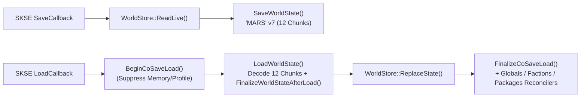

# `WorldStore`, State Tables & `'MARS'` v7 Co-Save — Architecture & Behavioral Guide

**Layers**: Foundation (`SKSE_Source/modules/foundation`), State (`SKSE_Source/modules/state`), Engine (`SKSE_Source/modules/engine`)  
**Sources**:
- [StrongIds.h](../../../SKSE_Source/modules/foundation/include/maras/foundation/StrongIds.h) & [DomainEnums.h](../../../SKSE_Source/modules/foundation/include/maras/foundation/DomainEnums.h)
- [WorldTables.h](../../../SKSE_Source/modules/state/include/maras/state/WorldTables.h), [WorldState.h](../../../SKSE_Source/modules/state/include/maras/state/WorldState.h), [WorldStore.h](../../../SKSE_Source/modules/state/include/maras/state/WorldStore.h), [PerTableSnapshot.h](../../../SKSE_Source/modules/state/include/maras/state/PerTableSnapshot.h)
- [CoSaveCodec.h](../../../SKSE_Source/modules/state/include/maras/state/CoSaveCodec.h), [CoSaveCodec.cpp](../../../SKSE_Source/modules/state/src/CoSaveCodec.cpp), & [MigrationReportFormatter.cpp](../../../SKSE_Source/modules/state/src/MigrationReportFormatter.cpp)
- [MigrationDiagnosticsCoordinator.cpp](../../../SKSE_Source/modules/app/src/MigrationDiagnosticsCoordinator.cpp)
- [SkseSerializationCallbacks.h](../../../SKSE_Source/modules/engine/include/maras/engine/SkseSerializationCallbacks.h) & [SkseSerializationCallbacks.cpp](../../../SKSE_Source/modules/engine/src/SkseSerializationCallbacks.cpp)
- [SessionEpoch.h](../../../SKSE_Source/modules/state/include/maras/state/SessionEpoch.h)
- [Architecture Overview](../ARCHITECTURE.md)

---

## 1. Purpose & Responsibility

`WorldStore` is M.A.R.A.S.'s engine-free, single source of truth for all persistent domain state. Compiled against the lightweight core precompiled header (`pch_core.h` / `maras_foundation`, cleanly separated from engine/Skyrim modules compiled against `pch_engine.h` / `maras_pch_engine`), all ten domain tables live inside a unified copy-on-write state container (`WorldState`) with lock-free atomic snapshot reads, serialized leaf-mutex transactions, deterministic co-save serialization (`'MARS'` v7), and monotonic session-epoch guards.

---

## 2. Typed Identity & Ten Normalized Domain Tables

### Strongly Typed IDs (`StrongIds.h`)
All core identifiers wrap raw 32-bit IDs in distinct value types to prevent accidental mixing of base forms, live references, cells, and child records:
- **Special Sentinels**: Player Ref `0x14` (`kPlayerRefRawId`), Player Base `0x7` (`kPlayerBaseRawId`), Unknown Biological Father `0xFFFFFFFE` (`kUnknownFatherRawId`).
- **Synthetic Unborn / Nursery Child Pool**: `0xFF700000..0xFF7FFFFF` (`SyntheticChildId`), distinguishing off-map unborn/infant/toddler records from spawned `0xFF` placed NPCs.
- **Canonical Symmetric Keys (`CanonicalPairKey`)**: Orders `(min(A, B), max(A, B))` so relationship statuses remain symmetric regardless of argument order.

### The Ten `CowTable<T>` Members (`WorldState`)
Every table sits inside a `CowTable<T>` handle (`PerTableSnapshot.h`). Calling `Read()` incurs zero locking; calling `Write()` mutates in place if uniquely owned (`use_count() == 1` with `std::atomic_thread_fence(std::memory_order_acquire)`) or copies on write only the mutated table when readers hold an older `WorldStateSnapshot`:

| Table Field | Backing Type | Owns |
| :--- | :--- | :--- |
| `actors` | `ActorProfileTable` | Registered adult NPC profiles (`BaseId`, `RefId`, `SocialClass`, `SkillType`, `Temperament`, `AddedKeywords`, legacy home marker, pending vanilla relationship queue). |
| `relationships` | `RelationshipEdgeTable` | Symmetric pair edges (`status`, `originalStatus`, `isOpen`, `statusHistory`, `marriageTimestamp`), pending partner intents (`ConfessTalking`, `ConfessPhysical`, `SuggestOpen`). |
| `affairs` | `AffairLedger` | Directional `AffairRecord` entries (`cheater`, `deceivedPartner`, `paramour`, secret/discovered flags, stage, status, affair cooldowns). |
| `lineage` | `LineageTable` | `ChildRecord` entries (`bioMother`, `bioFather`, neutral `GuardianSlots`, pregnancy/paternity secret flags, visual genetics, growth stage, beastblood, skill snapshots, Daedric blessing) and pending child spawns. |
| `hierarchy` | `SpouseHierarchyTable` | Ranked 4-slot spouse array (`slots`) and automatic spouse ranking order. |
| `household` | `HouseholdTable` | Registered player houses & home markers, tenant assignments + `stayAtHome`, shared spouse cells (`SharedCellRecord`), `ChildHouseholdState` (pets, critters, transient critter ref, training progress, orders, `ChildChestIntroduced`, `PoorCounter`, `NameCallingUsedLast`), `childFactionSnapshots`, adult-child travel records. |
| `affection` | `AffectionTable` | Permanent `[0, 100]` affection scores, interaction timestamps, daily accumulation by interaction type and type `[min, max]` bounds. |
| `deceased` | `DeceasedTable` | Archived dead adults & children (`partnersAtDeath` with secret affair metadata, `DeceasedChildMetadata` with guardian/bio parent snapshot and secret paternity flags). |
| `cooldowns` | `CooldownTable` | Per-actor matchmaking cooldowns, couple banter cooldowns, daily scene/agency guard timestamps, banter scene XMarker relocations & SkyrimNet mute recovery (`'BNT1'`), and relationship cooldown/flag fields (`npcBrokeupTime`, `npcLastTimeSharedIncome`, `lastTimePaidDivorceFee`, `playerKiller`, `playerHadWedding`, `dontShowSkipWeddingMessage`). |
| `settings` | `SettingsData` | Runtime gameplay configuration plus `ForEachPersistedSettingField` X-macro persistence descriptor. |

---

## 3. `WorldStore` Concurrency & Safety Invariants

- **Lock-Free Readers (`Snapshot()`)**: Acquires `publishedSnapshot_` via atomic load (`shared_ptr<const WorldStateSnapshot>`), giving query builders, UI bridges, SkyrimNet decorators, and reconcilers wait-free consistent views across all ten tables.
- **Serialized Writers (`Modify` / `ReadLive`)**: Protected by leaf `std::recursive_mutex writeMutex_`. Upon completion of `Modify`, `PublishSnapshotLocked()` swaps a fresh `WorldStateSnapshot` atomically into `publishedSnapshot_`.
- **Compile-Time Anti-Leak Guards**: `static_assert(!std::is_reference_v<ReturnT> && !std::is_pointer_v<ReturnT>)` on both void and value-returning `Modify(...)` and `ReadLive(...)` templates forbids returning dangling pointers or references to live internal tables outside `writeMutex_`.
- **No Engine Lookups Under `writeMutex_`**: Callers must resolve `RE::TESForm::LookupByID`, actor names, and spatial locations **before** calling `WorldStore::Modify(...)`.
- **`SessionEpoch` Stale-Task Fence (`SessionEpoch.h`)**: Monotonic 64-bit counter bumped in `kPreLoadGame` and `RevertCallback`. Deferred SKSE tasks, async LLM callbacks, and UI modal callbacks validate `IsSessionEpochCurrent(expectedEpoch)` and discard stale-save continuations cleanly.

---

## 4. `'MARS'` v7 Co-Save Serialization & Migrations

`CoSaveCodec` handles pure stream serialization independently of SKSE (`InMemoryCoSaveReader`/`Writer` enable fast deterministic C++ migration unit tests), while `SkseSerializationCallbacks` adapts SKSE save/load/revert interfaces and resolves legacy plugin FormIDs (`SkseFormIdResolver`).

### The 12 Top-Level Co-Save Chunks (`kDataVersion = 7`)

| Chunk FourCC | Domain Contents & Sub-Records / Extensions |
| :--- | :--- |
| `'NPCR'` | Registered adults, relationship edges, status history, and `AffairLedger` + inline extensions `'AGN1'`, `'PRG1'`, `'CHD1'`, `'LYC1'`, `'CHD2'`, `'FRT1'`, and `'SNU1'` for partner intents, secret pregnancy flags, child genetics, beastblood, lineage/blessing data, active multi-fetus fertility delivery batches, and persistent child SkyrimNet `EntityUUID` (`skyrimNetUuid`) continuity across despawned training and adult promotion (omitted when all zero). |
| `'SPHR'` | 4-slot ranked `SpouseHierarchyTable`. |
| `'AFCT'` | Permanent affection scores, timestamps, daily per-type maps, and type min/max bounds (`AffectionTable`); in pre-v2 (`v1`–`v3`) co-saves, also carries a trailing `float decayMultiplier_` migrated into `SettingsData::affectionDecayMultiplier`. |
| `'PHOU'` | Registered player houses, home markers, tenant assignments, and `stayAtHome` flags. |
| `'SPAS'` | Shared spouse interior cells (`SharedCellRecord` public area restoration tracking). |
| `'PLCH'` | Legacy/household child state (`petId`, `critterId`, bans, training location/progress, active orders), plus optional trailing `'PLC1'` extension (`ChildChestIntroduced`, `PoorCounter`, `NameCallingUsedLast`, `transientCritterId`; omitted when default/empty). |
| `'CFSN'` | Saved `ChildFactionSnapshot` records (original `crimeFactionId` and faction ranks restored on child graduation to Stage 4 Adult). |
| `'MKMK'` | Matchmaking NPC cooldown days, plus optional trailing `'REL1'` (`kExtRelationshipStateREL1`) extension for relationship cooldowns/flags (`lastTimePaidDivorceFee`, `playerKiller`, `playerHadWedding`, `dontShowSkipWeddingMessage`, `npcBrokeupTime`, `npcLastTimeSharedIncome`; omitted when `!HasAnyPhase3RelState()`, FormID-remapped, rejects synthetic child IDs, and pruned on load for deceased or orphaned dynamic `0xFF` actors). |
| `'DCSD'` | `DeceasedTable` entries (`DeceasedRecord`), plus optional trailing `'DCS1'` extension written whenever any record carries `partnersAtDeath[i].isSecretAffair` or `childInfo->hasUndiscoveredPaternitySecret` (preserving public fallback status/bio-father for Intrigue Mode across save loads). |
| `'BNTR'` | Ambient couple banter cooldowns and daily banter counters, plus optional trailing `'BNT1'` extension (`movedSceneActors` return XMarkers and `skyrimNetMutedActors` filter-faction mute recovery; omitted when empty). |
| `'ACTR'` | Active adult-child travel records and schedules. |
| `'CNFG'` | Persistent settings using marker `0xFF` and sub-version `4` (plus pre-v2 `v1`–`v3` `LoggingService` 4-byte `int32 logLevel` compatibility), plus optional trailing `'VER1'` metadata recording the M.A.R.A.S. release version (`Data/SKSE/Plugins/MARAS/version.txt` / compile-time fallback) that wrote the co-save. INI-only user preferences (`toggleUIKey*`, `enableConfirmationModal`, `actionsCooldown`, `actionsDeclineCooldown`, `defaultLogLevel`, `enablePlayerPolygamy`) are **preserved** from `iniBaselineSettings_` across save loads rather than overwritten by co-save data. |

- **Post-Decode Normalization (`FinalizeWorldStateAfterLoad`)**: Upgrades historical v1–v6 records cleanly into v7 tables, resolves dynamic `0xFF` deceased-child keying collisions against template `TESNPC` bases, normalizes `GuardianSlots`, repairs broken pair symmetry, and preserves INI baselines before publishing the initial snapshot via `WorldStore::ReplaceState`.
- **Save Migration Audit & Persistent Failure Protection (`MigrationReportFormatter` & `MigrationDiagnosticsCoordinator`)**:
  - Every load records per-chunk decode diagnostics (FourCC, schema version, byte length vs. bytes read, upgraded `< v7` chunk count, `'CNFG'` sub-version, and `'VER1'` origin build), FormID remap/unresolved counts, post-load normalization repair counters, and loaded domain table counts, emitting a concise two-line `[MigrationAudit]` summary to `MARAS.log` at `INFO` level.
  - Saves created on `<= v2.5.1.alpha` (prior to `'VER1'`) are automatically identified from chunk versions `< 7` or legacy `'CNFG'` headers; normal unresolved FormIDs from uninstalled third-party NPC/house mods log quietly without alarming the player.
  - Only when an actual migration error occurs—a co-save chunk fails/rolls back or a one-time Papyrus upgrade script reports an unrecoverable failure via `MARAS.ReportMigrationIssue`—does `MigrationDiagnosticsCoordinator` write a persistent `MARAS_MigrationReport.log` alongside `MARAS.log` (surviving subsequent game restarts) and open a game-pausing `save_migration_failed` modal (`ModalManager`) instructing the player not to overwrite their save, providing a one-click **Quit to Desktop** action, and displaying the exact report path.
