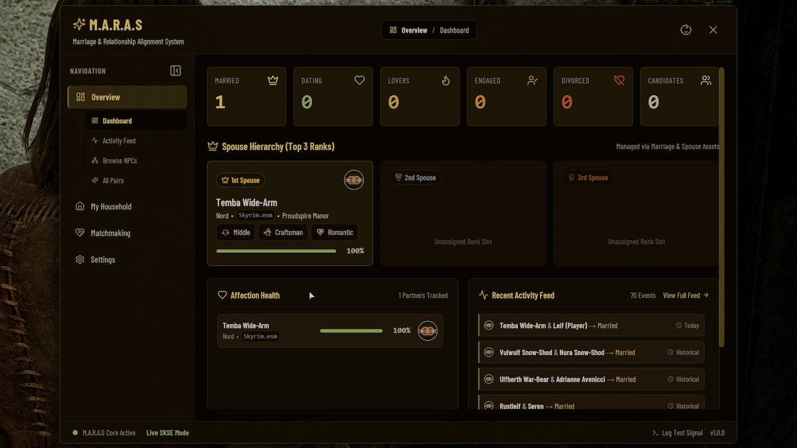
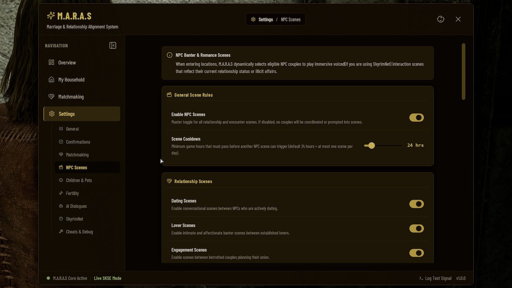

# 💍🐉 M.A.R.A.S Player Guide — The Ultimate "How-To" & Feature Handbook
*How to woo, wed, raise a dynasty, and (maybe) survive twelve spouses without soft-locking your heart or your wallet.*

Welcome to **M.A.R.A.S** (*Marriage, Affection, Romance & Adoption in Skyrim*)! Think of this guide as your **master handbook and shortcut cheat sheet**: what features the mod adds, how you're supposed to use them in actual gameplay, and which dialogue lines or Dashboard buttons do the magic. ✨

---

## 📚 Deep-Dive Player Guides (Pick Your Topic!)

Want the full details on a specific system? Jump straight to its dedicated guide:
- 🖥️ **[UI Dashboard Guide](UI_DASHBOARD_GUIDE.md)** — How to use the **`Alt + B`** menu to manage partners, homes, buffs, kids, and settings.
- 💞 **[Relationship Overview](RELATIONSHIP_OVERVIEW.md)** — Casual Lovers, Dating, Engagement, Marriage, Open Relationships, Cheating, and Matchmaking.
- ❤️ **[Affection System Guide](AFFECTION_SYSTEM.md)** — How daily moods, gifts, intimacy, and loneliness decay work.
- 🎭 **[Archetypes & Buffs](ARCHETYPES_AND_BUFFS.md)** — How Social Class, Skill Type, and Temperament grant 14 unique buffs.
- 👶 **[Kids, Adoption & Fertility Guide](FERTILITY_MODE_RELOADED_INTEGRATION_USER_GUIDE.md)** — Unlimited adoptions, FMR / Beeing Female pregnancies, pets, custody, and secret dads.
- 🤖 **[SkyrimNet AI Guide](SKYRIMNET_INTEGRATION_GUIDE.md)** — Voice/text AI romance, autonomous NPC actions, episodic memories, and live drama triggers.

---

## ⚡ 1. The "How Do I...?" Instant Cheat Sheet

Don't want to read a novel while a dragon is circling Whiterun? Here is how to do everything in M.A.R.A.S at a glance:

| What You Want to Do | Through Gameplay / Dialogue | Shortcut in the Dashboard (`Alt + B`) |
| :--- | :--- | :--- |
| **Open the M.A.R.A.S Menu** | Press **`Alt + B`** during gameplay *(pauses the game)* | Rebind hotkey in **Settings $\rightarrow$ General** |
| **Start Romancing Any NPC** | Say **`(M) Ever think we could be something more?`** *(or flirt in SkyrimNet chat)* | **Matchmaking $\rightarrow$ Manual Match** |
| **Raise a Partner's Affection** | Talk daily, give **Gifts**, sleep in the same house, bring them as a **Follower**, or be intimate | Click NPC $\rightarrow$ slide their **Affection** bar |
| **Date, Hook Up, or Propose** | Say **`(M) May I have a word with you?`** *(or ask them out / propose in SkyrimNet chat)* | **Matchmaking $\rightarrow$ Manual Match** |
| **Unlock Player Polygamy** | Marry + absorb 1 Dragon Soul + **Sleep** to start *"The Flame Divides Not"* $\rightarrow$ pray at a Shrine of Mara | **Settings $\rightarrow$ General $\rightarrow$ Enable Polygamy** |
| **Rank Your Spouses (`1st–4th+`)** | Say **`(M) Can we talk about our life together?`** $\rightarrow$ **`Let's talk about your standing...`** | **My Household $\rightarrow$ Partners** *(or NPC Profile)* |
| **Move a Spouse Into Your House** | **`(M) Can we talk about our life together?`** $\rightarrow$ **`I'd like us to move somewhere else.`** | Click Spouse $\rightarrow$ **Assigned Residence** dropdown |
| **Get Legal Access to Spouse's Home** | **`I want to talk about where we're living`** $\rightarrow$ **`Is your home open to me as well?`** *(Affection > 50)* | Automatic quest marker to visit their home |
| **Let a Housed Spouse Go Back to Work** | **`You can head back to your own home whenever you'd like.`** | Click Spouse $\rightarrow$ uncheck **Stay at Home** |
| **Open or Close a Relationship** | Ask via **`(M)` relationship dialogue** *(or negotiate in SkyrimNet chat)* | **My Household $\rightarrow$ Partners** $\rightarrow$ toggle **Open** |
| **Check or Change Spouse Buffs** | Marry spouses of different **Social Classes** or bring **Skill Type** spouse followers | **My Household $\rightarrow$ Household Buffs** *(override traits on NPC Profile)* |
| **Adopt Unlimited Kids** | Adopt urchins/orphans in dialogue *(vanilla limit removed!)* | **Matchmaking $\rightarrow$ Child Adoption** *(for you or NPC couples!)* |
| **Pair Up Two NPCs (Play Cupid)** | Let background Matchmaking run automatically every few days | **Matchmaking $\rightarrow$ Manual Match** or **LLM Matchmaking** |
| **Find a Lost Spouse or Kid** | Check quest markers or visit their assigned home | Click NPC $\rightarrow$ **Teleport Player To** / **Teleport NPC To Player** |
| **Send Kids Away Before a Scene** | **Talk to your child** and pick the *run away* dialogue option, or let it happen **automatically** when an OStim/SexLab scene starts in a cell with children | Click the **baby button** in the top bar (next to the `X`) |

---

## 💘 2. Step-by-Step: From First Flirt to Marriage

### Step 1: Turn Any NPC Into a Romantic Candidate 💬
Walk up to literally any adult NPC in Skyrim who catches your eye and select:
> **`(M) Ever think we could be something more?`**

- **What Happens**: M.A.R.A.S registers them as a **Candidate** and sets their starting **Affection (`0–100`)** based on how much they already like you in vanilla Skyrim (friends and allies start higher; people whose chickens you kicked start lower!).
- **No Neglect Timer Yet**: While an NPC is just a **Candidate**, their affection **never decays** if you leave town. Take all the time you want!

### Step 2: Courting, Casual Lovers & Exclusive Dating 🌹💋
Once an NPC is registered, talk to them and pick:
> **`(M) May I have a word with you?`**

From here (or naturally through **SkyrimNet AI conversation**!), you can:
1. 🎁 **Give Gifts (`I found something I thought you might like`)**:
   - More expensive gifts give more affection—and their **Social Class** matters! A **Poverty** or **Working** class sweetheart will love a modest gift, while a **Noble** or **Ruler** expects fine jewelry or gold.
   - *(Remember: Daily affection gains have a cap so you can't dump 400 iron daggers on someone in one afternoon to force marriage!)*
2. 💋 **Become Casual Lovers**:
   - Want friends-with-benefits without exclusivity? Start a **Lover** relationship! You can have multiple Lovers at once, and they barely mind when you're away (`25%` normal decay).
3. 🌹 **Start Officially Dating**:
   - Ready to go exclusive? Become a **Dating** couple (`50%` normal decay). Entering a committed relationship automatically breaks off any casual side Lovers (turning them into **Ex-Lovers**), unless you have **Polygamy** enabled or agree to an **Open Relationship**.

### Step 3: Proposing Marriage & Passing Their Standards 💍🏰
When you're ready to pop the question, choose **`Will you marry me?`** in dialogue (or propose in **SkyrimNet AI chat**):
- **Will They Say Yes? (Marriage Difficulty)**:
  - M.A.R.A.S checks your **Affection**, their **Social Class** vs. your wealth/houses/completed quests, and whether you belong to a **Guild** that matches their **Skill Type** (e.g., Companions for Warriors, College of Winterhold for Mages, Thieves Guild for Rogues).
  - **If They Say No**: Wait **24 in-game hours**, build up your Affection (or buy a house / finish some quests), and try again! *(Or lower the Marriage Difficulty sliders in **Dashboard $\rightarrow$ Settings**.)*
  - **If They Say Yes**: Congratulations, you are now **Engaged**! 💎

### Step 4: The Wedding Ceremony (Or Skipping Straight to the Honeymoon!) 💒
- **Your First Wedding**: Starts the classic Temple of Mara wedding ceremony in Riften.
- **Skipping Repeat Ceremonies**: Once you've experienced a wedding (or if you toggle **Skip Wedding** in **Dashboard $\rightarrow$ Settings $\rightarrow$ General**), M.A.R.A.S lets you skip the ceremony and become **Married** on the spot!
- **What If You Miss or Ruin the Wedding? (*Jilted*!)**:
  - Stand your fiancé(e) up at the altar—or call off the engagement—and they become **Jilted**!
  - A Jilted partner will refuse to speak to you for **24 in-game hours**. After cooling off, you can apologize via **`(M) I made mistakes, and I regret them. I still care - can we start over?`** (or beg for forgiveness in **SkyrimNet chat**) to win a second chance!

---

## 🏡 3. Married Life: Homes, Shops, Cooking & Buffs

Once married, talk to your spouse and choose:
> **`(M) Can we talk about our life together?`**

*(Or manage everything visually inside the **M.A.R.A.S Dashboard (`Alt + B`) $\rightarrow$ My Household**!)*

### 🍲 1. Home-Cooked Meals
> **`Would you mind cooking something for me?`**
- Available **once every 24 hours** while your spouse is inside your home. Free homemade food, made with love!

### 🗝️ 2. Living in *Their* House (Spouse Home Sharing)
> **`I want to talk about where we're living.`** $\rightarrow$ **`Is your home open to me as well?`**
- **Requirements**: Your spouse has a personal home in Skyrim, their **Affection is above `50`**, and you aren't currently in the middle of unlocking another spouse's house.
- **How It Works**: A mini-quest guides you to **visit your spouse's home**. The moment you step inside, M.A.R.A.S unlocks the doors/gives you the key and makes the interior legally yours—no trespassing warnings, free bed access, and taking items won't count as stealing!
- **Giving Up Access**: Tell them **`I won't be relying on your house for a while`** if you ever want to return their house to normal private ownership.

### 🏰 3. Moving Spouses Into *Your* Player Houses
> **`I want to talk about where we're living.`** $\rightarrow$ **`I'd like us to move somewhere else.`** *(or use the **Assigned Residence** dropdown on their Dashboard profile!)*
- **Requirements**: You own at least one **Player House** (vanilla hearthfire/city homes are detected automatically, and modded homes can be registered in a snap!) and the spouse's **Affection is above `25`**.
- **Keeping Quest NPCs & Shopkeepers Safe (*"Stay at Home"* Toggle)**:
  - Moving a spouse into your house gives them an AI package to live and relax there.
  - **Important Tip**: Did you marry a Jarl, a town blacksmith, or a quest-important NPC who needs to be at their job during the day? Tell them **`You can head back to your own home whenever you'd like`**—or simply uncheck **"Stay at Home"** on their **Dashboard Profile**! That lets them keep their normal daytime routine/quest schedule while still counting as part of your household!

### 💰 4. Daily Store Income & Specialized Home Merchants
When a spouse is assigned to one of your Player Houses (and their **Affection is above `50`**):
1. **Collect Daily Store Profits**: Ask **`Has the store made any money?`** once per day. Their payout scales with their **Social Class** (Nobles and Rulers bring in serious coin!), their **Household Rank**, and their **Affection Mood**!
2. **Shop at Their Home Stall**: Housed spouses become active merchants right in your living room! Based on their background and **Skill Type**, they stock one of **9 Merchant Inventories**:
   - 🧪 **Apothecary** *(potions & alchemy ingredients)*
   - ⚒️ **Blacksmith** *(weapons, armor & ingots)*
   - 🏹 **Fletcher** *(bows & arrows)*
   - 🦌 **Hunter** *(pelts & provisions)*
   - 🍺 **Innkeeper** *(food & drinks)*
   - 💎 **Jeweler** *(gems & jewelry)*
   - 🧵 **Tailor** *(clothes & fine fabrics)*
   - 🔮 **Spell Merchant** *(spell tomes, scrolls & soul gems)*
   - 📦 **Misc Merchant** *(general goods)*
   - *(Pro Tip: Spouses of the same merchant type share a linked merchant chest across your houses—so gear you sell to your Blacksmith wife in Whiterun can be bought back from your Blacksmith husband in Solitude!)*

### ⚡ 5. Passive & Follower Spouse Buffs
- **Permanent Household Buffs (From Social Class)**: Always active just for being married (+Carry Weight, +Sneak Damage, +Skill XP, better store prices, +Magic Resist, +Speech, or +Stamina Regen).
  - **Monogamy Bonus (`2.0x`)**: If you have **only ONE spouse**, their permanent buff is **doubled**!
- **Follower Combat Buffs (From Skill Type)**: Active whenever a married spouse travels with you as a follower (+Melee Damage, +Magicka Regen, +Ranged Damage, +Sneak, -Damage Taken, or -Shout Cooldown).
- Check your live numbers anytime in **Dashboard (`Alt + B`) $\rightarrow$ My Household $\rightarrow$ Household Buffs**!

---

## 👑 4. Player Polygamy & The Spouse Hierarchy

Want to marry more than one person without anyone accusing you of cheating?

### 🔥 How to Unlock Polygamy: *"The Flame Divides Not"*
1. **The Immersive Quest Way**:
   - Be **Married** + have absorbed at least **1 Dragon Soul** + **go to sleep** in any bed.
   - You'll awaken to the quest **"The Flame Divides Not"**, guiding you to pray at a **Shrine of Mara** and receive Mara's divine blessing for multiple marriages!
2. **The Instant Menu Shortcut**:
   - Open **Dashboard (`Alt + B`) $\rightarrow$ Settings $\rightarrow$ General** and toggle **Enable Polygamy** to **ON**.

### 🏆 Ranking Your Spouses (`1st`, `2nd`, `3rd`, `4th+`)
Once you have 2+ spouses, you can organize your **Household Hierarchy** either via **`Let's talk about your standing in our home`** or in **Dashboard $\rightarrow$ My Household**:
- 🥇 **Lead Spouse (`1st`)**: **`1.00x`** Permanent Buff & Store Gold
- 🥈 **Second Spouse (`2nd`)**: **`0.50x`** Permanent Buff & Store Gold
- 🥉 **Third Spouse (`3rd`)**: **`0.25x`** Permanent Buff & Store Gold
- 🏅 **Fourth+ Spouses (`4th+`)**: **`0.10x`** Permanent Buff & Store Gold each
- *(Watch out: Promoting a spouse boosts their affection—especially **Proud** spouses at **`+24`**—while demoting them tanks their affection by up to **`-24`**!)*

---

## 🕵️‍♂️ 5. Open Relationships, Cheating & Secret Affairs

M.A.R.A.S turns Skyrim into a two-way street of temptation:
- 🔓 **Open Relationships**: Want side flings without drama? Ask your partner in dialogue (or toggle **Open Relationship** in the Dashboard). **Independent** partners love it (`+15` Affection), while **Romantic** (`-20`) and **Jealous** (`-35`) partners hate it!
- 🚨 **Cheating & Bedroom Walk-Ins**:
  - If you're in a closed relationship (without Polygamy) and hook up with someone else, or if your neglected partner strays with another NPC, it starts a **Secret Affair**—unless a partner **physically walks into the room mid-scene**, catching the cheater red-handed (`-35` Affection)!
- 💬 **Uncovering & Resolving Affairs**:
  - Suspect your partner is cheating? **Ask them if they've been faithful** in dialogue (your Affection and Speech skill help uncover the truth!).
  - Guilty of cheating yourself? You can **Confess** (`-30` Affection) before your side lover gets messy and **Exposes** you (`-50` Affection!).
  - When an affair comes out, you can **demand they dump the side lover**, **forgive and open the relationship**, or **break up / divorce on the spot**.

---

## 💔 6. Neglect, *"Marriage: The Last Word"*, Divorce & Death

### 🚨 Neglect & *"Marriage: The Last Word"*
If you ignore a spouse for weeks or tank their affection below **`25` (*Estranged*)**:
1. All of their buffs and store income drop to **`0`**, and the ultimatum quest **"Marriage: The Last Word"** begins!
2. You have **3 in-game days** to track down your spouse and say:
   > **`(M) I came as soon as I heard. What's going on?`**
3. **How to Save the Marriage**:
   - **Without SkyrimNet**: Pass a **Persuade** or **Intimidate** check in dialogue, or raise their affection back to `25+` with gifts/attention before the 3 days expire.
   - **With SkyrimNet AI**: Talk things through in a heartfelt roleplay conversation and convince them to give you another chance!
   - **If You Fail (or Ignore Them for 3 Days)**: They divorce you automatically!

### 💸 Divorce Settlements & Hold Bounties (Alimony Hurts!)
Whether *you* initiate a divorce (`(M) We need to talk about... us. (Breakup)`), your spouse dumps you in SkyrimNet chat, or *"Marriage: The Last Word"* fails, your ex-spouse can demand a **Divorce Settlement**:
- **How the Bill Is Calculated**:
  - **`100` Base Gold**
  - **+ `30%` of your carried gold** *(up to `1,000` gold)*
  - **+ `700` gold per house** you own
  - **+ `500` gold per horse** you own
  - **+ `100` gold per quest completed** *(up to `1,000` gold)*
  - **+ `100` gold per dungeon cleared** *(up to `1,000` gold)*
- **Pay the Courier or Face the Guards**: A courier will deliver the settlement notice. Once delivered (or if you dodge the courier for **3 days**!), the settlement is added as a **Crime Bounty in your ex-spouse's Hold**! Pay the guards—or go to jail! 🚓
- *(Mercy Rule: Divorce settlements have a **7-day cooldown**, so if two spouses divorce you in the same week, you only get billed once!)*

### ⚰️ Death, Mourning & The "Murderer Gets Nothing" Rule
If a partner tracked by M.A.R.A.S dies:
- **Fiancé(e), Ex-Partner, or Jilted**: A courier brings you a **Mourning Letter**.
- **Married Spouse**: You receive a **Mourning Letter** plus an **Inheritance** scaled to their **Social Class**!
- 💀 **Unless *You* Killed Them**: If you were the one who struck the fatal blow on your spouse or fiancé(e), M.A.R.A.S gives you **zero gold and zero mourning letter**. Just cold, judging silence. *(You know what you did.)*

---

## 🏹 7. NPC-to-NPC Relationships, Matchmaking & The Living World

In M.A.R.A.S, romance isn't limited to the Dragonborn! Every adult NPC across Skyrim can date, take casual lovers, get engaged, marry, open their relationship, cheat, have babies, and divorce **other NPCs**!

### 🌍 1. Automatic Background Matchmaking (Hands-Free World Evolution)
Every few in-game days, M.A.R.A.S scans single and coupled NPCs across Skyrim and evolves the marriage market on its own:
- **New Couples & Promotions**: Single NPCs start **Dating** or hook up as **Lovers**, while existing NPC couples progress from **Lover $\rightarrow$ Dating $\rightarrow$ Engaged $\rightarrow$ Married**.
- **Splits & Infidelity**: Unhappy NPC couples can **Break Up**, call off weddings (**Jilted**), **Divorce**, **Open / Close** their relationships, or even start **secret side affairs** (if **Allow Cheating** is enabled in Matchmaking Settings!).
- **Two Matchmaking Brains (`Settings -> Matchmaking`)**:
  - 🤖 **SkyrimNet AI Matchmaker (LLM Mode)**: An AI Game Master reads NPC personalities, backgrounds, and relationship trees to propose lore-friendly pairs, verifies that the match makes sense, and **writes first-person memories for both NPCs** so they actually remember how they got together when you talk to them!
  - 🎲 **Weighted Dice-Roll Mode**: Fast, customizable background rolls that work **with or without SkyrimNet** *(and if SkyrimNet is installed, you can still use AI verification and memory generation on Dice-Roll matches!)*.
- **Your Ground Rules**: In **Dashboard (`Alt + B`) $\rightarrow$ Settings $\rightarrow$ Matchmaking**, you can toggle **`Exclude Player's Active Partners`** (so the Matchmaker never steals your spouses/partners!), pick from **7 Sexual Orientation rules**, and set per-NPC cooldown days.

### 🎯 2. Playing Cupid Yourself (Manual & AI Matchmaking in the Dashboard)
Want to pair up two specific followers, marry off your ex, or break up a couple in Whiterun? Press **`Alt + B`** and open the **Matchmaking** tab:
- **Manual Match**: Pick **NPC A** on the left and **NPC B** on the right (searchable across every NPC in Skyrim!) and click any status (**Lover**, **Dating**, **Engaged**, **Married**, **Breakup/Divorce**, or **Open/Close Relationship**) to apply it immediately!
- **LLM Matchmaking** *(with SkyrimNet)*: Run an on-demand **Per-NPC** or **Global World** AI scan, read why the AI thinks two characters belong together, edit their generated first-person memories, and click **Apply**!

### 💬 3. How NPC Couples Act in the World (Shared Homes, Banter & Live AI)
When NPCs pair up across Skyrim, you'll see and hear the results directly in gameplay:
- **Moving In Together**: When two NPCs marry (and have or adopt kids), M.A.R.A.S manages their family unit and relocates their children to live with them!
- **Ambient Couple Banter in Towns & Taverns**: As you walk through cities, inns, temples, and shops, nearby NPC couples spontaneously banter with each other about their romance, their open relationship, or their cheating drama—and even talk or complain about their absent partner when alone! *(Customize scene types, cooldowns, and location rules in **Settings $\rightarrow$ NPC Scenes**.)*

- **Live SkyrimNet NPC-to-NPC Drama**: When two NPCs converse near you with SkyrimNet active, they can propose dating or marriage to each other, confess affairs, or expose cheating right in front of you!
- **Track the Gossip**: Open **Dashboard (`Alt + B`) $\rightarrow$ Overview** and check **Activity Feed** (chronological log of every new couple and breakup), **Browse NPCs**, or **All Pairs** to see who is dating or cheating on whom across the province!

---

## 👶 8. Unlimited Kids, Adoption, Pets & Fertility

Whether you want to adopt every orphan in Skyrim or raise a biological family, M.A.R.A.S overhauls family life:
- 🧸 **Unlimited Adoptions (For You *or* NPC Couples!)**:
  - Adopt street urchins (Lucia, Sofie, Blaise, Alesan), Honorhall orphans, or modded kids without vanilla's 2-kid (or Hearthfire's 6-kid) limit!
  - Use **Dashboard (`Alt + B`) $\rightarrow$ Matchmaking $\rightarrow$ Child Adoption** to adopt a child with one click—or assign an orphan to an **NPC-to-NPC married couple**!
  - **Orphanage Safety Net**: If both parents of an NPC child die, that child automatically moves to **Honorhall Orphanage** so you (or another NPC couple) can adopt them.

- 🤰 **Biological Pregnancies & Growing Up (*Fertility Mode Reloaded* / *Beeing Female NG*)**:
  - Tracks children from **Expecting / Unborn $\rightarrow$ Newborn Infant $\rightarrow$ Child $\rightarrow$ In Training $\rightarrow$ Adult Offspring** (who become recruitable adult followers!).
  - Click **`Spawn Child`** on any unspawned child's Dashboard profile to bring their 3D child actor into your home!

- 🐕 **1 Pet Dog + 1 Wild Critter *Per Child***:
  - Every child can have their own dog and their own woodland critter—and you can **Dismiss** or **Ban** pets/critters per-child right from their Dashboard profile.
- 🏃 **Kids Run Away From Intimate Scenes**:
  - **Automatic**: whenever an **OStim or SexLab** scene is running in a cell with children (even an NPC-to-NPC scene), every awake child in that cell runs away. They are released as soon as the scene ends. Sleeping children are left alone.
  - **Manual**: click the **baby button** at the top of the Dashboard (next to the `X`, available on every page) to make all children in your current cell run away right now. Hover it for a reminder. It is greyed out if you have no children.
  - **Through dialogue**: your own children also have this as a **dialogue option**. Talk to one of your children and ask them to run away, and every child in the cell runs off, exactly like pressing the Dashboard button (no menu needed, handy when the game is not paused). It resets the same way when you change cell.
  - **It resets when you change cell**: a manual flee ends as soon as you leave the cell you pressed it in, and children run back to their normal routine. Press the button again in the new cell if you want them to flee there too.
  - Children flee through the nearest door. If a child gets stuck next to you for about 12 seconds (e.g. blocked by the scene), M.A.R.A.S moves them out of the way and they keep fleeing.
- 🕵️‍♂️ **Secret Dads & Divorce Custody**:
  - If a baby's biological father isn't the mother's partner, M.A.R.A.S tracks the **Paternity Secret** (with higher discovery odds if the baby's race obviously doesn't match the presumed dad!).
  - If a couple divorces, customizable **Custody Rules** (**Settings $\rightarrow$ Children & Pets**) decide who keeps the kids—and if a deceived husband walks out over a secret baby, the real biological father can step in and marry the mother!

Go forth, Dragonborn—love wisely, check your affection bars, and never demote a Proud spouse without a backup plan! 😉💖

