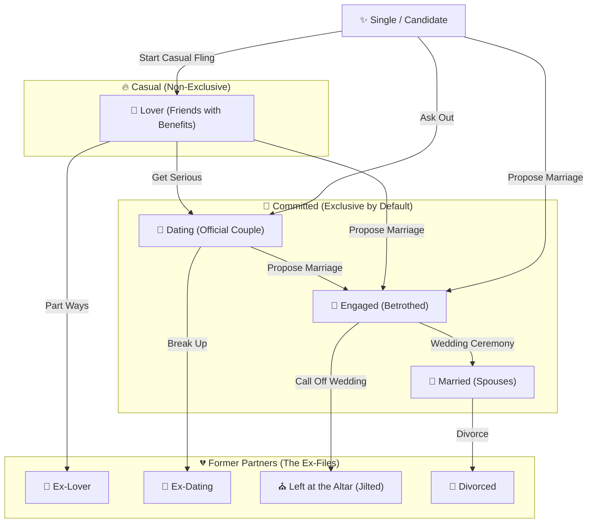

# 💞🔥 M.A.R.A.S Relationship Guide — Romance, Marriage & Soap-Opera Drama

Welcome to **M.A.R.A.S** (*Marriage, Affection, Romance & Adoption in Skyrim*)! Whether you want a cozy fairytale marriage with one soulmate, a sprawling twelve-spouse noble dynasty, or a messy web of tavern hookups and secret affairs, this guide covers how love (and heartbreak) works in Skyrim.

And here's the best part: **the world doesn't revolve only around the Dragonborn**. While you're out slaying dragons, NPCs across Skyrim are dating each other, hooking up at the local inn, getting engaged, marrying, walking in on cheating partners, and filing for divorce! 🍿

---

> [!TIP]
> **Related Player Guides**
> - [❤️ Affection System Guide](AFFECTION_SYSTEM.md) — Daily upkeep, moods, loneliness decay, and keeping your partners happy.
> - [🎭 Archetypes & Buffs](ARCHETYPES_AND_BUFFS.md) — How Social Class, Skill Type, and Temperament shape buffs and personalities.
> - [👶 Fertility Mode Reloaded Guide](FERTILITY_MODE_RELOADED_INTEGRATION_USER_GUIDE.md) — Pregnancy, childbirth, secret paternity, and raising kids.

---

## 1. The Relationship Ladder: From Flings to "I Do" 🪜💍

M.A.R.A.S divides romance into **Casual (Non-Exclusive)** flings, **Committed (Exclusive)** relationships, and **Exes**:

### What Each Stage Actually Means in Gameplay
- ✨ **Single / Candidate**: Eligible NPCs who are open to romance.
- 🍺 **One-Night Hookups**: Spontaneous intimate encounters (via OStim or SexLab) that don't start an ongoing relationship—though if you're already in a committed relationship and get caught, your partner will *definitely* care!
- 💋 **Lover (Casual)**: Friends with benefits! You (and NPCs) can have multiple casual Lovers at the same time without anyone expecting exclusivity. Affection decay is tiny (`25%` of normal), making Lovers great for low-commitment romance.
- 🌹 **Dating (Committed)**: You're officially a couple! By default, Dating is exclusive (`50%` normal affection decay).
- 💎 **Engaged (Committed)**: You proposed and they said yes! You're now betrothed (`75%` affection decay) and ready either for a full **Temple of Mara wedding ceremony** in Riften or a quick **instant ceremony**.
- 👑 **Married (Committed)**: The big league! Married spouses unlock **Permanent Household Buffs**, **Follower Combat Buffs**, **Daily Store Gold**, **Home Sharing**, **Specialized Home Shops**, and **Child Custody**.

---

## 2. How to Woo, Date & Marry Someone 💘🎻

Depending on your mod setup, you have two ways to romance anyone in Skyrim:

### Option A: Standard Dialogue & The Amulet of Mara 📿
1. **Register & Court**: Talk to an eligible NPC (wearing an **Amulet of Mara** helps open romantic topics!).
2. **Pass Their Standards (Romance & Marriage Difficulty)**:
   - Asking someone to become your **Lover**, start **Dating**, or **Marry** you isn't always an automatic *"Yes!"*—with casual Lover proposals being the easiest, Dating in the middle, and Marriage requiring the highest commitment, and progressing step-by-step (`Lover` $\rightarrow$ `Dating` $\rightarrow$ `Engaged`) improving your odds along the way.
   - Depending on their **Social Class** and **Skill Type**, they'll evaluate your **Prestige**—how much they like you, whether you own houses, how much gold you have, how many quests you've completed, and whether you lead a guild they respect (like the Companions for a Warrior or the College for a Mage).
   - **History & Exclusivity Matter**: Winning back an ex (`Ex-Lover`, `Ex-Dating`, or `Jilted`) or proposing when either of you would be **cheating** on a closed partner significantly lowers your chances!
   - *(Want easier or harder proposals? You can tweak or turn off proposal requirements anytime in the **M.A.R.A.S Dashboard $\rightarrow$ Settings**!)*
3. **Tie the Knot**: Once engaged, head to Maramal in Riften for a traditional wedding—or use the quick-marriage option if you'd rather skip the church pews and get straight to the honeymoon.

### Option B: Natural Roleplay with SkyrimNet AI 🎙️🤖
If you have **SkyrimNet** installed, you don't even need to click static romance menus!
- Simply **flirt, ask them out on a date, suggest becoming lovers, or propose marriage naturally in voice or text chat**.
- The NPC's AI weighs their feelings, temperament, and relationship history with you before accepting or turning you down!

---

## 3. Going Exclusive: What Happens to Your Side Lovers? ✂️💋

When two people enter a **Committed Relationship** (`Dating`, `Engaged`, or `Married`), exclusivity kicks in automatically:
- **Automatic Break-Off**: Any casual **Lovers** either of you had on the side are politely cut loose and become **Ex-Lovers**.
- **The Two Exceptions**: Side lovers are *kept* if your relationship is an **Open Relationship**, or if you are the **Player with Polygamy enabled**!

---

## 4. Cheating, Secret Affairs & Bedroom Walk-Ins 🕵️‍♂️💥

What happens when someone in a closed, committed relationship (`Dating`, `Engaged`, or `Married`) decides to stray? **Chaos.**

### 🙈 How Cheating Works (For Both You *and* NPCs!)
Yes—**both you AND your partners can cheat!** If you neglect a partner or marry someone with a restless **Independent** streak, the background romance engine might tempt them into a secret affair while you're out dungeon-delving.

Here is how affairs blow up:
1. 🚨 **Caught Red-Handed (Walk-Ins!)**:
   - If you (or an NPC) get intimate with someone else while a committed partner is awake in the same room with line-of-sight—or if your spouse **physically walks into the bedroom mid-scene**—you are caught on the spot!
   - Expect immediate shock, furious confrontation, and a massive **`-35` Affection** hit.
2. 🤫 **Secret Affairs**:
   - If nobody sees the tryst, it becomes a **Secret Affair**. Everything looks fine on the surface... for now.
3. 💬 **Confession vs. Third-Party Exposure**:
   - **Coming Clean (`-30` Affection)**: A guilty partner can confess the affair in dialogue. It hurts, but honesty gives you a better shot at saving the relationship.
   - **Spilling the Tea (`-50` Affection)**: If an affair drags on, the third-party paramour might get jealous or petty and **expose the affair** directly to the betrayed partner!
   - **Questioning Your Partner**: Suspect your partner is sneaking around? You can **ask them if they've been faithful** in dialogue! Your current **Affection** and **Speech** skill affect your chances of getting the truth out of them.

### ⚖️ Three Ways an Affair Ends
When cheating comes to light, the betrayed partner faces three choices:
1. **Demand They End the Affair**: The cheater dumps their side lover (`Ex-Lover`) and recommits. Trust takes a beating, but the relationship survives.
2. **Forgive & Open the Relationship**: The couple decides monogamy isn't working and transitions into an **Open Relationship**.
3. **Break Up / Divorce**: Enough is enough—immediate breakup, called-off wedding (`Jilted`), or **Divorce**!

---

## 5. Open Relationships 🔓💞

Any committed couple (`Dating`, `Engaged`, or `Married`) can agree to an **Open Relationship**:
- **Side Flings Allowed**: Both partners can take casual **Lovers** and enjoy intimate encounters with others without it counting as cheating.
- **No Walk-In Confrontations**: Walking in on a partner with a side lover won't trigger a cheating breakup.
- **Watch Out for Temperaments!**:
  - 🐺 **Independent** partners *love* open relationships (**`+15` Affection**).
  - ❤️ **Romantic** (**`-20`**) and 👀 **Jealous** (**`-35`**) partners hate the idea!
  - *(Bonus detail: Even if a **Jealous** partner reluctantly agrees to an open relationship, if they physically see you being intimate with someone else right in front of them, they'll still lose **`-10` Affection**!)*
- **Closing It Back Up**: If you close an open relationship later, all outside casual lovers are immediately dropped.

---

## 6. Player Polygamy & The Spouse Hierarchy 👑🏰

While regular NPCs in Skyrim practice one-at-a-time committed relationships, the Dragonborn can unlock **Player Polygamy**:

### 🙏 How to Unlock Polygamy
- **In-Game Immersive Way**: Pray at any **Shrine of Mara** to receive **Mara's Blessing of Polygamy**.
- **Menu Shortcut**: Toggle Polygamy directly in the **M.A.R.A.S Dashboard $\rightarrow$ Settings** tab.

### 🏆 The Household Hierarchy (`1st`, `2nd`, `3rd`, `4th+`)
When you have multiple spouses, your partners recognize Mara's blessing (so marrying Spouse #2 doesn't count as cheating on Spouse #1!), and your spouses are organized into a **Household Hierarchy** that scales their **Permanent Household Buffs** and **Daily Store Gold**:
- 🥇 **Lead Spouse (`1st Rank` — `1.00x`)**: The head of your household! Receives full baseline buff and gold scaling.
- 🥈 **Second Spouse (`2nd Rank` — `0.50x`)**: Senior partner (`50%` permanent buff & gold share).
- 🥉 **Third Spouse (`3rd Rank` — `0.25x`)**: Honored partner (`25%` permanent buff & gold share).
- 🏅 **Fourth+ Spouses (`4th+ Rank` — `0.10x` each)**: Additional spouses (`10%` permanent buff & gold share each).

> [!WARNING]
> **Careful Who You Demote!**
> You can reorder your spouses' ranks anytime in dialogue or in the **Dashboard $\rightarrow$ My Household** tab. Promoting a **Proud** spouse gives a huge **`+24` Affection** boost—but demoting them down the ladder hits you with up to **`-24` Affection**!

---

## 7. Heartbreak: Breakups, Jilting & Expensive Divorces 💔💸

Not every love story lasts forever. When you (or your partner) end a relationship:

- 🥀 **Dating Breakup (`Ex-Dating`)**: A clean split. If things cool off, you can even try to win them back later!
- ⛪ **Left at the Altar (`Jilted`)**: Calling off an engagement breaks your fiancé(e)'s heart—expect them to be furious and unwilling to jump right back into dating.
- 📜 **Divorce (`Divorced`)**: Ending a marriage is serious business in M.A.R.A.S:
  1. **Moving Out & Losing Perks**: Your ex-spouse moves out of your Player House (or kicks you out of theirs!), and you immediately lose their buffs and daily store income.
  2. **The Divorce Settlement (Alimony!)**: Your ex-spouse won't walk away empty-handed! A courier will track you down with a **Divorce Settlement** demand scaled to your gold, houses, and their Social Class.
  3. **Pay Up or Talk to the Guards**: If you refuse or dodge the settlement for **3 in-game days**, your ex reports you to the jarl's men and the entire unpaid settlement is slapped onto your **Hold Bounty**! 🚓💰
  4. **Child Custody**: If you share adopted or biological children, custody is decided automatically based on the **Custody Policy** in your Dashboard Settings (*Stay with Player*, *Stay with Mother*, *Stay with Father*, or *Split*).

---

## 8. Playing Cupid: Matchmaking & The Living World 🏹💘

Why should the Dragonborn have all the fun? M.A.R.A.S includes a full **Matchmaking System** that turns Skyrim's NPCs into a living, breathing romance market—whether you want the world to evolve automatically on its own or you want to play hands-on Cupid yourself!

### 🌍 Automatic World Matchmaking (Hands-Free Soap Opera)
Every few in-game days (configurable in **Settings**), M.A.R.A.S checks in on single and coupled NPCs across Skyrim:
- **New Sparks**: Single NPCs start **Dating** or hook up as casual **Lovers**.
- **Moving Up**: Existing NPC couples naturally progress from **Lover $\rightarrow$ Dating $\rightarrow$ Engaged $\rightarrow$ Married**.
- **Splits & Drama**: Troubled NPC couples can **Break Up**, call off engagements (**Jilted**), **Divorce**, or decide to **Open / Close** their relationships.
- **Secret NPC Affairs**: If you enable **Allow Cheating** in Matchmaking Settings, taken NPCs might even start sneaky side affairs behind their partner's back!

### 🧠 Two Matchmaking Brains: AI Matchmaker vs. Dice-Roll Engine
You can choose how the Matchmaker picks couples in **Dashboard $\rightarrow$ Settings**:
1. 🤖 **SkyrimNet AI Matchmaker (LLM Mode)**:
   - If you have **SkyrimNet** installed, an AI Game Master reads all unique NPCs(thier current relationship status, race and gender) to propose pairs that actually make sense!
   - **AI Verification & Custom Memories**: Before locking in a match, the AI verifies that the pairing fits the story and **writes first-person memories for both NPCs**! That means if Ysolda and Mikael start dating while you're out of town, you can walk up to them in the Bannered Mare and they'll actually remember *how* and *where* they got together!
2. 🎲 **Weighted Dice-Roll Mode (Works With or Without SkyrimNet!)**:
   - Prefer fast, lightweight randomization (or playing without SkyrimNet)? The **Dice-Roll Engine** rolls new couples, promotions, breakups, and affairs behind the scenes using probability weights you control.
   - *(Hybrid Bonus: If you use Dice-Roll mode **with** SkyrimNet installed, you can still let the AI verify the rolled pairs and generate their memories!)*

### 🎯 Manual Matchmaking: Play Cupid in the Dashboard!
Want to pair up your favorite followers or break up a couple you can't stand? Open the **M.A.R.A.S Dashboard (`Alt + B`)**:
- **Per-NPC Matchmaker**: Select any NPC to generate tailored romantic suggestions specifically for them—review the proposed partners, read or edit their generated backstory memories, and click **Apply** to make it official!
- **Global Matchmaking Scan**: Trigger a world-wide matchmaking scan on demand whenever you want fresh town gossip, and either review the proposals yourself or let them auto-apply.
- **Your World, Your Rules**:
  - 🛡️ **Protect Your Partners**: Keep **`Exclude Player's Active Partners`** turned on so the Matchmaker never touches your spouses, fiancés, or dating partners *(or turn it off if you want the danger of an ignored partner moving on!)*.
  - 🌈 **Orientation Rules**: Choose which pairings the Matchmaker can create (*Any*, *Heterosexual*, *Homosexual*, *Gay*, *Lesbian*, *Heterosexual & Gay*, or *Heterosexual & Lesbian*).
  - ⏳ **Cooldowns**: Set how many in-game days an NPC must wait after a relationship change before the Matchmaker can pick them again.

### 💬 Overhearing Love & Drama: Ambient Couple Banter
As NPCs pair up across Skyrim, you won't just see it on a menu—**you'll hear it in the streets and taverns!**
- When you walk through towns, inns, temples, or shops, nearby NPC couples will spontaneously banter with each other about their romance, their open relationship, or their cheating drama.
- Even if one partner is out of town, you might overhear a local NPC daydreaming, bragging, or complaining about their absent sweetheart!

---

## 9. Tracking the Soap Opera in the M.A.R.A.S Dashboard 🖥️🗺️

Press **`Alt + B`** (default) in-game to open the **M.A.R.A.S Dashboard (`Prisma UI`)** (see the [🖥️ UI Dashboard Guide](UI_DASHBOARD_GUIDE.md)):
- **Overview & My Household**: Manage all of your spouses, fiancés, dating partners, and lovers, reorder spouse ranks, assign homes, and check active buffs.
- **Matchmaking**: Run manual per-NPC or world-wide matchmaking scans, review AI relationship proposals, and customize generated memories.
- **Relationship Graph**: View an interactive visual web of **every romantic relationship, affair, and breakup happening across Skyrim**—including NPC-to-NPC couples!
- **Settings**: Customize polygamy, affection decay, matchmaking engines and weights, ambient banter scenes, marriage difficulty, and child custody rules whenever you want. 😉

