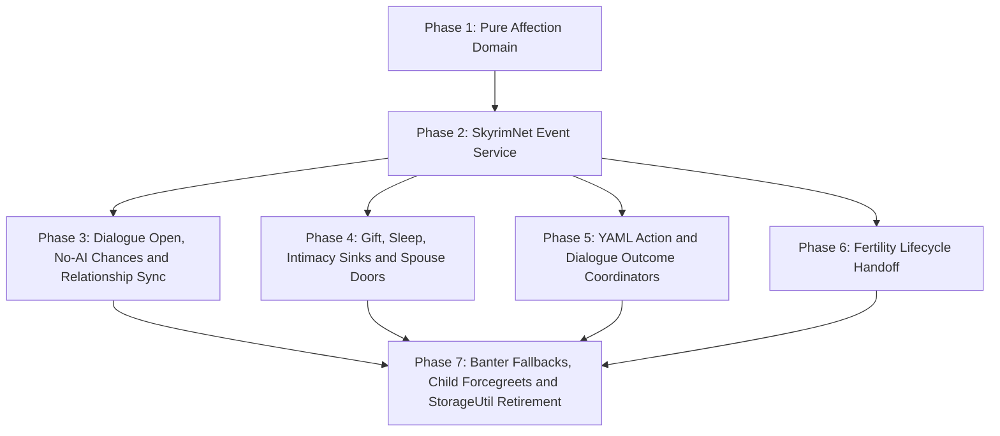

# M.A.R.A.S — 7-Phase Papyrus-to-C++ Migration Plan

Migrate pure domain math, SkyrimNet JSON event construction & audience routing, relationship/dialogue engine side-effects, native menu/sleep/intimacy event sinks, YAML action & dialogue outcome coordinators, fertility post-processing, and scattered `StorageUtil` state out of `Scripts/Source/*.psc` into the 13-module C++23 SKSE plugin (`SKSE_Source/modules/`). Papyrus retains only Creation Kit fragments/aliases, vanilla script casts, and soft-dependency mod adapters.

> [!IMPORTANT]
> **Confirmed Architecture Decisions:**
> 1. **Clean-Cut Global Papyrus Functions:** Once all internal `.psc`, `actions/*.yaml`, and CK fragment callers are migrated, delete obsolete global Papyrus functions outright (`TTM_ServiceAffection`, `TTM_ServiceSkyrimNet`, `TTM_ServiceMarriageDifficulty`, `TTM_ServiceGift`, `TTM_Messages`, `TTM_ServiceSpouseAssets`, and unused `TTM_Data` getters). Keep `SkyrimnetApi.RegisterEventSchema` in Papyrus only if `SkyrimNet.dll` does not export a native C schema registration function.
> 2. **`TT_LoversLedger.esp` (`TTLL_Store`) Intimacy Bonus in Phase 3:** Preserve and fix the optional `TTLL_Store` intimacy bonus for No-AI `IntimateChance` calculation via a lightweight optional bridge gated on `TESDataHandler::LookupModByName("TT_LoversLedger.esp") != nullptr` (fixing both the inverted `if(TTM_Data.GetHasTTLL()) return 0` bailout and the `i == 0` top-lover rank bug in [TTM_ServiceIntimateMoments.psc](file:///e:/Skyrim/development/mods/M.A.R.A.S%20Dev/Scripts/Source/TTM_ServiceIntimateMoments.psc#L230-L260)).

---

## Phase Dependency Diagram



---

## Cross-Cutting Invariants & Per-Phase Verification Gate

### 13-Module DAG & Anti-Monolith Rule
- **Pure Domain First (`STATIC`, `pch_core.h`)**: Author all gameplay math, eligibility rules, and string normalization in new focused files under `maras_domain_relationships`, `maras_domain_lineage`, `maras_domain_household`, and `maras_domain_agency` (zero `<RE/...>`, `<SKSE/...>`, JSON, YAML, or spdlog includes) with deterministic headless unit tests in `SKSE_Source/tests/`.
- **Co-Save State Ownership (`maras_state`)**: Persist all state tables in [WorldTables.h](file:///e:/Skyrim/development/mods/M.A.R.A.S%20Dev/SKSE_Source/modules/state/include/maras/state/WorldTables.h) and `'MARS'` v7 serialization in [CoSaveCodec.cpp](file:///e:/Skyrim/development/mods/M.A.R.A.S%20Dev/SKSE_Source/modules/state/src/CoSaveCodec.cpp), guarded by [test_cosave_migrations.cpp](file:///e:/Skyrim/development/mods/M.A.R.A.S%20Dev/SKSE_Source/tests/test_cosave_migrations.cpp).
- **Single Visibility Choke Point (`maras_projection`)**: Route all secrecy masking and audience filtering through `MARAS::Projection::PerspectiveView` ([PerspectiveView.h](file:///e:/Skyrim/development/mods/M.A.R.A.S%20Dev/SKSE_Source/modules/projection/include/maras/projection/PerspectiveView.h)).
- **Focused Orchestrators (`OBJECT` Modules)**: Create dedicated `.h`/`.cpp` translation units in `engine/`, `app/`, and `bridge_*/` registered in [CMakeLists.txt](file:///e:/Skyrim/development/mods/M.A.R.A.S%20Dev/SKSE_Source/CMakeLists.txt) (`-Reconfigure`). Never append unrelated subsystems into [RelationshipUseCases.cpp](file:///e:/Skyrim/development/mods/M.A.R.A.S%20Dev/SKSE_Source/modules/app/src/RelationshipUseCases.cpp), [LineageUseCases.cpp](file:///e:/Skyrim/development/mods/M.A.R.A.S%20Dev/SKSE_Source/modules/app/src/LineageUseCases.cpp), [PaternityWorkflowCoordinator.cpp](file:///e:/Skyrim/development/mods/M.A.R.A.S%20Dev/SKSE_Source/modules/app/src/PaternityWorkflowCoordinator.cpp), [SkyrimNetDecorators.cpp](file:///e:/Skyrim/development/mods/M.A.R.A.S%20Dev/SKSE_Source/modules/bridge_skyrimnet/src/SkyrimNetDecorators.cpp), or [SkyrimNetMemoryService.cpp](file:///e:/Skyrim/development/mods/M.A.R.A.S%20Dev/SKSE_Source/modules/bridge_skyrimnet/src/SkyrimNetMemoryService.cpp).

> [!WARNING]
> **`.ess` Save-Game & CK Fragment Safety:** Pure global scripts (no `extends Quest`) can have dead functions deleted cleanly. Quest, Alias, TopicInfo, Scene, and Package scripts ([TTM_MainController.psc](file:///e:/Skyrim/development/mods/M.A.R.A.S%20Dev/Scripts/Source/TTM_MainController.psc), [TTM_Actions.psc](file:///e:/Skyrim/development/mods/M.A.R.A.S%20Dev/Scripts/Source/TTM_Actions.psc), [TTM_PlayerScript.psc](file:///e:/Skyrim/development/mods/M.A.R.A.S%20Dev/Scripts/Source/TTM_PlayerScript.psc), [TTM_DialogueManagerMisc.psc](file:///e:/Skyrim/development/mods/M.A.R.A.S%20Dev/Scripts/Source/TTM_DialogueManagerMisc.psc), [TTM_ServiceIntimateMoments.psc](file:///e:/Skyrim/development/mods/M.A.R.A.S%20Dev/Scripts/Source/TTM_ServiceIntimateMoments.psc), [TTM_NpcsScenes.psc](file:///e:/Skyrim/development/mods/M.A.R.A.S%20Dev/Scripts/Source/TTM_NpcsScenes.psc), [TTM_ServiceChildrenLogic.psc](file:///e:/Skyrim/development/mods/M.A.R.A.S%20Dev/Scripts/Source/TTM_ServiceChildrenLogic.psc)) must retain their `ScriptName ... extends ...` shell, CK `;BEGIN CODE` / `;END CODE` fragment markers, and any `Conditional` properties read by `GetVMQuestVariable` in `TT_MARAS.esp` (audit `.spriggit/TT_MARAS.esp` before removing any property).

### Mandatory Verification Gate (Run After Every Phase)
1. **C++ Build & Headless Unit Tests:**
   ```powershell
   powershell -NoProfile -ExecutionPolicy Bypass -File ".agents/skills/maras-build-and-test/scripts/build-and-test.ps1" -Target all -Reconfigure
   ```
2. **Papyrus Compilation (`Scripts/*.pex`):** Compile modified `.psc` scripts via `E:\SteamLibrary\steamapps\common\Skyrim Special Edition\Papyrus Compiler\PapyrusCompiler.exe` using the import paths declared in [skyrimse.ppj](file:///e:/Skyrim/development/mods/M.A.R.A.S%20Dev/skyrimse.ppj).
3. **Config & Sanity Verifier Self-Test:**
   ```powershell
   powershell -NoProfile -ExecutionPolicy Bypass -File "tools/ingame_sanity/verify-maras-sanity.ps1" -SelfTest
   ```
4. **Documentation Sync:** Update affected pages in `docs/modder/` (behavior, formulas, edge cases without copy-pasting headers) and `docs/player/`.

---

## Detailed Phase-by-Phase Execution Checklist

### Phase 1 — Pure Affection Domain & Life-Event Multipliers
**Primary Targets:** [TTM_ServiceAffection.psc](file:///e:/Skyrim/development/mods/M.A.R.A.S%20Dev/Scripts/Source/TTM_ServiceAffection.psc), affection branches in [TTM_MainController.psc](file:///e:/Skyrim/development/mods/M.A.R.A.S%20Dev/Scripts/Source/TTM_MainController.psc)

- [x] Add `SKSE_Source/modules/domain_relationships/include/maras/domain/relationships/AffectionEventRules.h` and `src/AffectionEventRules.cpp` (sibling to [AffectionRules.h](file:///e:/Skyrim/development/mods/M.A.R.A.S%20Dev/SKSE_Source/modules/domain_relationships/include/maras/domain/relationships/AffectionRules.h)):
  - [x] Encode default daily min/max bounds (`intimacy`, `gift`, `dialogueStarted`, `slept`, `promotion`, `loneliness`, `family`) natively in C++, removing the 7 `SetAffectionMinMax` boot calls from `TTM_ServiceAffection.Maintenance()`.
  - [x] Implement pure `(Temperament, SocialClass, EventKind) -> delta` calculators for intimacy, gifts, dialogue start, sleep, hierarchy promotion, player-partner breakup/divorce splash, open-relationship toggles, affair exposure/resolution, paternity secrets, and child adoption/milestones.
- [x] Add `SKSE_Source/modules/app/include/maras/app/AffectionEventCoordinator.h` and `src/AffectionEventCoordinator.cpp`, invoked atomically inside relationship, hierarchy, infidelity, paternity, and lineage transitions.
- [x] Expose temporary native hooks in [PapyrusRelationship.cpp](file:///e:/Skyrim/development/mods/M.A.R.A.S%20Dev/SKSE_Source/modules/bridge_papyrus/src/PapyrusRelationship.cpp) and [MARAS.psc](file:///e:/Skyrim/development/mods/M.A.R.A.S%20Dev/Scripts/Source/MARAS.psc) only for Gift/Sleep/Intimacy/Fertility callers awaiting Phases 4–6 (clean-cut once migrated).
- [x] Remove `TTM_ServiceAffection.Maintenance()` from `TTM_MainController.psc` and clean-cut migrated affection `ModCallbackEvent` steps (`OnMarasOpenRelationshipChanged`, `OnMarasAffairExposed`, `OnMarasAffairResolved`, `OnPaternitySecretResolved`, `OnActionDecline` affection branches).
- [x] Add temperament × social-class multiplier, daily clamping, and multi-partner splash unit tests in [test_domain_relationships.cpp](file:///e:/Skyrim/development/mods/M.A.R.A.S%20Dev/SKSE_Source/tests/test_domain_relationships.cpp).
- [x] Pass Phase 1 Verification Gate (`-Target all -Reconfigure`, `.pex` compile, sanity `-SelfTest`, doc sync).

---

### Phase 2 — C++ SkyrimNet Event Builder & Audience Dispatcher
**Primary Targets:** [TTM_ServiceSkyrimNet.psc](file:///e:/Skyrim/development/mods/M.A.R.A.S%20Dev/Scripts/Source/TTM_ServiceSkyrimNet.psc), event-relay `ModCallbackEvent` handlers in [TTM_MainController.psc](file:///e:/Skyrim/development/mods/M.A.R.A.S%20Dev/Scripts/Source/TTM_MainController.psc)

- [x] **Pure Routing & Secrecy Descriptors (`maras_projection`):**
  - [x] Add `SKSE_Source/modules/projection/include/maras/projection/EventDispatchPlan.h` and `src/EventDispatchPlan.cpp` modeling pure `EventDispatchPlan` descriptors (`exactAudience` lists, `maskSecrets` split, `isSecretForBio && bioFather == playerRef` speaker fallback suppression, and narration suppression policy) across all `ttm_*` events via `MARAS::Projection::PerspectiveView`.
- [x] **Thin JSON & Gateway Serialization (`maras_bridge_skyrimnet` & `maras_app`):**
  - [x] Add `SKSE_Source/modules/bridge_skyrimnet/include/maras/bridge_skyrimnet/SkyrimNetEventPayloads.h` and `src/SkyrimNetEventPayloads.cpp` with typed `nlohmann::json` serialization (`UTF-8 error_handler_t::replace`) matching all 25 YAML triggers in `SKSE/Plugins/SkyrimNet/external/tetherball88.maras/triggers/*.yaml` (eliminating unescaped raw Papyrus `BuildJson` string concatenation).
  - [x] Add `SKSE_Source/modules/bridge_skyrimnet/include/maras/bridge_skyrimnet/SkyrimNetEventService.h` and `src/SkyrimNetEventService.cpp` (strictly thin execution of `EventDispatchPlan` + `PublicRegisterEvent` FFI), extend [SkyrimNetGateway.h](file:///e:/Skyrim/development/mods/M.A.R.A.S%20Dev/SKSE_Source/modules/app/include/maras/app/SkyrimNetGateway.h), gate every call site behind `MARAS::IsSkyrimNetAvailable()`, and replace `StorageUtil` `SuppressNextActionNarration` with a `std::chrono::steady_clock::time_point` window (cleared on `Revert()`).
- [x] Clean up [SkyrimNetApiLoader.cpp](file:///e:/Skyrim/development/mods/M.A.R.A.S%20Dev/SKSE_Source/modules/bridge_skyrimnet/src/SkyrimNetApiLoader.cpp#L204-L250): delete the `"_marasMemory"` JSON-smuggling parse/strip block and invoke [SkyrimNetMemoryService.cpp](file:///e:/Skyrim/development/mods/M.A.R.A.S%20Dev/SKSE_Source/modules/bridge_skyrimnet/src/SkyrimNetMemoryService.cpp) directly from C++ event emitters.
- [x] Clean-cut [TTM_ServiceSkyrimNet.psc](file:///e:/Skyrim/development/mods/M.A.R.A.S%20Dev/Scripts/Source/TTM_ServiceSkyrimNet.psc) and retire redundant `ModCallbackEvent` handlers in [TTM_MainController.psc](file:///e:/Skyrim/development/mods/M.A.R.A.S%20Dev/Scripts/Source/TTM_MainController.psc) (`maras_hierarchy_changed`, `maras_change_affection`, `maras_decline`, `maras_paternity_secret_resolved`, `maras_cheating_caught`, `maras_open_relationship_walkin`, `maras_open_relationship_changed`, `maras_affair_exposed`, `maras_affair_resolved`), keeping `SkyrimnetApi.RegisterEventSchema` on boot only if `SkyrimNet.dll` lacks a native C export.
- [x] Add headless `EventDispatchPlan` routing, `exactAudience` splitting, `maskSecrets`, speaker fallback suppression, and narration suppression tests in [test_perspective_lens.cpp](file:///e:/Skyrim/development/mods/M.A.R.A.S%20Dev/SKSE_Source/tests/test_perspective_lens.cpp) proving zero secret leakage to unaware `presumedFather`, `childActor`, or unaware `0x14` Player.
- [x] Pass Phase 2 Verification Gate (`-Target all -Reconfigure`, `.pex` compile, sanity `-SelfTest`, doc sync).

---

### Phase 3 — Dialogue-Open Globals, No-AI Chances & Relationship Engine Sync
**Primary Targets:** [TTM_ServiceMarriageDifficulty.psc](file:///e:/Skyrim/development/mods/M.A.R.A.S%20Dev/Scripts/Source/TTM_ServiceMarriageDifficulty.psc), [TTM_ServiceRelationships.psc](file:///e:/Skyrim/development/mods/M.A.R.A.S%20Dev/Scripts/Source/TTM_ServiceRelationships.psc), [TTM_Messages.psc](file:///e:/Skyrim/development/mods/M.A.R.A.S%20Dev/Scripts/Source/TTM_Messages.psc), `SetGameNoAIChancesGlobals` in [TTM_Data.psc](file:///e:/Skyrim/development/mods/M.A.R.A.S%20Dev/Scripts/Source/TTM_Data.psc), `OnDialogueOpened` in [TTM_MainController.psc](file:///e:/Skyrim/development/mods/M.A.R.A.S%20Dev/Scripts/Source/TTM_MainController.psc), `GetNpcPlayerIntimacy` in [TTM_ServiceIntimateMoments.psc](file:///e:/Skyrim/development/mods/M.A.R.A.S%20Dev/Scripts/Source/TTM_ServiceIntimateMoments.psc#L230-L260)

- [x] **Co-Save State Migration (`maras_state`):**
  - [x] Add typed fields in [WorldTables.h](file:///e:/Skyrim/development/mods/M.A.R.A.S%20Dev/SKSE_Source/modules/state/include/maras/state/WorldTables.h) and backward-compatible `'MARS'` serialization in [CoSaveCodec.cpp](file:///e:/Skyrim/development/mods/M.A.R.A.S%20Dev/SKSE_Source/modules/state/src/CoSaveCodec.cpp) for former `StorageUtil` relationship keys (`BrokeupTime`, `LastTimeSharedIncome`, `KilledByPlayer`, `TTM_LastTimePayedDivorceFee`, `PlayerKiller`, `PlayerHadWedding`, `TTM_DontShowSkipWeddingMessage`).
  - [x] Add v7 migration and round-trip assertions in [test_cosave_migrations.cpp](file:///e:/Skyrim/development/mods/M.A.R.A.S%20Dev/SKSE_Source/tests/test_cosave_migrations.cpp).
- [x] **Form Cache, Dialogue Sink & Optional `TT_LoversLedger.esp` Bridge (`maras_engine`):**
  - [x] Cache `DatingChance` (`0x5D0`), `LoverChance` (`0x5D1`), `MarriageChance` (`0x15C`), cooldown/pacify spells (`0x102`, `0x10E`, `0x167`), and divorce forms in [FormCache.h](file:///e:/Skyrim/development/mods/M.A.R.A.S%20Dev/SKSE_Source/modules/engine/include/maras/engine/FormCache.h).
  - [x] Add a lightweight optional `TT_LoversLedger.esp` intimacy bonus reader gated on `RE::TESDataHandler::GetSingleton()->LookupModByName("TT_LoversLedger.esp") != nullptr`, fixing the inverted `GetHasTTLL()` check and `i == 0` rank-0 bug from [TTM_ServiceIntimateMoments.psc](file:///e:/Skyrim/development/mods/M.A.R.A.S%20Dev/Scripts/Source/TTM_ServiceIntimateMoments.psc#L230-L260).
  - [x] Update [DialogueEventSink.cpp](file:///e:/Skyrim/development/mods/M.A.R.A.S%20Dev/SKSE_Source/modules/engine/src/DialogueEventSink.cpp) to run `AddDialogueStartedAffection` and No-AI chance global calculation (`RE::MiscStatManager` + `MarriageDifficultyRules` + optional TTLL bonus) directly in C++, retiring `maras_dialogue_opened`.
- [x] **Relationship Side-Effects & Bug Fix:**
  - [x] Add `RelationshipEngineReconciler.h/.cpp` (`maras_engine`) to apply vanilla `SetRelationshipRank`, permanent affection floors, cooldown/pacify spells, `$TTM_MSG_*` `RE::DebugNotification`s, and `AddDivorceFee` gold/bounty math.
  - [x] Fix the accidental `"happy" as int` cast in [TTM_Data.psc](file:///e:/Skyrim/development/mods/M.A.R.A.S%20Dev/Scripts/Source/TTM_Data.psc) and remove migrated globals in `TTM_ServiceMarriageDifficulty.psc`, `TTM_ServiceRelationships.psc`, and `TTM_Messages.psc`.
  - [x] Shrink `OnMarasStatusChanged` in `TTM_MainController.psc` strictly to vanilla `RelationshipMarriage` / `TTM_QuestEnablePolygamy` quest-stage transitions.
- [x] **Unit Tests:**
  - [x] Add No-AI chance formula (including optional TTLL rank-`0` fix & clamping) and divorce settlement calculation tests in [test_domain_relationships.cpp](file:///e:/Skyrim/development/mods/M.A.R.A.S%20Dev/SKSE_Source/tests/test_domain_relationships.cpp).
  - [x] Add `EngineSyncPlan` assertions in [test_reconcilers.cpp](file:///e:/Skyrim/development/mods/M.A.R.A.S%20Dev/SKSE_Source/tests/test_reconcilers.cpp) covering desired No-AI globals (`0x5D0`, `0x5D1`, `0x15C`) and permanent affection floors.
- [x] Pass Phase 3 Verification Gate (`-Target all -Reconfigure`, `.pex` compile, sanity `-SelfTest`, doc sync).

---

### Phase 4 — Native Gift, Sleep & Intimacy Sinks + Spouse Home Door Ops
**Primary Targets:** [TTM_ServiceGift.psc](file:///e:/Skyrim/development/mods/M.A.R.A.S%20Dev/Scripts/Source/TTM_ServiceGift.psc), [TTM_PlayerScript.psc](file:///e:/Skyrim/development/mods/M.A.R.A.S%20Dev/Scripts/Source/TTM_PlayerScript.psc), [TTM_ServiceIntimateMoments.psc](file:///e:/Skyrim/development/mods/M.A.R.A.S%20Dev/Scripts/Source/TTM_ServiceIntimateMoments.psc), [TTM_ServiceSpouseAssets.psc](file:///e:/Skyrim/development/mods/M.A.R.A.S%20Dev/Scripts/Source/TTM_ServiceSpouseAssets.psc)

- [x] **Pure Domain Extraction (`maras_domain_relationships` & `maras_domain_household`):**
  - [x] Extract pure gift-value aggregation and intimacy-end state/affection rules into `maras_domain_relationships`.
  - [x] Extract sleep rested-ability selection (`LoversRadiance` vs. `MarriageSleep` vs. `BYOHAdoptionSleep*`) into [SpouseBuffRules.h](file:///e:/Skyrim/development/mods/M.A.R.A.S%20Dev/SKSE_Source/modules/domain_household/include/maras/domain/household/SpouseBuffRules.h).
- [x] **Gift Sink (`maras_engine`):** Add `GiftMenuEventSink.h/.cpp` listening to `RE::MenuOpenCloseEvent("GiftMenu")` + `RE::TESContainerChangedEvent` to accumulate gifted items/gold in memory and invoke the pure gift rules + `AffectionEventCoordinator` + `SkyrimNetEventService` on close; delete `TTM_ServiceGift.psc` functions, `OnItemRemoved` filter in `TTM_PlayerScript.psc`, and 4 `StorageUtil` `Gift.*` keys.
- [x] **Sleep Sink (`maras_engine`):** Add `SleepEventSink.h/.cpp` (`RE::TESSleepStopEvent`) + [BuffReconciler.h](file:///e:/Skyrim/development/mods/M.A.R.A.S%20Dev/SKSE_Source/modules/engine/include/maras/engine/BuffReconciler.h) rested-spell sync and partner `AddSleptAffection`, retiring `ApplySleepRestedSpell` cell loops in `TTM_PlayerScript.psc`.
- [x] **Intimacy Completion (`maras_engine`):** Extend `ClearIntimateThread(framework, threadID, hadSex)` on [IntimateThreadService.h](file:///e:/Skyrim/development/mods/M.A.R.A.S%20Dev/SKSE_Source/modules/engine/include/maras/engine/IntimateThreadService.h) so C++ applies intimacy rules and clears `CheatingNpcCaughtFaction` (no unused `ttm_intimacy_end` event emitted); delete `StorageUtil` thread lists in `TTM_ServiceIntimateMoments.psc`.
- [x] **Spouse Home Doors (`maras_engine`):** Move door unlocking and house key granting from `TTM_ServiceSpouseAssets.psc` directly into `ShareHouseWithPlayer` ([HouseholdEngineOps.h](file:///e:/Skyrim/development/mods/M.A.R.A.S%20Dev/SKSE_Source/modules/engine/include/maras/engine/HouseholdEngineOps.h)), clean-cutting migrated functions in `TTM_ServiceSpouseAssets.psc`.
- [x] Remove temporary Phase 1 Papyrus affection shims no longer used after Gift/Sleep/Intimacy migration.
- [x] **Unit Tests:** Add gift-value aggregation and intimacy-end tests in [test_domain_relationships.cpp](file:///e:/Skyrim/development/mods/M.A.R.A.S%20Dev/SKSE_Source/tests/test_domain_relationships.cpp), and sleep rested-ability selection tests in [test_domain_household.cpp](file:///e:/Skyrim/development/mods/M.A.R.A.S%20Dev/SKSE_Source/tests/test_domain_household.cpp) and [test_reconcilers.cpp](file:///e:/Skyrim/development/mods/M.A.R.A.S%20Dev/SKSE_Source/tests/test_reconcilers.cpp).
- [x] Pass Phase 4 Verification Gate (`-Target all -Reconfigure`, `.pex` compile, sanity `-SelfTest`, doc sync).

---

### Phase 5 — SkyrimNet YAML Action Coordinator & Dialogue Prompt Outcome Dispatcher
**Primary Targets:** [TTM_Actions.psc](file:///e:/Skyrim/development/mods/M.A.R.A.S%20Dev/Scripts/Source/TTM_Actions.psc), [TTM_DialogueManagerMisc.psc](file:///e:/Skyrim/development/mods/M.A.R.A.S%20Dev/Scripts/Source/TTM_DialogueManagerMisc.psc), `JsonUtil` prompt lookup in [TTM_Data.psc](file:///e:/Skyrim/development/mods/M.A.R.A.S%20Dev/Scripts/Source/TTM_Data.psc)

- [x] **Pure Domain Parsers (`maras_domain_lineage` & `maras_domain_relationships`):**
  - [x] Add deterministic parsers for LLM reveal/discovery mode strings (`"both"`, `"pregnancy_only"`, `"bio"`, `"presumed"`, `"Player"`/`"Dragonborn"` resolution) and dialogue `PromptKey` transition outcomes.
  - [x] Add unit tests in [test_domain_lineage.cpp](file:///e:/Skyrim/development/mods/M.A.R.A.S%20Dev/SKSE_Source/tests/test_domain_lineage.cpp) and [test_domain_relationships.cpp](file:///e:/Skyrim/development/mods/M.A.R.A.S%20Dev/SKSE_Source/tests/test_domain_relationships.cpp).
- [x] **Action & Prompt Coordinators (`maras_app` & `maras_engine`):**
  - [x] Add `SkyrimNetActionCoordinator.h/.cpp` (`maras_app`) centralizing paternity reveal/discovery execution, post-modal state revalidation, rejection affection penalties, and narration suppression; reduce all 18 functions in `TTM_Actions.psc` to thin 1-line YAML entrypoints (`actions/*.yaml` unchanged).
  - [x] Add `PromptStringsLoader.h/.cpp` (`maras_engine`, native `nlohmann::json` reading `SKSE/Plugins/MARAS/promptStrings.json` instead of `JsonUtil`).
  - [x] Add `DialogueOutcomeCoordinator.h/.cpp` (`maras_app`) exposing `MARAS.ApplyDialoguePromptOutcome(akSpeaker, promptKey)`—resolving or retiring leftover `StorageUtil` keys `TTM_PartnerResentment` / `TTM_PartnerUpset` and non-state-changing intent event logging inside C++, shrinking `TTM_DialogueManagerMisc.psc` while preserving CK fragment markers, `pFDS.Persuade`/`Intimidate`, and `TTM_AdultUtils`.
- [x] Pass Phase 5 Verification Gate (`-Target all -Reconfigure`, `.pex` compile, sanity `-SelfTest`, doc sync).

---

### Phase 6 — Fertility Mod Lifecycle Handoff Consolidation [x]
**Primary Targets:** [TTM_ServiceFertilityFMR.psc](file:///e:/Skyrim/development/mods/M.A.R.A.S%20Dev/Scripts/Source/TTM_ServiceFertilityFMR.psc), [TTM_ServiceFertilityBF.psc](file:///e:/Skyrim/development/mods/M.A.R.A.S%20Dev/Scripts/Source/TTM_ServiceFertilityBF.psc), [TTM_ServiceFertility.psc](file:///e:/Skyrim/development/mods/M.A.R.A.S%20Dev/Scripts/Source/TTM_ServiceFertility.psc)

- [x] **Pure Domain & `'FRT1'` Co-Save State (`maras_state` & `maras_domain_lineage`):**
  - [x] Added pure conception, Beeing Female multi-fetus delivery batch grouping, miscarriage/loss transition rules, spawn lineage planning, and adult graduation resolution in [FertilityLifecycleRules.h](file:///e:/Skyrim/development/mods/M.A.R.A.S%20Dev/SKSE_Source/modules/domain_lineage/include/maras/domain/lineage/FertilityLifecycleRules.h) / [FertilityLifecycleRules.cpp](file:///e:/Skyrim/development/mods/M.A.R.A.S%20Dev/SKSE_Source/modules/domain_lineage/src/FertilityLifecycleRules.cpp), plus `ActiveDeliveryBatch` persisted inside `'NPCR'` inline `'FRT1'` (`CoSaveCodec`).
- [x] **Coordinator & Native Bridge (`maras_app` & `maras_bridge_papyrus`):**
  - [x] Added [FertilityLifecycleCoordinator.h](file:///e:/Skyrim/development/mods/M.A.R.A.S%20Dev/SKSE_Source/modules/app/include/maras/app/FertilityLifecycleCoordinator.h) / [FertilityLifecycleCoordinator.cpp](file:///e:/Skyrim/development/mods/M.A.R.A.S%20Dev/SKSE_Source/modules/app/src/FertilityLifecycleCoordinator.cpp) + 15 native entrypoints in [PapyrusChildren.cpp](file:///e:/Skyrim/development/mods/M.A.R.A.S%20Dev/SKSE_Source/modules/bridge_papyrus/src/PapyrusChildren.cpp) (`OnFertilityConception`, `OnFertilityProgressStatus`, `OnFertilityLaborStarted`, `OnFertilityBirth`, `OnFertilityPregnancyLoss`, `OnFertilityChildGrewUp`, `OnFertilityChildGrewUpActor`, `OnFertilityChildSentToTraining`, `OnFertilityChildFinishedTraining`, `OnFertilityAdultChildSpawned`, `FindFertilityInfantForSpawn`, `ResolveFertilitySpawnSyntheticId`, `RegisterNpcFertilityChildSpawn`, `GetFertilitySpawnCoSpouse`, `MigrateCompletedFmrNpcChild`).
  - [x] Orchestrated synthetic/child registration, Beeing Female twin batching (`'FRT1'`, retiring `StorageUtil` `MARAS.BF.*` & `MARAS_FMR_Migration_PlayerChildrenMothers*` scratch lists), parent affection, and `SkyrimNetEventService` + `SkyrimNetMemoryService` emission in C++.
- [x] Thinned `TTM_ServiceFertilityFMR.psc` and `TTM_ServiceFertilityBF.psc` to reading third-party `_JSW_BB_Storage` Papyrus arrays and `FW.*` `StorageUtil` keys and passing extracted FormIDs/primitives to `MARAS.*` (deleted unused `TTM_ServiceFertility.GetEngine*` / `PromoteAdultFollowerChild`, `FMR.GrowUpChild`, `BF.FinalizeBirthBatch`/`FindInfant`/`RegisterPregnancyLoss`/`PromoteAdultFollowerChild`, and `TTM_Utils.GetChildNameByParents`).
- [x] Removed the 5 Phase 1 temporary Papyrus affection shims (`AdjustPlayerPartnerAffection`..`ApplyChildMilestoneForParents`) and 9 Phase 2 temporary SkyrimNet fertility shims (`RegisterPregnancyAnnounced`..`RegisterChildBecameAdult`) from `MARAS.psc` and C++ Papyrus bridge.
- [x] Added conception, twin birth-batch grouping, loss, spawn-planning, and adult-graduation tests in [test_domain_lineage.cpp](file:///e:/Skyrim/development/mods/M.A.R.A.S%20Dev/SKSE_Source/tests/test_domain_lineage.cpp) (`71 checks`) and `'FRT1'` co-save round-trip/omission/pruning tests in [test_cosave_migrations.cpp](file:///e:/Skyrim/development/mods/M.A.R.A.S%20Dev/SKSE_Source/tests/test_cosave_migrations.cpp) (`16 checks`).
- [x] Passed Phase 6 Verification Gate (`build-and-test.ps1 -Target all` -> `102 passed, 0 failed`, `MARAS.dll` linked cleanly, `.pex` compile 48/48, sanity `-SelfTest` PASS, docs synced).

---

### Phase 7 — Banter Fallbacks, Child Forcegreet Engine & Final `StorageUtil` Retirement [x]
**Primary Targets:** [TTM_NpcsScenes.psc](file:///e:/Skyrim/development/mods/M.A.R.A.S%20Dev/Scripts/Source/TTM_NpcsScenes.psc), [TTM_ServiceChildrenLogic.psc](file:///e:/Skyrim/development/mods/M.A.R.A.S%20Dev/Scripts/Source/TTM_ServiceChildrenLogic.psc), [TTM_Data.psc](file:///e:/Skyrim/development/mods/M.A.R.A.S%20Dev/Scripts/Source/TTM_Data.psc)

- [x] **Banter & Scene State (`maras_domain_agency`, `maras_state` & `maras_app`):**
  - [x] Extended [CoSaveCodec.cpp](file:///e:/Skyrim/development/mods/M.A.R.A.S%20Dev/SKSE_Source/modules/state/src/CoSaveCodec.cpp) / [WorldTables.h](file:///e:/Skyrim/development/mods/M.A.R.A.S%20Dev/SKSE_Source/modules/state/include/maras/state/WorldTables.h) with `'BNT1'` (`movedSceneActors` & `skyrimNetMutedActors`), [BanterPlanner.h](file:///e:/Skyrim/development/mods/M.A.R.A.S%20Dev/SKSE_Source/modules/domain_agency/include/maras/domain/agency/BanterPlanner.h) with cheating-scene fallback & caught scene planning, and created [BanterSceneCoordinator.h](file:///e:/Skyrim/development/mods/M.A.R.A.S%20Dev/SKSE_Source/modules/app/include/maras/app/BanterSceneCoordinator.h) / [BanterSceneCoordinator.cpp](file:///e:/Skyrim/development/mods/M.A.R.A.S%20Dev/SKSE_Source/modules/app/src/BanterSceneCoordinator.cpp) + 6 banter natives in [PapyrusSkyrimNet.cpp](file:///e:/Skyrim/development/mods/M.A.R.A.S%20Dev/SKSE_Source/modules/bridge_papyrus/src/PapyrusSkyrimNet.cpp), thinning [TTM_NpcsScenes.psc](file:///e:/Skyrim/development/mods/M.A.R.A.S%20Dev/Scripts/Source/TTM_NpcsScenes.psc) and retiring `TTM_MovedNpcs`, `TTM_NpcOriginalLocation`, and `SkyrimNet_Blacklisted_Actors`.
  - [x] Added `'PLC1'`/`'BNT1'` serialization tests in [test_cosave_migrations.cpp](file:///e:/Skyrim/development/mods/M.A.R.A.S%20Dev/SKSE_Source/tests/test_cosave_migrations.cpp) and banter setup/fallback unit tests in [test_domain_agency.cpp](file:///e:/Skyrim/development/mods/M.A.R.A.S%20Dev/SKSE_Source/tests/test_domain_agency.cpp).
- [x] **Child Forcegreets & Pet/Chest Domain (`maras_domain_household`, `maras_app` & `maras_bridge_papyrus`):**
  - [x] Audited `.spriggit/TT_MARAS.esp` `Conditional` quest properties (`GiftReaction`, `PoorCounter`, `ForcegreetEventReady`, `playerLastSeen`, `lastChildAdoptedTimestamp`, `sceneIdx`) and preserved CK-queried fields.
  - [x] Fixed premature `ChildChestIntroduced` mutation in `LineageUseCases::OnChildAddedToHousehold`, added stage `< 4` tenant-house lookup guard in `FertilityLifecycleCoordinator`, fixed `RejectPetForChild` cooldown target, and synced `PoorCounter` on load via `MARAS.GetChildPoorCounter()`.
  - [x] Added [ChildForcegreetRules.h](file:///e:/Skyrim/development/mods/M.A.R.A.S%20Dev/SKSE_Source/modules/domain_household/include/maras/domain/household/ChildForcegreetRules.h) / [ChildForcegreetRules.cpp](file:///e:/Skyrim/development/mods/M.A.R.A.S%20Dev/SKSE_Source/modules/domain_household/src/ChildForcegreetRules.cpp), [ChildInteractionCoordinator.h](file:///e:/Skyrim/development/mods/M.A.R.A.S%20Dev/SKSE_Source/modules/app/include/maras/app/ChildInteractionCoordinator.h) / [ChildInteractionCoordinator.cpp](file:///e:/Skyrim/development/mods/M.A.R.A.S%20Dev/SKSE_Source/modules/app/src/ChildInteractionCoordinator.cpp), and [PapyrusChildInteractions.cpp](file:///e:/Skyrim/development/mods/M.A.R.A.S%20Dev/SKSE_Source/modules/bridge_papyrus/src/PapyrusChildInteractions.cpp) (`12` natives), thinned `TTM_ServiceChildrenLogic.psc`, and added headless tests in [test_domain_household.cpp](file:///e:/Skyrim/development/mods/M.A.R.A.S%20Dev/SKSE_Source/tests/test_domain_household.cpp) (`53 checks`).
- [x] **Final Sweep:** Cleaned 2 dead helpers in `TTM_Utils.psc` and 19 dead getters in `TTM_Data.psc` (retaining `SetHasTTRF`), added `StorageUtil.ClearAllPrefix` migration cleanup in `TTM_MainController.psc`, hardened `'PLC1'`/`'DCS1'`/`'BNT1'` trailing-extension truncation checks (`HasRemaining(1u)`) in `CoSaveCodec.cpp`, passed full Verification Gate (`113 passed, 0 failed`, `2451 assertions`, `MARAS.dll` linked, 48/48 `.psc` compiled with 0 errors/warnings, sanity `-SelfTest` PASS), and synchronized all `AGENTS.md`, skills, modder, and player documentation.

---

## Boundary Reference — What Remains in Papyrus Permanently

- **CK Quest, Scene, TopicInfo & Package Fragments / Alias Forcing:** `Quest.Start()` / `Stop()` / `Reset()` / `SetStage()`, `Scene.Start()`, `ReferenceAlias.ForceRefTo(...)` (`Child001`..`Child020`), `Keyword.SendStoryEvent*()`, `ImageSpaceModifier` fades with `Utility.Wait`, and [TTM_MCM.psc](file:///e:/Skyrim/development/mods/M.A.R.A.S%20Dev/Scripts/Source/TTM_MCM.psc) Quest `000800` ongoing-save `.ess` stub.
- **Vanilla Quest Script Property Casts:** Hearthfire adoption (`BYOHRelationshipAdoptableOrphanageSc`, `BYOHRelationshipAdoptableUrchinScript`), `DialogueFollowerScript.SetAnimal`, `FavorDialogueScript.Persuade` / `Intimidate`, `RelationshipMarriageSpouseHouseScript`, and `PlayerSleepQuestScript`.
- **Soft-Dependency Papyrus Adapters:** OStim / SexLab thread hooks (`TTM_AdultUtils*.psc`, thin `TTM_ServiceIntimateMoments.psc`), FMR `_JSW_BB_Storage` array readers (`TTM_ServiceFertilityFMR.psc`), Beeing Female `FW.*` `StorageUtil` readers (`TTM_ServiceFertilityBF.psc`), and the 18 one-line YAML action entrypoints in [TTM_Actions.psc](file:///e:/Skyrim/development/mods/M.A.R.A.S%20Dev/Scripts/Source/TTM_Actions.psc) (plus `SkyrimnetApi.RegisterEventSchema` on boot if `SkyrimNet.dll` lacks a C export).
